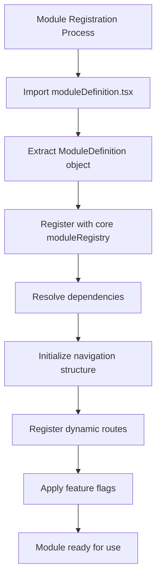
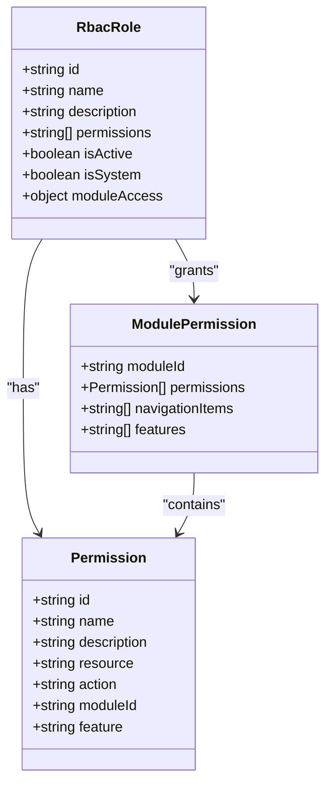
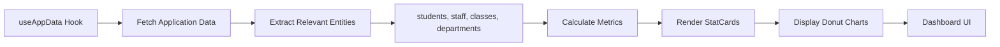
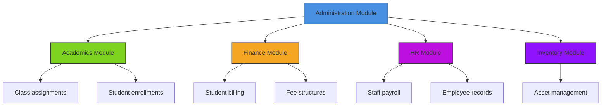
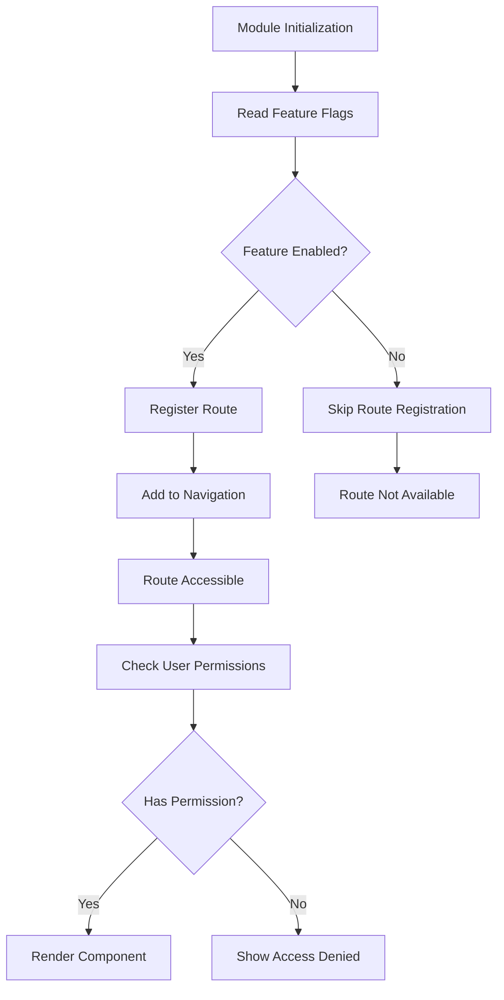

# Administration Module Overview

<cite>
**Referenced Files in This Document**   
- [moduleDefinition.tsx](file://src/modules/administration/moduleDefinition.tsx)
- [rbac.ts](file://src/modules/administration/rbac.ts)
- [AdministrationDashboardPage.tsx](file://src/modules/administration/pages/AdministrationDashboardPage.tsx)
- [types.ts](file://src/core/types.ts)
- [useAppData.ts](file://src/hooks/useAppData.ts)
- [AppDataContext.tsx](file://src/contexts/AppDataContext.tsx)
</cite>

## Table of Contents
1. [Introduction](#introduction)
2. [Module Registration and Integration](#module-registration-and-integration)
3. [Role-Based Access Control Configuration](#role-based-access-control-configuration)
4. [Administration Dashboard Overview](#administration-dashboard-overview)
5. [Cross-Module Data Integrity](#cross-module-data-integrity)
6. [Dynamic Routing and Feature Flags](#dynamic-routing-and-feature-flags)

## Introduction
The Administration module in schoolpilot3 serves as the central hub for managing institutional data and foundational configurations. It provides comprehensive management capabilities for students, staff, departments, academic structures, and other core entities that form the backbone of the educational institution's operations. This module establishes the data foundation that other modules such as Academics and Finance depend upon, ensuring data consistency and integrity across the entire system.

The module is designed with a modular architecture that enables dynamic registration, role-based access control, and seamless integration with the core module loader. It manages critical institutional data including student records, staff information, class structures, academic year configurations, and various administrative entities like clubs, partners, and communication templates.

**Section sources**
- [moduleDefinition.tsx](file://src/modules/administration/moduleDefinition.tsx#L1-L100)

## Module Registration and Integration

The Administration module registers itself with the core module loader through the `moduleDefinition.tsx` file, which exports a `ModuleDefinition` object containing all necessary metadata for integration. This registration process follows a standardized pattern that allows the core system to dynamically load and configure modules at runtime.

**Diagram sources**
- [moduleDefinition.tsx](file://src/modules/administration/moduleDefinition.tsx#L1-L50)

The module definition includes essential properties that define its behavior and integration points:

**Module Definition Properties**
- **id**: "administration" - Unique identifier for the module
- **name**: "administration.moduleName" - Translation key for the module name
- **description**: "administration.moduleDescription" - Translation key for module description
- **icon**: Component reference for the module's navigation icon
- **path**: "/administration" - Base URL path for the module
- **isActive**: true - Indicates the module is enabled
- **version**: "1.0.0" - Semantic versioning of the module
- **dependencies**: Array of dependent modules that must be loaded first
- **navigation**: Array of navigation items that appear in the sidebar
- **routes**: Custom route definitions for dynamic page loading

The module integrates with the core module loader through the `core/moduleLoader.ts` system, which processes the module definition and registers it in the global module registry. This allows for dynamic import of module components and lazy loading of module resources, optimizing application performance.

When the application initializes, the core module loader reads the module definition and:
1. Registers the module's navigation items in the global navigation structure
2. Configures the module's routes with the routing system
3. Resolves and loads any dependencies required by the module
4. Applies role-based access control rules defined in the module's rbac configuration
5. Initializes any feature flags specific to the module

**Section sources**
- [moduleDefinition.tsx](file://src/modules/administration/moduleDefinition.tsx#L1-L100)
- [types.ts](file://src/core/types.ts#L1400-L1600)

## Role-Based Access Control Configuration

The Administration module implements a comprehensive role-based access control (RBAC) system defined in the `rbac.ts` file. This configuration establishes granular permissions for administrative operations, ensuring that users can only access functionality appropriate to their roles.

**Diagram sources**
- [rbac.ts](file://src/modules/administration/rbac.ts#L1-L100)
- [types.ts](file://src/core/types.ts#L1600-L1648)

The RBAC configuration defines several key roles with specific permission scopes:

**Administrative Roles and Permissions**
- **System Administrator**: Full access to all administrative functions including user management, system configuration, and data integrity operations
- **School Administrator**: Access to student, staff, and class management, but restricted from system-level configurations
- **Department Head**: Limited to managing staff and students within their department
- **Registrar**: Focused on student enrollment, attendance, and academic records management
- **HR Manager**: Specialized access to staff records, payroll configurations, and personnel management

Each role is associated with specific permissions that follow the pattern `administration.<entity>.<action>`, where:
- **entity**: The data entity being accessed (e.g., students, staff, classes)
- **action**: The operation being performed (create, read, update, delete, execute)

For example:
- `administration.students.create` - Permission to add new students
- `administration.staff.read` - Permission to view staff records
- `administration.classes.update` - Permission to modify class configurations
- `administration.academicYears.delete` - Permission to remove academic years

The RBAC system also defines navigation-level permissions, ensuring that users only see menu items for which they have appropriate access. This prevents users from even seeing options they cannot use, improving the user experience and security posture.

**Section sources**
- [rbac.ts](file://src/modules/administration/rbac.ts#L1-L150)
- [types.ts](file://src/core/types.ts#L1600-L1648)

## Administration Dashboard Overview

The `AdministrationDashboardPage` serves as the primary interface for administrators, providing an overview of key institutional metrics and quick access to essential management functions. The dashboard leverages the `useAppData` hook to access real-time data from the application context, displaying summarized information in an intuitive visual format.

**Diagram sources**
- [AdministrationDashboardPage.tsx](file://src/modules/administration/pages/AdministrationDashboardPage.tsx#L1-L60)
- [useAppData.ts](file://src/hooks/useAppData.ts#L1-L20)

The dashboard implementation follows a component-based architecture with the following key elements:

**Dashboard Components**
- **StatCard**: Reusable component that displays a single metric with an icon, title, and value
- **DonutChart**: Visual component that shows distribution data, such as staff by department
- **Navigation Links**: Quick access buttons to major administrative functions

The dashboard retrieves data through the `useAppData` hook, which provides access to the `AppDataContext`. This context contains all institutional data in a centralized store, allowing the dashboard to access:

- **students**: Array of student records with demographic and enrollment information
- **staff**: Array of staff records with employment details
- **classes**: Array of class configurations
- **departments**: Array of academic and administrative departments
- **studentCategories**: Classification groups for students
- **academicYearStructures**: Frameworks for organizing academic years
- **academicYears**: Specific academic year instances
- **schoolPeriods**: Term periods within academic years
- **clubs**: Extracurricular organizations
- **customers**: Financial customers and billing entities

The dashboard calculates key metrics such as:
- Total number of students enrolled
- Total number of staff members
- Number of active classes
- Staff distribution by department (displayed in a donut chart)
- Number of academic structures and years

When data is loading, the dashboard displays a spinner to provide user feedback. The loading state checks multiple data entities to ensure all required information is available before rendering the dashboard content.

**Section sources**
- [AdministrationDashboardPage.tsx](file://src/modules/administration/pages/AdministrationDashboardPage.tsx#L1-L60)
- [useAppData.ts](file://src/hooks/useAppData.ts#L1-L20)
- [AppDataContext.tsx](file://src/contexts/AppDataContext.tsx#L1-L168)

## Cross-Module Data Integrity

The Administration module serves as the foundation for cross-module data integrity, providing shared data entities that are consumed by other modules such as Academics and Finance. This centralized approach ensures consistency and eliminates data duplication across the system.

**Diagram sources**
- [types.ts](file://src/core/types.ts#L200-L800)
- [AppDataContext.tsx](file://src/contexts/AppDataContext.tsx#L1-L168)

The module maintains several critical data entities that are essential for other modules:

**Shared Data Entities**
- **Students**: Student records with personal information, enrollment status, and demographic data used by Academics for class assignments and by Finance for billing
- **Staff**: Employee records with employment details used by HR for payroll and by Academics for teacher assignments
- **Classes**: Educational class configurations used by Academics for scheduling and by Finance for fee calculations
- **Departments**: Organizational units used by HR for personnel management and by Academics for curriculum organization
- **Academic Years**: Temporal frameworks that structure the educational calendar, used by both Academics for scheduling and Finance for fiscal period alignment
- **School Periods**: Term periods that align academic and financial cycles

The data integrity is maintained through the `AppDataContext`, which serves as a single source of truth for all modules. When data is updated in the Administration module, the context automatically propagates changes to all consuming modules, ensuring consistency across the application.

For example, when a student is enrolled in a class:
1. The Administration module updates the student's class assignment
2. The change is reflected in the AppDataContext
3. The Academics module receives the updated data and adjusts class rosters
4. The Finance module receives the updated data and generates appropriate fee invoices

This centralized data management approach reduces the risk of data inconsistencies and simplifies data validation and auditing processes.

**Section sources**
- [types.ts](file://src/core/types.ts#L200-L800)
- [AppDataContext.tsx](file://src/contexts/AppDataContext.tsx#L1-L168)

## Dynamic Routing and Feature Flags

The Administration module implements dynamic route registration and module-level feature flags to provide flexibility in functionality and user experience. These mechanisms allow for conditional rendering of features and pages based on configuration settings and user permissions.

**Diagram sources**
- [moduleDefinition.tsx](file://src/modules/administration/moduleDefinition.tsx#L1-L50)
- [rbac.ts](file://src/modules/administration/rbac.ts#L1-L50)

The module definition includes a `routes` property that specifies custom routes for dynamic page loading:

**Dynamic Route Configuration**
- **Path**: The URL path for the route (e.g., "/administration/students")
- **Page**: The component name to be dynamically imported (e.g., "StudentsListPage")

This allows the core routing system to lazy-load pages only when needed, improving application performance and reducing initial load times.

The module also supports feature flags through the `settings` property in the module definition, which can include boolean, string, number, or select-type configuration options. These feature flags enable or disable specific functionality based on institutional requirements or user roles.

For example, the module might include feature flags for:
- **studentPortalAccess**: Enables or disables student portal functionality
- **onlineAdmissions**: Controls whether online admission applications are accepted
- **biometricAttendance**: Toggles biometric attendance tracking features
- **mobileAppIntegration**: Enables integration with mobile applications

Feature flags are particularly useful for:
- Gradually rolling out new features to users
- Enabling institution-specific functionality
- Conducting A/B testing of different user interfaces
- Managing licensing restrictions for different customer tiers

The combination of dynamic routing and feature flags makes the Administration module highly adaptable to different institutional needs and deployment scenarios, while maintaining a consistent core architecture.

**Section sources**
- [moduleDefinition.tsx](file://src/modules/administration/moduleDefinition.tsx#L1-L100)
- [rbac.ts](file://src/modules/administration/rbac.ts#L1-L50)