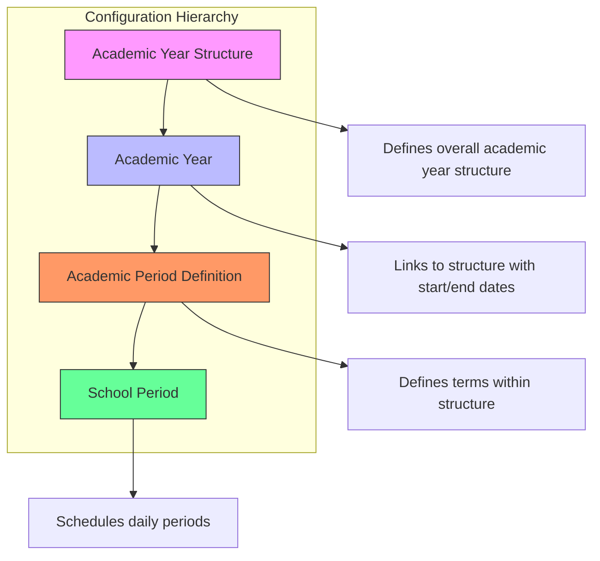
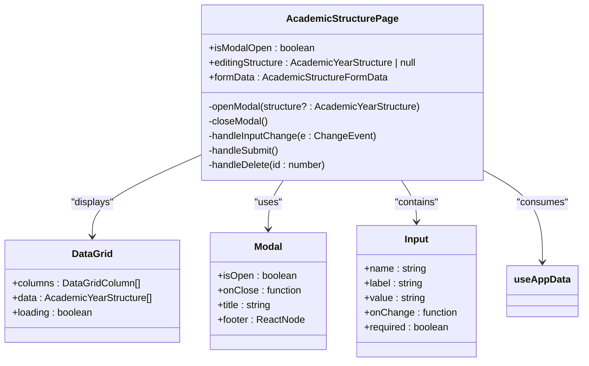
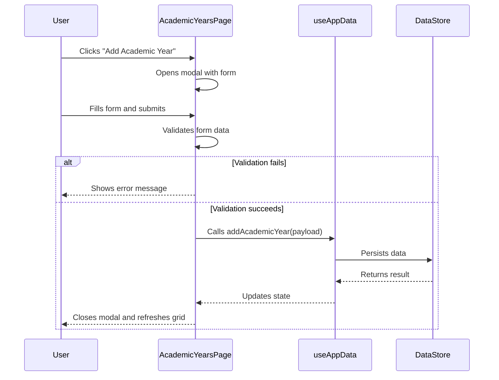
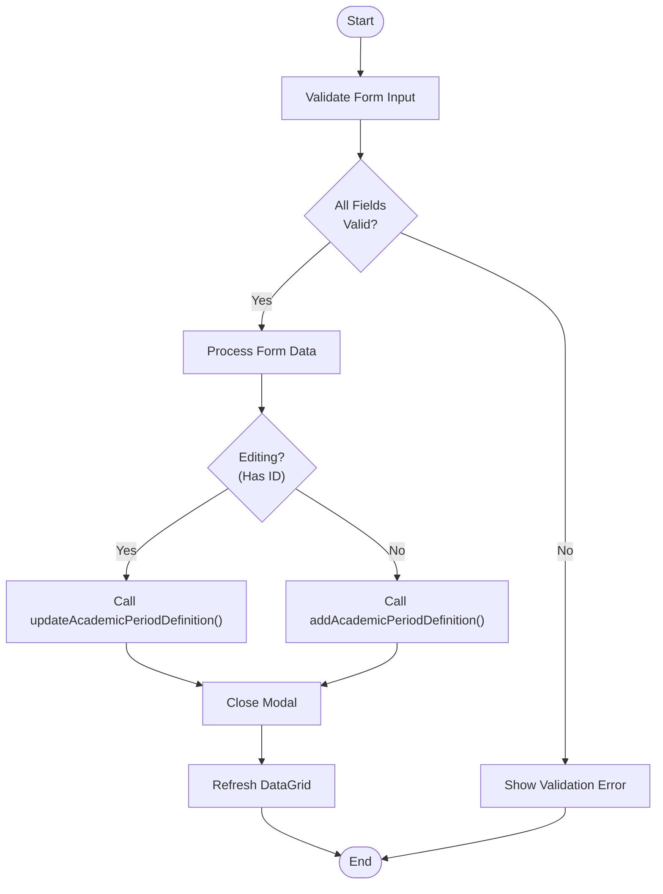
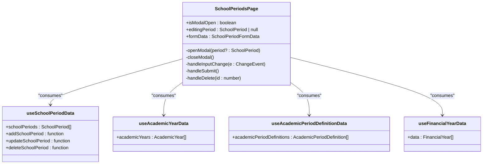
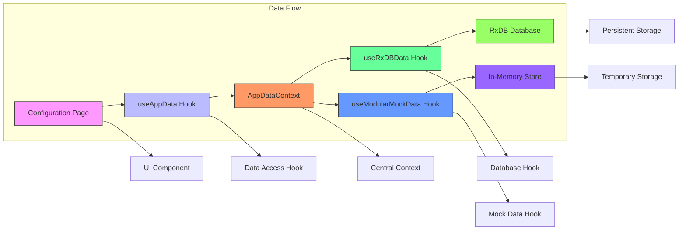
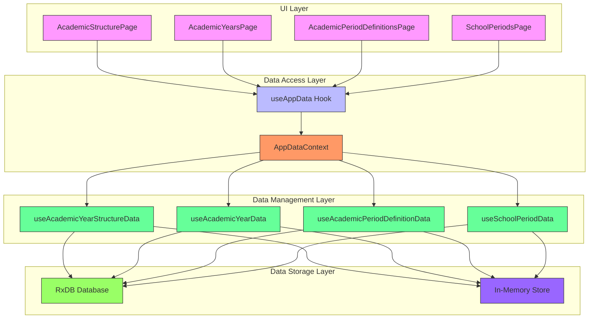

# Academic Structure Configuration

<cite>
**Referenced Files in This Document**   
- [AcademicStructurePage.tsx](file://src/modules/administration/pages/AcademicStructurePage.tsx)
- [AcademicYearsPage.tsx](file://src/modules/administration/pages/AcademicYearsPage.tsx)
- [AcademicPeriodDefinitionsPage.tsx](file://src/modules/administration/pages/AcademicPeriodDefinitionsPage.tsx)
- [SchoolPeriodsPage.tsx](file://src/modules/administration/pages/SchoolPeriodsPage.tsx)
- [useAppData.ts](file://src/hooks/useAppData.ts)
- [AppDataContext.tsx](file://src/contexts/AppDataContext.tsx)
- [useRxDBData.ts](file://src/hooks/useRxDBData.ts)
- [useAcademicYearStructureData.ts](file://src/modules/administration/data/useAcademicYearStructureData.ts)
- [useAcademicYearData.ts](file://src/modules/administration/data/useAcademicYearData.ts)
- [useAcademicPeriodDefinitionData.ts](file://src/modules/administration/data/useAcademicPeriodDefinitionData.ts)
- [useSchoolPeriodData.ts](file://src/modules/administration/data/useSchoolPeriodData.ts)
- [mockData.ts](file://src/modules/administration/data/mockData.ts)
</cite>

## Table of Contents
1. [Introduction](#introduction)
2. [Core Configuration Pages](#core-configuration-pages)
3. [Academic Structure Management](#academic-structure-management)
4. [Academic Year Management](#academic-year-management)
5. [Academic Period Definitions](#academic-period-definitions)
6. [School Period Scheduling](#school-period-scheduling)
7. [Data Management and Propagation](#data-management-and-propagation)
8. [Form Validation and Conflict Detection](#form-validation-and-conflict-detection)
9. [System Architecture](#system-architecture)
10. [Conclusion](#conclusion)

## Introduction

The Academic Structure Configuration system in schoolpilot3 provides a comprehensive interface for defining and managing the hierarchical organization of academic time units within an educational institution. This documentation details the implementation of key configuration pages that enable administrators to establish the academic hierarchy, manage academic year cycles, define term structures, and schedule daily class periods. The system is built on a modular React architecture with a centralized data context that ensures consistency across the application.

The configuration pages are located within the administration module and follow a consistent design pattern using reusable UI components such as DataGrid, Modal, and Card. Each page provides a user-friendly interface for creating, reading, updating, and deleting academic entities, with appropriate form validation and confirmation dialogs to prevent accidental data loss.

**Section sources**
- [AcademicStructurePage.tsx](file://src/modules/administration/pages/AcademicStructurePage.tsx#L1-L160)
- [AcademicYearsPage.tsx](file://src/modules/administration/pages/AcademicYearsPage.tsx#L1-L240)

## Core Configuration Pages

The academic structure configuration system consists of four primary pages that work together to define the complete academic hierarchy:

1. **AcademicStructurePage**: Defines the overall structure of an academic year (e.g., "Standard 3-Term System", "Semester System")
2. **AcademicYearsPage**: Manages academic year cycles by linking them to academic year structures and setting start/end dates
3. **AcademicPeriodDefinitionsPage**: Configures term structures within academic year structures, defining individual periods and their sequence
4. **SchoolPeriodsPage**: Schedules daily class periods by associating them with academic years, period definitions, and financial years

These pages follow a consistent UI pattern with a DataGrid component for displaying existing records, a Card component for organizing content, and a Modal component for creating and editing records. Each page uses a similar workflow: display a list of existing entities, allow users to add new entities or edit existing ones through a form, and provide confirmation before deletion.



**Diagram sources**
- [AcademicStructurePage.tsx](file://src/modules/administration/pages/AcademicStructurePage.tsx#L1-L160)
- [AcademicYearsPage.tsx](file://src/modules/administration/pages/AcademicYearsPage.tsx#L1-L240)
- [AcademicPeriodDefinitionsPage.tsx](file://src/modules/administration/pages/AcademicPeriodDefinitionsPage.tsx#L1-L238)
- [SchoolPeriodsPage.tsx](file://src/modules/administration/pages/SchoolPeriodsPage.tsx#L1-L267)

**Section sources**
- [AcademicStructurePage.tsx](file://src/modules/administration/pages/AcademicStructurePage.tsx#L1-L160)
- [AcademicYearsPage.tsx](file://src/modules/administration/pages/AcademicYearsPage.tsx#L1-L240)
- [AcademicPeriodDefinitionsPage.tsx](file://src/modules/administration/pages/AcademicPeriodDefinitionsPage.tsx#L1-L238)
- [SchoolPeriodsPage.tsx](file://src/modules/administration/pages/SchoolPeriodsPage.tsx#L1-L267)

## Academic Structure Management

The AcademicStructurePage serves as the primary interface for defining the school's academic hierarchy at the highest level. It allows administrators to create and manage academic year structures, which represent the overall framework for organizing academic time (e.g., "Standard 3-Term System", "Semester System").

The page implementation uses a DataGrid component to display existing academic year structures in a tabular format with columns for ID, structure name, and actions. Users can add new structures or edit existing ones through a modal dialog that contains a simple form with a single required field for the structure name. The interface provides immediate feedback through loading states and validation messages.



**Diagram sources**
- [AcademicStructurePage.tsx](file://src/modules/administration/pages/AcademicStructurePage.tsx#L1-L160)

**Section sources**
- [AcademicStructurePage.tsx](file://src/modules/administration/pages/AcademicStructurePage.tsx#L1-L160)

## Academic Year Management

The AcademicYearsPage provides functionality for managing academic year cycles by linking them to predefined academic year structures and setting their temporal boundaries. This page enables administrators to create academic years (e.g., "AY 2023/2024") that are associated with specific academic year structures and have defined start and end dates.

The implementation includes comprehensive form validation to ensure data integrity. When creating or editing an academic year, the system validates that all required fields are filled and that the end date is after the start date. The DataGrid component displays academic years with their associated structure names and formatted dates, providing a clear overview of the academic calendar.



**Diagram sources**
- [AcademicYearsPage.tsx](file://src/modules/administration/pages/AcademicYearsPage.tsx#L1-L240)

**Section sources**
- [AcademicYearsPage.tsx](file://src/modules/administration/pages/AcademicYearsPage.tsx#L1-L240)

## Academic Period Definitions

The AcademicPeriodDefinitionsPage enables administrators to configure the internal structure of academic year structures by defining individual periods (e.g., "Term 1", "Term 2", "Semester 1") and their sequence within the structure. This level of configuration allows schools to customize their academic calendars according to their specific educational models.

The page implementation includes intelligent default values for the sequence order field, automatically suggesting the next available sequence number based on existing period definitions for the selected structure. The form validation ensures that all required fields are completed and that the sequence order is a positive integer. The DataGrid displays period definitions sorted by structure and sequence order, providing a clear hierarchical view of the academic organization.



**Diagram sources**
- [AcademicPeriodDefinitionsPage.tsx](file://src/modules/administration/pages/AcademicPeriodDefinitionsPage.tsx#L1-L238)

**Section sources**
- [AcademicPeriodDefinitionsPage.tsx](file://src/modules/administration/pages/AcademicPeriodDefinitionsPage.tsx#L1-L238)

## School Period Scheduling

The SchoolPeriodsPage provides functionality for scheduling daily class periods by associating them with academic years, period definitions, and financial years. This represents the most granular level of academic time organization, defining specific time periods during which classes are held.

The implementation includes comprehensive date validation to ensure temporal consistency. The system validates that the end date is after the start date and that mid-break end date is after mid-break start date when both are provided. The form also includes a checkbox for marking periods as active, allowing administrators to control which periods are currently in use.



**Diagram sources**
- [SchoolPeriodsPage.tsx](file://src/modules/administration/pages/SchoolPeriodsPage.tsx#L1-L267)

**Section sources**
- [SchoolPeriodsPage.tsx](file://src/modules/administration/pages/SchoolPeriodsPage.tsx#L1-L267)

## Data Management and Propagation

The academic structure configuration system employs a centralized data management approach through the AppDataContext and useAppData hook. This architecture ensures that data changes are propagated consistently across the application and that all components have access to the same data state.

The data flow begins with individual data hooks (e.g., useAcademicYearStructureData, useAcademicYearData) that manage specific entity types. These hooks are consumed by the AppDataContext, which aggregates all data sources and provides a unified interface through the useAppData hook. When a user makes changes through any configuration page, the update is processed by the specific data hook, which updates its internal state and triggers re-renders in all components that consume the data.



**Diagram sources**
- [useAppData.ts](file://src/hooks/useAppData.ts#L1-L21)
- [AppDataContext.tsx](file://src/contexts/AppDataContext.tsx#L1-L169)
- [useRxDBData.ts](file://src/hooks/useRxDBData.ts#L1-L306)

**Section sources**
- [useAppData.ts](file://src/hooks/useAppData.ts#L1-L21)
- [AppDataContext.tsx](file://src/contexts/AppDataContext.tsx#L1-L169)
- [useRxDBData.ts](file://src/hooks/useRxDBData.ts#L1-L306)

## Form Validation and Conflict Detection

The academic structure configuration pages implement comprehensive form validation to ensure data integrity and prevent common errors. Each page includes client-side validation that checks for required fields and logical consistency before submitting data to the backend.

The validation strategy includes:
- Required field validation for all essential inputs
- Date validation to ensure end dates are after start dates
- Type validation for numeric fields like sequence order
- Confirmation dialogs before deletion to prevent accidental data loss

The system also implements basic conflict detection through the use of unique identifiers and the prevention of duplicate names within the same context. When a user attempts to delete an academic structure that might affect related entities, the system displays a warning message to alert them of potential cascading effects.

```mermaid
flowchart TD
A[Form Submission] --> B{Required Fields<br>Completed?}
B --> |No| C[Show "All fields required" error]
B --> |Yes| D{End Date After<br>Start Date?}
D --> |No| E[Show "End date must be after start date" error]
D --> |Yes| F{Sequence Order<br>Valid?}
F --> |No| G[Show "Sequence order must be positive" error]
F --> |Yes| H[Submit Data]
H --> I[Update Database]
I --> J[Refresh UI]
style C fill:#fdd,stroke:#f66
style E fill:#fdd,stroke:#f66
style G fill:#fdd,stroke:#f66
style J fill:#dfd,stroke:#6f6
```

**Diagram sources**
- [AcademicYearsPage.tsx](file://src/modules/administration/pages/AcademicYearsPage.tsx#L1-L240)
- [AcademicPeriodDefinitionsPage.tsx](file://src/modules/administration/pages/AcademicPeriodDefinitionsPage.tsx#L1-L238)
- [SchoolPeriodsPage.tsx](file://src/modules/administration/pages/SchoolPeriodsPage.tsx#L1-L267)

**Section sources**
- [AcademicYearsPage.tsx](file://src/modules/administration/pages/AcademicYearsPage.tsx#L1-L240)
- [AcademicPeriodDefinitionsPage.tsx](file://src/modules/administration/pages/AcademicPeriodDefinitionsPage.tsx#L1-L238)
- [SchoolPeriodsPage.tsx](file://src/modules/administration/pages/SchoolPeriodsPage.tsx#L1-L267)

## System Architecture

The academic structure configuration system follows a modular React architecture with a clear separation of concerns between UI components, data management, and business logic. The system is built on a hierarchical data model that reflects the natural organization of academic time units, from broad academic year structures down to specific school periods.

The architecture leverages React's context API for global state management, with the AppDataContext providing a centralized store for all application data. Individual pages consume this context through the useAppData hook, ensuring consistency and reducing prop drilling. Data persistence is handled through a combination of RxDB for production environments and in-memory storage for development and testing.



**Diagram sources**
- [AcademicStructurePage.tsx](file://src/modules/administration/pages/AcademicStructurePage.tsx#L1-L160)
- [AcademicYearsPage.tsx](file://src/modules/administration/pages/AcademicYearsPage.tsx#L1-L240)
- [AcademicPeriodDefinitionsPage.tsx](file://src/modules/administration/pages/AcademicPeriodDefinitionsPage.tsx#L1-L238)
- [SchoolPeriodsPage.tsx](file://src/modules/administration/pages/SchoolPeriodsPage.tsx#L1-L267)
- [useAppData.ts](file://src/hooks/useAppData.ts#L1-L21)
- [AppDataContext.tsx](file://src/contexts/AppDataContext.tsx#L1-L169)
- [useAcademicYearStructureData.ts](file://src/modules/administration/data/useAcademicYearStructureData.ts#L1-L41)
- [useAcademicYearData.ts](file://src/modules/administration/data/useAcademicYearData.ts#L1-L44)
- [useAcademicPeriodDefinitionData.ts](file://src/modules/administration/data/useAcademicPeriodDefinitionData.ts#L1-L44)
- [useSchoolPeriodData.ts](file://src/modules/administration/data/useSchoolPeriodData.ts#L1-L44)

**Section sources**
- [AcademicStructurePage.tsx](file://src/modules/administration/pages/AcademicStructurePage.tsx#L1-L160)
- [AcademicYearsPage.tsx](file://src/modules/administration/pages/AcademicYearsPage.tsx#L1-L240)
- [AcademicPeriodDefinitionsPage.tsx](file://src/modules/administration/pages/AcademicPeriodDefinitionsPage.tsx#L1-L238)
- [SchoolPeriodsPage.tsx](file://src/modules/administration/pages/SchoolPeriodsPage.tsx#L1-L267)
- [useAppData.ts](file://src/hooks/useAppData.ts#L1-L21)
- [AppDataContext.tsx](file://src/contexts/AppDataContext.tsx#L1-L169)
- [useAcademicYearStructureData.ts](file://src/modules/administration/data/useAcademicYearStructureData.ts#L1-L41)
- [useAcademicYearData.ts](file://src/modules/administration/data/useAcademicYearData.ts#L1-L44)
- [useAcademicPeriodDefinitionData.ts](file://src/modules/administration/data/useAcademicPeriodDefinitionData.ts#L1-L44)
- [useSchoolPeriodData.ts](file://src/modules/administration/data/useSchoolPeriodData.ts#L1-L44)

## Conclusion

The Academic Structure Configuration system in schoolpilot3 provides a comprehensive and user-friendly interface for defining and managing the hierarchical organization of academic time units. The system's modular architecture, consistent UI patterns, and centralized data management ensure a cohesive user experience and reliable data integrity.

The four primary configuration pages—AcademicStructurePage, AcademicYearsPage, AcademicPeriodDefinitionsPage, and SchoolPeriodsPage—work together to create a complete academic hierarchy, from broad academic year structures down to specific daily class periods. Each page follows a consistent design pattern with a DataGrid for displaying records, a modal form for creating and editing, and appropriate validation to ensure data quality.

The system's data management approach, centered around the AppDataContext and useAppData hook, ensures that changes are propagated consistently across the application. This architecture supports both development and production environments through the use of mock data and persistent database storage, respectively.

Overall, the academic structure configuration system demonstrates a well-structured implementation that balances user experience with technical robustness, providing school administrators with the tools they need to effectively organize their academic calendars.