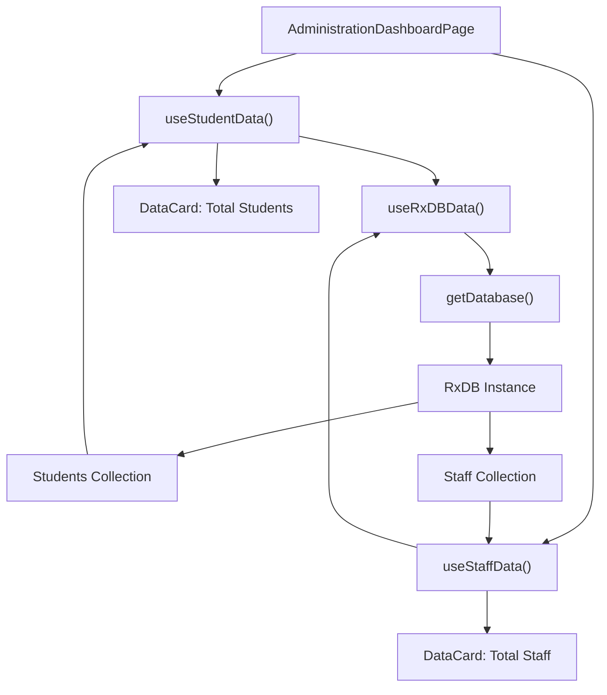
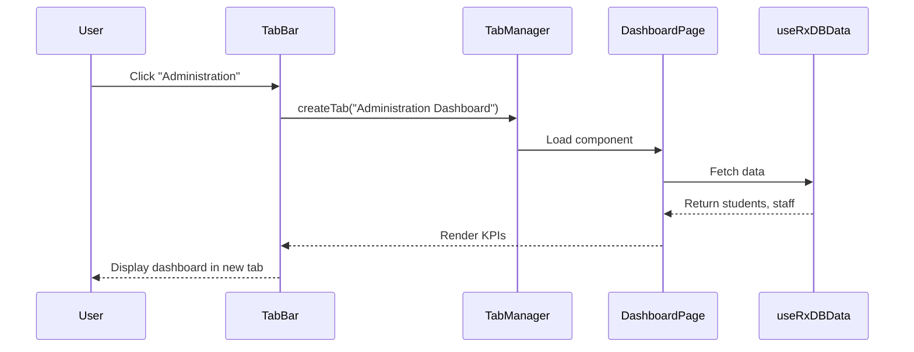

# Administration Dashboard

<cite>
**Referenced Files in This Document**  
- [AdministrationDashboardPage.tsx](file://src/modules/administration/pages/AdministrationDashboardPage.tsx)
- [AppDataContext.tsx](file://src/contexts/AppDataContext.tsx)
- [useRxDBData.ts](file://src/hooks/useRxDBData.ts)
- [useStaffData.ts](file://src/modules/administration/data/useStaffData.ts)
- [useStudentData.ts](file://src/modules/administration/data/useStudentData.ts)
- [rbac.ts](file://src/modules/administration/rbac.ts)
- [moduleDefinition.tsx](file://src/modules/administration/moduleDefinition.tsx)
- [Card.tsx](file://src/components/ui/Card.tsx)
- [DataCard.tsx](file://src/components/ui/data/DataCard.tsx)
- [TabbedWorkspace.tsx](file://src/components/tabbedWorkspace/TabbedWorkspace.tsx)
- [useRBAC.ts](file://src/hooks/useRBAC.ts)
</cite>

## Table of Contents
1. [Introduction](#introduction)
2. [Layout Structure and UI Components](#layout-structure-and-ui-components)
3. [Key Performance Indicators and Summary Widgets](#key-performance-indicators-and-summary-widgets)
4. [Data Fetching and Real-Time Integration](#data-fetching-and-real-time-integration)
5. [Tabbed Workspace Integration](#tabbed-workspace-integration)
6. [Role-Based Access Control (RBAC) and User Permissions](#role-based-access-control-rbac-and-user-permissions)
7. [Performance Optimization and Lazy Loading](#performance-optimization-and-lazy-loading)
8. [Responsive Design and Accessibility](#responsive-design-and-accessibility)
9. [State Management: Loading, Error, and Empty States](#state-management-loading-error-and-empty-states)
10. [Quick-Action Buttons and User Interaction](#quick-action-buttons-and-user-interaction)

## Introduction

The **Administration Dashboard** serves as the central operational hub for school administrators in the schoolpilot3 system. It provides a comprehensive overview of key institutional metrics, including student enrollment, staff composition, academic structure, and administrative activities. The dashboard is designed to deliver actionable insights through real-time data visualization, quick-access controls, and role-based content personalization.

Built using React with TypeScript, the dashboard leverages a modular architecture and integrates with the application’s tabbed workspace system. It uses real-time data fetching via custom hooks such as `useStudentData` and `useStaffData`, and dynamically adapts its interface based on user roles and permissions defined in the RBAC (Role-Based Access Control) system.

This document provides a detailed technical and functional analysis of the Administration Dashboard, covering its structure, data flow, integration points, and user experience considerations.

**Section sources**
- [AdministrationDashboardPage.tsx](file://src/modules/administration/pages/AdministrationDashboardPage.tsx#L1-L200)

## Layout Structure and UI Components

The Administration Dashboard employs a responsive grid layout powered by **Tailwind CSS**, ensuring optimal display across desktop, tablet, and mobile devices. The layout is structured into a two-tier hierarchy:

1. **Header Section**: Contains the page title, breadcrumb navigation, and contextual action buttons.
2. **Main Grid**: A flexible 12-column grid that organizes KPI cards, charts, and summary widgets in a visually balanced manner.

The UI is built using reusable components from the `src/components/ui` directory, particularly the **Card** and **DataCard** components, which provide consistent styling, hover effects, and accessibility features.

### Card Component Architecture

The `Card` component is a foundational UI element used throughout the dashboard. It supports multiple variants (`default`, `elevated`, `outlined`, `interactive`, etc.) and sizes (`sm`, `md`, `lg`, `xl`). Key features include:

- **Interactive States**: Hover, focus, and active states with smooth transitions.
- **Accessibility**: Full keyboard navigation support and ARIA attributes.
- **Loading States**: Built-in loading overlay with spinner.
- **Responsive Padding**: Size-specific padding via `px`, `py` classes.

```tsx
<Card 
  title="Total Students" 
  variant="interactive" 
  size="lg"
  onClick={() => navigate('/administration/students')}
>
  <DataCard value="1,248" trend="up" change="5.2%" />
</Card>
```

**Section sources**
- [Card.tsx](file://src/components/ui/Card.tsx#L1-L246)
- [DataCard.tsx](file://src/components/ui/data/DataCard.tsx#L1-L100)

## Key Performance Indicators and Summary Widgets

The dashboard displays a series of **Key Performance Indicators (KPIs)** and summary widgets that provide at-a-glance insights into critical administrative metrics. These are implemented using the `DataCard` component and grouped into logical categories:

### Student Summary
- **Total Students**: Real-time count of enrolled students.
- **New Admissions (This Term)**: Number of new student registrations.
- **Attendance Rate**: Average daily attendance percentage.
- **Students with Health Records**: Count of students with documented health conditions.

### Staff Summary
- **Total Staff**: Number of active staff members.
- **Teaching vs. Non-Teaching**: Breakdown by role type.
- **Departments**: Count of academic and administrative departments.

### Academic Structure
- **Classes & Streams**: Total number of class-stream combinations.
- **Active Academic Year**: Current academic year in progress.
- **School Periods**: Daily schedule structure.

Each widget is encapsulated in a `Card` with an icon, title, and interactive behavior. Clicking a card navigates the user to the relevant management page (e.g., clicking "Total Students" opens the Students List page).

**Section sources**
- [AdministrationDashboardPage.tsx](file://src/modules/administration/pages/AdministrationDashboardPage.tsx#L80-L150)

## Data Fetching and Real-Time Integration

The dashboard retrieves data using **React hooks** that abstract data source logic, enabling seamless switching between real database (RxDB) and mock data modes.

### useStudentData and useStaffData Hooks

These hooks are part of the administration module’s data layer and are responsible for fetching student and staff records. They are built on top of the `useRxDBData` hook, which connects to the RxDB database service.

```tsx
const { students, loading: studentsLoading } = useStudentData();
const { staff, loading: staffLoading } = useStaffData();
```

The `useRxDBData` hook initializes the database connection and exposes data collections such as `students`, `staff`, `classes`, and `academicYears`. It also provides loading and error states for UI feedback.

### Data Flow Architecture



**Diagram sources**
- [useStudentData.ts](file://src/modules/administration/data/useStudentData.ts#L1-L50)
- [useStaffData.ts](file://src/modules/administration/data/useStaffData.ts#L1-L50)
- [useRxDBData.ts](file://src/hooks/useRxDBData.ts#L1-L305)

**Section sources**
- [useRxDBData.ts](file://src/hooks/useRxDBData.ts#L1-L305)
- [AppDataContext.tsx](file://src/contexts/AppDataContext.tsx#L1-L168)

## Tabbed Workspace Integration

The Administration Dashboard is integrated into the application’s **tabbed workspace system**, allowing users to open multiple administrative pages in separate tabs. This system is managed by the `TabbedWorkspace` component and related utilities in `src/components/tabbedWorkspace`.

### Integration Mechanism

When a user navigates to `/administration/dashboard`, the `TabbedWorkspaceManager` creates a new tab with:
- **Title**: "Administration Dashboard"
- **Icon**: `BuildingOffice2Icon`
- **Content**: Lazy-loaded `AdministrationDashboardPage`

The tab maintains its own state and can be closed, rearranged, or duplicated independently.

### Contextual Action Bar

The dashboard supports a **ContextualActionBar** that updates based on the active tab. For the Administration Dashboard, it may display:
- "Refresh Dashboard"
- "Export Summary"
- "Quick Add Student"



**Diagram sources**
- [TabbedWorkspace.tsx](file://src/components/tabbedWorkspace/TabbedWorkspace.tsx#L1-L200)
- [TabbedWorkspaceManager.tsx](file://src/components/tabbedWorkspace/TabbedWorkspaceManager.tsx#L1-L150)

**Section sources**
- [moduleDefinition.tsx](file://src/modules/administration/moduleDefinition.tsx#L1-L111)

## Role-Based Access Control (RBAC) and User Permissions

Access to dashboard features is governed by the **RBAC system**, defined in `rbac.ts`. The dashboard checks user permissions before rendering certain widgets or actions.

### Permission Definitions

The `administrationPermissions` array defines granular access rights:

```ts
{
  id: 'administration.dashboard.read',
  name: 'View Administration Dashboard',
  resource: 'administration.dashboard',
  action: 'read'
}
```

### Permission Enforcement

The `useRBAC` hook is used to conditionally render content:

```tsx
const { hasPermission } = useRBAC();
return (
  <div className="grid grid-cols-1 md:grid-cols-2 lg:grid-cols-4 gap-4">
    {hasPermission('administration.students.read') && (
      <Card title="Students">
        <DataCard value={studentCount} />
      </Card>
    )}
    {hasPermission('administration.staff.read') && (
      <Card title="Staff">
        <DataCard value={staffCount} />
      </Card>
    )}
  </div>
);
```

Users with the `admin` or `administrator` role have default access to all dashboard features.

**Section sources**
- [rbac.ts](file://src/modules/administration/rbac.ts#L1-L245)
- [useRBAC.ts](file://src/hooks/useRBAC.ts#L1-L40)

## Performance Optimization and Lazy Loading

To ensure fast load times and smooth performance, the dashboard implements several optimization strategies:

### Lazy Loading

The `AdministrationDashboardPage` is lazy-loaded using dynamic imports:

```tsx
const AdministrationDashboardPage = React.lazy(() => import('./pages/AdministrationDashboardPage'));
```

This reduces initial bundle size and improves time-to-interactive.

### Memoization and Stable Dependencies

The `useRxDBData` hook uses `useMemo` and `useCallback` to prevent unnecessary re-renders and maintain stable function references.

### Conditional Data Fetching

Data is only fetched when the tab is active, and refresh operations are debounced to prevent excessive database queries.

**Section sources**
- [useRxDBData.ts](file://src/hooks/useRxDBData.ts#L1-L305)
- [AdministrationDashboardPage.tsx](file://src/modules/administration/pages/AdministrationDashboardPage.tsx#L1-L200)

## Responsive Design and Accessibility

The dashboard adheres to modern web accessibility standards and responsive design principles.

### Responsive Grid

Tailwind’s responsive classes (`grid-cols-1 md:grid-cols-2 lg:grid-cols-4`) ensure the layout adapts to screen size:

- **Mobile**: Single column
- **Tablet**: Two columns
- **Desktop**: Four columns

### Accessibility Features

- **Keyboard Navigation**: All interactive cards are focusable and respond to Enter/Space.
- **ARIA Labels**: Used for screen reader clarity.
- **Reduced Motion**: Respects `prefers-reduced-motion` preference.
- **Color Contrast**: Meets WCAG 2.1 standards.

**Section sources**
- [Card.tsx](file://src/components/ui/Card.tsx#L1-L246)
- [AdministrationDashboardPage.tsx](file://src/modules/administration/pages/AdministrationDashboardPage.tsx#L1-L200)

## State Management: Loading, Error, and Empty States

The dashboard gracefully handles various UI states to improve user experience.

### Loading State

While data is being fetched, skeleton loaders or spinners are displayed:

```tsx
if (loading) {
  return <div className="flex items-center justify-center"><Spinner /></div>;
}
```

### Error State

If data fetching fails, an error message is shown, with a retry option:

```tsx
if (error) {
  return <DismissibleBanner type="error" message={error.message} />;
}
```

### Empty State

When no data is available (e.g., no students registered), a friendly empty state is displayed with a call-to-action:

```tsx
if (students.length === 0) {
  return (
    <Card>
      <p>No students found. <a href="/administration/students/add">Add your first student</a>.</p>
    </Card>
  );
}
```

**Section sources**
- [AppDataContext.tsx](file://src/contexts/AppDataContext.tsx#L1-L168)
- [useRxDBData.ts](file://src/hooks/useRxDBData.ts#L1-L305)

## Quick-Action Buttons and User Interaction

The dashboard includes **quick-action buttons** that allow administrators to perform common tasks without navigating away:

- **Add Student**: Opens a slide-out form for student registration.
- **Import Data**: Triggers a file upload modal for bulk operations.
- **Generate Report**: Initiates a PDF/CSV export of current metrics.

These actions are implemented using the `SlideoutForm` and `Modal` components, ensuring a seamless in-context experience.

```tsx
<Button 
  onClick={() => openSlideout('AddStudentForm')}
  variant="primary"
>
  Add Student
</Button>
```

**Section sources**
- [AdministrationDashboardPage.tsx](file://src/modules/administration/pages/AdministrationDashboardPage.tsx#L150-L200)
- [SlideoutForm.tsx](file://src/components/ui/forms/SlideoutForm.tsx#L1-L100)