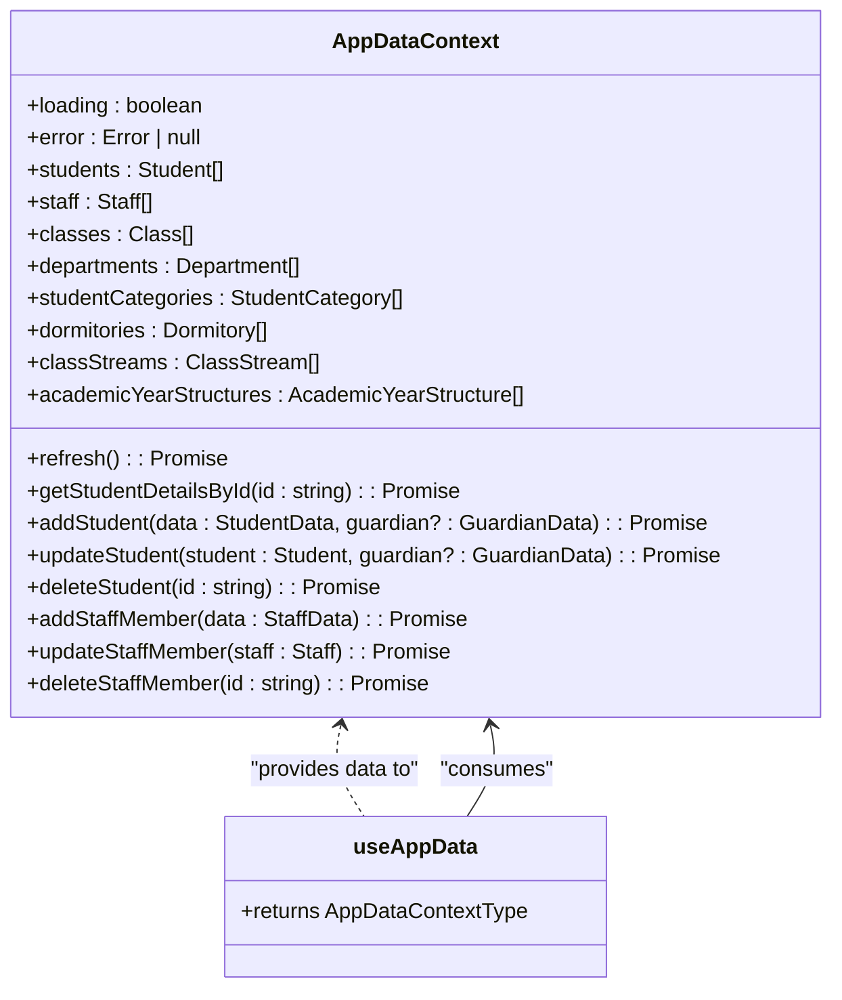
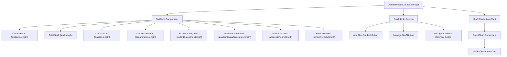
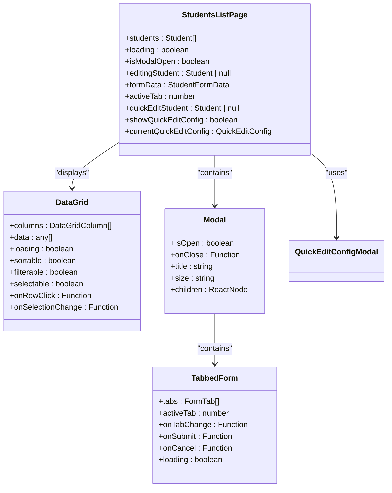
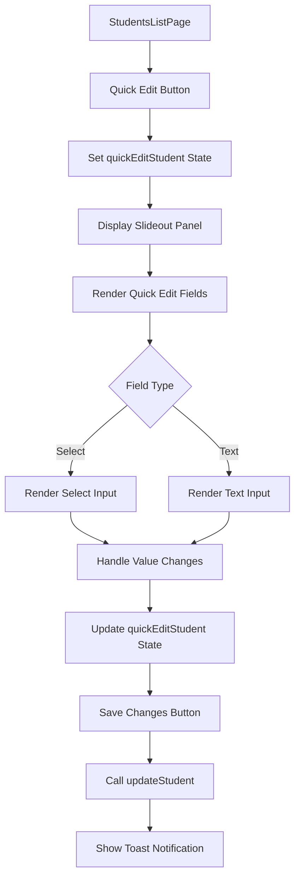
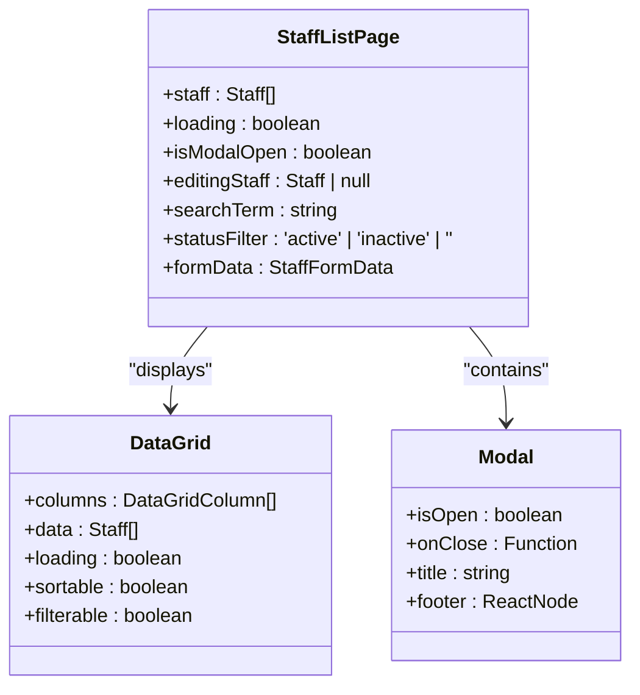
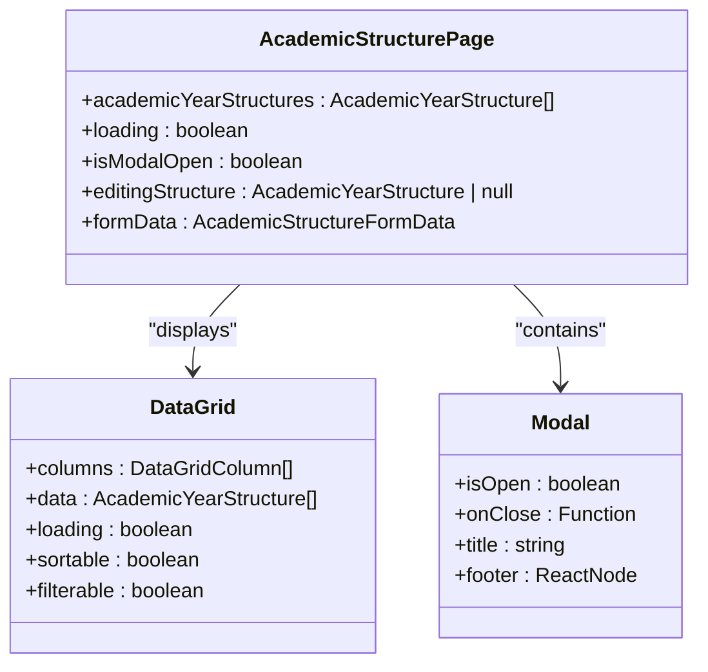
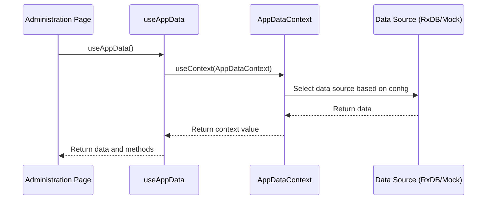
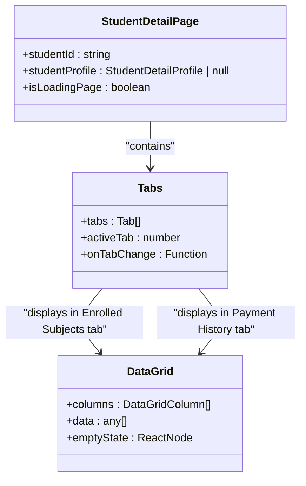

# Administration Pages and Features

<cite>
**Referenced Files in This Document**   
- [AppDataContext.tsx](file://src/contexts/AppDataContext.tsx)
- [useAppData.ts](file://src/hooks/useAppData.ts)
- [StudentDetailPage.tsx](file://src/modules/administration/pages/StudentDetailPage.tsx)
- [StudentsListPage.tsx](file://src/modules/administration/pages/StudentsListPage.tsx)
- [StaffListPage.tsx](file://src/modules/administration/pages/StaffListPage.tsx)
- [AcademicStructurePage.tsx](file://src/modules/administration/pages/AcademicStructurePage.tsx)
- [AdministrationDashboardPage.tsx](file://src/modules/administration/pages/AdministrationDashboardPage.tsx)
- [quickEditConfig.ts](file://src/modules/administration/config/quickEditConfig.ts)
- [QuickEditConfigModal.tsx](file://src/modules/administration/components/QuickEditConfigModal.tsx)
</cite>

## Table of Contents
1. [Introduction](#introduction)
2. [Core Data Architecture](#core-data-architecture)
3. [Administration Dashboard](#administration-dashboard)
4. [Student Management](#student-management)
5. [Staff Management](#staff-management)
6. [Academic Structure Configuration](#academic-structure-configuration)
7. [Component Composition Patterns](#component-composition-patterns)
8. [Data Fetching Strategies](#data-fetching-strategies)
9. [Form Handling Mechanisms](#form-handling-mechanisms)
10. [Tabbed Navigation System](#tabbed-navigation-system)
11. [Responsive Design Considerations](#responsive-design-considerations)
12. [Integration with Tabbed Workspace](#integration-with-tabbed-workspace)

## Introduction
The Administration module in schoolpilot3 provides a comprehensive suite of interfaces for managing core school operations. This document details the implementation of key administrative pages including the AdministrationDashboardPage, StudentsListPage, StaffListPage, AcademicStructurePage, and StudentDetailPage. These interfaces leverage a consistent component composition pattern, utilize custom data hooks for state management, and implement responsive design principles to support both desktop and tablet workflows. The pages integrate with the global tabbed workspace system, enabling users to manage multiple administrative tasks simultaneously within a unified interface.

## Core Data Architecture

The administration pages rely on a centralized data architecture implemented through the AppDataContext and useAppData hook. This architecture provides a unified interface for accessing and manipulating application data across different modules.

**Diagram sources**
- [AppDataContext.tsx](file://src/contexts/AppDataContext.tsx#L1-L168)
- [useAppData.ts](file://src/hooks/useAppData.ts#L1-L20)

**Section sources**
- [AppDataContext.tsx](file://src/contexts/AppDataContext.tsx#L1-L168)
- [useAppData.ts](file://src/hooks/useAppData.ts#L1-L20)

## Administration Dashboard

The AdministrationDashboardPage serves as the central hub for administrative functions, providing summary widgets and quick-action buttons to facilitate efficient navigation and monitoring of key metrics.

### Summary Widgets Implementation
The dashboard displays a grid of StatCard components that present key metrics such as total students, staff, classes, and departments. Each StatCard combines an icon with a title and value, using a consistent visual design with a colored background for the icon and clear typography for the data.

**Diagram sources**
- [AdministrationDashboardPage.tsx](file://src/modules/administration/pages/AdministrationDashboardPage.tsx#L1-L108)

**Section sources**
- [AdministrationDashboardPage.tsx](file://src/modules/administration/pages/AdministrationDashboardPage.tsx#L1-L108)

The dashboard uses the useAppData hook to retrieve all necessary data, including students, staff, classes, departments, student categories, academic year structures, academic years, and school periods. Loading states are handled by displaying a spinner when any of the required data sets are being fetched.

### Quick-Action Buttons
The dashboard includes a Quick Links section with buttons that navigate to key administrative pages:
- Add New Student: Links to the students management page
- Manage Staff: Links to the staff management page
- Manage Academic Calendar: Links to the academic structures management page

These buttons use the Link component from react-router-dom to enable client-side navigation without full page reloads, improving the user experience.

## Student Management

The student management functionality is implemented through two primary components: StudentsListPage for viewing and managing multiple students, and StudentDetailPage for viewing and editing individual student records.

### StudentsListPage Implementation

The StudentsListPage provides a comprehensive interface for managing student records with filtering, bulk operations, and form handling capabilities.

#### DataGrid Configuration
The page uses the DataGrid component to display student records in a tabular format with the following columns:
- Admission No: Student identifier
- Name: Student's full name with link to detail page
- Class and Stream: Current academic placement
- Gender: Student's gender
- Status: Current enrollment status with color-coded badges
- Guardian: Primary guardian's name
- Actions: Edit and delete buttons

**Diagram sources**
- [StudentsListPage.tsx](file://src/modules/administration/pages/StudentsListPage.tsx#L1-L939)

**Section sources**
- [StudentsListPage.tsx](file://src/modules/administration/pages/StudentsListPage.tsx#L1-L939)

#### Filtering and Search
The page implements client-side filtering through two mechanisms:
1. Text search: Filters students based on admission number, name, email, class, and stream
2. Status filter: Allows filtering by active or inactive students

The filtering is implemented using useMemo to optimize performance, ensuring that the filter calculations are only performed when the relevant dependencies change.

#### Bulk Operations
While the current implementation focuses on individual student operations, the DataGrid component is configured with selectable={true} and an onSelectionChange callback, indicating support for bulk operations. The onSelectionChange handler logs selected students to the console, providing a foundation for implementing bulk actions such as status updates or enrollment changes.

#### Form Handling
The page uses a TabbedForm component for both adding new students and editing existing ones. The form is divided into three tabs:
- Personal Details: Admission number, names, gender, date of birth, and status
- Guardian Details: Guardian's name, relationship, and contact information
- Academic Details: Current class stream, student category, dormitory, and exam results

The form handling implementation includes:
- State management through useState hooks
- Input validation for required fields
- Type conversion for numeric and enum values
- Error handling with user feedback via toast notifications
- Integration with the useAppData hook for data persistence

### Quick Edit Functionality
The page implements a sophisticated quick edit feature that allows users to make rapid updates to student information without navigating to the full edit form.

**Diagram sources**
- [StudentsListPage.tsx](file://src/modules/administration/pages/StudentsListPage.tsx#L1-L939)
- [quickEditConfig.ts](file://src/modules/administration/config/quickEditConfig.ts#L1-L20)
- [QuickEditConfigModal.tsx](file://src/modules/administration/components/QuickEditConfigModal.tsx#L1-L150)

The quick edit panel is implemented as a slideout component that appears from the right side of the screen. It uses the currentQuickEditConfig state, which is initialized from getQuickEditConfig(), allowing administrators to customize which fields are available for quick editing.

#### Quick Edit Configuration
The quick edit functionality includes a configuration modal that allows administrators to customize which fields are available in the quick edit panel. This is implemented through the QuickEditConfigModal component, which provides a user interface for selecting and ordering the fields that appear in the quick edit panel.

## Staff Management

The StaffListPage provides a dedicated interface for managing staff records with role-based visibility controls and comprehensive filtering capabilities.

### Role-Based Visibility Controls
The page implements filtering controls that allow administrators to filter staff members by status (active or inactive). This is implemented through a statusFilter state variable and a corresponding Select component in the filtering toolbar.

**Diagram sources**
- [StaffListPage.tsx](file://src/modules/administration/pages/StaffListPage.tsx#L1-L282)

**Section sources**
- [StaffListPage.tsx](file://src/modules/administration/pages/StaffListPage.tsx#L1-L282)

### Filtering Implementation
The page implements two filtering mechanisms:
1. Text search: Filters staff members based on name, staff number, email, department, or designation
2. Status filter: Filters by active or inactive status

The filtered results are computed using useMemo to ensure optimal performance, with the filtering logic applied to the staff array based on the current searchTerm and statusFilter values.

### Form Handling
The staff management form is implemented within a Modal component and includes fields for:
- Staff number (auto-generated for new staff)
- First and last names
- Phone number
- Department and designation
- Head of Department assignment (limited to academic departments)
- Active status (checkbox)

The form uses a single handleInputChange function to manage all input changes, with type conversion logic for numeric and boolean values.

## Academic Structure Configuration

The AcademicStructurePage provides an interface for configuring the academic hierarchy, allowing administrators to define the overall structure of academic years.

### Academic Hierarchy Implementation
The page enables administrators to create, edit, and delete academic year structures, which serve as templates for organizing academic periods.

**Diagram sources**
- [AcademicStructurePage.tsx](file://src/modules/administration/pages/AcademicStructurePage.tsx#L1-L159)

**Section sources**
- [AcademicStructurePage.tsx](file://src/modules/administration/pages/AcademicStructurePage.tsx#L1-L159)

The page displays a list of existing academic structures in a DataGrid with columns for ID and structure name. Administrators can add new structures or edit existing ones through a modal form that validates the structure name before submission.

## Component Composition Patterns

The administration pages follow consistent component composition patterns that promote reusability and maintainability.

### Card-Based Layout
All administration pages use the Card component as a container for content sections. The Card component provides a consistent visual treatment with a title, actions area, and body content.

### DataGrid Usage
The DataGrid component is used consistently across multiple pages for displaying tabular data. It provides common features including:
- Sorting by column
- Filtering capabilities
- Loading states
- Empty state handling
- Action buttons with custom rendering

### Modal and Form Patterns
The pages use Modal components for data entry and editing operations, typically containing either a TabbedForm for complex forms or a simple form layout for simpler data entry tasks.

## Data Fetching Strategies

The administration pages utilize the useAppData hook as a central data fetching mechanism, which abstracts the underlying data source and provides a consistent interface for data access.

### useAppData Hook Implementation
The useAppData hook provides access to the AppDataContext, which manages data from multiple sources. The hook returns an object with properties for different data entities and methods for data manipulation.

**Diagram sources**
- [useAppData.ts](file://src/hooks/useAppData.ts#L1-L20)
- [AppDataContext.tsx](file://src/contexts/AppDataContext.tsx#L1-L168)

The data source selection is determined by the enhancedDataLayer feature flag in the unified configuration, allowing the application to switch between RxDB/Enhanced mode and Modular Mock Data mode.

## Form Handling Mechanisms

The administration pages implement robust form handling mechanisms that ensure data integrity and provide a good user experience.

### TabbedForm Component
The TabbedForm component is used for complex forms with multiple sections of related data. It provides features including:
- Tab navigation between form sections
- Progress indication
- Tab switching controls
- Unified submit and cancel actions

### Validation and Error Handling
The forms implement client-side validation for required fields and provide user feedback through:
- Alert dialogs for validation errors
- Toast notifications for success and error states
- Loading indicators during data operations

## Tabbed Navigation System

The StudentDetailPage implements a tabbed navigation system that organizes student information into logical sections.

### StudentDetailPage Implementation
The StudentDetailPage uses the Tabs component to organize student information into three main sections:
- Student Bio: Personal information and basic details
- Enrolled Subjects: List of subjects the student is enrolled in
- Payment History: Record of payments made by the student

**Diagram sources**
- [StudentDetailPage.tsx](file://src/modules/administration/pages/StudentDetailPage.tsx#L1-L249)

**Section sources**
- [StudentDetailPage.tsx](file://src/modules/administration/pages/StudentDetailPage.tsx#L1-L249)

The tabs are implemented as an array of objects with label and content properties. The content for the Enrolled Subjects and Payment History tabs uses the DataGrid component with appropriate column configurations and empty state handling.

## Responsive Design Considerations

The administration pages implement responsive design principles to ensure usability across different device sizes.

### Grid Layouts
The pages use CSS Grid and Flexbox layouts with responsive breakpoints to adapt to different screen sizes:
- Single column layout on mobile devices
- Multi-column layouts on tablets and desktops
- Flexible card arrangements that reflow based on available space

### Mobile-First Approach
The components are designed with a mobile-first approach, ensuring that core functionality is accessible on smaller screens before enhancing the experience for larger displays.

## Integration with Tabbed Workspace

The administration pages integrate with the global tabbed workspace system, allowing users to manage multiple administrative tasks simultaneously.

### Workspace Integration
The pages are designed to function within the TabbedWorkspace component, which provides:
- Multiple tab support for concurrent task management
- Contextual action bars
- Sub-tab navigation
- Workspace error boundaries

This integration enables administrators to keep multiple student or staff records open simultaneously, facilitating comparison and bulk operations across different records.