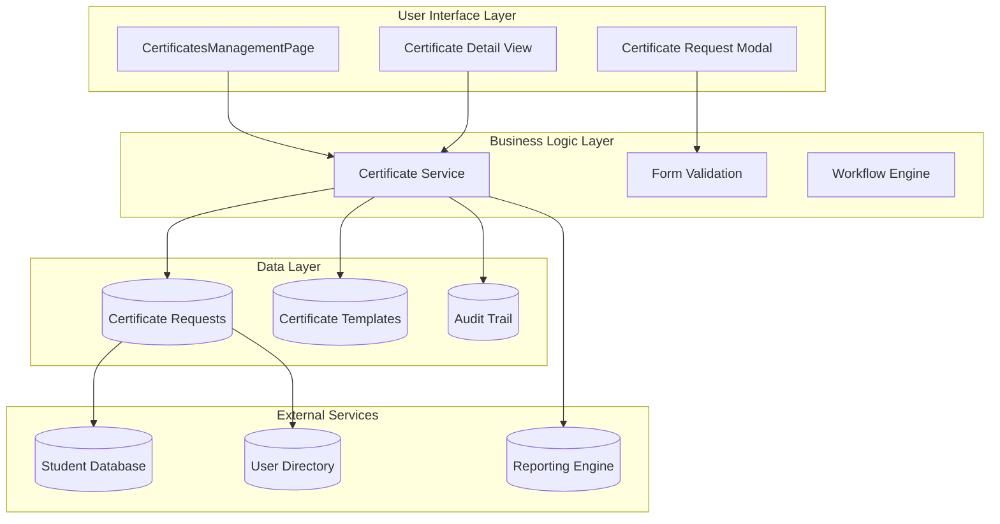
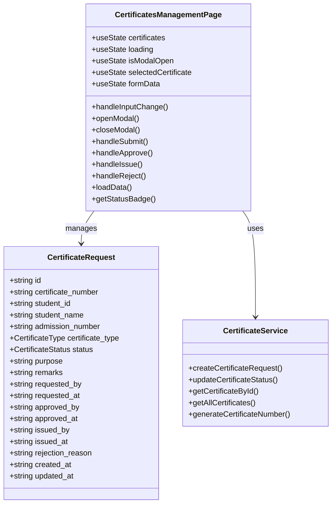
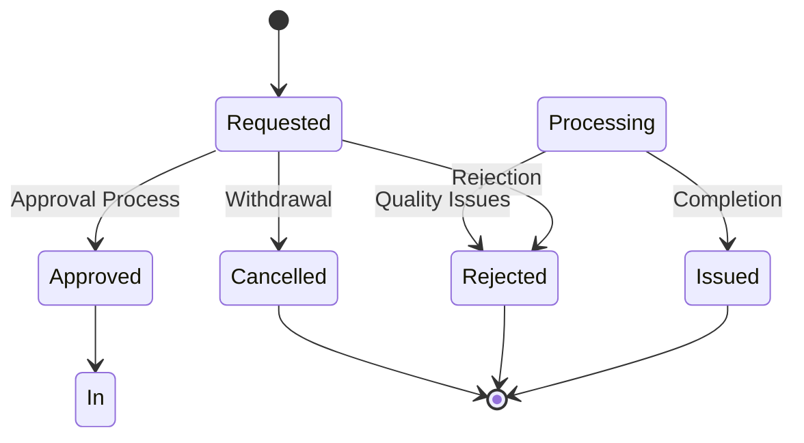
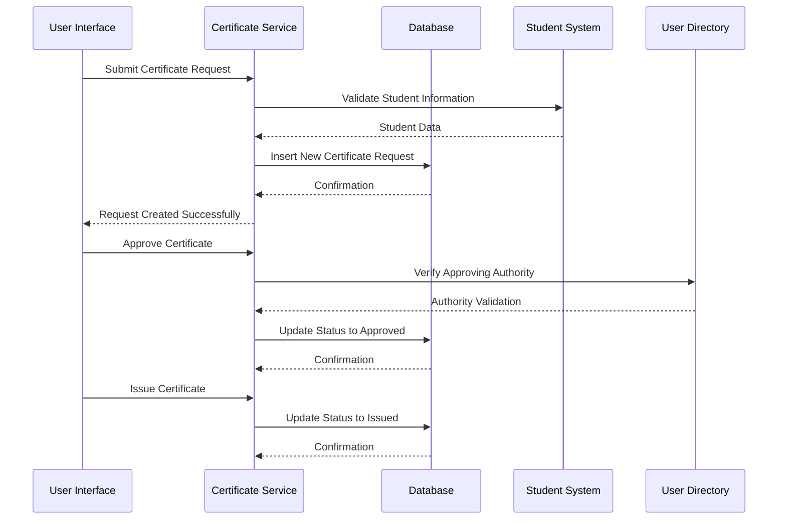
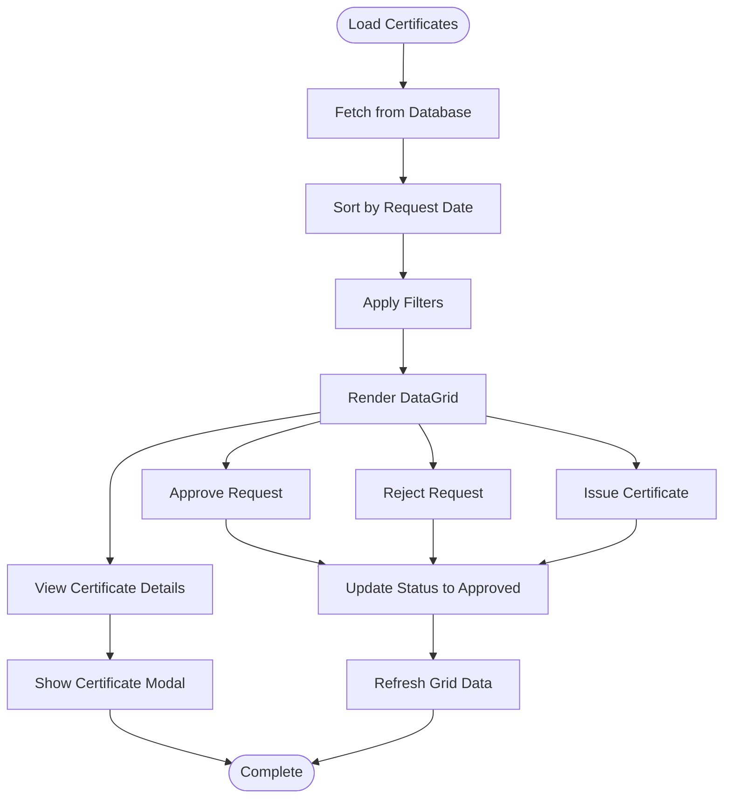
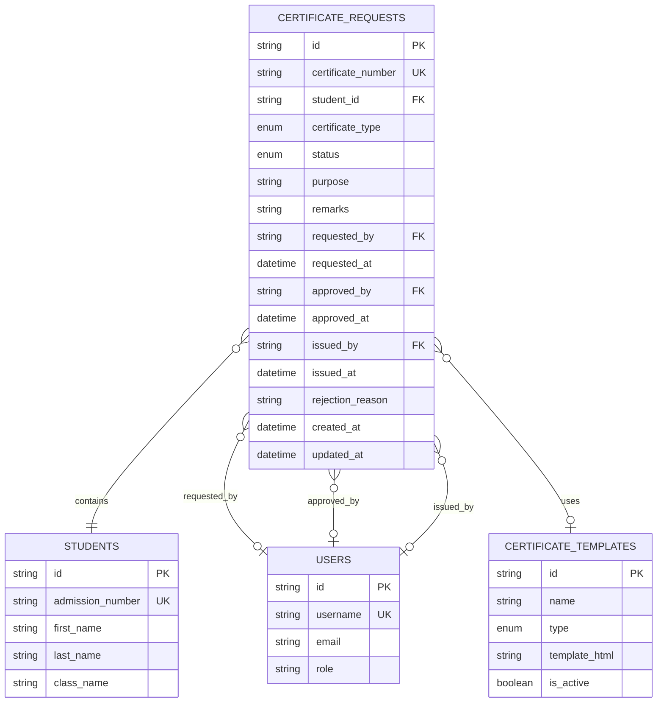
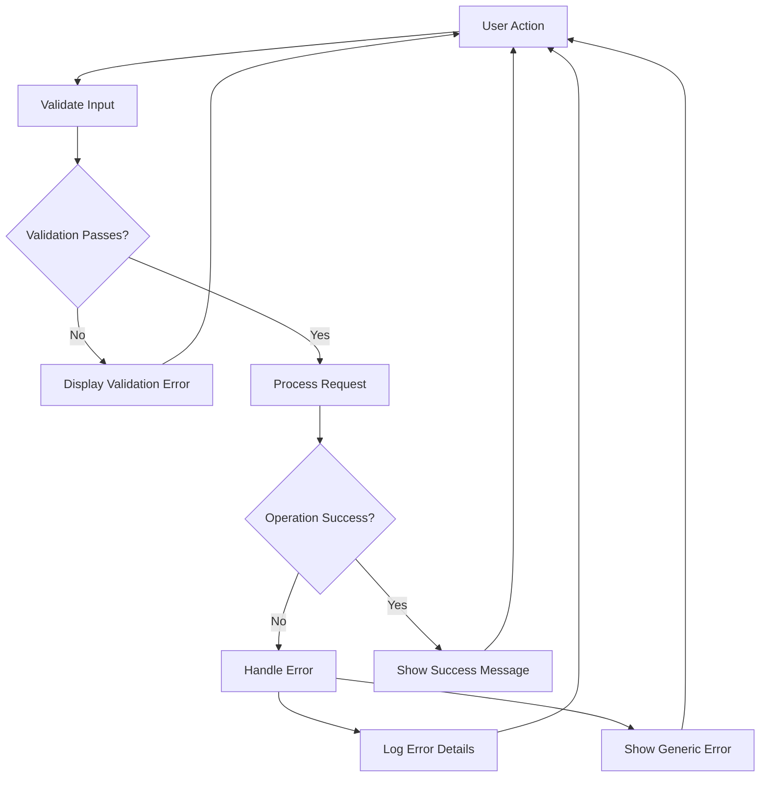

# Certificates Management

<cite>
**Referenced Files in This Document**
- [CertificatesManagementPage.tsx](file://src/modules/administration/pages/CertificatesManagementPage.tsx)
- [types.ts](file://src/modules/administration/data/types.ts)
- [schema.ts](file://src/modules/administration/data/schema.ts)
- [Admissions_Architecture_Spec.md](file://docs/migration/admissions-migration/architecture/Admissions_Architecture_Spec.md)
</cite>

## Table of Contents
1. [Introduction](#introduction)
2. [System Architecture](#system-architecture)
3. [Core Components](#core-components)
4. [Data Model](#data-model)
5. [Workflow Management](#workflow-management)
6. [User Interface Components](#user-interface-components)
7. [Database Integration](#database-integration)
8. [Security and Access Control](#security-and-access-control)
9. [Performance Considerations](#performance-considerations)
10. [Troubleshooting Guide](#troubleshooting-guide)
11. [Conclusion](#conclusion)

## Introduction

The Certificates Management system is a comprehensive solution designed for educational institutions to manage various types of student certificates efficiently. This system handles the complete lifecycle of certificate requests, from creation and approval to issuance and tracking. The implementation follows modern React patterns with TypeScript for type safety and integrates seamlessly with the school's database infrastructure.

The system supports multiple certificate types including Bonafide Certificates, Transfer Certificates, Character Certificates, and Academic Certificates, providing administrators with a centralized platform to oversee certificate operations while maintaining audit trails and approval workflows.

## System Architecture

The Certificates Management system follows a modular architecture pattern, integrating tightly with the Administration module of the EduGen platform. The system is built using React with TypeScript, implementing a component-based structure that promotes reusability and maintainability.

**Diagram sources**
- [CertificatesManagementPage.tsx:1-347](file://src/modules/administration/pages/CertificatesManagementPage.tsx#L1-L347)
- [types.ts:759-800](file://src/modules/administration/data/types.ts#L759-L800)

## Core Components

### Certificate Management Page

The main component serves as the central hub for certificate operations, providing a comprehensive interface for managing certificate requests. It implements a data-driven approach using the DataGrid component for displaying certificate records with sorting, filtering, and pagination capabilities.

**Diagram sources**
- [CertificatesManagementPage.tsx:16-347](file://src/modules/administration/pages/CertificatesManagementPage.tsx#L16-L347)
- [types.ts:782-800](file://src/modules/administration/data/types.ts#L782-L800)

**Section sources**
- [CertificatesManagementPage.tsx:16-347](file://src/modules/administration/pages/CertificatesManagementPage.tsx#L16-L347)

### Form Management System

The system implements a sophisticated form management approach that handles dynamic form generation based on certificate types. The form validation ensures data integrity while providing user-friendly error messaging.

**Section sources**
- [CertificatesManagementPage.tsx:22-341](file://src/modules/administration/pages/CertificatesManagementPage.tsx#L22-L341)

## Data Model

The certificate management system utilizes a comprehensive data model that supports multiple certificate types and maintains detailed audit trails for all operations.

### Certificate Types

The system supports a wide range of certificate types commonly used in educational institutions:

| Certificate Type | Description | Use Case |
|------------------|-------------|----------|
| Bonafide Certificate | Verifies student identity and enrollment | Bank applications, scholarship applications |
| Transfer Certificate | Documents student transfer between institutions | Academic records transfer |
| Character Certificate | Describes student behavior and conduct | University applications |
| Academic Certificate | Documents academic achievements | Higher education applications |
| Completion Certificate | Documents course completion | Professional development |
| Achievement Certificate | Recognizes special accomplishments | Extracurricular activities |
| Conduct Certificate | Documents good behavior and discipline | Character references |
| Leaving Certificate | Official departure documentation | Graduation ceremonies |

### Certificate Status Workflow

The system implements a robust status management workflow that tracks certificate lifecycle stages:

**Diagram sources**
- [types.ts:773-780](file://src/modules/administration/data/types.ts#L773-L780)

**Section sources**
- [types.ts:761-780](file://src/modules/administration/data/types.ts#L761-L780)

### Database Schema Implementation

The database schema ensures data integrity and supports efficient querying operations:

| Field | Type | Description | Constraints |
|-------|------|-------------|-------------|
| id | String | Unique identifier | Primary key |
| certificate_number | String | Generated certificate number | Unique, Required |
| student_id | String | Reference to student | Required, Indexed |
| certificate_type | Enum | Type of certificate | Required, Enum |
| status | Enum | Current workflow status | Required, Enum |
| purpose | String | Reason for certificate request | Optional, Max 500 chars |
| remarks | String | Administrative notes | Optional, Max 500 chars |
| requested_by | String | User who created request | Required, Indexed |
| requested_at | Timestamp | Creation timestamp | Required |
| approved_by | String | Approving authority | Optional |
| approved_at | Timestamp | Approval timestamp | Optional |
| issued_by | String | Issuing authority | Optional |
| issued_at | Timestamp | Issuance timestamp | Optional |
| rejection_reason | String | Reason for rejection | Optional, Max 500 chars |
| created_at | Timestamp | Record creation | Required |
| updated_at | Timestamp | Last modification | Required |

**Section sources**
- [schema.ts:687-701](file://src/modules/administration/data/schema.ts#L687-L701)

## Workflow Management

### Certificate Request Process

The certificate request process follows a structured workflow that ensures proper authorization and documentation:

**Diagram sources**
- [CertificatesManagementPage.tsx:53-125](file://src/modules/administration/pages/CertificatesManagementPage.tsx#L53-L125)

### Approval Hierarchy

The system implements a flexible approval hierarchy that can be configured based on institutional policies:

| Level | Authority | Required For | Approval Threshold |
|-------|-----------|--------------|-------------------|
| Initial | Certificate Officer | All requests | Automatic |
| Department Head | Academic Certificates | Academic requests | Manual |
| Principal | Character Certificates | Behavior-related | Manual |
| Registrar | Official Certificates | Leaving/Transfer | Manual |

**Section sources**
- [CertificatesManagementPage.tsx:80-125](file://src/modules/administration/pages/CertificatesManagementPage.tsx#L80-L125)

## User Interface Components

### Data Grid Interface

The system utilizes a sophisticated DataGrid component that provides comprehensive certificate management capabilities:

**Diagram sources**
- [CertificatesManagementPage.tsx:158-205](file://src/modules/administration/pages/CertificatesManagementPage.tsx#L158-L205)

### Form Validation System

The form validation system ensures data integrity through comprehensive field validation:

| Field | Validation Rule | Error Message | Required |
|-------|----------------|---------------|----------|
| Student Name | Min 2, Max 200 chars | Invalid name format | Yes |
| Admission Number | Pattern matching | Invalid admission number | No |
| Certificate Type | Enum validation | Select valid certificate type | Yes |
| Purpose | Min 5, Max 500 chars | Purpose too short/long | No |
| Remarks | Max 500 chars | Remarks exceed limit | No |

**Section sources**
- [CertificatesManagementPage.tsx:32-341](file://src/modules/administration/pages/CertificatesManagementPage.tsx#L32-L341)

## Database Integration

### Collection Schema

The certificate management system uses a dedicated collection schema optimized for certificate operations:

**Diagram sources**
- [schema.ts:687-701](file://src/modules/administration/data/schema.ts#L687-L701)

### Indexing Strategy

The database implementation includes strategic indexing to optimize query performance:

| Index | Columns | Purpose | Query Patterns |
|-------|---------|---------|----------------|
| PK_index | id | Primary key lookup | Individual record retrieval |
| student_index | student_id | Student-based queries | Student certificate history |
| status_index | status | Status-based filtering | Workflow management |
| date_index | requested_at | Timeline queries | Audit reporting |
| number_index | certificate_number | Search optimization | Certificate lookup |

**Section sources**
- [schema.ts:687-701](file://src/modules/administration/data/schema.ts#L687-L701)

## Security and Access Control

### Role-Based Permissions

The system implements comprehensive role-based access control for certificate operations:

| Role | Permissions | Allowed Actions |
|------|-------------|-----------------|
| Student | View own certificates | View status, download |
| Certificate Officer | Create, approve, issue | All certificate operations |
| Department Head | Approve academic certificates | Approve/reject requests |
| Principal | Issue official certificates | Final approval authority |
| Administrator | Full system access | All operations, user management |

### Audit Trail Implementation

Every certificate operation is tracked through a comprehensive audit trail system:

| Event Type | Tracked Fields | Storage Location | Retention Period |
|------------|----------------|------------------|------------------|
| Request Creation | Requested by, timestamp | Audit log | 5 years |
| Status Changes | Previous/Current status, changer | Audit log | 5 years |
| Approvals | Approver, timestamp | Audit log | 5 years |
| Issuance | Issuer, timestamp | Audit log | 5 years |
| Rejections | Rejection reason, timestamp | Audit log | 5 years |

**Section sources**
- [CertificatesManagementPage.tsx:146-156](file://src/modules/administration/pages/CertificatesManagementPage.tsx#L146-L156)

## Performance Considerations

### Data Loading Optimization

The system implements several optimization strategies for efficient data loading:

- **Lazy Loading**: Certificate data loads only when the page is accessed
- **Pagination**: Large result sets are paginated for better performance
- **Caching**: Frequently accessed certificate templates are cached
- **Indexing**: Strategic database indexing for common query patterns

### Memory Management

The component implements efficient memory management practices:

- **State Cleanup**: Proper cleanup of component state on unmount
- **Event Listeners**: Automatic removal of event listeners
- **Image Optimization**: Lazy loading for certificate preview images
- **Virtual Scrolling**: Efficient rendering of large data sets

### Scalability Features

The system is designed to handle growth through:

- **Horizontal Scaling**: Support for multiple database instances
- **Load Balancing**: Distribution of certificate processing tasks
- **Caching Layers**: Multi-level caching for frequently accessed data
- **Background Processing**: Asynchronous certificate generation

## Troubleshooting Guide

### Common Issues and Solutions

| Issue | Symptoms | Solution |
|-------|----------|----------|
| Certificate not appearing | Empty certificate list | Check database connectivity and refresh page |
| Approval button disabled | Cannot approve requests | Verify user permissions and role assignment |
| Status update failures | Error messages on status change | Check network connectivity and database permissions |
| Form validation errors | Red error messages on submit | Correct field format according to validation rules |
| Template loading issues | Blank certificate templates | Verify template configuration and file paths |

### Error Handling Strategies

The system implements comprehensive error handling:

**Diagram sources**
- [CertificatesManagementPage.tsx:74-77](file://src/modules/administration/pages/CertificatesManagementPage.tsx#L74-L77)

### Debugging Tools

Available debugging capabilities include:

- **Console Logging**: Comprehensive logging of all operations
- **Network Monitoring**: Real-time monitoring of database operations
- **Performance Metrics**: Tracking of component rendering performance
- **Error Reporting**: Automated error reporting to developers

**Section sources**
- [CertificatesManagementPage.tsx:74-139](file://src/modules/administration/pages/CertificatesManagementPage.tsx#L74-L139)

## Conclusion

The Certificates Management system provides a robust, scalable solution for educational institutions to manage their certificate operations efficiently. The system's modular architecture, comprehensive data model, and user-friendly interface make it suitable for institutions of all sizes.

Key strengths of the system include:

- **Comprehensive Coverage**: Supports all major certificate types used in education
- **Flexible Workflow**: Adaptable approval processes and status management
- **Audit Trail**: Complete tracking of all certificate operations
- **Performance Optimized**: Efficient data handling and user interface
- **Secure Architecture**: Robust access control and data protection

The system's extensible design allows for future enhancements including automated certificate generation, integration with external verification systems, and advanced reporting capabilities. The implementation follows best practices for React development and TypeScript usage, ensuring maintainability and scalability for future development needs.