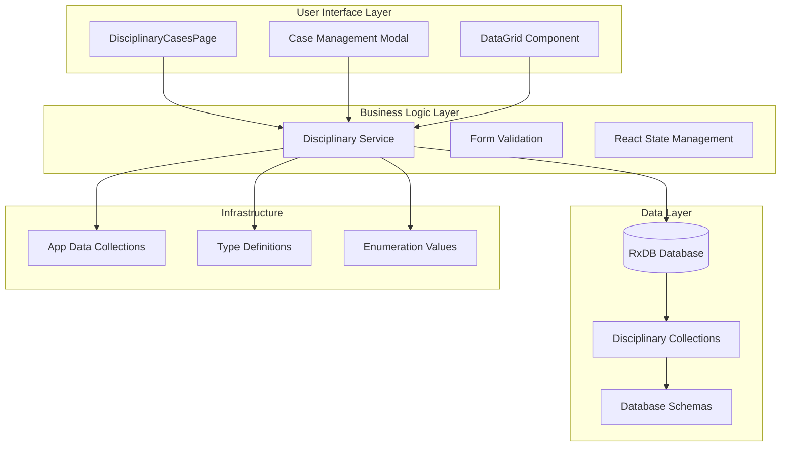
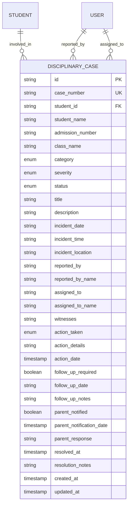
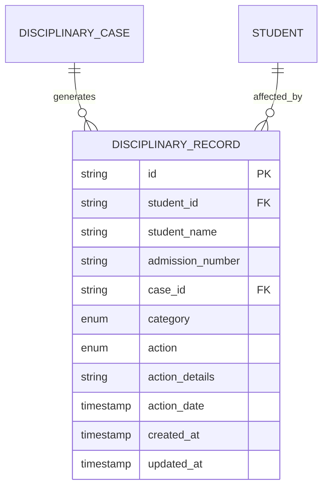
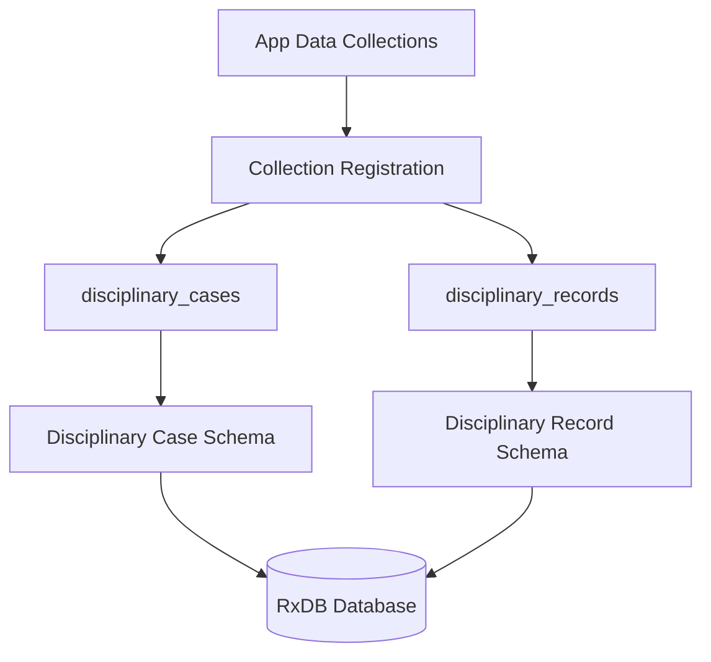
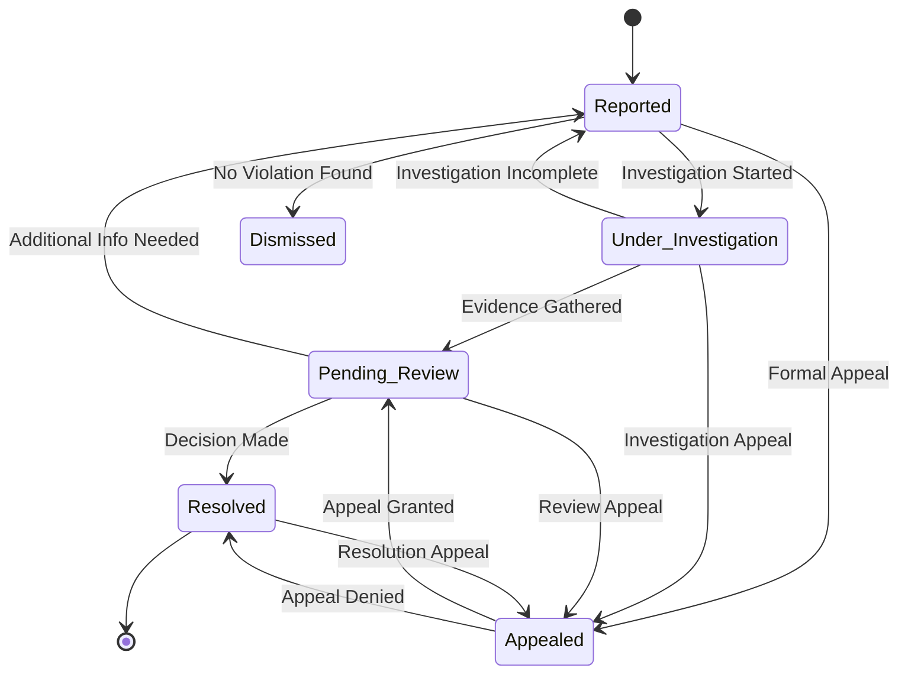

# Disciplinary Cases Management

<cite>
**Referenced Files in This Document**
- [DisciplinaryCasesPage.tsx](file://src/modules/administration/pages/DisciplinaryCasesPage.tsx)
- [types.ts](file://src/modules/administration/data/types.ts)
- [schema.ts](file://src/modules/administration/data/schema.ts)
- [collections.ts](file://src/modules/administration/data/collections.ts)
- [appDataCollections.ts](file://src/contexts/appData/appDataCollections.ts)
- [databaseService.ts](file://src/services/databaseService.ts)
- [tabbed_workspace_prd.md](file://.trae/documents/tabbed_workspace_prd.md)
</cite>

## Table of Contents
1. [Introduction](#introduction)
2. [System Architecture](#system-architecture)
3. [Core Components](#core-components)
4. [Data Model](#data-model)
5. [User Interface Components](#user-interface-components)
6. [Database Integration](#database-integration)
7. [Workflow Management](#workflow-management)
8. [Security and Access Control](#security-and-access-control)
9. [Performance Considerations](#performance-considerations)
10. [Troubleshooting Guide](#troubleshooting-guide)
11. [Conclusion](#conclusion)

## Introduction

The Disciplinary Cases Management system is a comprehensive solution designed to track, manage, and resolve student behavioral incidents within educational institutions. This system provides a centralized platform for recording disciplinary cases, monitoring their progression through various stages, and maintaining detailed records of resolutions and follow-up actions.

The system integrates seamlessly with the broader Administration module of the school management platform, offering robust functionality for handling behavioral violations, academic dishonesty, attendance issues, and other disciplinary matters. It supports multiple categories of infractions, varying severity levels, and different resolution actions while maintaining comprehensive audit trails and reporting capabilities.

## System Architecture

The Disciplinary Cases Management system follows a modular architecture pattern, integrating with the Administration module of the school management platform. The system is built using React with TypeScript, RxDB for local database management, and a comprehensive UI component library.

**Diagram sources**
- [DisciplinaryCasesPage.tsx:16-485](file://src/modules/administration/pages/DisciplinaryCasesPage.tsx#L16-L485)
- [collections.ts:71-77](file://src/modules/administration/data/collections.ts#L71-L77)
- [schema.ts:605-668](file://src/modules/administration/data/schema.ts#L605-L668)

## Core Components

### Disciplinary Cases Page

The main interface component provides comprehensive functionality for managing disciplinary cases through an intuitive data grid interface. The component handles CRUD operations, case resolution workflows, and real-time data synchronization.

Key features include:
- **Case Creation**: Form-based interface for reporting new incidents
- **Case Management**: Edit, view, and delete existing cases
- **Resolution Tracking**: Monitor case progression through different statuses
- **Filtering and Sorting**: Advanced data grid with sorting and filtering capabilities
- **Real-time Updates**: Automatic refresh of case data

### Data Types and Interfaces

The system defines comprehensive TypeScript interfaces and enumerations to ensure type safety and maintain consistency across the application.

**Section sources**
- [DisciplinaryCasesPage.tsx:13-14](file://src/modules/administration/pages/DisciplinaryCasesPage.tsx#L13-L14)
- [types.ts:666-757](file://src/modules/administration/data/types.ts#L666-L757)

## Data Model

The Disciplinary Cases Management system utilizes a sophisticated data model designed to capture comprehensive information about student behavioral incidents and their resolutions.

### Disciplinary Case Entity

The core entity representing individual disciplinary cases contains extensive metadata for tracking and reporting purposes.

**Diagram sources**
- [schema.ts:605-646](file://src/modules/administration/data/schema.ts#L605-L646)
- [types.ts:710-743](file://src/modules/administration/data/types.ts#L710-L743)

### Disciplinary Record Entity

Supporting entity for maintaining historical records of disciplinary actions taken against students.

**Diagram sources**
- [schema.ts:648-668](file://src/modules/administration/data/schema.ts#L648-L668)
- [types.ts:745-757](file://src/modules/administration/data/types.ts#L745-L757)

**Section sources**
- [schema.ts:605-668](file://src/modules/administration/data/schema.ts#L605-L668)
- [types.ts:666-757](file://src/modules/administration/data/types.ts#L666-L757)

## User Interface Components

### Case Management Interface

The primary user interface provides a comprehensive data grid for viewing and managing disciplinary cases with advanced filtering and sorting capabilities.

#### Data Grid Configuration

The interface utilizes a sophisticated data grid component with the following column configurations:

| Column | Header | Width | Properties | Rendering |
|--------|--------|-------|------------|-----------|
| case_number | Case # | 110px | Sortable, Filterable | Static text |
| student_name | Student | 160px | Sortable, Filterable | Static text |
| admission_number | Adm No | 100px | Sortable | Static text |
| category | Category | 130px | Sortable, Filterable | Badge component |
| severity | Severity | 100px | Sortable, Filterable | Colored badge |
| status | Status | 130px | Sortable, Filterable | Colored badge |
| incident_date | Incident Date | 110px | Sortable | Static text |
| parent_notified | Parent Notified | 110px | Render only | Badge component |
| id | Actions | 140px | Non-sortable | Action buttons |

#### Color-Coded Status System

The interface implements a comprehensive color-coding system for different case severities and statuses:

**Severity Color Coding:**
- Minor: Green badge
- Moderate: Yellow badge  
- Serious: Orange badge
- Critical: Red badge

**Status Color Coding:**
- Reported: Gray badge
- Under Investigation: Blue badge
- Pending Review: Yellow badge
- Resolved: Green badge
- Dismissed: Purple badge
- Appealed: Orange badge

**Section sources**
- [DisciplinaryCasesPage.tsx:182-252](file://src/modules/administration/pages/DisciplinaryCasesPage.tsx#L182-L252)
- [DisciplinaryCasesPage.tsx:40-54](file://src/modules/administration/pages/DisciplinaryCasesPage.tsx#L40-L54)

### Modal Forms

The system provides modal-based forms for creating and editing disciplinary cases with comprehensive validation and user-friendly interfaces.

#### Case Creation Form

The creation form captures essential information about disciplinary incidents:

**Required Fields:**
- Student identification (name, admission number)
- Case category and severity
- Incident date and time
- Case title and detailed description
- Incident location and witnesses

**Optional Enhancements:**
- Parent notification tracking
- Follow-up requirement designation
- Assigned case handler

**Section sources**
- [DisciplinaryCasesPage.tsx:374-479](file://src/modules/administration/pages/DisciplinaryCasesPage.tsx#L374-L479)

## Database Integration

### Collection Configuration

The system integrates with RxDB for local database management, utilizing specialized collections for disciplinary case data persistence.

#### Collection Registration

The administrative module registers disciplinary collections through a centralized configuration system:

**Diagram sources**
- [collections.ts:71-77](file://src/modules/administration/data/collections.ts#L71-L77)
- [schema.ts:605-668](file://src/modules/administration/data/schema.ts#L605-L668)

#### Schema Definition

Each collection utilizes carefully crafted schemas defining data types, validation rules, and indexing strategies:

**Disciplinary Cases Schema Properties:**
- Primary key: `id` (auto-generated)
- Unique constraints: `case_number`
- Foreign key relationships: `student_id` → students
- Enumerated fields: `category`, `severity`, `status`
- Timestamp fields: `created_at`, `updated_at`, `incident_date`
- Boolean fields: `follow_up_required`, `parent_notified`

**Indexing Strategy:**
- Composite indexes for frequent queries
- Single-field indexes for filtering operations
- Optimized for common search patterns

**Section sources**
- [collections.ts:71-77](file://src/modules/administration/data/collections.ts#L71-L77)
- [schema.ts:605-646](file://src/modules/administration/data/schema.ts#L605-L646)

## Workflow Management

### Case Lifecycle Management

The system implements a comprehensive workflow for managing disciplinary cases from initial reporting through final resolution.

### Resolution Actions

The system supports various resolution actions with appropriate tracking and documentation:

**Available Actions:**
- Verbal Warning
- Written Warning  
- Detention
- Suspension
- Expulsion
- Community Service
- Parent Meeting
- Behavioral Contract
- Counseling

**Section sources**
- [types.ts:684-694](file://src/modules/administration/data/types.ts#L684-L694)
- [DisciplinaryCasesPage.tsx:144-161](file://src/modules/administration/pages/DisciplinaryCasesPage.tsx#L144-L161)

## Security and Access Control

### Permission-Based Access

The system implements role-based access control ensuring appropriate permissions for disciplinary case management operations. Different user roles have varying levels of access and modification capabilities.

### Data Privacy and Protection

The system maintains strict data privacy standards for student disciplinary records, implementing appropriate access controls and audit trails for all modifications.

## Performance Considerations

### Database Optimization

The system employs several optimization strategies for efficient data management:

- **Indexing Strategy**: Strategic indexing on frequently queried fields
- **Query Optimization**: Efficient filtering and sorting mechanisms
- **Data Synchronization**: Real-time updates with conflict resolution
- **Memory Management**: Optimized rendering for large datasets

### Scalability Features

The modular architecture supports horizontal scaling and can accommodate growing institutional needs through:

- **Collection Partitioning**: Logical separation of data volumes
- **Query Performance**: Optimized search and filtering operations
- **Caching Strategies**: Intelligent caching for frequently accessed data

## Troubleshooting Guide

### Common Issues and Solutions

**Data Loading Problems:**
- Verify database initialization
- Check collection registration
- Validate schema compatibility

**Form Validation Errors:**
- Ensure required fields are completed
- Verify date formats
- Check enum value validity

**UI Rendering Issues:**
- Confirm component dependencies
- Validate TypeScript definitions
- Check CSS class conflicts

**Database Synchronization:**
- Monitor RxDB connection status
- Verify collection schemas
- Check for data conflicts

### Debugging Tools

The system provides comprehensive debugging capabilities including:
- Console logging for database operations
- Error boundary implementation
- Component state inspection
- Performance monitoring integration

## Conclusion

The Disciplinary Cases Management system represents a comprehensive solution for educational institutions seeking to streamline their disciplinary processes. Through its modular architecture, robust data model, and user-friendly interface, the system provides effective tools for tracking student behavioral incidents while maintaining compliance with institutional policies and legal requirements.

The system's integration with the broader Administration module ensures seamless data flow and consistent user experiences across the educational management platform. Its extensible design allows for future enhancements and adaptations to meet evolving institutional needs.

Key strengths of the system include its comprehensive data modeling, intuitive user interface, robust workflow management, and strong integration with the underlying database infrastructure. These features combine to create a reliable and efficient solution for disciplinary case management in educational environments.