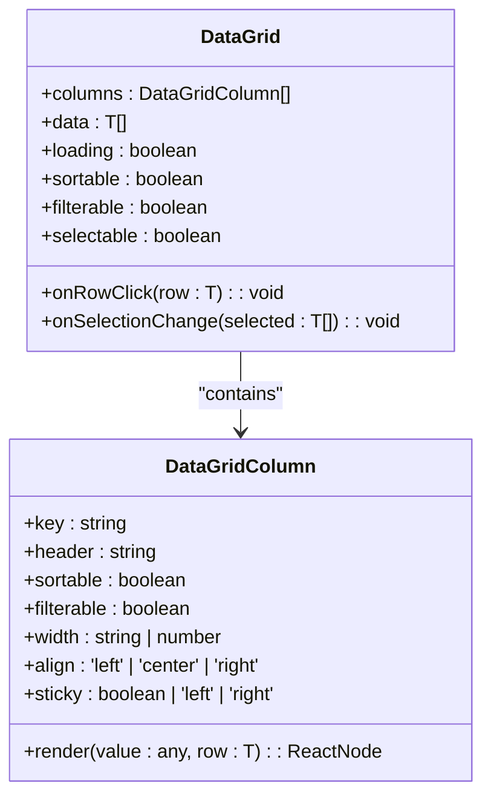
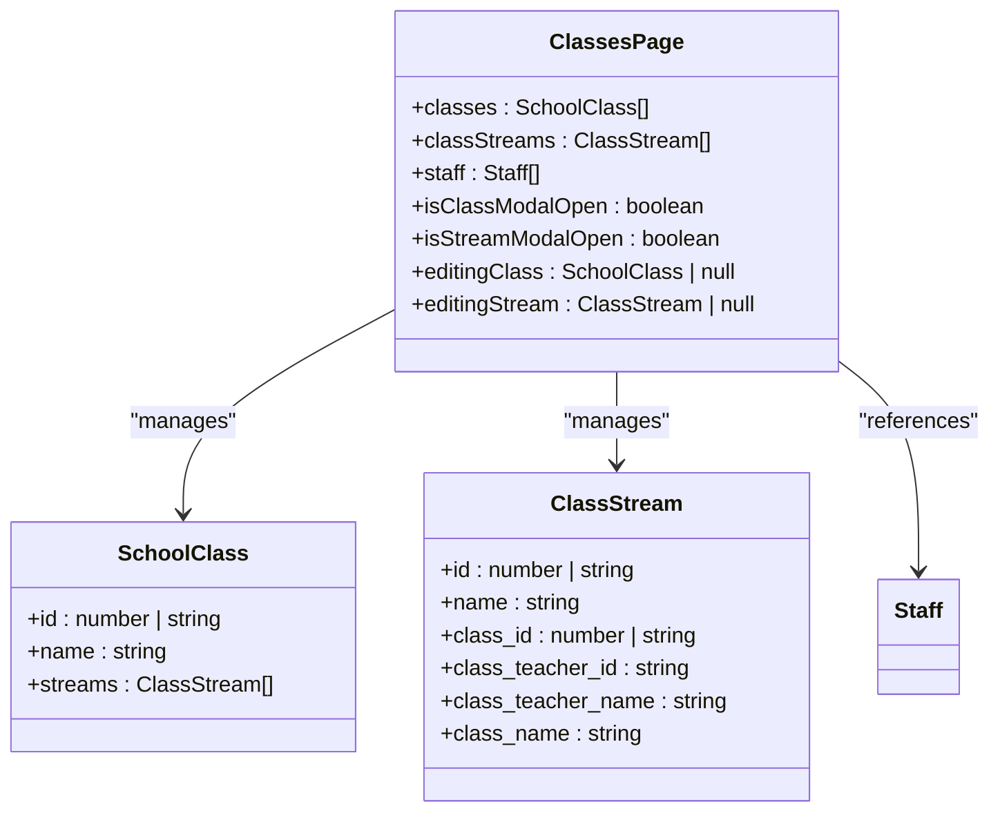
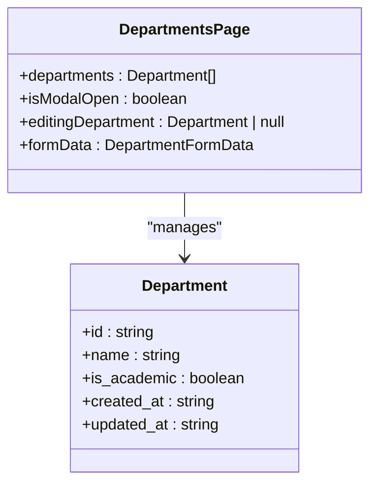
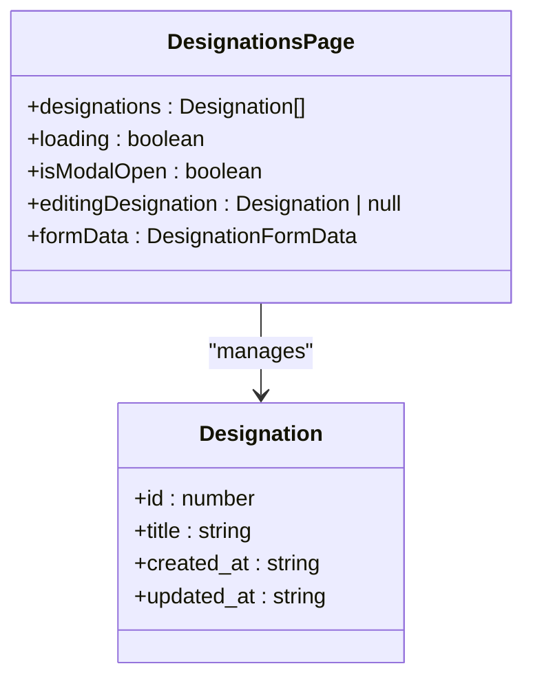
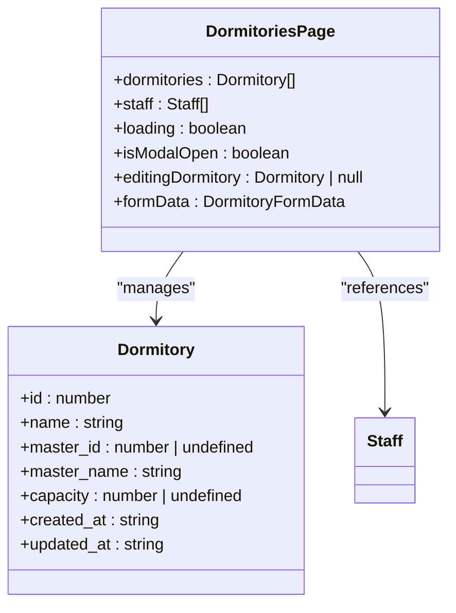
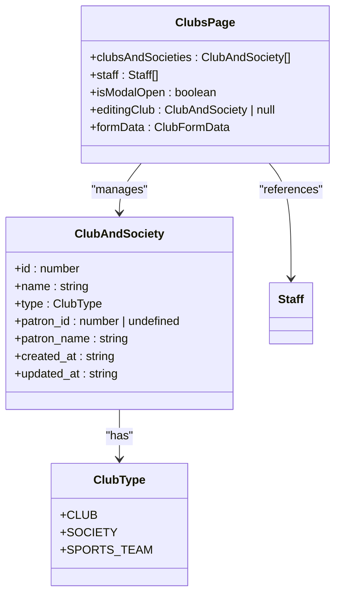
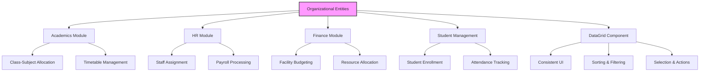
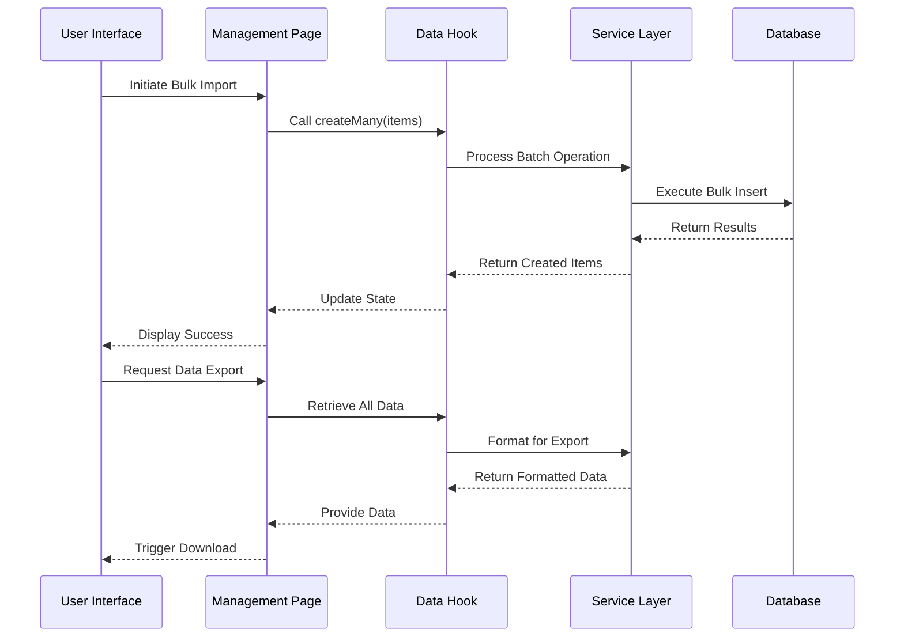

# Organizational Entities Management

<cite>
**Referenced Files in This Document**   
- [ClassesPage.tsx](file://src/modules/administration/pages/ClassesPage.tsx)
- [DepartmentsPage.tsx](file://src/modules/administration/pages/DepartmentsPage.tsx)
- [DesignationsPage.tsx](file://src/modules/administration/pages/DesignationsPage.tsx)
- [DormitoriesPage.tsx](file://src/modules/administration/pages/DormitoriesPage.tsx)
- [ClubsPage.tsx](file://src/modules/administration/pages/ClubsPage.tsx)
- [DataGrid.tsx](file://src/components/ui/data/DataGrid.tsx)
- [useAppData.ts](file://src/hooks/useAppData.ts)
- [AppDataContext.tsx](file://src/contexts/AppDataContext.tsx)
- [useClassData.ts](file://src/modules/administration/data/useClassData.ts)
- [useDepartmentData.ts](file://src/modules/administration/data/useDepartmentData.ts)
- [useDesignationData.ts](file://src/modules/administration/data/useDesignationData.ts)
- [useDormitoryData.ts](file://src/modules/administration/data/useDormitoryData.ts)
- [useClubAndSocietyData.ts](file://src/modules/administration/data/useClubAndSocietyData.ts)
</cite>

## Table of Contents
1. [Introduction](#introduction)
2. [Core UI Components](#core-ui-components)
3. [Organizational Entity Pages](#organizational-entity-pages)
4. [Data Management Architecture](#data-management-architecture)
5. [Integration with Other Modules](#integration-with-other-modules)
6. [Bulk Operations and Service Layer](#bulk-operations-and-service-layer)
7. [Conclusion](#conclusion)

## Introduction
The Organizational Entities Management system in schoolpilot3 provides a comprehensive interface for managing various school organizational structures. This document details the implementation of key management pages including Classes, Departments, Designations, Dormitories, and Clubs. Each page follows a consistent design pattern using the DataGrid component for data presentation and standardized form layouts for data entry. The system integrates with other modules such as academics, HR, and finance, and supports bulk import/export operations through a robust service layer.

## Core UI Components

### DataGrid Component
The DataGrid component serves as the primary interface for displaying and interacting with organizational entity data across all management pages. It provides consistent functionality including sorting, filtering, and selection capabilities.



**Diagram sources**
- [DataGrid.tsx](file://src/components/ui/data/DataGrid.tsx#L20-L100)

**Section sources**
- [DataGrid.tsx](file://src/components/ui/data/DataGrid.tsx#L0-L200)

## Organizational Entity Pages

### ClassesPage
The ClassesPage component manages student classes with capacity limits and teacher assignments. It features a dual-table interface for managing both classes and their streams.



**Diagram sources**
- [ClassesPage.tsx](file://src/modules/administration/pages/ClassesPage.tsx#L0-L50)

**Section sources**
- [ClassesPage.tsx](file://src/modules/administration/pages/ClassesPage.tsx#L0-L301)

### DepartmentsPage
The DepartmentsPage component manages academic and administrative departments, distinguishing between academic and non-academic departments through a boolean flag.



**Diagram sources**
- [DepartmentsPage.tsx](file://src/modules/administration/pages/DepartmentsPage.tsx#L0-L50)

**Section sources**
- [DepartmentsPage.tsx](file://src/modules/administration/pages/DepartmentsPage.tsx#L0-L169)

### DesignationsPage
The DesignationsPage component manages staff roles and positions, providing a simple interface for creating and editing job titles.



**Diagram sources**
- [DesignationsPage.tsx](file://src/modules/administration/pages/DesignationsPage.tsx#L0-L50)

**Section sources**
- [DesignationsPage.tsx](file://src/modules/administration/pages/DesignationsPage.tsx#L0-L150)

### DormitoriesPage
The DormitoriesPage component manages residential facilities, including capacity limits and assignment of dormitory masters/mistresses from the staff list.



**Diagram sources**
- [DormitoriesPage.tsx](file://src/modules/administration/pages/DormitoriesPage.tsx#L0-L50)

**Section sources**
- [DormitoriesPage.tsx](file://src/modules/administration/pages/DormitoriesPage.tsx#L0-L190)

### ClubsPage
The ClubsPage component manages extracurricular activities, supporting both clubs and societies with patron assignment from the staff list.



**Diagram sources**
- [ClubsPage.tsx](file://src/modules/administration/pages/ClubsPage.tsx#L0-L50)

**Section sources**
- [ClubsPage.tsx](file://src/modules/administration/pages/ClubsPage.tsx#L0-L194)

## Data Management Architecture

### Shared Data Management Patterns
The organizational entity management pages utilize a consistent data management architecture, with each page using specialized hooks for data operations.

```mermaid
classDiagram
class AppDataContext {
+classes : Class[]
+departments : Department[]
+designations : Designation[]
+dormitories : Dormitory[]
+staff : Staff[]
+loading : boolean
+error : Error | null
+refresh() : Promise<void>
}
class useAppData {
+returns : AppDataContext
}
class useClassData {
+data : Class[]
+create(item : Partial<Class>) : Promise<Class>
+update(id : number, updates : Partial<Class>) : Promise<void>
+remove(id : number) : Promise<void>
}
class useDepartmentData {
+departments : Department[]
+loading : {departments : boolean}
+addDepartment(item : Omit<Department, 'id'>) : Promise<Department>
+updateDepartment(item : Department) : Promise<void>
+deleteDepartment(id : string) : Promise<void>
}
class useDesignationData {
+designations : Designation[]
+loading : {designations : boolean}
+addDesignation(item : Omit<Designation, 'id'>) : Promise<Designation>
+updateDesignation(item : Designation) : Promise<void>
+deleteDesignation(id : number) : Promise<void>
}
class useDormitoryData {
+dormitories : Dormitory[]
+loading : {dormitories : boolean}
+addDormitory(item : Omit<Dormitory, 'id'>) : Promise<Dormitory>
+updateDormitory(item : Dormitory) : Promise<void>
+deleteDormitory(id : number) : Promise<void>
}
class useClubAndSocietyData {
+data : ClubAndSociety[]
+create(item : Partial<ClubAndSociety>) : Promise<ClubAndSociety>
+update(id : number, updates : Partial<ClubAndSociety>) : Promise<void>
+remove(id : number) : Promise<void>
}
AppDataContext --> useAppData : "exposes"
useAppData --> AppDataContext : "consumes"
ClassesPage --> useClassData : "uses"
DepartmentsPage --> useDepartmentData : "uses"
DesignationsPage --> useDesignationData : "uses"
DormitoriesPage --> useAppData : "uses"
ClubsPage --> useClubAndSocietyData : "uses"
ClubsPage --> useAppData : "uses"
```

**Diagram sources**
- [AppDataContext.tsx](file://src/contexts/AppDataContext.tsx#L0-L150)
- [useAppData.ts](file://src/hooks/useAppData.ts#L0-L20)
- [useClassData.ts](file://src/modules/administration/data/useClassData.ts#L0-L44)
- [useDepartmentData.ts](file://src/modules/administration/data/useDepartmentData.ts#L0-L66)
- [useDesignationData.ts](file://src/modules/administration/data/useDesignationData.ts#L0-L66)
- [useDormitoryData.ts](file://src/modules/administration/data/useDormitoryData.ts#L0-L66)
- [useClubAndSocietyData.ts](file://src/modules/administration/data/useClubAndSocietyData.ts#L0-L66)

**Section sources**
- [AppDataContext.tsx](file://src/contexts/AppDataContext.tsx#L0-L169)
- [useAppData.ts](file://src/hooks/useAppData.ts#L0-L21)

## Integration with Other Modules

### Module Integration Architecture
The organizational entities management system integrates with various other modules in the schoolpilot3 application, creating a cohesive ecosystem for school administration.



**Diagram sources**
- [ClassesPage.tsx](file://src/modules/administration/pages/ClassesPage.tsx#L0-L301)
- [DepartmentsPage.tsx](file://src/modules/administration/pages/DepartmentsPage.tsx#L0-L169)
- [DesignationsPage.tsx](file://src/modules/administration/pages/DesignationsPage.tsx#L0-L150)
- [DormitoriesPage.tsx](file://src/modules/administration/pages/DormitoriesPage.tsx#L0-L190)
- [ClubsPage.tsx](file://src/modules/administration/pages/ClubsPage.tsx#L0-L194)

**Section sources**
- [ClassesPage.tsx](file://src/modules/administration/pages/ClassesPage.tsx#L0-L301)
- [DepartmentsPage.tsx](file://src/modules/administration/pages/DepartmentsPage.tsx#L0-L169)

## Bulk Operations and Service Layer

### Service Layer Architecture
The module's service layer supports bulk import/export operations, enabling efficient data management across organizational entities.



**Diagram sources**
- [useClassData.ts](file://src/modules/administration/data/useClassData.ts#L0-L44)
- [useDepartmentData.ts](file://src/modules/administration/data/useDepartmentData.ts#L0-L66)
- [useDesignationData.ts](file://src/modules/administration/data/useDesignationData.ts#L0-L66)
- [useDormitoryData.ts](file://src/modules/administration/data/useDormitoryData.ts#L0-L66)
- [useClubAndSocietyData.ts](file://src/modules/administration/data/useClubAndSocietyData.ts#L0-L66)

**Section sources**
- [useClassData.ts](file://src/modules/administration/data/useClassData.ts#L0-L44)
- [useDepartmentData.ts](file://src/modules/administration/data/useDepartmentData.ts#L0-L66)

## Conclusion
The Organizational Entities Management system in schoolpilot3 provides a robust and consistent interface for managing key school structures. By leveraging the DataGrid component and standardized data management hooks, the system ensures a uniform user experience across different entity types. The architecture supports integration with other modules such as academics, HR, and finance, creating a comprehensive school management ecosystem. The service layer enables efficient bulk operations, making data import and export straightforward for administrators. This design promotes maintainability, scalability, and ease of use for school administrators managing organizational structures.