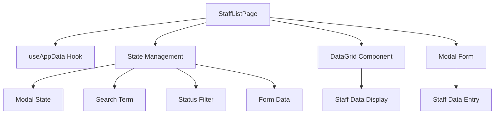
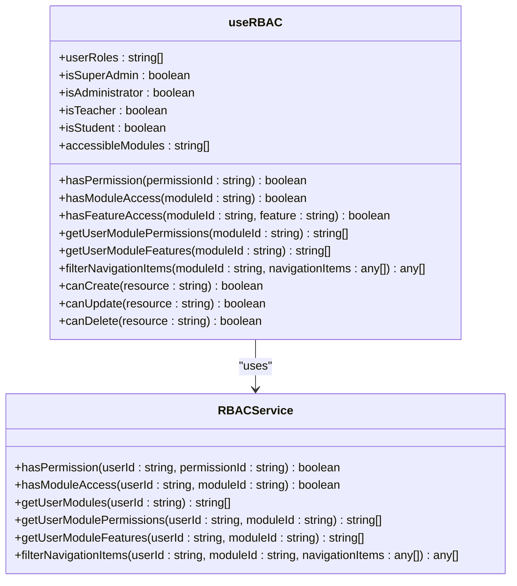
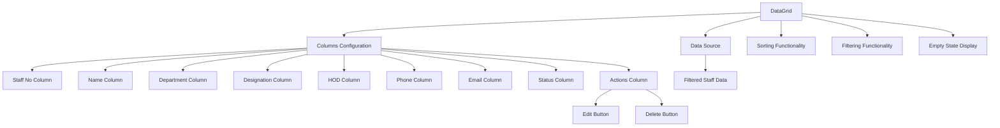
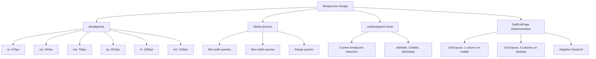
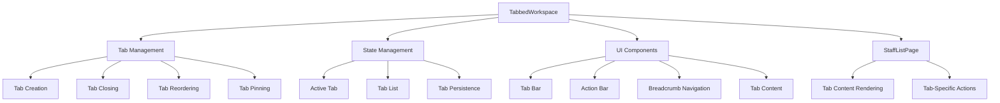
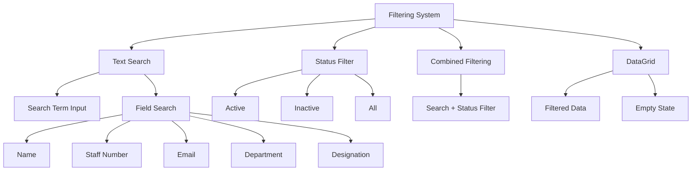

# Staff Management Pages

<cite>
**Referenced Files in This Document**   
- [StaffListPage.tsx](file://src/modules/administration/pages/StaffListPage.tsx)
- [useStaffData.ts](file://src/modules/administration/data/useStaffData.ts)
- [useRBAC.ts](file://src/hooks/useRBAC.ts)
- [TabbedWorkspace.tsx](file://src/components/tabbedWorkspace/TabbedWorkspace.tsx)
- [responsive.ts](file://src/utils/responsive.ts)
- [DataGrid.tsx](file://src/components/ui/data/DataGrid.tsx)
</cite>

## Table of Contents
1. [Introduction](#introduction)
2. [StaffListPage Implementation](#stafflistpage-implementation)
3. [Role-Based Access Control Integration](#role-based-access-control-integration)
4. [DataGrid Component and Custom Columns](#datagrid-component-and-custom-columns)
5. [useStaffData Hook for Data Management](#usestaffdata-hook-for-data-management)
6. [Responsive Design Considerations](#responsive-design-considerations)
7. [Integration with Tabbed Workspace System](#integration-with-tabbed-workspace-system)
8. [Filtering and Bulk Operations](#filtering-and-bulk-operations)
9. [Conclusion](#conclusion)

## Introduction
The StaffListPage in schoolpilot3 serves as a comprehensive staff directory with advanced filtering, role-based visibility controls, and support for bulk operations. This document provides a detailed analysis of its implementation, focusing on key aspects such as integration with the RBAC system, use of the DataGrid component, data fetching through the useStaffData hook, responsive design considerations, and integration with the global tabbed workspace system.

**Section sources**
- [StaffListPage.tsx](file://src/modules/administration/pages/StaffListPage.tsx)

## StaffListPage Implementation
The StaffListPage component is implemented as a React functional component that provides a comprehensive interface for managing staff information. It leverages the useAppData hook to access staff data, departments, and designations, while implementing state management for modal operations, search functionality, and filtering.

The component structure follows a card-based layout with a search and filter section at the top, followed by the DataGrid component that displays staff information. A modal form is used for adding and editing staff members, providing a consistent user experience for data entry operations.

Key features of the implementation include:
- Search functionality that filters staff by name, staff number, email, department, and designation
- Status filtering to show active or inactive staff members
- Modal-based form for creating and editing staff records
- Responsive grid layout for form fields



**Diagram sources**
- [StaffListPage.tsx](file://src/modules/administration/pages/StaffListPage.tsx)

**Section sources**
- [StaffListPage.tsx](file://src/modules/administration/pages/StaffListPage.tsx)

## Role-Based Access Control Integration
The StaffListPage integrates with the RBAC system through the useAppData hook, which internally utilizes the useRBAC hook to determine user permissions and role-based visibility. The RBAC system controls which staff information is visible to different user roles and what operations they can perform.

The useRBAC hook provides several key functions for permission checking:
- `hasPermission`: Checks if a user has a specific permission
- `hasModuleAccess`: Determines if a user can access a specific module
- `canCreate`, `canRead`, `canUpdate`, `canDelete`: Resource-based permission checks



**Diagram sources**
- [useRBAC.ts](file://src/hooks/useRBAC.ts)
- [rbacService.ts](file://src/core/rbacService.ts)

**Section sources**
- [useRBAC.ts](file://src/hooks/useRBAC.ts)

## DataGrid Component and Custom Columns
The StaffListPage utilizes the DataGrid component to display staff information in a tabular format with custom columns for staff photos, roles, and contact information. The DataGrid component is configured with specific columns that define how data is displayed and sorted.

The columns configuration includes:
- Staff number with sorting and filtering capabilities
- Name column that combines first and last names
- Department and designation columns with sorting
- HOD (Head of Department) information
- Contact information (phone and email)
- Status indicator for active/inactive staff
- Action buttons for editing and deleting staff records



**Diagram sources**
- [StaffListPage.tsx](file://src/modules/administration/pages/StaffListPage.tsx)
- [DataGrid.tsx](file://src/components/ui/data/DataGrid.tsx)

**Section sources**
- [StaffListPage.tsx](file://src/modules/administration/pages/StaffListPage.tsx)

## useStaffData Hook for Data Management
The useStaffData hook provides efficient data fetching and caching for staff information. It is a self-contained hook that manages staff data without depending on AppDataContext, making it reusable across different modules.

The hook implements CRUD operations for staff management:
- `addStaffMember`: Creates a new staff member with proper timestamps
- `updateStaffMember`: Updates an existing staff member with updated timestamp
- `deleteStaffMember`: Removes a staff member from the dataset

The hook also manages loading states for each operation, providing feedback to the user during data operations.

```mermaid
classDiagram
class useStaffData {
+staff : Staff[]
+loading : {staff : boolean}
+addStaffMember(newItem : Omit<Staff, 'id'|'created_at'|'updated_at'>) Promise<Staff>
+updateStaffMember(updatedItem : Staff) Promise<void>
+deleteStaffMember(id : string) Promise<void>
+data : Staff[]
+create : addStaffMember
+update : updateStaffMember
+remove : deleteStaffMember
}
class Staff {
+id : string
+staff_no : string
+first_name : string
+last_name : string
+is_active : boolean
+phone : string
+department_id : number
+designation_id : number
+hod_of_department_id : number
+created_at : string
+updated_at : string
}
useStaffData --> Staff : "manages"
```

**Diagram sources**
- [useStaffData.ts](file://src/modules/administration/data/useStaffData.ts)

**Section sources**
- [useStaffData.ts](file://src/modules/administration/data/useStaffData.ts)

## Responsive Design Considerations
The StaffListPage implements responsive design principles to ensure optimal user experience across different screen sizes and device types. The responsive design is achieved through a combination of CSS grid layouts, responsive breakpoints, and adaptive component behavior.

The responsive.ts utility provides:
- Breakpoint definitions for different screen sizes (xs, sm, md, lg, xl, 2xl)
- Media query helpers for CSS-in-JS styling
- A useBreakpoint hook for detecting current screen size
- Responsive value helpers for adapting component properties

The StaffListPage uses a responsive grid layout for the search and filter section, with a single column on small screens and multiple columns on larger screens. The DataGrid component also adapts its layout based on screen size, ensuring that important information is always visible.



**Diagram sources**
- [responsive.ts](file://src/utils/responsive.ts)
- [StaffListPage.tsx](file://src/modules/administration/pages/StaffListPage.tsx)

**Section sources**
- [responsive.ts](file://src/utils/responsive.ts)

## Integration with Tabbed Workspace System
The StaffListPage integrates with the global tabbed workspace system, allowing users to manage multiple pages and views within a single interface. The TabbedWorkspace component provides a consistent user experience across different modules and pages.

Key integration points include:
- Tab creation and management
- Tab persistence across sessions
- Hierarchical navigation with breadcrumbs
- Action bar integration for common operations
- Responsive tab layout for different screen sizes

The TabbedWorkspace component manages tab state, including active tab, tab order, and tab persistence. It also provides error boundaries and loading states to ensure a smooth user experience.



**Diagram sources**
- [TabbedWorkspace.tsx](file://src/components/tabbedWorkspace/TabbedWorkspace.tsx)
- [StaffListPage.tsx](file://src/modules/administration/pages/StaffListPage.tsx)

**Section sources**
- [TabbedWorkspace.tsx](file://src/components/tabbedWorkspace/TabbedWorkspace.tsx)

## Filtering and Bulk Operations
The StaffListPage implements comprehensive filtering capabilities that allow users to search and filter staff members by various criteria. The filtering system combines text search with status filtering to provide a flexible way to find specific staff members.

The filtering implementation includes:
- Text search across multiple fields (name, staff number, email, department, designation)
- Status filtering to show active or inactive staff members
- Real-time filtering as the user types
- Empty state display when no results are found

While the current implementation focuses on individual operations (add, edit, delete), the DataGrid component is designed to support bulk operations through its selection and action capabilities. This provides a foundation for future enhancements to support bulk editing, status updates, and other mass operations.



**Diagram sources**
- [StaffListPage.tsx](file://src/modules/administration/pages/StaffListPage.tsx)

**Section sources**
- [StaffListPage.tsx](file://src/modules/administration/pages/StaffListPage.tsx)

## Conclusion
The StaffListPage in schoolpilot3 is a comprehensive staff directory that combines role-based access control, responsive design, and integration with the global tabbed workspace system. Its implementation leverages the useStaffData hook for efficient data management and the DataGrid component for flexible data display.

The page provides a user-friendly interface for managing staff information with advanced filtering capabilities and modal-based data entry. The integration with the RBAC system ensures that staff information is visible only to authorized users, while the responsive design ensures optimal user experience across different devices.

Future enhancements could include bulk operations, advanced filtering options, and improved export functionality to further enhance the staff management capabilities of the system.