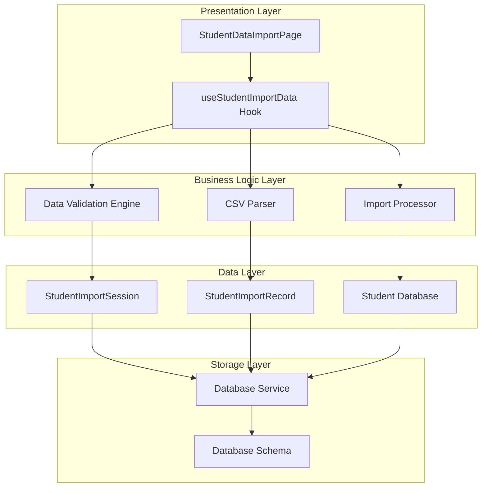
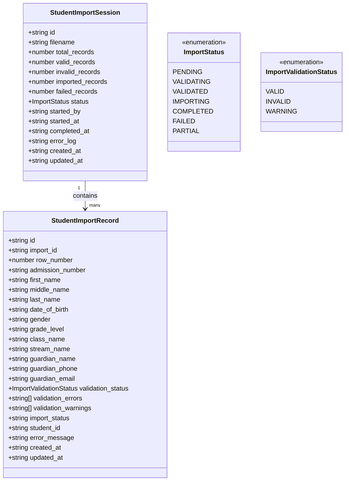
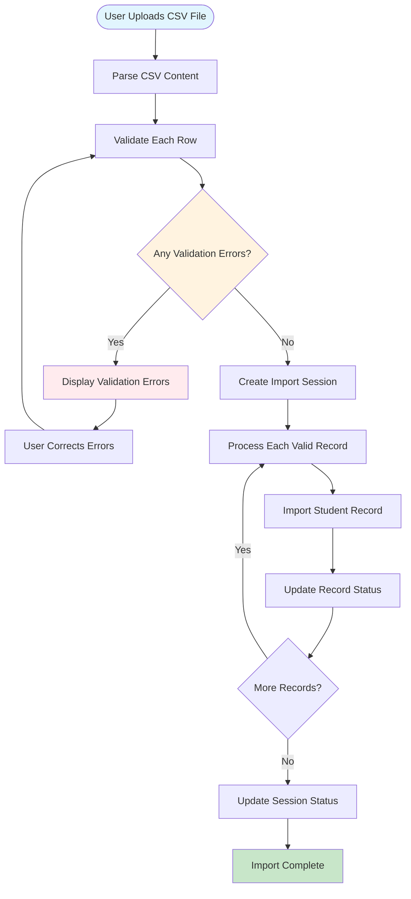
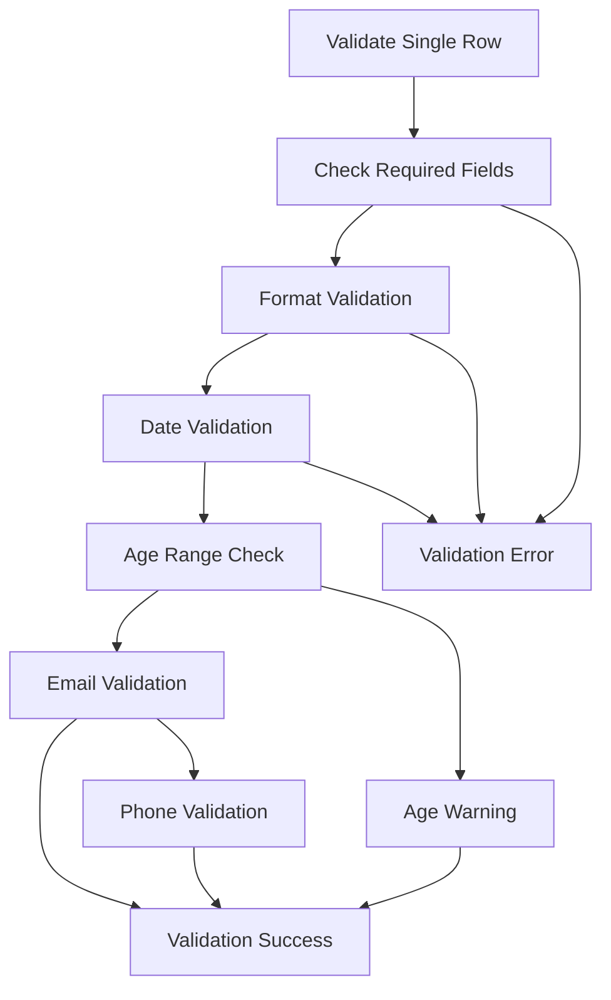
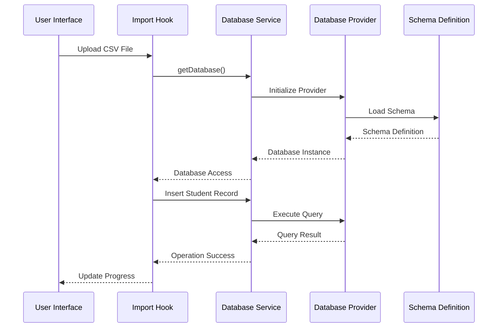
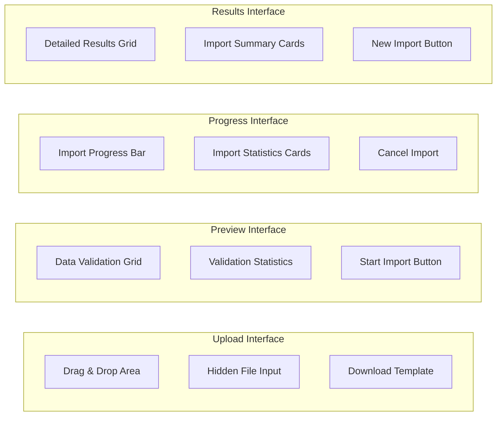
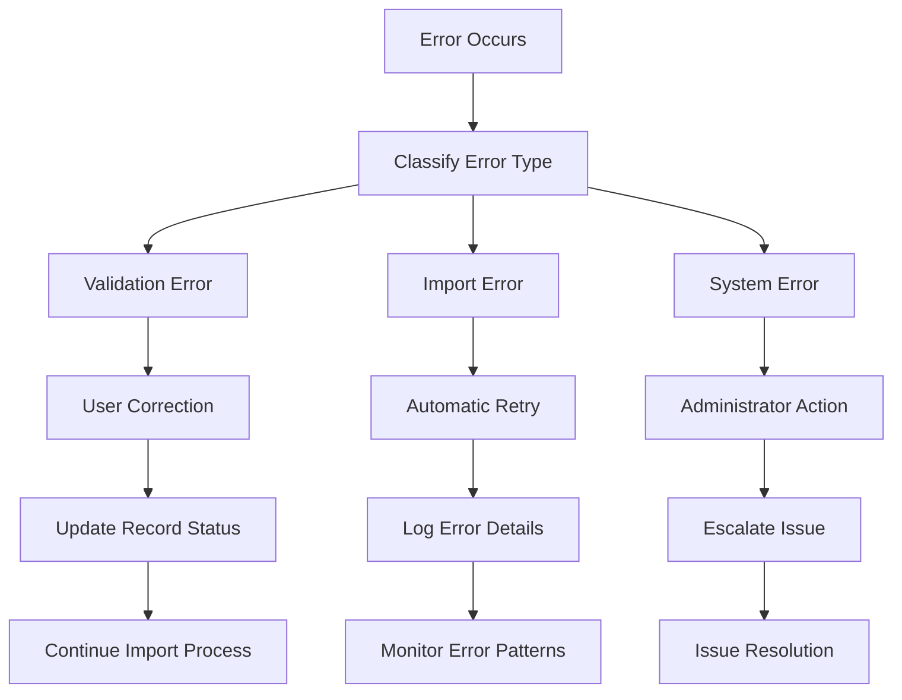

# Student Data Import

<cite>
**Referenced Files in This Document**
- [StudentDataImportPage.tsx](file://src/modules/administration/pages/StudentDataImportPage.tsx)
- [useStudentImportData.ts](file://src/modules/administration/data/useStudentImportData.ts)
- [types.ts](file://src/modules/administration/data/types.ts)
- [schema.ts](file://src/modules/administration/data/schema.ts)
- [databaseService.ts](file://src/services/databaseService.ts)
- [students.ts](file://src/api/students.ts)
- [schema.ts](file://src/livestore/schema.ts)
</cite>

## Table of Contents
1. [Introduction](#introduction)
2. [System Architecture](#system-architecture)
3. [Core Components](#core-components)
4. [Import Workflow](#import-workflow)
5. [Data Validation](#data-validation)
6. [Database Integration](#database-integration)
7. [User Interface](#user-interface)
8. [Error Handling](#error-handling)
9. [Performance Considerations](#performance-considerations)
10. [Troubleshooting Guide](#troubleshooting-guide)
11. [Conclusion](#conclusion)

## Introduction

The Student Data Import functionality is a comprehensive system designed to efficiently import student records from CSV files into the SchoolPilot3 educational management platform. This system provides a robust, user-friendly interface for administrators to bulk-upload student data while maintaining data integrity through comprehensive validation and error tracking mechanisms.

The import system supports structured CSV data containing student information including admission numbers, personal details, guardian information, and academic classifications. It features real-time validation, progress tracking, and detailed error reporting to ensure data quality and operational transparency.

## System Architecture

The Student Data Import system follows a modular architecture with clear separation of concerns across multiple layers:

**Diagram sources**
- [StudentDataImportPage.tsx:1-816](file://src/modules/administration/pages/StudentDataImportPage.tsx#L1-L816)
- [useStudentImportData.ts:1-142](file://src/modules/administration/data/useStudentImportData.ts#L1-L142)
- [databaseService.ts:1-358](file://src/services/databaseService.ts#L1-L358)

## Core Components

### Student Import Hook (`useStudentImportData`)

The `useStudentImportData` hook serves as the central orchestrator for all import operations, providing comprehensive CRUD functionality for import sessions and records.

**Key Features:**
- **Session Management**: Creates, updates, and deletes import sessions with comprehensive metadata tracking
- **Record Operations**: Handles individual student record processing with validation and status tracking
- **Student Creation**: Manages the actual insertion of student records into the database
- **Real-time Updates**: Provides reactive state management for import progress and results

**Section sources**
- [useStudentImportData.ts:9-141](file://src/modules/administration/data/useStudentImportData.ts#L9-L141)

### Import Data Types

The system defines comprehensive TypeScript interfaces for type safety and data validation:

**Diagram sources**
- [types.ts:538-598](file://src/modules/administration/data/types.ts#L538-L598)

**Section sources**
- [types.ts:538-598](file://src/modules/administration/data/types.ts#L538-L598)

### Database Schema Integration

The system integrates with both RxDB and LiveStore database providers through a unified schema definition:

**Section sources**
- [schema.ts:485-545](file://src/modules/administration/data/schema.ts#L485-L545)
- [schema.ts:127-150](file://src/livestore/schema.ts#L127-L150)

## Import Workflow

The import process follows a structured four-step workflow with comprehensive validation and error handling:

**Diagram sources**
- [StudentDataImportPage.tsx:225-344](file://src/modules/administration/pages/StudentDataImportPage.tsx#L225-L344)

### Step-by-Step Process

1. **File Upload and Parsing**: CSV files are parsed and converted into structured data objects
2. **Validation Engine**: Each row undergoes comprehensive validation for required fields, formats, and business rules
3. **Session Creation**: Validated records are organized into import sessions with metadata tracking
4. **Batch Processing**: Valid records are processed sequentially with real-time progress monitoring
5. **Database Integration**: Successful imports are persisted to the student database with proper relationships

**Section sources**
- [StudentDataImportPage.tsx:63-194](file://src/modules/administration/pages/StudentDataImportPage.tsx#L63-L194)
- [StudentDataImportPage.tsx:225-344](file://src/modules/administration/pages/StudentDataImportPage.tsx#L225-L344)

## Data Validation

The validation system implements a multi-tiered approach to ensure data integrity:

### Field-Level Validation

| Field | Required | Format | Business Rules |
|-------|----------|--------|----------------|
| Admission Number | Yes | Unique identifier | Must be unique across system |
| First Name | Yes | Text (200 chars max) | Required field validation |
| Last Name | Yes | Text (200 chars max) | Required field validation |
| Date of Birth | Yes | YYYY-MM-DD | Must be valid date, not in future |
| Gender | Yes | Enum: Male/Female/Other | Required selection |
| Grade Level | Yes | Text (50 chars max) | Must match existing grade levels |
| Guardian Name | Yes | Text (200 chars max) | Required for emergency contact |
| Guardian Phone | Yes | Phone format | Valid phone number format |

### Advanced Validation Rules

**Diagram sources**
- [StudentDataImportPage.tsx:95-161](file://src/modules/administration/pages/StudentDataImportPage.tsx#L95-L161)

**Section sources**
- [StudentDataImportPage.tsx:95-161](file://src/modules/administration/pages/StudentDataImportPage.tsx#L95-L161)

## Database Integration

The system seamlessly integrates with multiple database providers through a unified service layer:

### Database Service Architecture

**Diagram sources**
- [databaseService.ts:97-141](file://src/services/databaseService.ts#L97-L141)
- [useStudentImportData.ts:69-80](file://src/modules/administration/data/useStudentImportData.ts#L69-L80)

### Schema Compatibility

The system maintains compatibility across different database providers through standardized schema definitions:

**Section sources**
- [databaseService.ts:1-358](file://src/services/databaseService.ts#L1-L358)
- [schema.ts:485-545](file://src/modules/administration/data/schema.ts#L485-L545)

## User Interface

The user interface provides an intuitive, step-by-step import experience with comprehensive feedback mechanisms:

### Multi-Step Wizard Interface

| Step | Component | Purpose | Features |
|------|-----------|---------|----------|
| Upload | Drag & Drop Zone | File upload interface | Visual feedback, supported formats |
| Preview | Data Grid | Validation results | Real-time statistics, error highlighting |
| Importing | Progress Monitor | Import process tracking | Progress bars, statistics |
| Results | Detailed Report | Import outcomes | Status badges, error details |

### Interactive Elements

**Diagram sources**
- [StudentDataImportPage.tsx:612-816](file://src/modules/administration/pages/StudentDataImportPage.tsx#L612-L816)

**Section sources**
- [StudentDataImportPage.tsx:612-816](file://src/modules/administration/pages/StudentDataImportPage.tsx#L612-L816)

## Error Handling

The system implements comprehensive error handling at multiple levels:

### Error Categories

| Error Type | Description | Recovery Method |
|------------|-------------|-----------------|
| Validation Errors | Data format issues | User correction |
| Import Failures | Database insertion problems | Retry with corrections |
| System Errors | Platform issues | Administrator intervention |
| Network Errors | Connectivity problems | Connection retry |

### Error Reporting Mechanisms

**Diagram sources**
- [StudentDataImportPage.tsx:340-344](file://src/modules/administration/pages/StudentDataImportPage.tsx#L340-L344)

**Section sources**
- [StudentDataImportPage.tsx:340-344](file://src/modules/administration/pages/StudentDataImportPage.tsx#L340-L344)

## Performance Considerations

The system is optimized for handling large datasets efficiently:

### Batch Processing Strategy

- **Sequential Processing**: Records are processed one at a time to prevent memory overload
- **Progress Tracking**: Real-time progress updates prevent user uncertainty
- **Error Isolation**: Individual record failures don't affect the entire batch
- **Memory Management**: Proper cleanup of temporary data structures

### Scalability Features

- **Database Indexing**: Strategic indexing for fast lookups and queries
- **Transaction Support**: Atomic operations for data consistency
- **Connection Pooling**: Efficient database connection management
- **Caching Strategies**: Intelligent caching for frequently accessed data

## Troubleshooting Guide

### Common Issues and Solutions

| Issue | Symptoms | Solution |
|-------|----------|----------|
| CSV Parsing Errors | Import fails immediately | Check CSV format, remove extra spaces |
| Validation Failures | Many records marked invalid | Review template requirements |
| Import Stalls | Progress stops at specific record | Check database connectivity |
| Duplicate Admission Numbers | Import fails with duplicates | Remove duplicates from CSV |

### Diagnostic Commands

**Section sources**
- [StudentDataImportPage.tsx:164-194](file://src/modules/administration/pages/StudentDataImportPage.tsx#L164-L194)

## Conclusion

The Student Data Import system represents a comprehensive solution for bulk student data management in educational institutions. Its modular architecture, robust validation engine, and user-friendly interface make it an essential tool for administrative efficiency.

Key strengths include:
- **Data Integrity**: Multi-layered validation prevents data corruption
- **User Experience**: Intuitive interface with real-time feedback
- **Scalability**: Designed to handle large datasets efficiently
- **Maintainability**: Clean architecture supports future enhancements
- **Error Resilience**: Comprehensive error handling and recovery mechanisms

The system successfully bridges the gap between manual data entry and automated processing, providing administrators with a reliable tool for managing student enrollment data at scale.