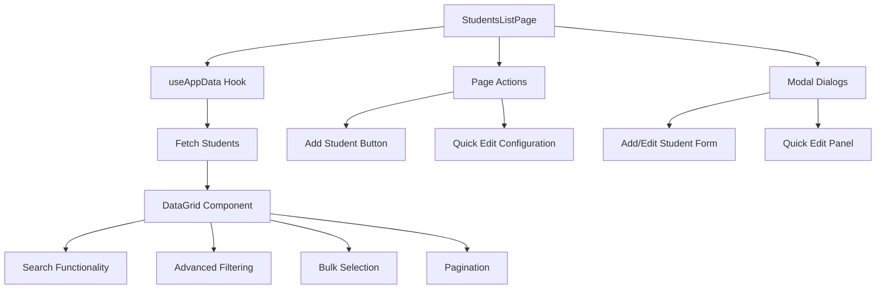
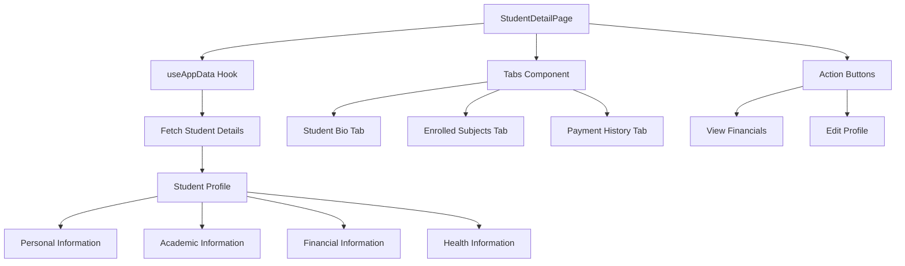
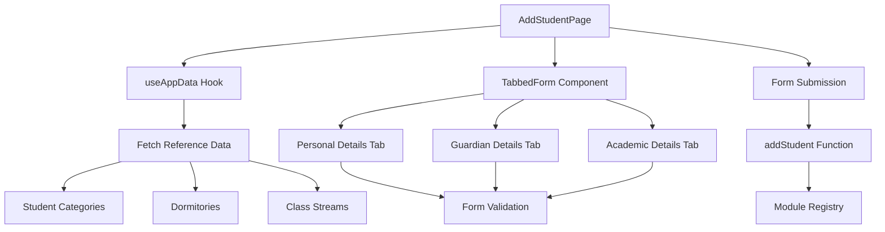
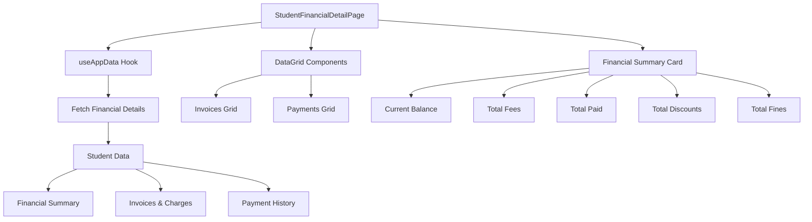
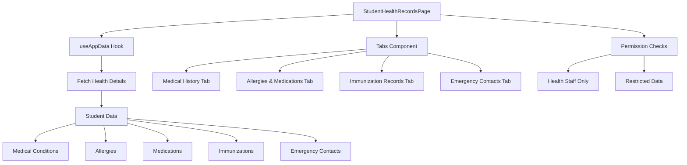
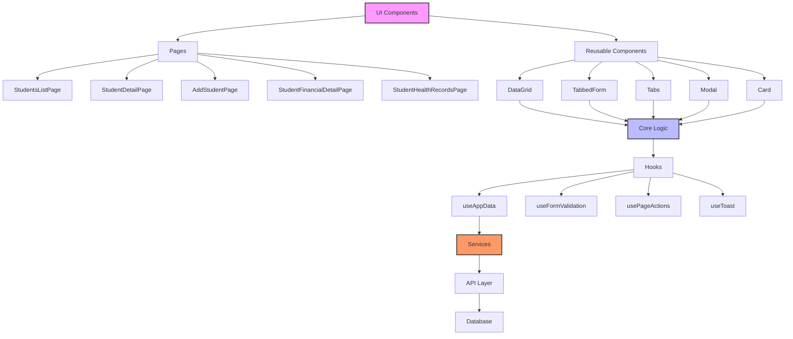

# Student Management Pages

<cite>
**Referenced Files in This Document**   
- [StudentsListPage.tsx](file://src/modules/administration/pages/StudentsListPage.tsx)
- [StudentDetailPage.tsx](file://src/modules/administration/pages/StudentDetailPage.tsx)
- [AddStudentPage.tsx](file://src/modules/administration/pages/AddStudentPage.tsx)
- [StudentFinancialDetailPage.tsx](file://src/modules/administration/pages/StudentFinancialDetailPage.tsx)
- [StudentHealthRecordsPage.tsx](file://src/modules/administration/pages/StudentHealthRecordsPage.tsx)
- [useAppData.ts](file://src/hooks/useAppData.ts)
- [DataGrid.tsx](file://src/components/ui/data/DataGrid.tsx)
- [TabbedForm.tsx](file://src/components/ui/forms/TabbedForm.tsx)
- [useFormValidation.tsx](file://src/hooks/useFormValidation.tsx)
</cite>

## Table of Contents
1. [Introduction](#introduction)
2. [Students List Page](#students-list-page)
3. [Student Detail Page](#student-detail-page)
4. [Add Student Page](#add-student-page)
5. [Student Financial Detail Page](#student-financial-detail-page)
6. [Student Health Records Page](#student-health-records-page)
7. [Core Components and Hooks](#core-components-and-hooks)
8. [Architecture Overview](#architecture-overview)
9. [Conclusion](#conclusion)

## Introduction
The student management system in schoolpilot3 provides a comprehensive suite of pages for managing student records throughout their academic lifecycle. This documentation details the implementation of key student management pages, including list views, detailed profiles, creation forms, and specialized data sections for financial and health information. The system leverages a modular architecture with reusable components and hooks to ensure consistency and maintainability across the application.

## Students List Page

The StudentsListPage serves as the primary interface for viewing and managing the complete roster of students within the institution. It implements a robust data grid component with advanced filtering, search functionality, bulk selection, and pagination capabilities.

**Diagram sources**
- [StudentsListPage.tsx](file://src/modules/administration/pages/StudentsListPage.tsx)
- [useAppData.ts](file://src/hooks/useAppData.ts)
- [DataGrid.tsx](file://src/components/ui/data/DataGrid.tsx)

**Section sources**
- [StudentsListPage.tsx](file://src/modules/administration/pages/StudentsListPage.tsx#L1-L940)

The page utilizes the DataGrid component to display student records with sortable and filterable columns. Users can search across multiple fields including admission number, name, class, and status. The implementation includes:

- **Advanced Filtering**: Dropdown filters for class stream, student category, dormitory, gender, and status
- **Search Functionality**: Real-time search across key student attributes
- **Bulk Selection**: Checkbox-based selection for batch operations
- **Pagination**: Server-side pagination with configurable page sizes
- **Action Buttons**: Floating action button for adding new students and configuring quick edit fields

The page also implements modal dialogs for adding and editing student records, with a tabbed form interface that separates personal, guardian, and academic information.

## Student Detail Page

The StudentDetailPage provides a comprehensive view of an individual student's record with tabbed navigation for accessing different categories of information. This page serves as the central hub for viewing a student's complete profile.

**Diagram sources**
- [StudentDetailPage.tsx](file://src/modules/administration/pages/StudentDetailPage.tsx)
- [useAppData.ts](file://src/hooks/useAppData.ts)
- [Tabs.tsx](file://src/components/ui/Tabs.tsx)

**Section sources**
- [StudentDetailPage.tsx](file://src/modules/administration/pages/StudentDetailPage.tsx#L1-L250)

The page features a responsive layout with a profile card on the left side displaying the student's photo, basic information, and contact details. The right side contains tabs for different information categories:

- **Student Bio**: Personal details including admission number, full name, date of birth, gender, class, primary guardian information, address, religion, and remarks
- **Enrolled Subjects**: Data grid displaying all subjects the student is currently enrolled in, with course name, instructor, and status
- **Payment History**: Data grid showing all recorded payments with transaction ID, date, amount, payment method, and reference notes

The page also includes action buttons for viewing financial details and editing the student profile, providing quick access to related functionality.

## Add Student Page

The AddStudentPage implements a multi-tabbed form for creating new student records with comprehensive validation and integration with the module registry system.

**Diagram sources**
- [AddStudentPage.tsx](file://src/modules/administration/pages/AddStudentPage.tsx)
- [useAppData.ts](file://src/hooks/useAppData.ts)
- [TabbedForm.tsx](file://src/components/ui/forms/TabbedForm.tsx)

**Section sources**
- [AddStudentPage.tsx](file://src/modules/administration/pages/AddStudentPage.tsx#L1-L506)

The page uses a tabbed form interface to organize the student creation process into logical sections:

- **Personal Details**: Admission number, UPI number, first, middle, and last names, gender, date of birth, admission date, status, religion, county, primary school attended, and remarks
- **Guardian Details**: Guardian full name, relationship type (Father, Mother, Guardian), and phone number
- **Academic Details**: Current class stream, student category, dormitory, and exam result summary (exam name, English, Kiswahili, Mathematics, Science, SSRE, and total marks)

The form implements client-side validation to ensure required fields are completed before submission. It integrates with the module registry through the useAppData hook, which provides access to the addStudent function for persisting new records to the database.

## Student Financial Detail Page

The StudentFinancialDetailPage extends the core student record with specialized financial data sections, providing a comprehensive overview of a student's financial status and transaction history.

**Diagram sources**
- [StudentFinancialDetailPage.tsx](file://src/modules/administration/pages/StudentFinancialDetailPage.tsx)
- [useAppData.ts](file://src/hooks/useAppData.ts)
- [DataGrid.tsx](file://src/components/ui/data/DataGrid.tsx)

**Section sources**
- [StudentFinancialDetailPage.tsx](file://src/modules/administration/pages/StudentFinancialDetailPage.tsx#L1-L277)

The page displays a comprehensive financial overview with:

- **Student Information Card**: Photo, full name, admission number, and class information
- **Financial Summary**: Current balance (with color-coded status), total fees billed, total paid, total discounts, and total fines
- **Invoices & Charges Tab**: Data grid listing all invoices with ID, description, due date, amount, status (Paid, Due, Overdue, Partially Paid, Voided), and action buttons
- **Payment History Tab**: Data grid showing all received payments with transaction ID, payment date, amount, payment method, description, and receipt generation options

The implementation uses modular data hooks to fetch financial-specific data and applies permission-based visibility controls to ensure users only see financial information they are authorized to access.

## Student Health Records Page

The StudentHealthRecordsPage extends the core student record with specialized health data sections, providing medical professionals and administrators with critical health information.

**Diagram sources**
- [StudentHealthRecordsPage.tsx](file://src/modules/administration/pages/StudentHealthRecordsPage.tsx)
- [useAppData.ts](file://src/hooks/useAppData.ts)
- [Tabs.tsx](file://src/components/ui/Tabs.tsx)

**Section sources**
- [StudentHealthRecordsPage.tsx](file://src/modules/administration/pages/StudentHealthRecordsPage.tsx)

The page provides a tabbed interface for accessing different categories of health information:

- **Medical History**: Chronic conditions, past illnesses, hospitalizations, and surgeries
- **Allergies & Medications**: Known allergies (food, medication, environmental) and current medications with dosages and schedules
- **Immunization Records**: Vaccination history with dates and next due dates
- **Emergency Contacts**: Primary and secondary emergency contacts with relationship, phone numbers, and authorization status

The implementation uses modular data hooks to fetch health-specific data from the backend and implements strict permission-based visibility controls. Sensitive health information is only accessible to authorized personnel such as school nurses, doctors, and designated administrators.

## Core Components and Hooks

The student management pages leverage several core components and hooks that provide consistent functionality across the application.

### DataGrid Component
The DataGrid component is a reusable table component that provides advanced data presentation capabilities:

- **Sorting**: Click column headers to sort data
- **Filtering**: Built-in filter controls for each column
- **Pagination**: Configurable page sizes and navigation
- **Empty States**: Customizable messages for empty datasets
- **Sticky Columns**: Ability to pin action columns to the right edge

### useFormValidation Hook
The useFormValidation hook provides a standardized approach to form validation across the application:

- **Field Validation**: Validates individual form fields based on type and requirements
- **Form State Management**: Tracks form validity and dirty state
- **Error Messaging**: Provides user-friendly error messages for invalid fields
- **Submission Handling**: Coordinates form submission with validation checks

### useAppData Hook
The useAppData hook serves as the primary interface for accessing student data:

- **Data Fetching**: Retrieves student lists, individual profiles, and related entities
- **CRUD Operations**: Provides functions for creating, reading, updating, and deleting student records
- **Reference Data**: Access to related entities like student categories, dormitories, and class streams
- **Loading States**: Tracks loading status for all data operations

## Architecture Overview

The student management system follows a modular architecture with clear separation of concerns between components, hooks, and services.

**Diagram sources**
- [StudentsListPage.tsx](file://src/modules/administration/pages/StudentsListPage.tsx)
- [StudentDetailPage.tsx](file://src/modules/administration/pages/StudentDetailPage.tsx)
- [AddStudentPage.tsx](file://src/modules/administration/pages/AddStudentPage.tsx)
- [StudentFinancialDetailPage.tsx](file://src/modules/administration/pages/StudentFinancialDetailPage.tsx)
- [StudentHealthRecordsPage.tsx](file://src/modules/administration/pages/StudentHealthRecordsPage.tsx)
- [useAppData.ts](file://src/hooks/useAppData.ts)
- [useFormValidation.tsx](file://src/hooks/useFormValidation.tsx)

The architecture follows a layered approach with UI components at the top, business logic in the middle, and data services at the bottom. Pages compose reusable UI components and leverage hooks for state management and data access. Hooks encapsulate complex logic and provide a clean interface to the underlying services. This separation ensures that changes to one layer do not unnecessarily impact others, improving maintainability and testability.

## Conclusion
The student management pages in schoolpilot3 provide a comprehensive and user-friendly interface for managing student records. By leveraging a modular architecture with reusable components and hooks, the system ensures consistency across different pages while allowing for specialized functionality where needed. The implementation of advanced features like filtering, search, bulk operations, and tabbed navigation enhances usability and productivity for administrators. The use of permission-based visibility controls and modular data hooks ensures that sensitive information is protected while providing authorized users with the data they need to perform their roles effectively.