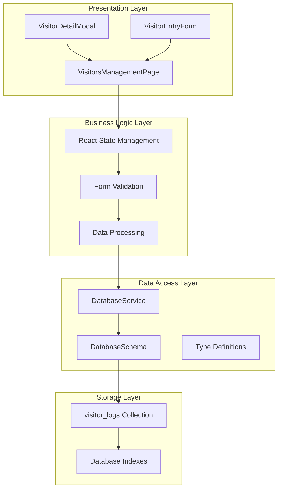
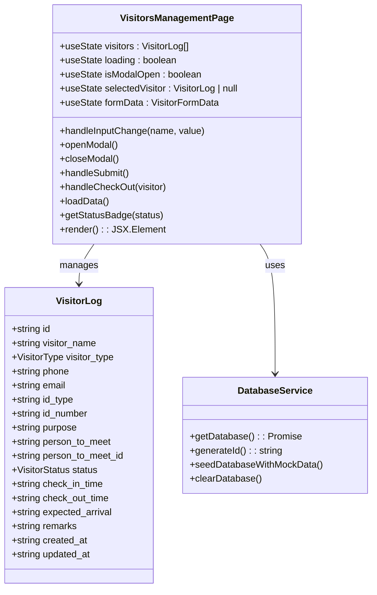
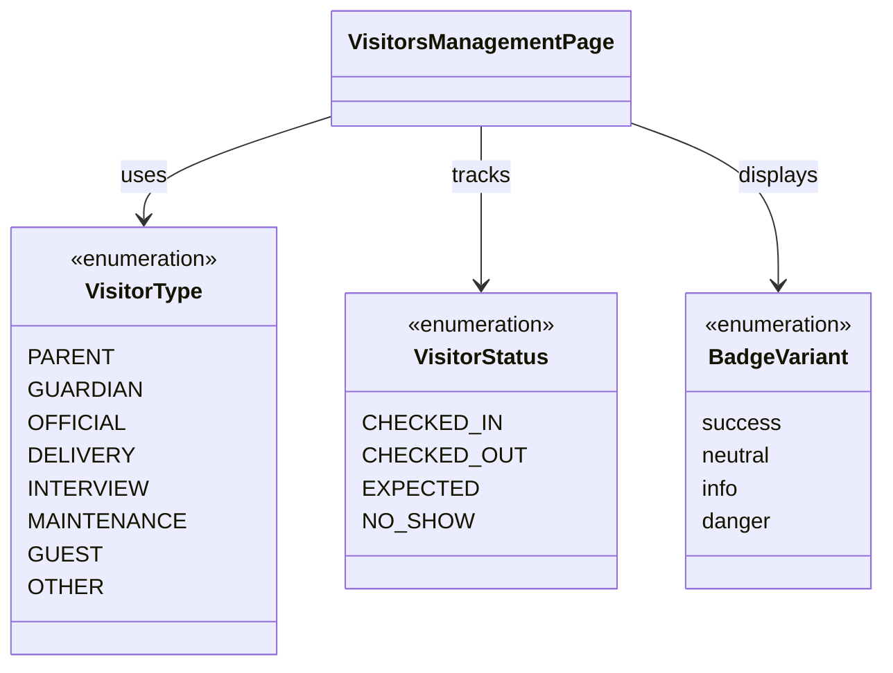
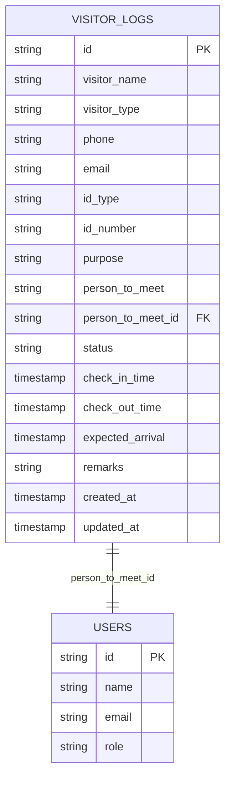
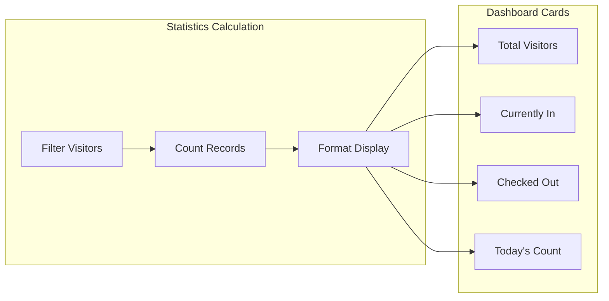
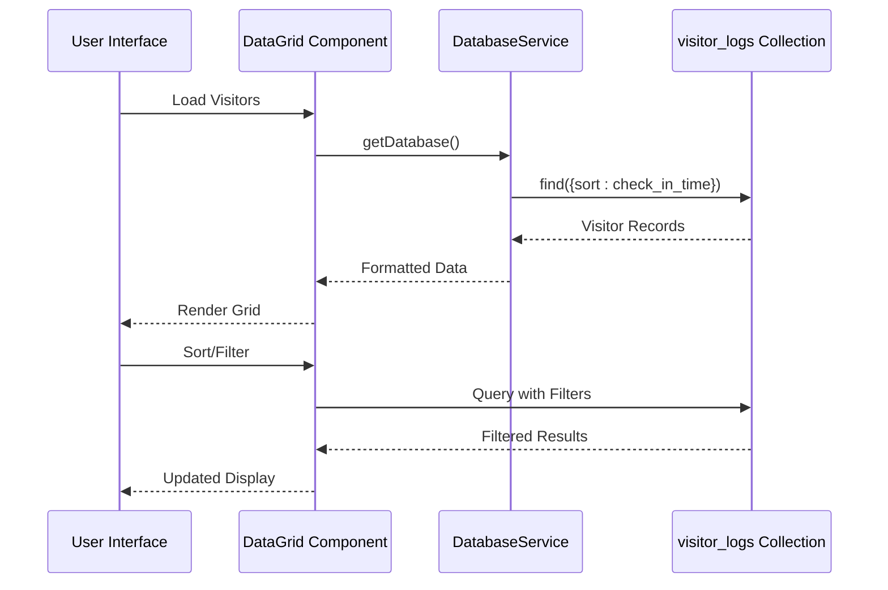
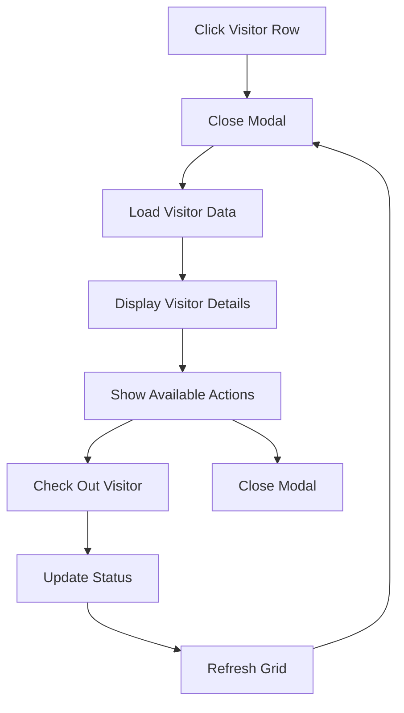
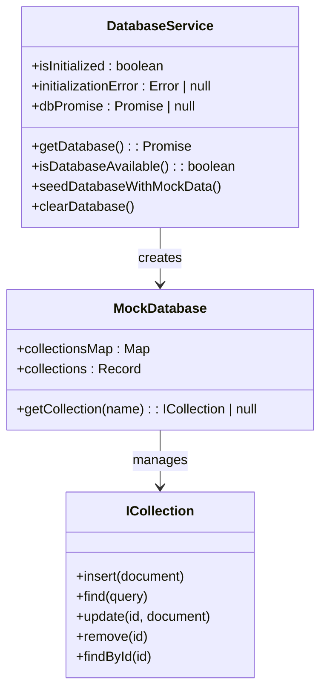
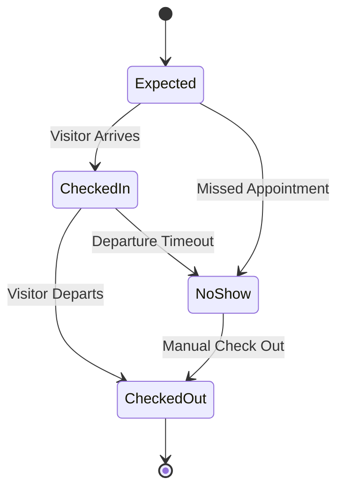
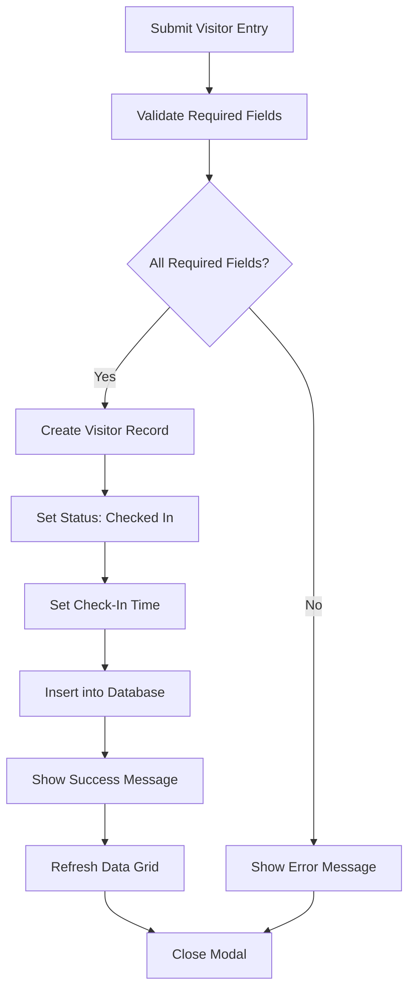

# Visitors Management

<cite>
**Referenced Files in This Document**
- [VisitorsManagementPage.tsx](file://src/modules/administration/pages/VisitorsManagementPage.tsx)
- [schema.ts](file://src/modules/administration/data/schema.ts)
- [types.ts](file://src/modules/administration/data/types.ts)
- [databaseService.ts](file://src/services/databaseService.ts)
- [moduleDefinition.tsx](file://src/modules/administration/moduleDefinition.tsx)
- [Akademiko_Admissions_Migration_Specification.md](file://docs/migration/admissions-migration/Akademiko_Admissions_Migration_Specification.md)
</cite>

## Table of Contents
1. [Introduction](#introduction)
2. [System Architecture](#system-architecture)
3. [Core Components](#core-components)
4. [Data Model](#data-model)
5. [User Interface Components](#user-interface-components)
6. [Database Integration](#database-integration)
7. [Business Logic](#business-logic)
8. [Internationalization](#internationalization)
9. [Navigation Integration](#navigation-integration)
10. [Migration Reference](#migration-reference)
11. [Conclusion](#conclusion)

## Introduction

The Visitors Management system is a comprehensive solution designed to track and manage visitor activity within educational institutions. This system provides real-time monitoring of visitor entries and exits, maintains detailed visitor logs, and offers administrative controls for visitor management. The implementation follows modern React patterns with TypeScript for type safety and integrates seamlessly with the broader SchoolPilot3 ecosystem.

The system supports multiple visitor types including parents, guardians, official visitors, delivery personnel, interviewees, maintenance staff, guests, and others. It provides real-time status tracking with four distinct states: Checked In, Checked Out, Expected, and No Show, enabling administrators to maintain accurate visitor records and enhance campus security.

## System Architecture

The Visitors Management system follows a modular architecture pattern within the Administration module of the SchoolPilot3 platform. The system is built using React with TypeScript, implementing a clean separation of concerns between presentation, business logic, and data persistence layers.



**Diagram sources**
- [VisitorsManagementPage.tsx:16-367](file://src/modules/administration/pages/VisitorsManagementPage.tsx#L16-L367)
- [databaseService.ts:98-141](file://src/services/databaseService.ts#L98-L141)
- [schema.ts:707-733](file://src/modules/administration/data/schema.ts#L707-L733)

## Core Components

### Visitors Management Page

The main component serves as the central hub for visitor management operations. It provides a comprehensive interface for viewing visitor statistics, managing visitor entries, and tracking visitor activities in real-time.



**Diagram sources**
- [VisitorsManagementPage.tsx:16-367](file://src/modules/administration/pages/VisitorsManagementPage.tsx#L16-L367)
- [types.ts:827-845](file://src/modules/administration/data/types.ts#L827-L845)
- [databaseService.ts:144-149](file://src/services/databaseService.ts#L144-L149)

**Section sources**
- [VisitorsManagementPage.tsx:16-367](file://src/modules/administration/pages/VisitorsManagementPage.tsx#L16-L367)

### Visitor Types and Status Management

The system defines comprehensive visitor categorization and status tracking mechanisms to support various institutional needs and security protocols.



**Diagram sources**
- [types.ts:809-825](file://src/modules/administration/data/types.ts#L809-L825)
- [VisitorsManagementPage.tsx:116-124](file://src/modules/administration/pages/VisitorsManagementPage.tsx#L116-L124)

**Section sources**
- [types.ts:809-825](file://src/modules/administration/data/types.ts#L809-L825)

## Data Model

The Visitors Management system utilizes a robust database schema designed for efficient visitor tracking and reporting capabilities.

### Database Schema Definition

The `visitor_logs` collection serves as the central repository for all visitor-related information, implementing comprehensive indexing strategies for optimal query performance.



**Diagram sources**
- [schema.ts:707-733](file://src/modules/administration/data/schema.ts#L707-L733)

### Data Schema Properties

The visitor log schema implements strict validation rules and comprehensive indexing for optimal performance:

- **Primary Key**: UUID-based unique identifier for each visitor record
- **Visitor Information**: Comprehensive personal details with length constraints
- **Contact Information**: Phone and email validation with appropriate limits
- **Identification Details**: Support for various identification types and numbers
- **Purpose Tracking**: Detailed visit purpose documentation
- **Person-to-Meet Reference**: Foreign key relationship to user database
- **Status Management**: Real-time status tracking with four distinct states
- **Timestamp Management**: Creation and modification timestamps for audit trails

**Section sources**
- [schema.ts:707-733](file://src/modules/administration/data/schema.ts#L707-L733)

## User Interface Components

### Dashboard Statistics

The system provides comprehensive visitor analytics through an intuitive dashboard displaying key metrics and real-time visitor counts.



**Diagram sources**
- [VisitorsManagementPage.tsx:170-175](file://src/modules/administration/pages/VisitorsManagementPage.tsx#L170-L175)

### Data Grid Interface

The visitor management interface utilizes a sophisticated data grid component providing sorting, filtering, and pagination capabilities for efficient visitor record management.



**Diagram sources**
- [VisitorsManagementPage.tsx:97-114](file://src/modules/administration/pages/VisitorsManagementPage.tsx#L97-L114)
- [databaseService.ts:144-149](file://src/services/databaseService.ts#L144-L149)

**Section sources**
- [VisitorsManagementPage.tsx:170-220](file://src/modules/administration/pages/VisitorsManagementPage.tsx#L170-L220)

### Modal Detail View

The system provides comprehensive visitor detail modal functionality allowing administrators to view complete visitor information and manage visitor status updates.



**Diagram sources**
- [VisitorsManagementPage.tsx:222-290](file://src/modules/administration/pages/VisitorsManagementPage.tsx#L222-L290)

**Section sources**
- [VisitorsManagementPage.tsx:222-290](file://src/modules/administration/pages/VisitorsManagementPage.tsx#L222-L290)

## Database Integration

### Service Architecture

The Visitors Management system leverages a sophisticated database service layer that abstracts database provider specifics while maintaining consistent functionality across different environments.



**Diagram sources**
- [databaseService.ts:44-95](file://src/services/databaseService.ts#L44-L95)
- [databaseService.ts:144-149](file://src/services/databaseService.ts#L144-L149)

### Collection Management

The system manages the `visitor_logs` collection through a standardized interface that supports CRUD operations, query optimization, and transaction management.

**Section sources**
- [databaseService.ts:98-141](file://src/services/databaseService.ts#L98-L141)

## Business Logic

### Visitor Lifecycle Management

The system implements comprehensive visitor lifecycle management covering entry registration, status tracking, and exit procedures.



### Form Validation and Processing

The visitor entry form implements comprehensive validation ensuring data integrity and completeness before processing.



**Diagram sources**
- [VisitorsManagementPage.tsx:57-80](file://src/modules/administration/pages/VisitorsManagementPage.tsx#L57-L80)

**Section sources**
- [VisitorsManagementPage.tsx:57-95](file://src/modules/administration/pages/VisitorsManagementPage.tsx#L57-L95)

## Internationalization

The system supports internationalization through the React i18n framework, enabling localized user interfaces for multiple languages and regions.

### Translation Keys

The Visitors Management system utilizes specific translation keys for user interface localization:

- `visitors.title`: Main page title
- `visitors.description`: Page description
- `visitors.checkIn`: Check-in button text

These keys are integrated into the component rendering through the `useTranslation` hook, ensuring consistent localization across the application.

**Section sources**
- [VisitorsManagementPage.tsx:17-17](file://src/modules/administration/pages/VisitorsManagementPage.tsx#L17-L17)

## Navigation Integration

### Module Registration

The Visitors Management system is seamlessly integrated into the Administration module navigation structure, providing easy access through the main application menu.

```mermaid
graph LR
subgraph "Administration Module"
Nav[Navigation Menu]
Visitors[Visitors Management]
Other[Other Modules]
end
subgraph "URL Routing"
Route[/administration/visitors]
Component[VisitorsManagementPage]
end
Nav --> Visitors
Visitors --> Route
Route --> Component
```

**Diagram sources**
- [moduleDefinition.tsx:49](file://src/modules/administration/moduleDefinition.tsx#L49)

**Section sources**
- [moduleDefinition.tsx:42-51](file://src/modules/administration/moduleDefinition.tsx#L42-L51)

## Migration Reference

### Historical Context

The Visitors Management system represents a modern implementation of functionality previously handled in legacy systems, particularly the Akademiko admissions system's visitor management capabilities.

### Legacy System Features

The migration specification outlines comprehensive visitor management functionality including:

- **Visitor Recording**: Traditional visitor information capture and storage
- **Entry/Exit Tracking**: Systematic logging of visitor arrival and departure times
- **Reporting Capabilities**: Generation of visitor traffic reports and analytics
- **Database Integration**: Proper relational database design with visitor and visitor logs tables

### Implementation Alignment

The current implementation aligns with legacy functionality while incorporating modern web development practices, database normalization, and enhanced user experience features.

**Section sources**
- [Akademiko_Admissions_Migration_Specification.md:229-245](file://docs/migration/admissions-migration/Akademiko_Admissions_Migration_Specification.md#L229-L245)

## Conclusion

The Visitors Management system represents a comprehensive solution for educational institution visitor tracking and management. Through its modular architecture, robust data model, and intuitive user interface, the system provides administrators with powerful tools for monitoring visitor activity, enhancing campus security, and maintaining accurate visitor records.

The implementation demonstrates best practices in modern web development, including TypeScript type safety, React component patterns, database abstraction layers, and comprehensive internationalization support. The system's extensible design allows for future enhancements while maintaining backward compatibility and performance optimization.

Key strengths of the implementation include real-time visitor tracking, comprehensive status management, efficient database queries through strategic indexing, and seamless integration with the broader SchoolPilot3 ecosystem. The system provides a solid foundation for visitor management while supporting scalability and maintainability requirements for educational institutions of various sizes.