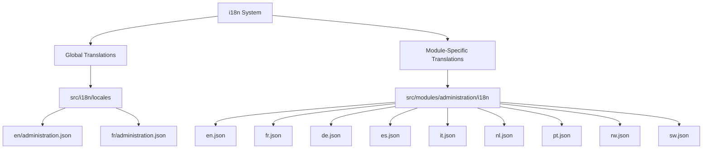
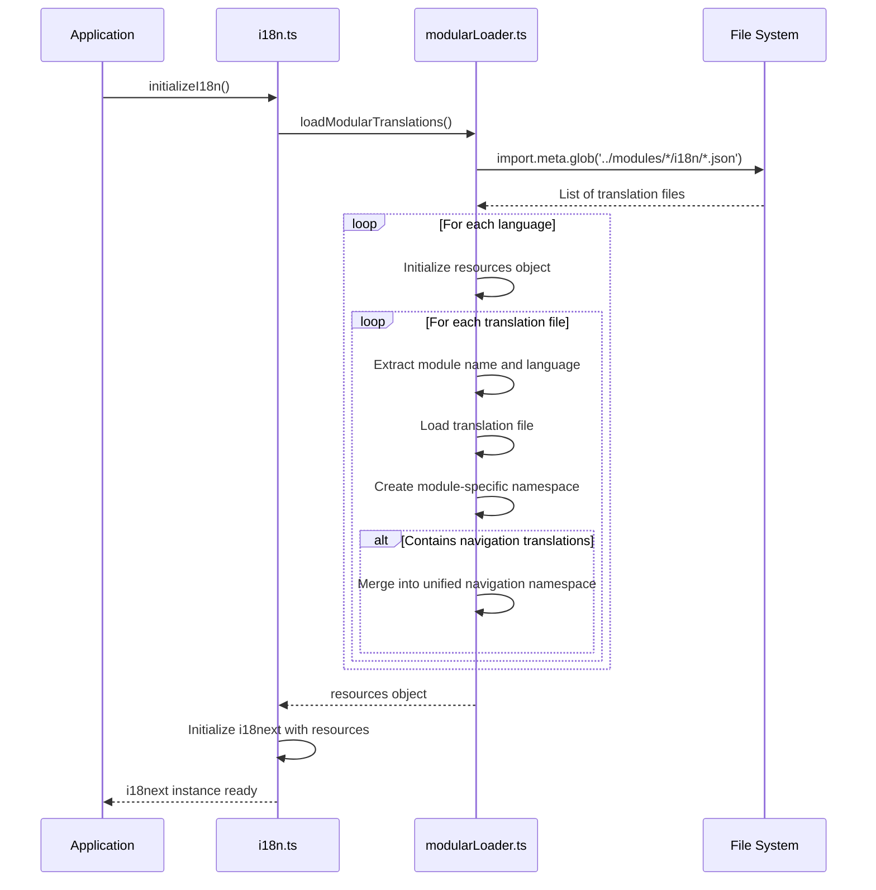

# Internationalization Support

<cite>
**Referenced Files in This Document**   
- [modularLoader.ts](file://src/i18n/modularLoader.ts)
- [i18n.ts](file://src/i18n/i18n.ts)
- [loader.ts](file://src/i18n/loader.ts)
- [administration.json](file://src/i18n/locales/en/administration.json)
- [administration.json](file://src/i18n/locales/fr/administration.json)
- [en.json](file://src/modules/administration/i18n/en.json)
- [fr.json](file://src/modules/administration/i18n/fr.json)
- [moduleDefinition.tsx](file://src/modules/administration/moduleDefinition.tsx)
- [LanguageSwitcher.tsx](file://src/components/ui/LanguageSwitcher.tsx)
</cite>

## Table of Contents
1. [Introduction](#introduction)
2. [Translation Structure and Organization](#translation-structure-and-organization)
3. [Module-Specific Translation Integration](#module-specific-translation-integration)
4. [Translation Usage in Administration Module](#translation-usage-in-administration-module)
5. [Best Practices for Translation Management](#best-practices-for-translation-management)
6. [Build-Time Validation and Quality Assurance](#build-time-validation-and-quality-assurance)
7. [Common Issues and Troubleshooting](#common-issues-and-troubleshooting)
8. [Conclusion](#conclusion)

## Introduction

The internationalization (i18n) system in schoolpilot3 is designed to support multiple languages across all modules, with a particular focus on the Administration module. The system leverages i18next as the core translation engine, integrated with React through react-i18next. It supports eight languages: English (en), French (fr), German (de), Spanish (es), Italian (it), Dutch (nl), Portuguese (pt), Kinyarwanda (rw), and Kiswahili (sw). The implementation follows a modular architecture where each module can define its own translation files, which are then dynamically loaded and merged into the global i18next instance during application initialization.

**Section sources**
- [i18n.ts](file://src/i18n/i18n.ts#L1-L117)
- [modularLoader.ts](file://src/i18n/modularLoader.ts#L1-L67)

## Translation Structure and Organization

The i18n system in schoolpilot3 employs a dual-layer translation structure consisting of both global and module-specific translation files. Global translations are stored in the `src/i18n/locales` directory, organized by language code (e.g., `en`, `fr`). Each language directory contains JSON files for different namespaces such as `administration.json`, `academics.json`, and `navigation.json`. These files contain high-level translations that are shared across multiple modules.

Module-specific translations are stored within each module's `i18n` directory, following the pattern `src/modules/{module-name}/i18n/{language-code}.json`. For the Administration module, this includes translation files for all supported languages. This modular approach allows each module to maintain its own translation keys without conflicting with other modules.

The translation files are organized hierarchically by functional areas within the module. For example, in the Administration module's English translation file (`en.json`), translations are grouped under keys such as `navigation`, `dashboard`, `students`, `staff`, `partners`, and `validation`. This hierarchical organization improves maintainability and makes it easier to locate specific translation keys.

**Diagram sources**
- [administration.json](file://src/i18n/locales/en/administration.json)
- [en.json](file://src/modules/administration/i18n/en.json)

**Section sources**
- [administration.json](file://src/i18n/locales/en/administration.json#L1-L15)
- [en.json](file://src/modules/administration/i18n/en.json#L1-L494)

## Module-Specific Translation Integration

The integration of module-specific translations into the global i18next instance is handled by the `modularLoader.ts` file, which exports the `loadModularTranslations` function. This function uses Vite's `import.meta.glob` to dynamically import translation files from each module's `i18n` directory. The loader processes both regular module translations and core module translations, creating a comprehensive resource object that is passed to i18next during initialization.

The `loadModularTranslations` function initializes a resources object with empty translation namespaces for each supported language. It then iterates through all detected translation files, extracting the module name from the file path and creating module-specific namespaces within each language. For example, a translation file at `src/modules/administration/i18n/en.json` would be loaded into the `en.administration` namespace.

A key feature of the modular loader is its ability to merge navigation translations from multiple modules into a unified `navigation` namespace. When a module's translation file contains a `navigation` object, its contents are extracted and merged into the global `navigation` namespace for that language. This allows different modules to contribute navigation items to a shared menu system while maintaining their own translation files.

The integration process is completed during the initialization of the i18next instance in `i18n.ts`, where the `loadModularTranslations` function is called to construct the resources object before initializing i18next with the `init` method. The initialization includes configuration for language detection, fallback language (English), and various i18next options such as interpolation and react integration.

**Diagram sources**
- [modularLoader.ts](file://src/i18n/modularLoader.ts#L1-L67)
- [i18n.ts](file://src/i18n/i18n.ts#L1-L117)

**Section sources**
- [modularLoader.ts](file://src/i18n/modularLoader.ts#L1-L67)
- [i18n.ts](file://src/i18n/i18n.ts#L1-L117)

## Translation Usage in Administration Module

The Administration module utilizes translations extensively throughout its components and pages. Translation keys are referenced using the i18next `t` function, typically accessed through the `useTranslation` hook from react-i18next. The module's navigation structure, defined in `moduleDefinition.tsx`, uses translation keys prefixed with `navigation:` to reference localized text for menu items and descriptions.

For example, the navigation item for the dashboard is defined as `navigation:administration.dashboard`, which corresponds to the translation key in the module's `en.json` file under `navigation.administration.dashboard`. This pattern is consistent across all navigation items in the module, allowing for complete localization of the user interface.

The module's pages and components use translation keys organized by functional area. The `StudentsListPage` component, for instance, would use keys from the `students` namespace such as `students.title`, `students.addButton`, and `students.searchPlaceholder`. Form validation messages are stored under the `validation` namespace, with keys like `validation.classNameIsRequired` and `validation.streamNameIsRequiredAndAClassMustBeSelected`.

Dynamic content is handled using i18next's interpolation feature. For example, the classes management interface uses a translation key with a placeholder: `classes.streamsTitle: "{{className}} - Streams"`. When rendering this text, the component passes the actual class name as a variable to the `t` function, which replaces the placeholder with the provided value.

The module also demonstrates the use of nested translation structures, particularly in the `admissions` section, which contains multiple levels of nested keys for different aspects of the admissions process including applications, reviews, approvals, and associated actions and messages.

**Section sources**
- [moduleDefinition.tsx](file://src/modules/administration/moduleDefinition.tsx#L1-L112)
- [en.json](file://src/modules/administration/i18n/en.json#L1-L494)

## Best Practices for Translation Management

Effective translation management in the Administration module follows several best practices to ensure consistency, maintainability, and completeness. When adding new translation keys, developers should follow the hierarchical organization pattern, grouping related translations under appropriate parent keys such as `students`, `staff`, or `validation`. This improves discoverability and reduces the likelihood of duplicate or conflicting keys.

For dynamic content, developers should use i18next's interpolation feature rather than string concatenation. This ensures that the entire phrase is translated in context, which is particularly important for languages with different grammatical structures. For example, instead of concatenating "Class" + className + "Streams", the translation key should include a placeholder: `{{className}} - Streams`.

Pluralization is handled through i18next's built-in pluralization support, though the current implementation in the Administration module appears to use separate keys for singular and plural forms rather than the full pluralization syntax. For example, "Total Students" and "Total Staff" are separate keys rather than using a single key with pluralization rules.

To maintain consistency across languages, all translation files for a module should contain the same set of keys. The build process includes validation to ensure translation completeness, but developers should also manually verify that new keys are added to all language files. The module-specific translation files should be kept in sync with the global translation files, with the modular loader resolving any conflicts by giving precedence to module-specific translations.

When referencing translations from other namespaces, developers should use the full namespace syntax, such as `common:cancel` or `common:save`, as demonstrated in the `common` section of the administration module's translation file. This explicit namespace referencing prevents ambiguity and makes it clear which translation bundle is being used.

**Section sources**
- [en.json](file://src/modules/administration/i18n/en.json#L1-L494)
- [fr.json](file://src/modules/administration/i18n/fr.json#L1-L494)

## Build-Time Validation and Quality Assurance

The schoolpilot3 repository includes several scripts in the `scripts` directory that support translation validation and quality assurance. The `translation-completeness-check.js` script analyzes translation files to ensure that all keys present in the source language (typically English) are also present in all target languages. This helps prevent missing translations that could result in fallback text or empty strings in the user interface.

Additional scripts such as `analyze-translation-issues.js` and `analyze-translation-usage.js` provide insights into translation usage patterns and potential issues. These tools can identify unused translation keys that may be candidates for removal, as well as keys that are used but not defined in the translation files.

The test suite includes `translationIntegrity.test.ts` in the integration tests, which verifies that the i18n system initializes correctly and that translation keys can be resolved properly. This test helps catch configuration issues early in the development process.

The `LanguageSwitcher.tsx` component includes error handling and fallback mechanisms to ensure a graceful user experience even if the i18next instance is not fully initialized. It uses the `useTranslation` hook's `ready` flag to display a loading state until translations are available, preventing flash of unstyled content or untranslated text.

The modular loader includes console logging to track the progress of translation loading, which aids in debugging initialization issues. In production, these logs can be disabled through the i18next debug configuration, but they provide valuable insights during development and testing.

**Section sources**
- [scripts/translation-completeness-check.js](file://scripts/translation-completeness-check.js)
- [tests/integration/translationIntegrity.test.ts](file://tests/integration/translationIntegrity.test.ts)
- [LanguageSwitcher.tsx](file://src/components/ui/LanguageSwitcher.tsx#L1-L119)

## Common Issues and Troubleshooting

Several common issues can arise with the i18n implementation in the Administration module. Missing translation keys are the most frequent issue, typically occurring when a new feature is implemented but translation keys are not added to all language files. This results in the fallback language (English) being displayed for that key, or potentially an empty string if the `returnNull` option were not set to `false` in the i18next configuration.

Another common issue is incorrect namespace referencing. Since the system uses multiple namespaces (global and module-specific), developers may accidentally use a key from the wrong namespace or omit the namespace prefix entirely. This can result in the wrong translation being displayed or a fallback to the key itself.

Pluralization issues can occur when translations require different forms based on quantity. While i18next supports pluralization rules, the current implementation in the Administration module appears to handle plurals through separate keys rather than using the full pluralization syntax. This approach works but requires more maintenance as each plural form must be translated separately.

Initialization issues can occur if the `initializeI18n` function is called multiple times or if components attempt to use translations before the i18next instance is ready. The `LanguageSwitcher.tsx` component demonstrates proper handling of this scenario by checking the `ready` flag from the `useTranslation` hook and displaying a loading state when translations are not yet available.

Namespace conflicts can occur when multiple modules define the same key in their translation files. The modular loader resolves this by processing modules in a specific order, but developers should avoid using generic key names and instead use descriptive, module-specific keys to minimize conflicts.

**Section sources**
- [i18n.ts](file://src/i18n/i18n.ts#L1-L117)
- [modularLoader.ts](file://src/i18n/modularLoader.ts#L1-L67)
- [LanguageSwitcher.tsx](file://src/components/ui/LanguageSwitcher.tsx#L1-L119)

## Conclusion

The internationalization system in schoolpilot3 provides a robust foundation for multi-language support in the Administration module and across the entire application. By combining global and module-specific translation files with a dynamic loading mechanism, the system achieves both consistency and flexibility. The use of i18next with react-i18next provides a powerful set of features for translation management, including namespace support, interpolation, and language detection.

The modular architecture allows each module to maintain its own translation files while contributing to a unified user interface through the merging of navigation translations. This approach scales well as new modules are added to the system, and it enables teams to work on translations independently while maintaining consistency across the application.

To ensure the continued success of the i18n implementation, developers should follow the established patterns for organizing translation keys, use interpolation for dynamic content, and ensure translation completeness across all supported languages. The existing validation scripts and testing infrastructure provide valuable tools for maintaining translation quality, and should be integrated into the development workflow.

Future enhancements could include more sophisticated pluralization support, improved tooling for translation management, and expanded language coverage. However, the current implementation provides a solid foundation that effectively supports the multilingual requirements of the schoolpilot3 application.