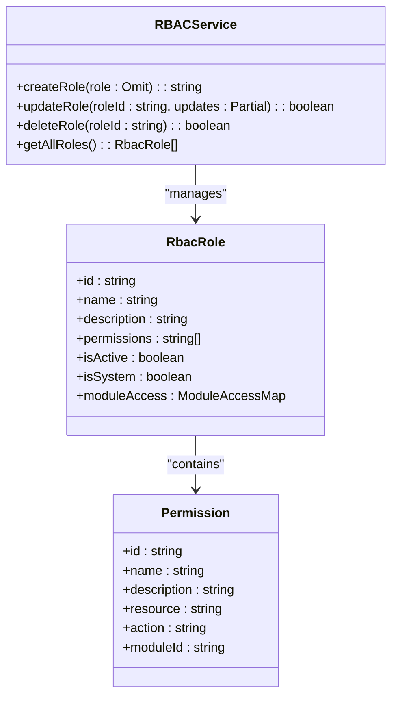
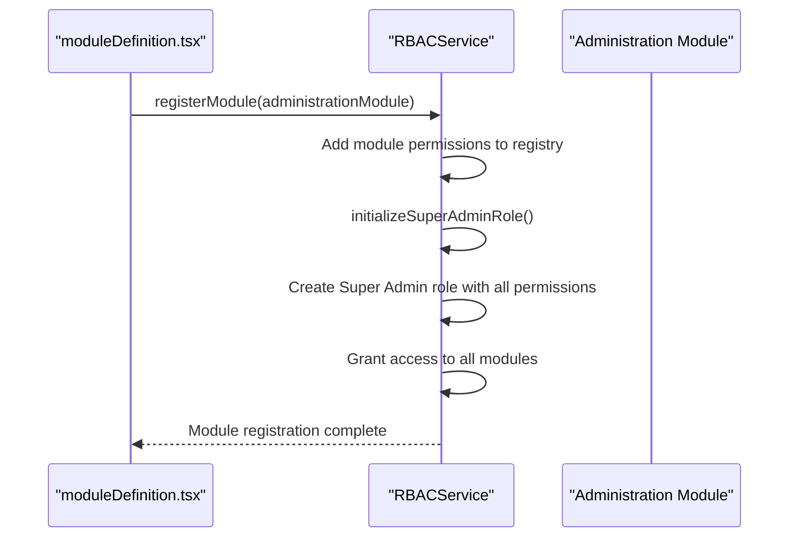
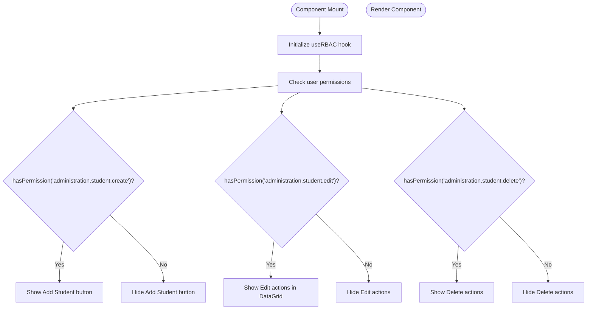
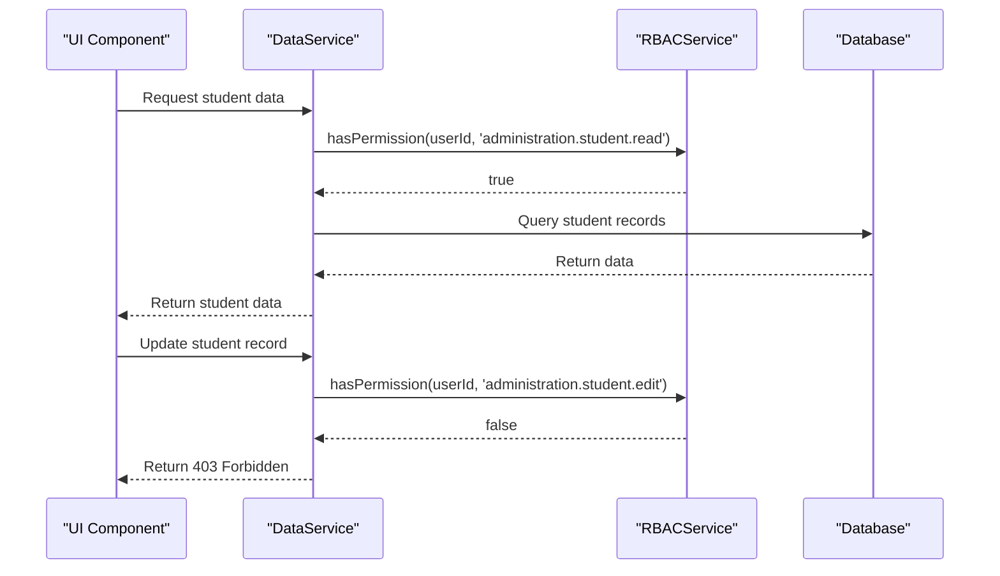

# RBAC Configuration

<cite>
**Referenced Files in This Document**   
- [rbac.ts](file://src/modules/administration/rbac.ts)
- [rbacService.ts](file://src/core/rbacService.ts)
- [useRBAC.ts](file://src/hooks/useRBAC.ts)
- [moduleDefinition.tsx](file://src/modules/administration/moduleDefinition.tsx)
- [StudentsListPage.tsx](file://src/modules/administration/pages/StudentsListPage.tsx)
</cite>

## Table of Contents
1. [Introduction](#introduction)
2. [Permission Definitions](#permission-definitions)
3. [Role Configuration](#role-configuration)
4. [Module Integration](#module-integration)
5. [UI Permission Checks](#ui-permission-checks)
6. [Server-Side Enforcement](#server-side-enforcement)
7. [Extending the Permission System](#extending-the-permission-system)
8. [Troubleshooting Access Issues](#troubleshooting-access-issues)

## Introduction
The Role-Based Access Control (RBAC) system in schoolpilot3 provides a comprehensive framework for managing user permissions across the Administration module. This documentation details the permission definitions, role configurations, and integration patterns that enable fine-grained access control throughout the application. The RBAC system is designed to support various administrative roles including SchoolAdministrator, Registrar, and HRManager, with the flexibility to create custom roles as needed.

**Section sources**
- [rbac.ts](file://src/modules/administration/rbac.ts#L1-L100)
- [rbacService.ts](file://src/core/rbacService.ts#L1-L50)

## Permission Definitions
The RBAC system in the Administration module defines granular permissions using a structured naming convention that follows the pattern: `{module}.{resource}.{action}`. These permissions are organized in the `rbac.ts` file within the administration module and registered with the global RBAC service during module initialization.

The permission definitions include various categories of actions:

**Student Management Permissions**
```typescript
{
  id: 'administration.student.create',
  name: 'Create Student',
  description: 'Add new student records',
  resource: 'student',
  action: 'create',
  moduleId: 'administration'
},
{
  id: 'administration.student.edit',
  description: 'Modify student information',
  resource: 'student',
  action: 'update',
  moduleId: 'administration'
},
{
  id: 'administration.student.delete',
  description: 'Remove student records',
  resource: 'student',
  action: 'delete',
  moduleId: 'administration'
}
```

**Staff Management Permissions**
```typescript
{
  id: 'administration.staff.read',
  name: 'View Staff',
  description: 'Access staff information',
  resource: 'staff',
  action: 'read',
  moduleId: 'administration'
},
{
  id: 'administration.staff.create',
  name: 'Create Staff',
  description: 'Add new staff members',
  resource: 'staff',
  action: 'create',
  moduleId: 'administration'
},
{
  id: 'administration.staff.edit',
  name: 'Edit Staff',
  description: 'Modify staff information',
  resource: 'staff',
  action: 'update',
  moduleId: 'administration'
}
```

**Academic Year Management Permissions**
```typescript
{
  id: 'administration.academic-year.read',
  name: 'View Academic Year',
  description: 'Access academic year information',
  resource: 'academic-year',
  action: 'read',
  moduleId: 'administration'
},
{
  id: 'administration.academic-year.create',
  name: 'Create Academic Year',
  description: 'Define new academic years',
  resource: 'academic-year',
  action: 'create',
  moduleId: 'administration'
},
{
  id: 'administration.academic-year.delete',
  name: 'Delete Academic Year',
  description: 'Remove academic year records',
  resource: 'academic-year',
  action: 'delete',
  moduleId: 'administration'
}
```

The permission structure follows a hierarchical pattern where broader permissions (e.g., `administration.student.create`) encompass specific actions on resources. Each permission includes metadata such as name, description, resource type, action type, and moduleId to facilitate clear understanding and management.

**Section sources**
- [rbac.ts](file://src/modules/administration/rbac.ts#L1-L100)
- [rbacService.ts](file://src/core/rbacService.ts#L279-L444)

## Role Configuration
Roles in the RBAC system are collections of permissions that can be assigned to users. The system supports both system-defined roles and custom roles, with appropriate safeguards to prevent modification of system roles.

### System Roles
The RBAC system defines several system roles with predefined permission sets:

**SchoolAdministrator Role**
```typescript
{
  id: 'school_admin',
  name: 'School Administrator',
  description: 'Full administrative access to school operations',
  permissions: [
    'administration.student.create',
    'administration.student.edit',
    'administration.student.delete',
    'administration.staff.create',
    'administration.staff.edit',
    'administration.academic-year.create',
    'administration.academic-year.delete'
  ],
  isActive: true,
  isSystem: true,
  moduleAccess: {
    administration: {
      enabled: true,
      permissions: [/* all administration permissions */]
    }
  }
}
```

**Registrar Role**
```typescript
{
  id: 'registrar',
  name: 'Registrar',
  description: 'Manage student records and enrollment',
  permissions: [
    'administration.student.create',
    'administration.student.edit',
    'administration.student.read',
    'administration.academic-year.read'
  ],
  isActive: true,
  isSystem: true,
  moduleAccess: {
    administration: {
      enabled: true,
      permissions: [
        'administration.student.create',
        'administration.student.edit',
        'administration.student.read',
        'administration.academic-year.read'
      ]
    }
  }
}
```

**HRManager Role**
```typescript
{
  id: 'hr_manager',
  name: 'HR Manager',
  description: 'Manage staff information and human resources',
  permissions: [
    'administration.staff.read',
    'administration.staff.create',
    'administration.staff.edit',
    'administration.departments.read',
    'administration.departments.create'
  ],
  isActive: true,
  isSystem: true,
  moduleAccess: {
    administration: {
      enabled: true,
      permissions: [
        'administration.staff.read',
        'administration.staff.create',
        'administration.staff.edit',
        'administration.departments.read',
        'administration.departments.create'
      ]
    }
  }
}
```

### Custom Role Management
The RBAC service provides methods for managing custom roles:



**Diagram sources**
- [rbacService.ts](file://src/core/rbacService.ts#L524-L577)
- [rbac.ts](file://src/modules/administration/rbac.ts#L1-L100)

**Section sources**
- [rbacService.ts](file://src/core/rbacService.ts#L524-L577)
- [rbac.ts](file://src/modules/administration/rbac.ts#L1-L100)

## Module Integration
The RBAC system integrates with the Administration module through the `moduleDefinition.tsx` file, which registers the module's permissions with the global RBAC service during initialization.

### Module Registration Process
```typescript
// moduleDefinition.tsx
const administrationModule: ModuleDefinition = {
  id: 'administration',
  name: 'Administration',
  description: 'School administration management module',
  version: '1.0.0',
  dependencies: [],
  features: [
    'student-management',
    'staff-management',
    'academic-structure',
    'system-settings'
  ],
  rbacPermissions: administrationPermissions // Imported from rbac.ts
};

// Register module with RBAC service
rbacService.registerModule(administrationModule);
```

The registration process follows these steps:
1. Define the module configuration with its ID, name, and features
2. Include the RBAC permissions array from the module's rbac.ts file
3. Register the module with the global RBAC service
4. Initialize the Super Admin role with access to all permissions

### Super Admin Initialization
The RBAC service automatically initializes a Super Administrator role during the module registration process:



**Diagram sources**
- [moduleDefinition.tsx](file://src/modules/administration/moduleDefinition.tsx#L1-L50)
- [rbacService.ts](file://src/core/rbacService.ts#L401-L444)

**Section sources**
- [moduleDefinition.tsx](file://src/modules/administration/moduleDefinition.tsx#L1-L50)
- [rbacService.ts](file://src/core/rbacService.ts#L401-L444)

## UI Permission Checks
The RBAC system provides a React hook `useRBAC` that enables permission checks in UI components. This hook integrates with the global RBAC service to determine user access rights.

### useRBAC Hook Interface
```typescript
export interface RBACHookReturn {
  // Permission checks
  hasPermission: (permissionId: string) => boolean;
  hasModuleAccess: (moduleId: string) => boolean;
  hasFeatureAccess: (moduleId: string, feature: string) => boolean;
  
  // User role information
  userRoles: string[];
  isSuperAdmin: boolean;
  isAdministrator: boolean;
  isTeacher: boolean;
  isStudent: boolean;
  
  // Module access
  accessibleModules: string[];
  getUserModulePermissions: (moduleId: string) => string[];
  getUserModuleFeatures: (moduleId: string) => string[];
  
  // Navigation filtering
  filterNavigationItems: (moduleId: string, navigationItems: any[]) => any[];
  
  // Utility functions
  canCreate: (resource: string) => boolean;
  canRead: (resource: string) => boolean;
  canUpdate: (resource: string) => boolean;
  canDelete: (resource: string) => boolean;
  canExecute: (resource: string) => boolean;
}
```

### Example Implementation in StudentsListPage
The `StudentsListPage.tsx` component demonstrates how permission checks are implemented in UI components:



**Diagram sources**
- [useRBAC.ts](file://src/hooks/useRBAC.ts#L1-L37)
- [StudentsListPage.tsx](file://src/modules/administration/pages/StudentsListPage.tsx#L1-L100)

**Section sources**
- [useRBAC.ts](file://src/hooks/useRBAC.ts#L1-L37)
- [StudentsListPage.tsx](file://src/modules/administration/pages/StudentsListPage.tsx#L1-L100)

## Server-Side Enforcement
While the UI implements client-side permission checks, the RBAC system also enforces permissions on the server side to prevent unauthorized access.

### Server-Side Permission Verification
The RBAC service provides methods for server-side permission enforcement:

```typescript
// Check if user has specific permission
public hasPermission(userId: string, permissionId: string): boolean {
  const userRoles = this.userRoles.get(userId) || [];
  
  for (const userRole of userRoles) {
    const role = this.roles.get(userRole.roleId);
    if (role && role.isActive && role.permissions.includes(permissionId)) {
      return true;
    }
  }
  
  return false;
}

// Check if user has access to a module
public hasModuleAccess(userId: string, moduleId: string): boolean {
  const userRoles = this.userRoles.get(userId) || [];
  
  for (const userRole of userRoles) {
    const role = this.roles.get(userRole.roleId);
    if (role && role.isActive && role.moduleAccess[moduleId]?.enabled) {
      return true;
    }
  }
  
  return false;
}
```

### Integration with Data Services
The RBAC service integrates with data services to enforce permissions at the data access layer:



**Diagram sources**
- [rbacService.ts](file://src/core/rbacService.ts#L444-L497)
- [StudentsListPage.tsx](file://src/modules/administration/pages/StudentsListPage.tsx#L200-L300)

**Section sources**
- [rbacService.ts](file://src/core/rbacService.ts#L444-L497)

## Extending the Permission System
The RBAC system is designed to be extensible, allowing administrators to create custom roles and permissions as organizational needs evolve.

### Creating Custom Roles
To create a custom role, use the `createRole` method of the RBAC service:

```typescript
// Create a custom role for academic coordinators
const academicCoordinatorRoleId = rbacService.createRole({
  name: 'Academic Coordinator',
  description: 'Coordinate academic activities and curriculum',
  permissions: [
    'administration.student.read',
    'administration.academic-year.read',
    'academics.exam-scheduling.read',
    'academics.grading-schemes.read'
  ],
  isActive: true
});
```

### Adding New Permissions
To add new permissions to the system:

1. Define the permission in the module's rbac.ts file:
```typescript
{
  id: 'administration.department.create',
  name: 'Create Department',
  description: 'Create new academic departments',
  resource: 'department',
  action: 'create',
  moduleId: 'administration'
}
```

2. Ensure the permission is included in the module's rbacPermissions array
3. Register the module to update the RBAC service

### Role Assignment
Users can be assigned roles through the RBAC service:

```typescript
// Assign a role to a user
rbacService.assignRoleToUser('user123', 'academic_coordinator');

// Remove a role from a user
rbacService.removeRoleFromUser('user123', 'academic_coordinator');
```

**Section sources**
- [rbacService.ts](file://src/core/rbacService.ts#L524-L577)
- [rbac.ts](file://src/modules/administration/rbac.ts#L1-L100)

## Troubleshooting Access Issues
When users experience access issues, follow this systematic approach to diagnose and resolve the problem.

### Common Issues and Solutions
**Issue: User cannot access a module**
- Verify the user has a role assigned
- Check if the role has module access enabled
- Confirm the module is properly registered with the RBAC service

**Issue: User can see a page but cannot perform actions**
- Verify the role includes the specific permissions needed
- Check if the UI is correctly implementing permission checks
- Ensure server-side enforcement is not blocking the action

**Issue: Permission changes not taking effect**
- Confirm the role update was successful
- Verify the user has the updated role assigned
- Check if the application requires a refresh to update permission cache

### Diagnostic Tools
The RBAC service provides several methods for troubleshooting:

```typescript
// Get all roles for a user
const userRoles = rbacService.getUserRoles('user123');

// Get all permissions for a user in a module
const userPermissions = rbacService.getUserModulePermissions('user123', 'administration');

// Check specific permission
const hasPermission = rbacService.hasPermission('user123', 'administration.student.create');

// Get all available permissions
const allPermissions = rbacService.getAllPermissions();
```

### Debugging Steps
1. Verify the user's assigned roles
2. Check the permissions associated with each role
3. Confirm the specific permission exists in the system
4. Validate the permission check implementation in the UI
5. Check server-side logs for permission enforcement

**Section sources**
- [rbacService.ts](file://src/core/rbacService.ts#L497-L696)
- [useRBAC.ts](file://src/hooks/useRBAC.ts#L1-L37)