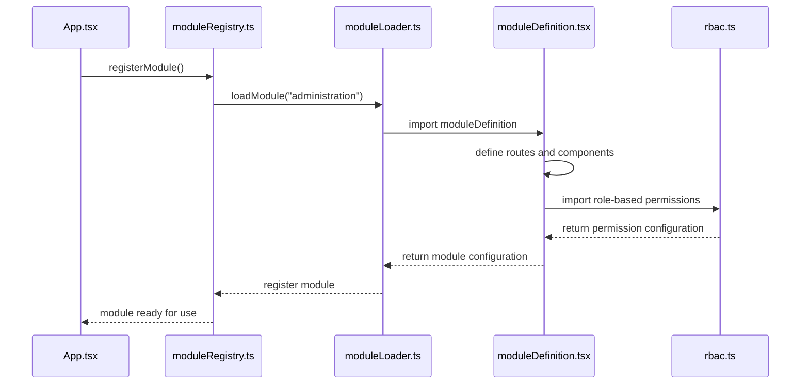
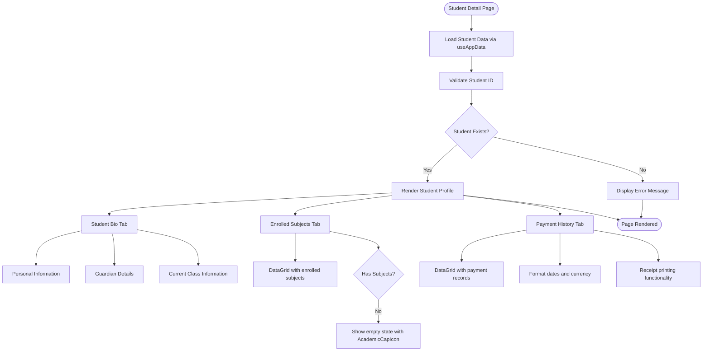
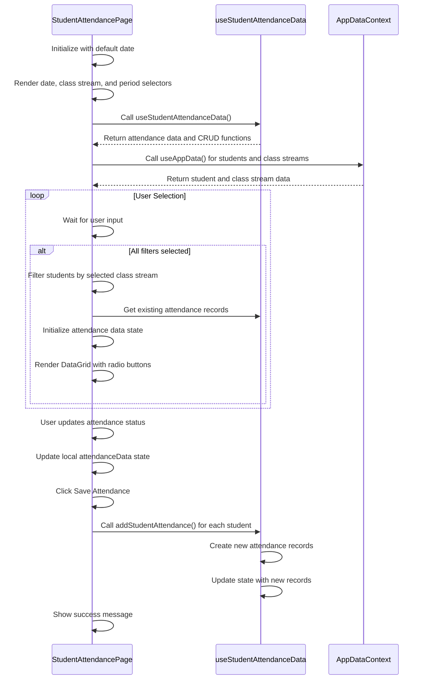
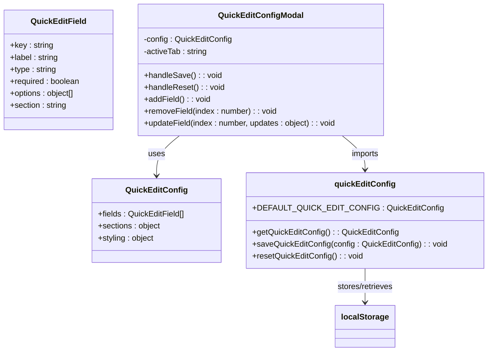
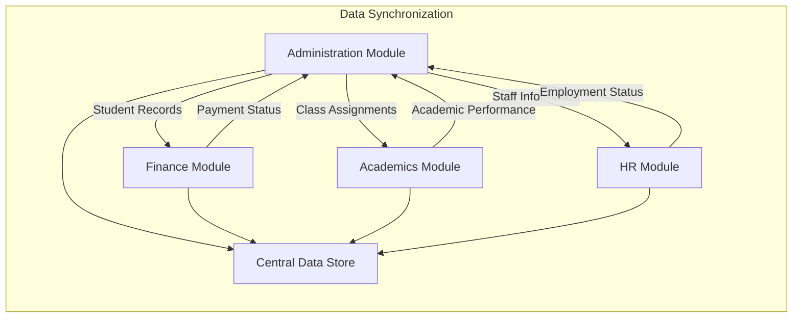

# Administration Module

<cite>
**Referenced Files in This Document**   
- [types.ts](file://src/modules/administration/data/types.ts)
- [StudentDetailPage.tsx](file://src/modules/administration/pages/StudentDetailPage.tsx)
- [StudentAttendancePage.tsx](file://src/modules/administration/pages/StudentAttendancePage.tsx)
- [QuickEditConfigModal.tsx](file://src/modules/administration/components/QuickEditConfigModal.tsx)
- [quickEditConfig.ts](file://src/modules/administration/config/quickEditConfig.ts)
- [useStudentAttendanceData.ts](file://src/modules/administration/data/useStudentAttendanceData.ts)
- [useAppData.ts](file://src/hooks/useAppData.ts)
- [AppDataContext.tsx](file://src/contexts/AppDataContext.tsx)
- [moduleDefinition.tsx](file://src/modules/administration/moduleDefinition.tsx)
- [rbac.ts](file://src/modules/administration/rbac.ts)
</cite>

## Table of Contents
1. [Introduction](#introduction)
2. [Module Registration and RBAC Configuration](#module-registration-and-rbac-configuration)
3. [Data Model Overview](#data-model-overview)
4. [Student Management System](#student-management-system)
5. [Attendance Tracking System](#attendance-tracking-system)
6. [Staff and Organizational Management](#staff-and-organizational-management)
7. [Rapid Data Update System](#rapid-data-update-system)
8. [Integration with Other Modules](#integration-with-other-modules)
9. [Data Consistency and Academic Period Management](#data-consistency-and-academic-period-management)
10. [Best Practices for Data Integrity](#best-practices-for-data-integrity)

## Introduction
The Administration module in schoolpilot3 serves as the central hub for managing core educational operations, including student enrollment, attendance tracking, staff management, and class organization. This comprehensive system provides administrators with the tools needed to maintain accurate records and efficiently manage school operations. The module is designed with a modular architecture that enables seamless integration with other system components such as Finance and Academics, ensuring data consistency across the platform. Built with React and TypeScript, the module follows modern software engineering practices with a strong emphasis on type safety, component reusability, and user experience.

**Section sources**
- [moduleDefinition.tsx](file://src/modules/administration/moduleDefinition.tsx)
- [rbac.ts](file://src/modules/administration/rbac.ts)

## Module Registration and RBAC Configuration
The Administration module is registered within the schoolpilot3 application through a structured module definition system that enables dynamic loading and configuration. The module registration process follows a standardized pattern implemented across the application, ensuring consistency in how modules are initialized and integrated into the overall system architecture.



**Diagram sources**
- [moduleDefinition.tsx](file://src/modules/administration/moduleDefinition.tsx)
- [rbac.ts](file://src/modules/administration/rbac.ts)

**Section sources**
- [moduleDefinition.tsx](file://src/modules/administration/moduleDefinition.tsx)
- [rbac.ts](file://src/modules/administration/rbac.ts)

The Role-Based Access Control (RBAC) system for the Administration module is defined in the `rbac.ts` file, which establishes granular permissions for different user roles. The configuration includes role hierarchies, permission sets, and access policies that govern user interactions with administrative functionality. This RBAC implementation ensures that users can only perform actions appropriate to their designated roles, maintaining data security and operational integrity.

## Data Model Overview
The Administration module employs a comprehensive data model that represents the core entities of an educational institution. The data structures are defined using TypeScript interfaces and enums in the `types.ts` file, providing type safety and clear documentation of the data schema. This approach ensures consistency across the application and enables robust data validation.

```mermaid
erDiagram
STUDENT ||--o{ STUDENT_ATTENDANCE : has
STUDENT ||--o{ STUDENT_HEALTH_RECORD : has
STUDENT ||--o{ APPLICATION : submits
STUDENT ||--|| STUDENT_CATEGORY : belongs_to
STUDENT ||--|| DORMITORY : resides_in
STAFF ||--|| DEPARTMENT : works_in
STAFF ||--|| DESIGNATION : holds
CLASS ||--o{ CLASS_STREAM : contains
CLASS_STREAM ||--o{ STUDENT : enrolls
ACADEMIC_YEAR ||--o{ ACADEMIC_PERIOD : contains
ACADEMIC_PERIOD ||--o{ SCHOOL_PERIOD : defines
CLUB_AND_SOCIETY ||--|| STAFF : patronized_by
CUSTOMER ||--o{ INVOICE : generates
PARTNER ||--o{ AGREEMENT : establishes
```

**Diagram sources**
- [types.ts](file://src/modules/administration/data/types.ts)

**Section sources**
- [types.ts](file://src/modules/administration/data/types.ts)

The data model includes several key entity types:

**Student Entity Structure**
- **Core Attributes**: `id`, `first_name`, `last_name`, `admission_no`, `date_of_birth`, `gender`
- **Academic Information**: `current_class_stream_id`, `student_category_id`, `dormitory_id`
- **Contact Details**: `email`, `phone`, `address`, `religion`
- **Guardian Information**: `primary_guardian_name`, `primary_guardian_phone`, `guardian_relationship`

**Staff Entity Structure**
- **Core Attributes**: `id`, `name`, `designation_id`, `department_id`
- **Contact Information**: `email`, `phone`, `address`
- **Employment Details**: `hire_date`, `employment_status`, `salary_grade`

**Academic Structure**
- **Academic Year**: Represents a complete academic cycle with start and end dates
- **Academic Period**: Subdivision of an academic year (e.g., term, semester)
- **School Period**: Daily schedule periods with start and end times
- **Class Stream**: Specific grouping within a class level (e.g., Class 8A, Class 8B)

The data model also includes specialized entities for administrative processes:
- **Applications**: Manages student admissions with status tracking
- **Pre-NAs Marks**: Stores standardized assessment results
- **Campaigns**: Facilitates communication with students, parents, and staff
- **Templates**: Provides reusable communication content for SMS, email, and notifications

## Student Management System
The student management system in schoolpilot3 provides comprehensive tools for handling student records throughout their academic journey. The system is centered around the `StudentDetailPage` component, which serves as the primary interface for viewing and managing individual student information.



**Diagram sources**
- [StudentDetailPage.tsx](file://src/modules/administration/pages/StudentDetailPage.tsx)

**Section sources**
- [StudentDetailPage.tsx](file://src/modules/administration/pages/StudentDetailPage.tsx)

The `StudentDetailPage` component implements several key features:
- **Data Loading**: Uses the `useAppData` hook to fetch student details by ID, with proper loading states and error handling
- **Tabbed Interface**: Organizes information into three main tabs - Student Bio, Enrolled Subjects, and Payment History
- **Responsive Design**: Adapts layout for different screen sizes using CSS grid and flexbox
- **Action Buttons**: Provides quick access to financial details and profile editing

The component retrieves student data through the `getStudentDetailsById` function from the `useAppData` hook, which serves as a centralized data access point for the application. This approach ensures consistent data retrieval patterns across different modules.

## Attendance Tracking System
The attendance tracking system enables administrators to record and manage student attendance efficiently. The `StudentAttendancePage` component provides a user-friendly interface for marking attendance, with support for filtering by date, class stream, and lesson period.



**Diagram sources**
- [StudentAttendancePage.tsx](file://src/modules/administration/pages/StudentAttendancePage.tsx)
- [useStudentAttendanceData.ts](file://src/modules/administration/data/useStudentAttendanceData.ts)

**Section sources**
- [StudentAttendancePage.tsx](file://src/modules/administration/pages/StudentAttendancePage.tsx)
- [useStudentAttendanceData.ts](file://src/modules/administration/data/useStudentAttendanceData.ts)

The attendance system implements the following key components:
- **Filtering System**: Allows selection of date, class stream, and lesson period to target specific attendance sessions
- **Real-time Updates**: Uses React state to immediately reflect changes in attendance status
- **Data Persistence**: Saves attendance records through the `addStudentAttendance` function provided by the `useStudentAttendanceData` hook
- **Validation**: Ensures all required filters are set before allowing attendance submission

The `useStudentAttendanceData` hook provides a self-contained data management system for attendance records, implementing CRUD operations without depending on the global `AppDataContext`. This design choice enhances modularity and makes the attendance system easier to test and maintain.

## Staff and Organizational Management
The Administration module includes comprehensive tools for managing staff members and organizational structures within the educational institution. These features enable administrators to maintain accurate records of employees, departments, and other organizational entities.

**Department Management**
- **Department Entity**: Represents academic and administrative divisions within the school
- **Attributes**: `id`, `name`, `is_academic` (boolean), `created_at`, `updated_at`
- **Functionality**: CRUD operations for creating, viewing, updating, and deleting departments

**Staff Management**
- **Staff Entity**: Represents teachers, administrators, and other employees
- **Attributes**: `id`, `name`, `designation_id`, `department_id`, `email`, `phone`
- **Relationships**: Links to designations and departments for organizational hierarchy

**Designation Management**
- **Designation Entity**: Represents job titles or positions within the organization
- **Attributes**: `id`, `title`, `created_at`, `updated_at`
- **Usage**: Applied to staff members to indicate their role or position

**Additional Organizational Entities**
- **Dormitories**: Residential facilities for boarding students with master assignment
- **Clubs and Societies**: Extracurricular organizations with patron teachers
- **Partners**: External organizations such as sponsors, government agencies, and service providers
- **Customers**: Entities that receive services or products from the institution

The organizational management system supports complex hierarchies and relationships, allowing schools to accurately represent their unique structures. The data model accommodates both academic departments (e.g., Mathematics, Science) and administrative departments (e.g., Finance, Human Resources), with the ability to distinguish between them through the `is_academic` flag.

## Rapid Data Update System
The rapid data update system in schoolpilot3 enables administrators to quickly modify student information through a customizable interface. The `QuickEditConfigModal` component allows users to configure which fields appear in the quick edit interface, providing flexibility to tailor the system to specific institutional needs.



**Diagram sources**
- [QuickEditConfigModal.tsx](file://src/modules/administration/components/QuickEditConfigModal.tsx)
- [quickEditConfig.ts](file://src/modules/administration/config/quickEditConfig.ts)

**Section sources**
- [QuickEditConfigModal.tsx](file://src/modules/administration/components/QuickEditConfigModal.tsx)
- [quickEditConfig.ts](file://src/modules/administration/config/quickEditConfig.ts)

The rapid data update system consists of the following components:
- **Configuration Model**: Defined by the `QuickEditConfig` interface, which specifies the fields, sections, and styling options
- **Field Customization**: Users can add, remove, and modify fields in the quick edit interface
- **Section Organization**: Fields are organized into logical sections (Basic, Academic, Guardian) with customizable titles and icons
- **Styling Options**: Allows customization of theme (dark/light), accent color, and border radius

The system stores user preferences in localStorage through the `getQuickEditConfig`, `saveQuickEditConfig`, and `resetQuickEditConfig` functions, ensuring that customizations persist across sessions. This client-side storage approach provides immediate feedback and reduces server load, while the fallback to `DEFAULT_QUICK_EDIT_CONFIG` ensures functionality even if local storage is unavailable.

## Integration with Other Modules
The Administration module integrates seamlessly with other modules in the schoolpilot3 ecosystem, creating a unified platform for educational management. These integrations ensure data consistency and enable comprehensive reporting across different functional areas.

**Finance Module Integration**
- **Student Financial Details**: The `StudentFinancialDetailPage` component displays financial information alongside academic records
- **Payment History**: Attendance module displays payment history in the student detail view
- **Fee Tracking**: Student records are linked to fee structures and payment schedules in the Finance module
- **Invoice Generation**: Student enrollment triggers automatic invoice creation for tuition and other fees

**Academics Module Integration**
- **Subject Enrollment**: Student records are synchronized with subject enrollment data
- **Exam Results**: Student identifiers link academic performance data across modules
- **Timetable Integration**: Class assignments in the Administration module connect to timetable entries in the Academics module
- **Gradebook Access**: Teachers can access student demographic information when entering grades

**Data Flow Between Modules**


**Diagram sources**
- [StudentDetailPage.tsx](file://src/modules/administration/pages/StudentDetailPage.tsx)
- [useAppData.ts](file://src/hooks/useAppData.ts)

**Section sources**
- [StudentDetailPage.tsx](file://src/modules/administration/pages/StudentDetailPage.tsx)
- [useAppData.ts](file://src/hooks/useAppData.ts)

The integration is facilitated by the `useAppData` hook, which provides a unified interface for accessing data across modules. This centralized data access pattern ensures that all modules work with consistent information and reduces the risk of data discrepancies.

## Data Consistency and Academic Period Management
Maintaining data consistency across academic periods is a critical challenge in educational management systems. The Administration module addresses this challenge through a structured approach to academic period management and data versioning.

**Academic Period Structure**
- **Academic Year**: Represents a complete academic cycle (e.g., 2023-2024)
- **Academic Period**: Subdivision of an academic year (Term 1, Term 2, Semester 1, etc.)
- **School Period**: Daily schedule periods that define the school day structure

**Data Consistency Mechanisms**
- **Temporal Data Modeling**: Records include `created_at` and `updated_at` timestamps to track changes over time
- **Academic Context**: Data is associated with specific academic years and periods to maintain historical accuracy
- **Versioning**: Critical records maintain change history to support auditing and rollback capabilities
- **Referential Integrity**: Foreign key relationships ensure that references between entities remain valid

**Common Issues and Solutions**
- **Issue**: Student transfers between classes during an academic period
  - **Solution**: Maintain historical class assignments with start and end dates
- **Issue**: Staff reassignment to different departments
  - **Solution**: Implement effective dating for position assignments
- **Issue**: Changes to fee structures between academic years
  - **Solution**: Version fee templates and link them to specific academic periods
- **Issue**: Curriculum changes affecting subject offerings
  - **Solution**: Archive previous curriculum versions and maintain historical subject enrollments

The system uses the `useAppData` hook in conjunction with the `AppDataContext` to ensure that data queries are scoped to the appropriate academic context. This approach prevents accidental mixing of data from different academic periods and supports accurate reporting and analysis.

## Best Practices for Data Integrity
Maintaining data integrity at scale requires adherence to established best practices in data management, validation, and system design. The Administration module incorporates several strategies to ensure high-quality data throughout the system.

**Data Validation Strategies**
- **Client-Side Validation**: Immediate feedback on form inputs using the `validationSchemas.ts` utilities
- **Server-Side Validation**: Comprehensive validation rules enforced at the data persistence layer
- **Type Safety**: TypeScript interfaces ensure consistent data structures across the application
- **Required Field Enforcement**: Critical fields are marked as required in the UI and validated on submission

**Error Handling and Recovery**
- **Graceful Degradation**: The system continues to function even when specific data sources are unavailable
- **Meaningful Error Messages**: Users receive clear, actionable feedback when errors occur
- **Automatic Retry Mechanisms**: Failed operations are automatically retried with exponential backoff
- **Data Recovery Options**: Backup and restore capabilities for critical data

**Performance Optimization**
- **Lazy Loading**: Data is loaded on-demand to reduce initial page load times
- **Caching Strategy**: Frequently accessed data is cached to improve response times
- **Pagination**: Large datasets are paginated to maintain UI responsiveness
- **Debounced Searches**: Search operations are debounced to reduce server load

**Security and Access Control**
- **Role-Based Permissions**: Fine-grained access control based on user roles and responsibilities
- **Audit Logging**: All critical operations are logged for security and compliance
- **Data Encryption**: Sensitive information is encrypted at rest and in transit
- **Session Management**: Secure authentication and session handling

These best practices ensure that the Administration module can handle the demands of large educational institutions while maintaining data accuracy, system performance, and user satisfaction.