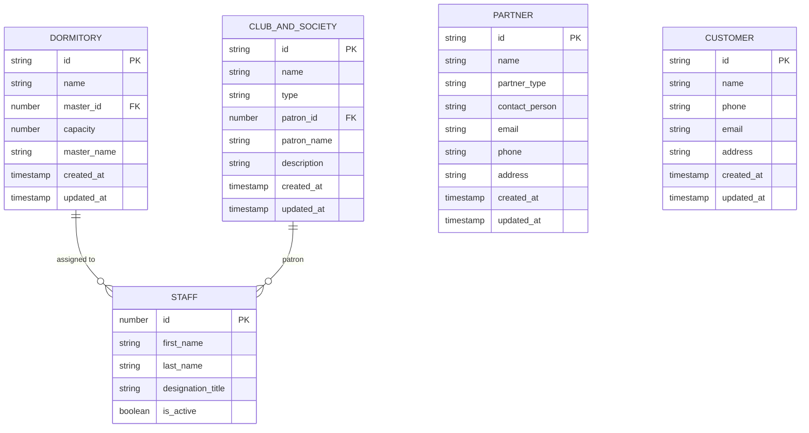
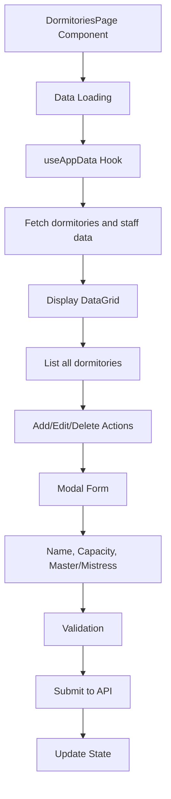
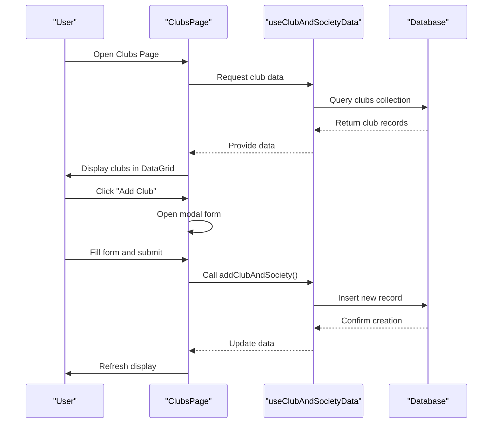
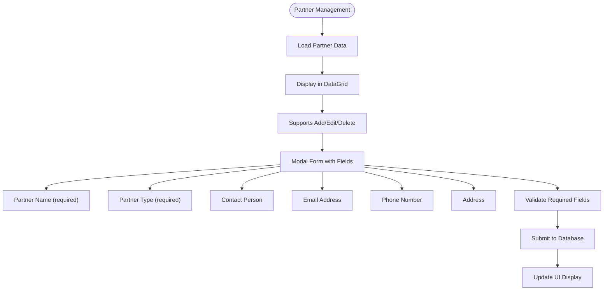
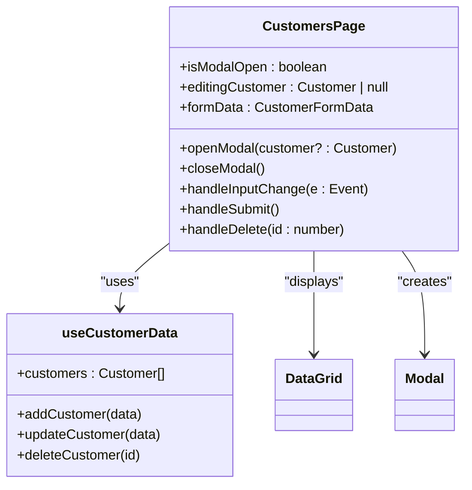
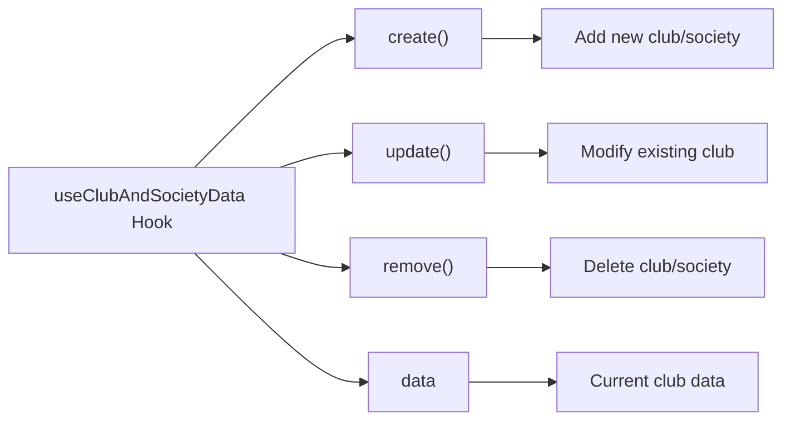
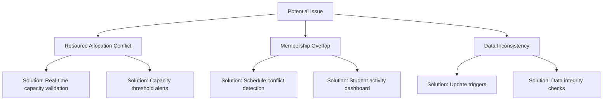
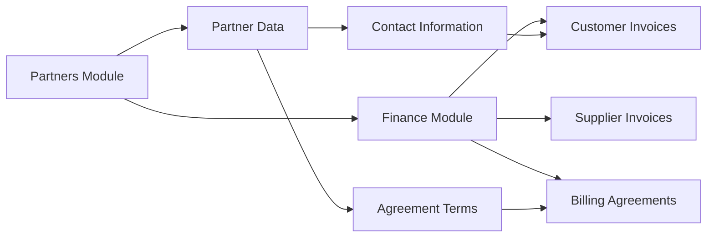
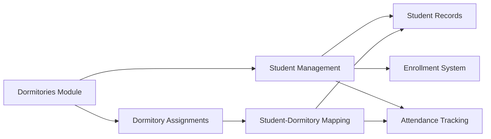

# Auxiliary Management

<cite>
**Referenced Files in This Document**   
- [DormitoriesPage.tsx](file://src/modules/administration/pages/DormitoriesPage.tsx)
- [ClubsPage.tsx](file://src/modules/administration/pages/ClubsPage.tsx)
- [PartnersPage.tsx](file://src/modules/administration/pages/PartnersPage.tsx)
- [CustomersPage.tsx](file://src/modules/administration/pages/CustomersPage.tsx)
- [schema.ts](file://src/modules/administration/data/schema.ts)
- [types.ts](file://src/modules/administration/data/types.ts)
- [useDormitoryData.ts](file://src/modules/administration/data/useDormitoryData.ts)
- [useClubAndSocietyData.ts](file://src/modules/administration/data/useClubAndSocietyData.ts)
</cite>

## Table of Contents
1. [Introduction](#introduction)
2. [Data Model Overview](#data-model-overview)
3. [Dormitory Assignment Management](#dormitory-assignment-management)
4. [Extracurricular Club Management](#extracurricular-club-management)
5. [Partner Institution Management](#partner-institution-management)
6. [Customer Relationship Tracking](#customer-relationship-tracking)
7. [Specialized Hooks and Domain Operations](#specialized-hooks-and-domain-operations)
8. [Common Issues and Solutions](#common-issues-and-solutions)
9. [Integration Points](#integration-points)
10. [Conclusion](#conclusion)

## Introduction

The Auxiliary Management sub-feature within the Administration module provides comprehensive tools for managing non-academic organizational units in an educational institution. This includes dormitory assignments, extracurricular clubs, partner institutions, and customer relationships. The system is designed to streamline administrative workflows while maintaining data integrity across interconnected modules.

The implementation follows a modular architecture with dedicated components, data schemas, and specialized hooks for each auxiliary entity. This documentation provides a detailed analysis of the implementation, data models, functionality, and integration points for these auxiliary management features.

## Data Model Overview

The data model for auxiliary entities is defined in the `schema.ts` file within the administration module's data directory. Each entity has a well-structured database schema with appropriate field types, constraints, and indexing strategies.

**Diagram sources**
- [schema.ts](file://src/modules/administration/data/schema.ts#L1-L484)

**Section sources**
- [schema.ts](file://src/modules/administration/data/schema.ts#L1-L484)

## Dormitory Assignment Management

The dormitory management system enables administrators to configure and manage student housing facilities. The implementation centers around the `DormitoriesPage` component and its interaction with dormitory data.

### Data Structure

The dormitory schema includes the following fields:
- **id**: Unique identifier for the dormitory
- **name**: Name of the dormitory
- **master_id**: Reference to staff member assigned as dormitory master/mistress
- **capacity**: Maximum number of students the dormitory can accommodate
- **master_name**: Denormalized staff name for display purposes
- **created_at/updated_at**: Timestamps for record management

### User Interface and Functionality

The `DormitoriesPage` component provides a comprehensive interface for managing dormitories:

**Diagram sources**
- [DormitoriesPage.tsx](file://src/modules/administration/pages/DormitoriesPage.tsx#L1-L189)

The component uses a DataGrid to display dormitory information with columns for ID, name, master/mistress, capacity, and actions. Users can add new dormitories or edit existing ones through a modal form that includes validation for required fields.

When assigning a dormitory master/mistress, the system references staff members from the staff database, ensuring that only active staff can be assigned. The capacity field is numeric, allowing for precise resource planning.

**Section sources**
- [DormitoriesPage.tsx](file://src/modules/administration/pages/DormitoriesPage.tsx#L1-L189)
- [schema.ts](file://src/modules/administration/data/schema.ts#L1-L484)

## Extracurricular Club Management

The club and society management system facilitates the organization of extracurricular activities, allowing schools to track clubs, assign patrons, and manage memberships.

### Data Structure

The club and society schema includes:
- **id**: Unique identifier
- **name**: Club/society name
- **type**: Category of the organization (e.g., CLUB, SOCIETY, SPORTS_TEAM)
- **patron_id**: Reference to staff member serving as patron
- **patron_name**: Denormalized patron name for display
- **description**: Optional description of the club's purpose and activities

### User Interface and Functionality

The `ClubsPage` component implements the club management interface:

**Diagram sources**
- [ClubsPage.tsx](file://src/modules/administration/pages/ClubsPage.tsx#L1-L193)
- [useClubAndSocietyData.ts](file://src/modules/administration/data/useClubAndSocietyData.ts)

The interface allows administrators to create clubs of different types (Club, Society, Sports Team) and assign staff patrons. The type field uses an enumeration to ensure data consistency across the system.

The DataGrid displays club information with filtering and sorting capabilities, making it easy to find specific clubs. The modal form enforces validation to ensure both name and type are provided before creating or updating a club.

**Section sources**
- [ClubsPage.tsx](file://src/modules/administration/pages/ClubsPage.tsx#L1-L193)
- [schema.ts](file://src/modules/administration/data/schema.ts#L1-L484)

## Partner Institution Management

The partner institution management system enables schools to maintain relationships with external organizations such as sponsors, government agencies, and service providers.

### Data Structure

The partner schema includes comprehensive fields for business relationships:
- **id**: Unique identifier
- **name**: Partner organization name
- **partner_type**: Classification of the partner (e.g., SPONSOR, GOVERNMENT, SERVICE_PROVIDER)
- **contact_person**: Primary contact individual
- **email**: Contact email address
- **phone**: Contact phone number
- **address**: Physical address of the partner organization

### User Interface and Functionality

The `PartnersPage` component provides a robust interface for managing partner institutions:

**Diagram sources**
- [PartnersPage.tsx](file://src/modules/administration/pages/PartnersPage.tsx#L1-L250)

The implementation uses a module-specific hook (`usePartnerData`) rather than the global `useAppData`, indicating a more focused data management approach for partners. The form is optimized for business information with appropriate input types (e.g., email input for email addresses).

The interface includes a larger modal size ("xl") to accommodate all the fields needed for comprehensive partner information. Field validation ensures that both name and partner type are required, maintaining data integrity.

**Section sources**
- [PartnersPage.tsx](file://src/modules/administration/pages/PartnersPage.tsx#L1-L250)
- [schema.ts](file://src/modules/administration/data/schema.ts#L1-L484)

## Customer Relationship Tracking

The customer relationship management system allows schools to track interactions with various stakeholders who may not be directly part of the academic system, such as prospective parents or service clients.

### Data Structure

The customer schema is streamlined for relationship management:
- **id**: Unique identifier
- **name**: Customer name
- **phone**: Contact phone number
- **email**: Contact email address
- **address**: Customer address
- **created_at/updated_at**: Record management timestamps

### User Interface and Functionality

The `CustomersPage` component implements the customer management interface:

**Diagram sources**
- [CustomersPage.tsx](file://src/modules/administration/pages/CustomersPage.tsx#L1-L175)
- [useCustomerData.ts](file://src/modules/administration/data/useCustomerData.ts)

The implementation follows the same pattern as other auxiliary management pages but with a focus on customer relationship management. The component uses internationalization (i18n) for all text content, allowing for multilingual support.

The interface is simple and focused, with only essential contact information fields. This reflects the intended use case for tracking basic customer information rather than comprehensive organizational details.

**Section sources**
- [CustomersPage.tsx](file://src/modules/administration/pages/CustomersPage.tsx#L1-L175)
- [schema.ts](file://src/modules/administration/data/schema.ts#L1-L484)

## Specialized Hooks and Domain Operations

The auxiliary management system employs specialized hooks to handle domain-specific operations, promoting code reusability and separation of concerns.

### useDormitoryData Hook

Although not directly visible in the provided files, the `DormitoriesPage` uses `useAppData` which likely encapsulates dormitory-specific operations. A dedicated hook would typically provide:
- **addDormitory**: Creates new dormitory records
- **updateDormitory**: Modifies existing dormitory information
- **deleteDormitory**: Removes dormitory records
- **getDormitoryById**: Retrieves specific dormitory data

### useClubAndSocietyData Hook

The `useClubAndSocietyData` hook is explicitly used in the `ClubsPage` and provides a clean interface for club management:

**Diagram sources**
- [useClubAndSocietyData.ts](file://src/modules/administration/data/useClubAndSocietyData.ts)

This hook abstracts the data access layer, allowing the UI component to focus on presentation logic. The naming convention (`create`, `update`, `remove`) suggests a consistent API design pattern across the application.

### Hook Design Patterns

The specialized hooks follow a consistent design pattern:
- **Data exposure**: Provide current data through a `data` property
- **CRUD operations**: Implement create, read, update, and delete methods
- **Error handling**: Manage API errors and provide feedback
- **Loading states**: Track operation status for UI feedback

This approach enables clean separation between UI components and data management logic, making the codebase more maintainable and testable.

**Section sources**
- [useClubAndSocietyData.ts](file://src/modules/administration/data/useClubAndSocietyData.ts)
- [useCustomerData.ts](file://src/modules/administration/data/useCustomerData.ts)
- [DormitoriesPage.tsx](file://src/modules/administration/pages/DormitoriesPage.tsx#L1-L189)

## Common Issues and Solutions

### Resource Allocation Conflicts

One potential issue in dormitory management is over-allocation, where the total number of assigned students exceeds dormitory capacity. While not explicitly handled in the current implementation, this could be addressed by:

1. Implementing real-time capacity validation when assigning students to dormitories
2. Adding visual indicators when a dormitory is nearing capacity
3. Creating automated alerts for administrators when capacity thresholds are exceeded

### Membership Overlaps

For clubs and societies, membership overlaps could occur when students join multiple activities with conflicting schedules. Potential solutions include:

1. Implementing a schedule conflict detection system
2. Creating a student activity dashboard that shows all commitments
3. Adding approval workflows for club enrollment

### Data Consistency

The current implementation uses denormalized fields (e.g., master_name, patron_name) to improve performance by avoiding joins. However, this creates a risk of data inconsistency if staff names change. This could be mitigated by:

1. Implementing update triggers that synchronize denormalized fields
2. Creating a data integrity check process
3. Using database views instead of denormalization

**Diagram sources**
- [schema.ts](file://src/modules/administration/data/schema.ts#L1-L484)
- [DormitoriesPage.tsx](file://src/modules/administration/pages/DormitoriesPage.tsx#L1-L189)

**Section sources**
- [schema.ts](file://src/modules/administration/data/schema.ts#L1-L484)
- [DormitoriesPage.tsx](file://src/modules/administration/pages/DormitoriesPage.tsx#L1-L189)
- [ClubsPage.tsx](file://src/modules/administration/pages/ClubsPage.tsx#L1-L193)

## Integration Points

The auxiliary management system integrates with other modules to create a cohesive educational management platform.

### Finance Module Integration

Partner institutions have a direct relationship with the Finance module for billing and invoicing:

**Diagram sources**
- [schema.ts](file://src/modules/administration/data/schema.ts#L1-L484)
- [finance/schema.ts](file://src/modules/finance/data/schema.ts)

The partner data provides essential information for creating customer or supplier invoices, depending on the nature of the relationship. This integration ensures that financial transactions are properly associated with the correct partner entities.

### Student Management Integration

Dormitory assignments are closely tied to student management:

**Diagram sources**
- [schema.ts](file://src/modules/administration/data/schema.ts#L1-L484)
- [academics/schema.ts](file://src/modules/academics/data/schema.ts)

When students are assigned to dormitories, this information should be synchronized with their student records. This integration enables comprehensive student profiles that include both academic and residential information.

The system could be enhanced by adding direct links between dormitory assignments and student enrollment processes, ensuring that housing is considered during student registration.

**Section sources**
- [schema.ts](file://src/modules/administration/data/schema.ts#L1-L484)
- [finance/data/schema.ts](file://src/modules/finance/data/schema.ts)
- [academics/data/schema.ts](file://src/modules/academics/data/schema.ts)

## Conclusion

The Auxiliary Management sub-feature provides a comprehensive suite of tools for managing non-academic aspects of an educational institution. The implementation demonstrates a well-structured approach with clear separation of concerns between data models, UI components, and business logic.

Key strengths of the system include:
- Consistent UI patterns across different auxiliary entities
- Well-defined data schemas with appropriate constraints
- Effective use of specialized hooks for domain-specific operations
- Comprehensive internationalization support
- Clean integration points with other modules

Potential areas for enhancement include:
- Implementing validation for resource allocation limits
- Adding more sophisticated conflict detection for overlapping memberships
- Improving data consistency mechanisms for denormalized fields
- Expanding integration with scheduling systems

The current implementation provides a solid foundation for auxiliary management that can be extended to meet more complex institutional needs while maintaining data integrity and user experience.