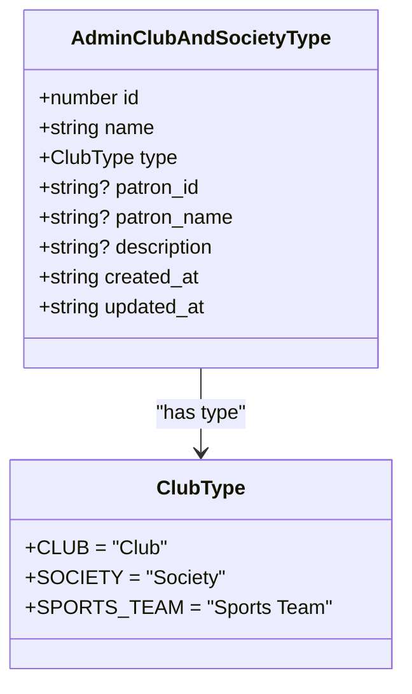
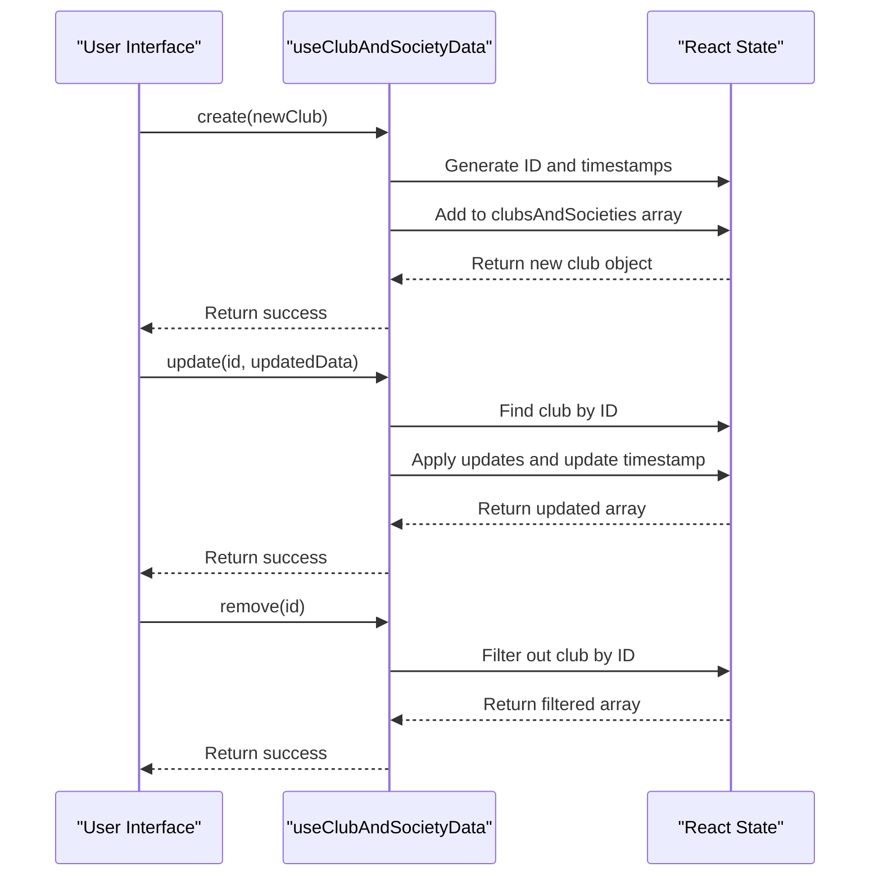
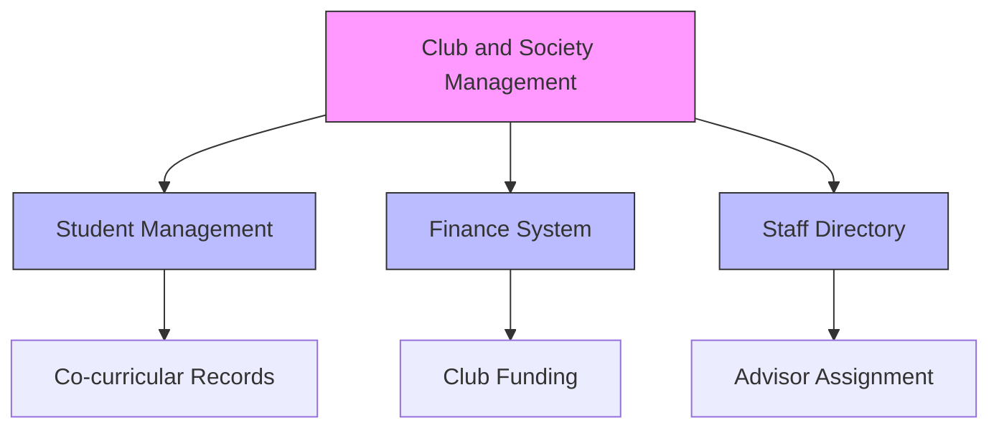

# Club and Society Management

<cite>
**Referenced Files in This Document**   
- [useClubAndSocietyData.ts](file://src\modules\administration\data\useClubAndSocietyData.ts)
- [mockData.ts](file://src\modules\administration\data\mockData.ts)
- [types.ts](file://src\modules\administration\data\types.ts)
- [ClubsPage.tsx](file://src\modules\administration\pages\ClubsPage.tsx)
</cite>

## Table of Contents
1. [Introduction](#introduction)
2. [Data Model](#data-model)
3. [Core Functionality](#core-functionality)
4. [User Interface](#user-interface)
5. [Business Logic and Operations](#business-logic-and-operations)
6. [Integration Points](#integration-points)
7. [Common Issues and Solutions](#common-issues-and-solutions)
8. [Usage Examples](#usage-examples)
9. [Conclusion](#conclusion)

## Introduction
The Club and Society Management sub-feature within the Auxiliary Management system provides comprehensive tools for managing extracurricular activities in educational institutions. This system enables administrators to create, manage, and track clubs, societies, and sports teams, including membership, advisor assignment, meeting schedules, and event planning. The implementation supports the full lifecycle of extracurricular activities from creation to deactivation, with integration points to student records and financial systems for comprehensive management.

**Section sources**
- [useClubAndSocietyData.ts](file://src\modules\administration\data\useClubAndSocietyData.ts#L1-L60)
- [types.ts](file://src\modules\administration\data\types.ts#L1-L538)

## Data Model
The Club and Society Management system is built around a well-defined data model that captures all essential attributes of extracurricular activities. The core entity is the `AdminClubAndSocietyType` interface, which defines the structure for clubs and societies.



**Diagram sources**
- [types.ts](file://src\modules\administration\data\types.ts#L10-L25)

### Field Definitions
- **id**: Unique identifier for the club or society (number)
- **name**: Official name of the club or society (string)
- **type**: Categorical classification using the `ClubType` enum (Club, Society, or Sports Team)
- **patron_id**: Reference to the staff member serving as advisor (string, optional)
- **patron_name**: Display name of the advisor (string, optional)
- **description**: Brief description of the club's purpose and activities (string, optional)
- **created_at**: Timestamp of creation in ISO format (string)
- **updated_at**: Timestamp of last modification in ISO format (string)

The data model is designed to be extensible, allowing for future additions such as membership limits, meeting schedules, and funding information without requiring significant structural changes.

**Section sources**
- [types.ts](file://src\modules\administration\data\types.ts#L10-L25)
- [mockData.ts](file://src\modules\administration\data\mockData.ts#L497-L520)

## Core Functionality
The Club and Society Management system provides a complete set of CRUD (Create, Read, Update, Delete) operations through the `useClubAndSocietyData` hook, which serves as the primary interface for data manipulation.

### Data Access Hook
The `useClubAndSocietyData` hook implements a self-contained data management solution that provides all necessary operations without dependencies on global application context.



**Diagram sources**
- [useClubAndSocietyData.ts](file://src\modules\administration\data\useClubAndSocietyData.ts#L1-L60)

### Key Operations
The hook exposes three primary operations:

- **create**: Adds a new club or society to the collection
  - Generates a unique ID using `Date.now()`
  - Sets creation and update timestamps
  - Returns the newly created object

- **update**: Modifies an existing club or society
  - Locates the item by ID
  - Applies the provided updates
  - Updates the `updated_at` timestamp
  - Preserves all existing fields not specified in the update

- **remove**: Deletes a club or society from the collection
  - Filters out the item with the specified ID
  - Maintains data integrity by not affecting other records

The hook also manages loading states and error conditions, providing a robust interface for the user interface components.

**Section sources**
- [useClubAndSocietyData.ts](file://src\modules\administration\data\useClubAndSocietyData.ts#L1-L60)

## User Interface
The ClubsPage component provides the user interface for managing clubs and societies, implementing a standard administrative interface pattern with list views, forms, and action controls.

### Component Structure
The UI is organized around a tabular display of existing clubs and societies, with controls for creating new entries and editing existing ones. The interface follows consistent design patterns with other administrative modules in the system.

### Sample Data
The system includes predefined sample data to demonstrate the functionality:

```typescript
const initialMockClubsAndSocieties: AdminClubAndSocietyType[] = [
  {
    id: 1,
    name: 'Science Club',
    type: ClubType.CLUB,
    patron_id: 'STF002',
    patron_name: 'Dwight Schrute',
    description: 'Promoting scientific inquiry and experimentation',
    created_at: new Date().toISOString(),
    updated_at: new Date().toISOString()
  },
  {
    id: 2,
    name: 'Drama Society',
    type: ClubType.SOCIETY,
    patron_id: 'STF008',
    patron_name: 'Phyllis Vance',
    description: 'Theatre arts and performance',
    created_at: new Date().toISOString(),
    updated_at: new Date().toISOString()
  },
  {
    id: 3,
    name: 'Basketball Team',
    type: ClubType.SPORTS_TEAM,
    patron_id: 'STF005',
    patron_name: 'Kevin Malone',
    description: 'School basketball team',
    created_at: new Date().toISOString(),
    updated_at: new Date().toISOString()
  }
];
```

This sample data demonstrates the three types of extracurricular activities supported by the system: clubs, societies, and sports teams, each with a designated patron (advisor) from the staff directory.

**Section sources**
- [mockData.ts](file://src\modules\administration\data\mockData.ts#L497-L520)
- [ClubsPage.tsx](file://src\modules\administration\pages\ClubsPage.tsx)

## Business Logic and Operations
The Club and Society Management system implements domain-specific operations that support the complete lifecycle of extracurricular activities.

### Club Lifecycle Management
The system supports the full lifecycle of clubs and societies from creation to deactivation:

1. **Creation**: Administrators can create new clubs by providing a name, type, description, and assigning a patron (advisor)
2. **Editing**: Existing clubs can be modified to update their details, change advisors, or adjust descriptions
3. **Deactivation**: While the current implementation uses deletion, a more sophisticated system would likely implement soft deletion or status changes to preserve historical data

### Domain-Specific Operations
The `useClubAndSocietyData` hook enables several domain-specific operations:

- **Member Enrollment**: While not explicitly implemented in the current hook, the data model supports integration with student records for membership management
- **Attendance Tracking**: The system could be extended to track attendance at club meetings by integrating with the student attendance system
- **Event Scheduling**: The data model could be enhanced to include meeting schedules and event calendars

The hook is designed to be easily extensible, allowing for the addition of new operations such as membership cap enforcement, meeting time conflict detection, and funding allocation.

**Section sources**
- [useClubAndSocietyData.ts](file://src\modules\administration\data\useClubAndSocietyData.ts#L1-L60)
- [types.ts](file://src\modules\administration\data\types.ts#L10-L25)

## Integration Points
The Club and Society Management system is designed to integrate with other modules in the educational management ecosystem.

### Student Management Integration
The system connects with the Student Management module to:
- Track co-curricular records for students
- Generate participation reports and transcripts
- Manage membership rosters
- Track attendance at club meetings

The patron_id field references staff members, creating a direct link between the club management system and the human resources module.

### Finance Integration
The system has potential integration points with the Finance module for:
- Managing club funding and budgets
- Processing club-related expenses
- Tracking fundraising activities
- Allocating resources to clubs based on participation and performance

While these integrations are not fully implemented in the current version, the data model and architecture support future expansion to include financial management capabilities.



**Diagram sources**
- [useClubAndSocietyData.ts](file://src\modules\administration\data\useClubAndSocietyData.ts#L1-L60)
- [types.ts](file://src\modules\administration\data\types.ts#L10-L25)

## Common Issues and Solutions
The Club and Society Management system addresses several common challenges in extracurricular activity administration.

### Overlapping Meeting Times
While the current implementation does not include meeting schedules, a complete system would need to address scheduling conflicts. Potential solutions include:
- Implementing a calendar system for club meetings
- Adding time slot validation to prevent overlaps
- Providing visual scheduling tools for administrators

### Advisor Availability
The system currently allows any staff member to be assigned as a patron, but does not validate their availability. Future enhancements could:
- Integrate with staff schedules to ensure advisors have available time
- Limit the number of clubs a single staff member can advise
- Provide workload balancing recommendations

### Membership Cap Enforcement
The current data model does not include membership limits, but this could be added by:
- Adding a `membership_limit` field to the `AdminClubAndSocietyType` interface
- Implementing validation in the create and update operations
- Providing notifications when clubs approach capacity

These issues represent opportunities for future enhancement of the system to provide more comprehensive management capabilities.

**Section sources**
- [types.ts](file://src\modules\administration\data\types.ts#L10-L25)
- [useClubAndSocietyData.ts](file://src\modules\administration\data\useClubAndSocietyData.ts#L1-L60)

## Usage Examples
The Club and Society Management system supports various practical use cases for educational institutions.

### Membership Roster Generation
The system can generate membership rosters by combining club data with student enrollment information. For example:

```typescript
// Example function to generate a membership roster
function generateMembershipRoster(clubId: number) {
  const club = clubsAndSocieties.find(c => c.id === clubId);
  const members = studentEnrollments.filter(se => 
    se.club_id === clubId && se.active
  );
  
  return {
    clubName: club?.name,
    advisor: club?.patron_name,
    totalMembers: members.length,
    members: members.map(m => ({
      studentName: m.student_name,
      grade: m.grade,
      contact: m.parent_contact
    }))
  };
}
```

### Participation Metrics Tracking
The system can track participation metrics to evaluate the success of extracurricular programs:

```typescript
// Example function to track participation metrics
function getParticipationMetrics() {
  return clubsAndSocieties.map(club => ({
    name: club.name,
    type: club.type,
    memberCount: getActiveMemberCount(club.id),
    meetingAttendanceRate: calculateAttendanceRate(club.id),
    activityCount: getEventCount(club.id),
    fundingLevel: getClubFunding(club.id)
  }));
}
```

These examples demonstrate how the core data model and operations can be extended to support reporting and analytics for extracurricular programs.

**Section sources**
- [mockData.ts](file://src\modules\administration\data\mockData.ts#L497-L520)
- [useClubAndSocietyData.ts](file://src\modules\administration\data\useClubAndSocietyData.ts#L1-L60)

## Conclusion
The Club and Society Management system provides a solid foundation for managing extracurricular activities in educational institutions. The well-defined data model, comprehensive CRUD operations, and integration capabilities make it a valuable component of the Auxiliary Management system. While the current implementation focuses on basic club management, the architecture supports future enhancements for more sophisticated features like scheduling, membership limits, and financial integration. By leveraging this system, educational institutions can effectively organize and track extracurricular activities, enhancing student engagement and development beyond the classroom.

The system's modular design and clear separation of concerns make it easy to maintain and extend, ensuring it can evolve to meet changing institutional needs. With further development, it could become a comprehensive platform for managing all aspects of student life outside the formal curriculum.