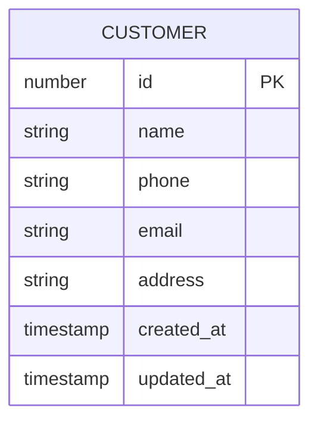
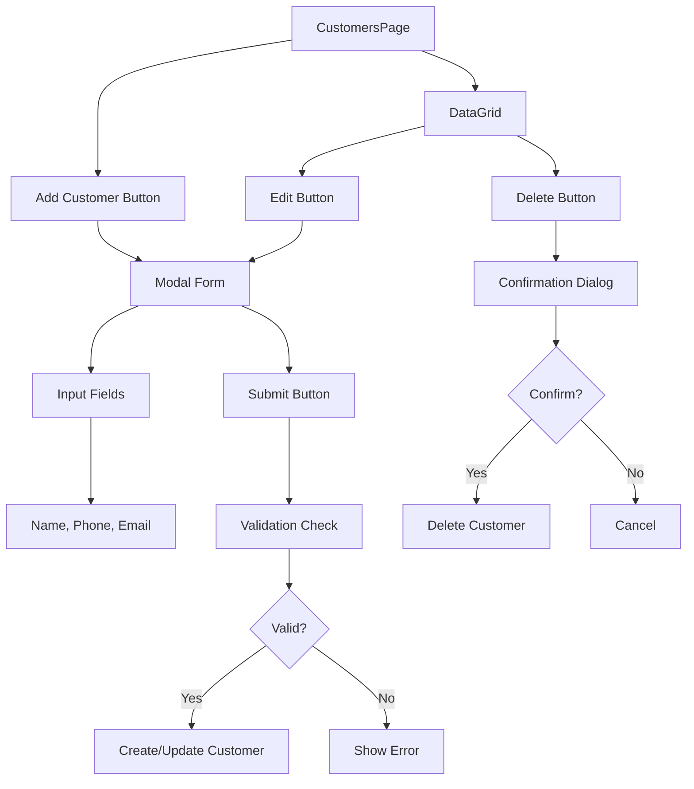
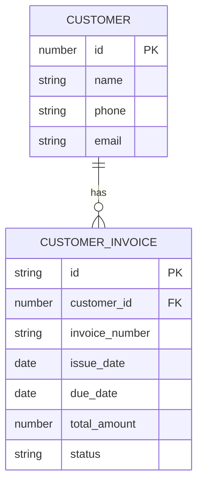
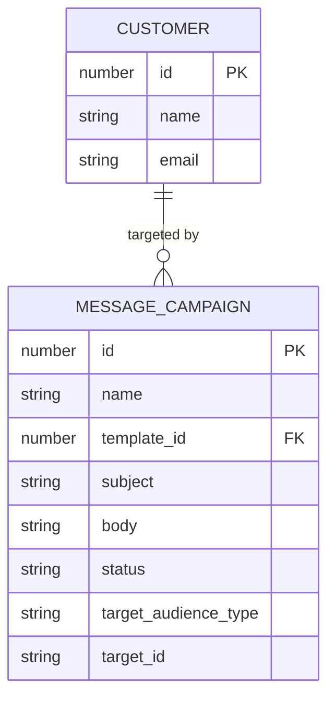

# Customer Relationship Management

<cite>
**Referenced Files in This Document**   
- [CustomersPage.tsx](file://src/modules/administration/pages/CustomersPage.tsx)
- [useCustomerData.ts](file://src/modules/administration/data/useCustomerData.ts)
- [schema.ts](file://src/modules/administration/data/schema.ts#L48-L76)
- [types.ts](file://src/core/types.ts#L667-L674)
- [useCustomerInvoiceData.ts](file://src/modules/finance/data/useCustomerInvoiceData.ts)
- [useCampaignData.ts](file://src/modules/administration/data/useCampaignData.ts)
</cite>

## Table of Contents
1. [Introduction](#introduction)
2. [Data Model](#data-model)
3. [Customer Lifecycle Management](#customer-lifecycle-management)
4. [Data Querying and Filtering](#data-querying-and-filtering)
5. [Integration with Finance Module](#integration-with-finance-module)
6. [Integration with Communication Module](#integration-with-communication-module)
7. [Common Issues and Solutions](#common-issues-and-solutions)

## Introduction
The Customer Relationship Management (CRM) sub-feature within the Auxiliary Management system provides comprehensive tools for managing customer records, tracking service interactions, maintaining communication history, and monitoring customer satisfaction. This documentation details the implementation of customer data management, focusing on the data model, user interface components, data access patterns, and integration points with other system modules such as Finance and Communication.

**Section sources**
- [CustomersPage.tsx](file://src/modules/administration/pages/CustomersPage.tsx#L1-L175)
- [useCustomerData.ts](file://src/modules/administration/data/useCustomerData.ts#L1-L65)

## Data Model
The customer data model is defined in the administration module's schema and represents the core structure for storing customer information. The model includes essential fields for identification, contact details, and system metadata.



**Diagram sources**
- [schema.ts](file://src/modules/administration/data/schema.ts#L48-L76)
- [types.ts](file://src/core/types.ts#L667-L674)

**Section sources**
- [schema.ts](file://src/modules/administration/data/schema.ts#L48-L76)
- [types.ts](file://src/core/types.ts#L667-L674)

### Field Definitions
- **id**: Unique identifier for the customer (required)
- **name**: Customer name with maximum length of 200 characters (required)
- **phone**: Customer phone number with maximum length of 20 characters (optional)
- **email**: Customer email address with maximum length of 100 characters (optional)
- **address**: Customer address with maximum length of 500 characters (optional)
- **created_at**: Record creation timestamp (required)
- **updated_at**: Record last update timestamp (required)

The data model implements indexing on the name field to optimize search and filtering operations. All customer records are validated to ensure the presence of required fields (id, name, created_at, updated_at) before persistence.

## Customer Lifecycle Management
The CustomersPage component provides a complete interface for managing the customer lifecycle from creation to deletion. The interface is built using React components and follows a modal-based pattern for data entry and editing.



**Diagram sources**
- [CustomersPage.tsx](file://src/modules/administration/pages/CustomersPage.tsx#L1-L175)

**Section sources**
- [CustomersPage.tsx](file://src/modules/administration/pages/CustomersPage.tsx#L1-L175)

### Interface Components
The CustomersPage interface consists of:
- **Card Container**: Wraps the main content with a title and action button
- **DataGrid**: Displays customer records in a tabular format with sorting and filtering capabilities
- **Modal Dialog**: Provides a form for adding new customers or editing existing ones
- **Input Fields**: Collect customer name, phone, and email information
- **Action Buttons**: Enable editing and deletion of customer records

The interface supports the following operations:
- **Create**: Add new customers through the modal form
- **Read**: View customer records in the DataGrid with search and sort functionality
- **Update**: Edit existing customer information through the modal form
- **Delete**: Remove customer records with confirmation

## Data Querying and Filtering
The useCustomerData hook provides an abstraction layer for accessing and manipulating customer data. This custom React hook encapsulates all CRUD operations and manages the state of customer records.

```mermaid
classDiagram
class useCustomerData {
+customers : Customer[]
+loading : {customers : boolean}
+addCustomer(newItem : Omit~Customer, 'id' | 'created_at' | 'updated_at'~) : Promise~Customer~
+updateCustomer(updatedItem : Customer) : Promise~void~
+deleteCustomer(id : number) : Promise~void~
+data : Customer[]
+create : Function
+update : Function
+remove : Function
}
class Customer {
+id : number
+name : string
+phone? : string | null
+email? : string | null
+created_at : string
+updated_at : string
}
useCustomerData --> Customer : "manages"
```

**Diagram sources**
- [useCustomerData.ts](file://src/modules/administration/data/useCustomerData.ts#L1-L65)
- [types.ts](file://src/core/types.ts#L667-L674)

**Section sources**
- [useCustomerData.ts](file://src/modules/administration/data/useCustomerData.ts#L1-L65)

### Hook Functionality
The useCustomerData hook provides the following functions:
- **addCustomer**: Creates a new customer record with auto-generated ID and timestamps
- **updateCustomer**: Updates an existing customer record and updates the timestamp
- **deleteCustomer**: Removes a customer record with confirmation
- **customers**: Returns the current list of customer records

The hook manages loading states for customer operations and provides legacy compatibility through aliased methods (create, update, remove). It currently uses mock data from initialMockCustomers but is designed to be easily replaceable with actual database operations.

## Integration with Finance Module
The CRM system integrates with the Finance module to support billing cycles and customer invoicing. Customer records are linked to financial transactions through the customer_id field in the customer_invoices collection.



**Diagram sources**
- [schema.ts](file://src/modules/administration/data/schema.ts#L48-L76)
- [schema.ts](file://src/modules/finance/data/schema.ts#L305-L328)

**Section sources**
- [useCustomerInvoiceData.ts](file://src/modules/finance/data/useCustomerInvoiceData.ts#L1-L40)

### Billing Integration
The integration enables the following functionality:
- **Customer Invoicing**: Create invoices for customers with reference to their customer_id
- **Payment Tracking**: Monitor payment status and amounts applied to customer invoices
- **Billing History**: Maintain a record of all financial transactions with customers

The useCustomerInvoiceData hook in the finance module provides CRUD operations for customer invoices, allowing the system to manage the complete billing lifecycle. Customer name is denormalized in the invoice records to optimize reporting and display.

## Integration with Communication Module
The CRM system integrates with the Communication module to enable targeted messaging campaigns. Customer data serves as a potential audience for communication campaigns, allowing personalized outreach based on customer attributes.



**Diagram sources**
- [schema.ts](file://src/modules/administration/data/schema.ts#L48-L76)
- [schema.ts](file://src/modules/administration/data/schema.ts#L117-L137)

**Section sources**
- [useCampaignData.ts](file://src/modules/administration/data/useCampaignData.ts#L1-L43)

### Campaign Targeting
The integration supports the following communication features:
- **Audience Selection**: Target customers as a specific audience type in message campaigns
- **Template Usage**: Use communication templates to standardize messaging
- **Campaign Management**: Schedule and track the status of customer communication campaigns

The campaignSchema includes a target_audience_type field that can be set to identify customers as a target group, enabling systematic outreach and relationship management.

## Common Issues and Solutions
The CRM implementation addresses several common challenges in customer data management:

### Data Duplication
The system prevents data duplication through:
- Unique ID generation using Date.now() for new records
- Required name field validation
- Indexing on the name field to facilitate duplicate detection

### Stale Records
Stale records are managed through:
- Automatic timestamp updates on create and update operations
- Clear distinction between created_at and updated_at timestamps
- Regular data review processes facilitated by the interface

### Permission Boundaries
While the current implementation does not explicitly define permission boundaries between support teams, the architecture supports future implementation through:
- Modular hook design that can incorporate access control
- Clear separation of data access logic in custom hooks
- Potential integration with the system's RBAC service

The current implementation uses mock data and is designed for single-user scenarios, but the pattern can be extended to support multi-team environments with appropriate permission controls.

**Section sources**
- [useCustomerData.ts](file://src/modules/administration/data/useCustomerData.ts#L1-L65)
- [CustomersPage.tsx](file://src/modules/administration/pages/CustomersPage.tsx#L1-L175)