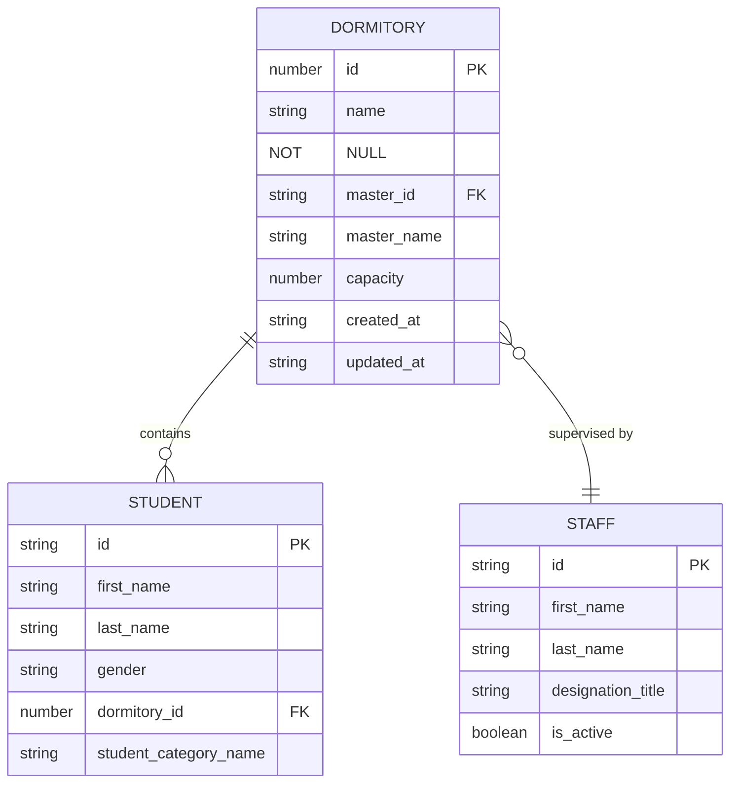
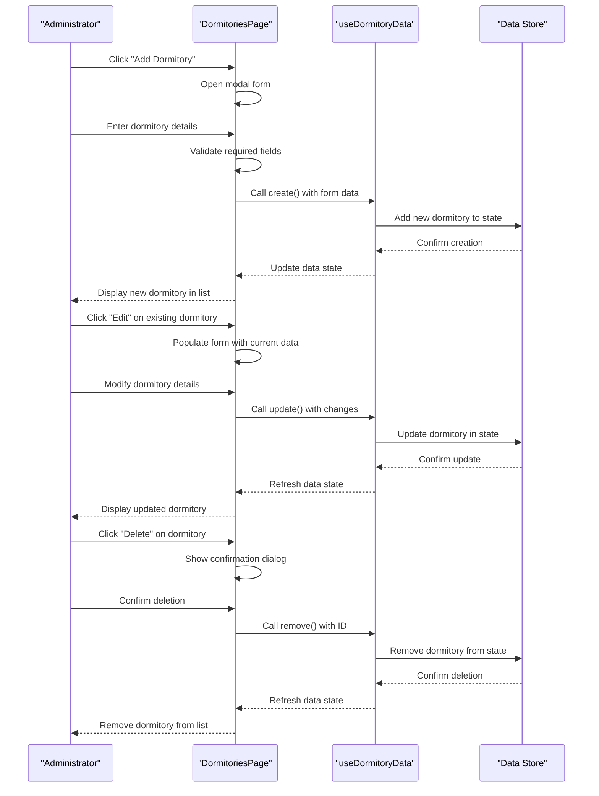
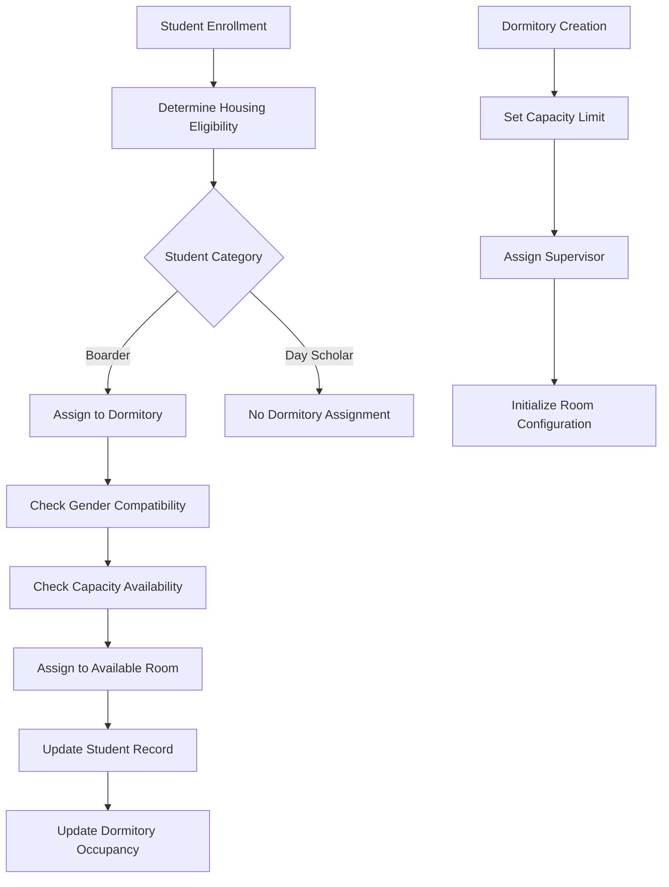
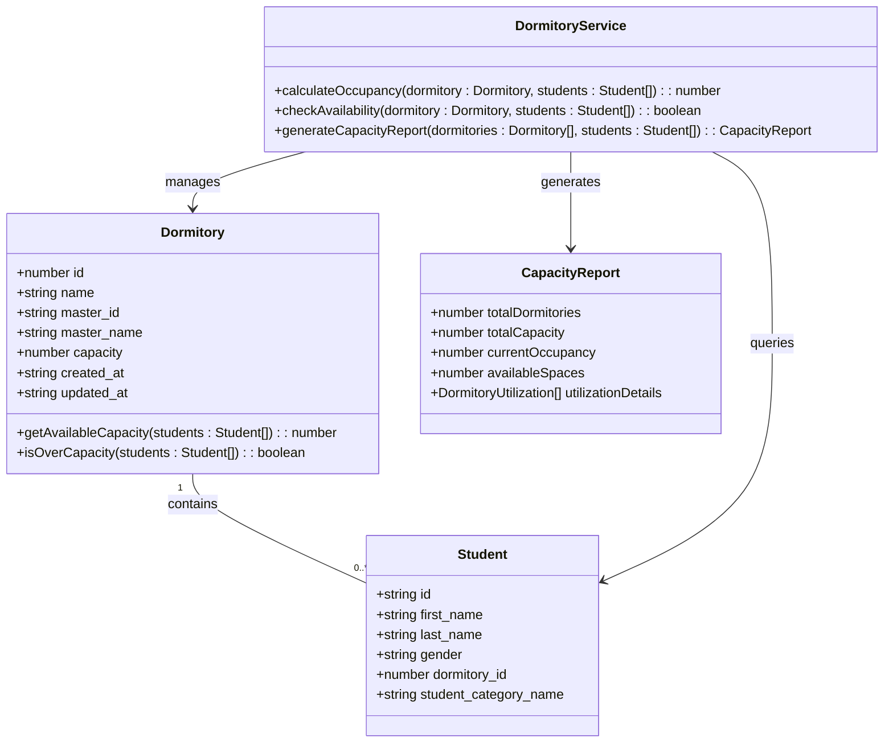
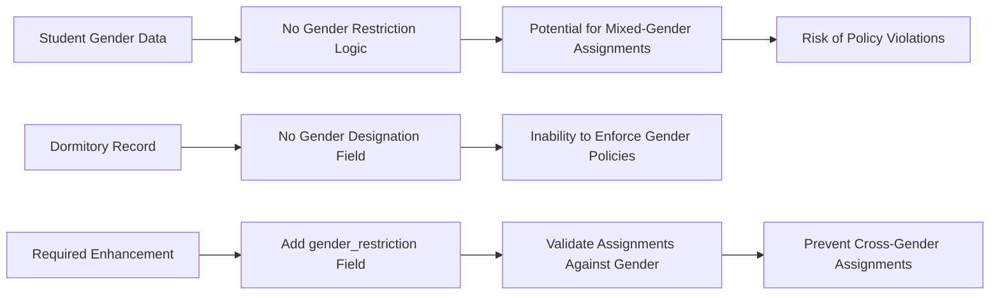
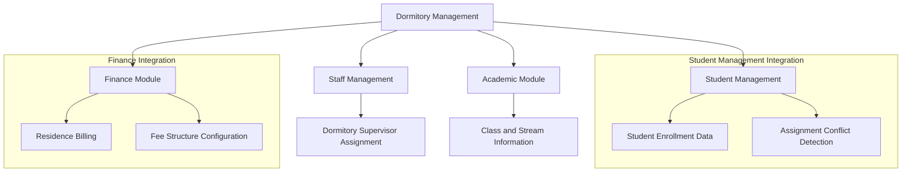
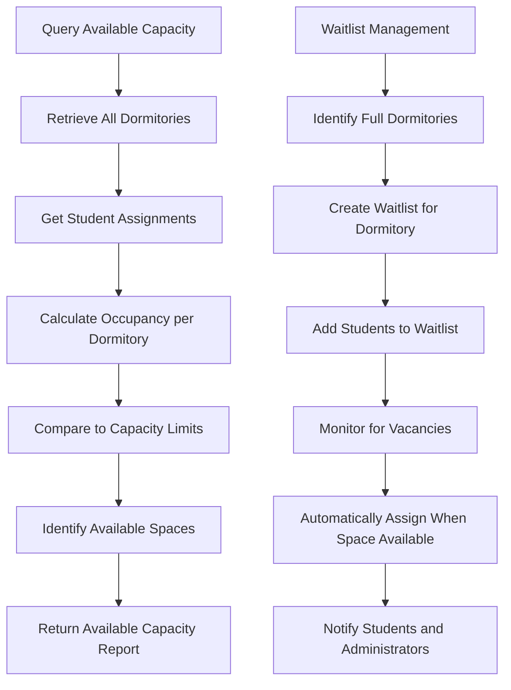
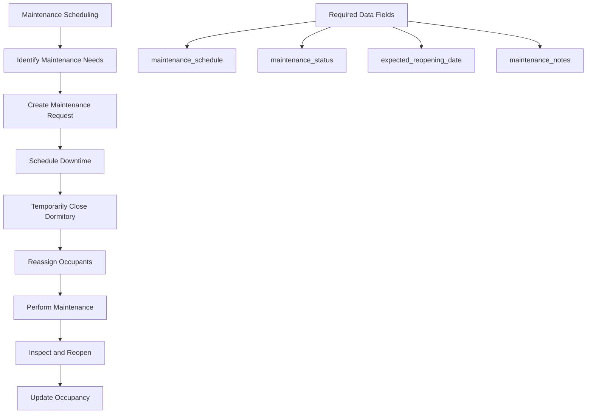

# Dormitory Management

<cite>
**Referenced Files in This Document**   
- [DormitoriesPage.tsx](file://src/modules/administration/pages/DormitoriesPage.tsx)
- [useDormitoryData.ts](file://src/modules/administration/data/useDormitoryData.ts)
- [mockData.ts](file://src/modules/administration/data/mockData.ts)
- [types.ts](file://src/core/types.ts)
- [schema.ts](file://src/livestore/schema.ts)
</cite>

## Table of Contents
1. [Introduction](#introduction)
2. [Data Model](#data-model)
3. [Dormitory Records and CRUD Operations](#dormitory-records-and-crud-operations)
4. [Room Allocation and Student Assignment](#room-allocation-and-student-assignment)
5. [Capacity Tracking and Over-Allocation Prevention](#capacity-tracking-and-over-allocation-prevention)
6. [Gender-Based Restrictions](#gender-based-restrictions)
7. [Integration with Student Management and Finance](#integration-with-student-management-and-finance)
8. [Querying Available Capacity and Waitlists](#querying-available-capacity-and-waitlists)
9. [Maintenance Scheduling](#maintenance-scheduling)

## Introduction
The Dormitory Management sub-feature within the Auxiliary Management system provides comprehensive functionality for managing student housing. This system enables administrators to create and manage dormitory records, assign students to rooms, track capacity utilization, and enforce gender-based restrictions. The implementation leverages React hooks for state management and integrates with the broader student information system to ensure data consistency across modules. While the current implementation provides core functionality for dormitory management, there are opportunities to enhance validation logic for capacity limits and gender restrictions.

## Data Model
The dormitory data model is defined across multiple files in the system, establishing a consistent structure for dormitory records throughout the application.

**Diagram sources**
- [types.ts](file://src/core/types.ts#L539-L547)
- [schema.ts](file://src/livestore/schema.ts#L31-L381)

**Section sources**
- [types.ts](file://src/core/types.ts#L539-L547)
- [schema.ts](file://src/livestore/schema.ts#L31-L381)

The Dormitory interface defines the core properties of a dormitory record:
- **id**: Unique identifier for the dormitory
- **name**: Name of the dormitory (e.g., "Simba House")
- **master_id**: Reference to the staff member responsible for the dormitory
- **master_name**: Denormalized field for the supervisor's name
- **capacity**: Maximum number of students the dormitory can accommodate
- **created_at**: Timestamp of record creation
- **updated_at**: Timestamp of last modification

The implementation shows a discrepancy between the TypeScript interface and the database schema. While the interface in `types.ts` does not include a capacity field, the actual implementation in the DormitoriesPage component and mock data demonstrates that capacity is a functional field in the system.

## Dormitory Records and CRUD Operations
The system provides full CRUD (Create, Read, Update, Delete) operations for managing dormitory records through the DormitoriesPage component and the useDormitoryData hook.

**Diagram sources**
- [DormitoriesPage.tsx](file://src/modules/administration/pages/DormitoriesPage.tsx#L15-L186)
- [useDormitoryData.ts](file://src/modules/administration/data/useDormitoryData.ts#L7-L39)

**Section sources**
- [DormitoriesPage.tsx](file://src/modules/administration/pages/DormitoriesPage.tsx#L15-L186)
- [useDormitoryData.ts](file://src/modules/administration/data/useDormitoryData.ts#L7-L39)

The useDormitoryData hook provides the core CRUD functionality:
- **create**: Adds a new dormitory record with a generated ID and timestamps
- **update**: Modifies an existing dormitory record and updates the timestamp
- **remove**: Deletes a dormitory record by ID

The DormitoriesPage component serves as the user interface for these operations, providing a data grid to view all dormitories and a modal form for creating and editing records. The form includes validation to ensure the dormitory name is provided before submission.

## Room Allocation and Student Assignment
Student assignment to dormitories is managed through the student data model, which includes a dormitory_id field that creates a relationship between students and their assigned dormitories.

**Diagram sources**
- [mockData.ts](file://src/modules/administration/data/mockData.ts#L170-L369)
- [DormitoriesPage.tsx](file://src/modules/administration/pages/DormitoriesPage.tsx#L15-L186)

**Section sources**
- [mockData.ts](file://src/modules/administration/data/mockData.ts#L170-L369)
- [DormitoriesPage.tsx](file://src/modules/administration/pages/DormitoriesPage.tsx#L15-L186)

The system uses student categories to determine housing eligibility. In the mock data, students with student_category_id: 1 are designated as "Boarder" and are assigned to dormitories, while those with student_category_id: 2 are "Day Scholar" and do not receive dormitory assignments. The assignment process links students to dormitories through the dormitory_id field in the student record, with corresponding dormitory_name for display purposes.

## Capacity Tracking and Over-Allocation Prevention
The system includes capacity tracking functionality, though the current implementation lacks validation to prevent over-allocation of students beyond a dormitory's capacity.

**Diagram sources**
- [types.ts](file://src/core/types.ts#L539-L547)
- [mockData.ts](file://src/modules/administration/data/mockData.ts#L170-L369)

**Section sources**
- [types.ts](file://src/core/types.ts#L539-L547)
- [mockData.ts](file://src/modules/administration/data/mockData.ts#L170-L369)

The system defines a capacity field for dormitories, as evidenced by the form in DormitoriesPage.tsx that includes a capacity input field. However, there is no validation logic to prevent assigning more students to a dormitory than its defined capacity. The mock data shows two dormitories: "Simba House" (ID: 1) and "Twiga Block" (ID: 2), with multiple students assigned to each. A proper implementation would calculate occupancy by counting students with matching dormitory_id values and comparing this to the capacity limit.

## Gender-Based Restrictions
The current implementation does not enforce gender-based restrictions for dormitory assignments, despite the presence of gender data in student records.

**Diagram sources**
- [types.ts](file://src/core/types.ts#L539-L547)
- [mockData.ts](file://src/modules/administration/data/mockData.ts#L170-L369)

**Section sources**
- [types.ts](file://src/core/types.ts#L539-L547)
- [mockData.ts](file://src/modules/administration/data/mockData.ts#L170-L369)

Student records include a gender field with values like PersonGender.MALE and PersonGender.FEMALE, but the dormitory management system does not utilize this information for assignment decisions. The dormitory data model lacks a gender_restriction field that would specify whether a dormitory is for male students, female students, or mixed gender. This absence creates a risk of policy violations and inappropriate room assignments. A robust implementation would include gender restriction rules and validate student assignments against these rules.

## Integration with Student Management and Finance
The dormitory management system integrates with other modules in the educational platform, particularly Student Management and Finance, to ensure cohesive operation across administrative functions.

**Diagram sources**
- [DormitoriesPage.tsx](file://src/modules/administration/pages/DormitoriesPage.tsx#L15-L186)
- [mockData.ts](file://src/modules/administration/data/mockData.ts#L170-L369)

**Section sources**
- [DormitoriesPage.tsx](file://src/modules/administration/pages/DormitoriesPage.tsx#L15-L186)
- [mockData.ts](file://src/modules/administration/data/mockData.ts#L170-L369)

The integration with Student Management allows for:
- Access to student enrollment data for assignment decisions
- Detection of assignment conflicts (e.g., duplicate dormitory assignments)
- Synchronization of student status changes (e.g., withdrawal affecting housing)

The integration with Finance enables:
- Residence billing based on dormitory assignment
- Configuration of fee structures tied to housing categories
- Generation of financial reports that include housing charges

The system already establishes relationships between dormitories and staff members through the master_id field, allowing for supervisor assignment and accountability.

## Querying Available Capacity and Waitlists
While the system tracks dormitory capacity, it lacks functionality for querying available spaces and managing waitlists for full dormitories.

**Diagram sources**
- [useDormitoryData.ts](file://src/modules/administration/data/useDormitoryData.ts#L7-L39)
- [mockData.ts](file://src/modules/administration/data/mockData.ts#L170-L369)

**Section sources**
- [useDormitoryData.ts](file://src/modules/administration/data/useDormitoryData.ts#L7-L39)
- [mockData.ts](file://src/modules/administration/data/mockData.ts#L170-L369)

The current implementation does not provide explicit functions for querying available capacity or managing waitlists. However, this functionality could be implemented by:
1. Creating a service function that calculates the difference between capacity and current occupancy for each dormitory
2. Implementing a query method that returns dormitories with available spaces
3. Developing a waitlist system that tracks students awaiting dormitory placement
4. Adding notification mechanisms for when spaces become available

The useDormitoryData hook provides the foundational data access methods that could be extended to support these capabilities.

## Maintenance Scheduling
The system does not currently include functionality for scheduling dormitory maintenance, which is a critical aspect of dormitory management.

**Diagram sources**
- [types.ts](file://src/core/types.ts#L539-L547)
- [schema.ts](file://src/livestore/schema.ts#L31-L381)

**Section sources**
- [types.ts](file://src/core/types.ts#L539-L547)
- [schema.ts](file://src/livestore/schema.ts#L31-L381)

The current dormitory data model lacks fields to support maintenance scheduling, such as:
- **maintenance_schedule**: Regular maintenance intervals
- **maintenance_status**: Current status (e.g., "Operational", "Under Maintenance")
- **expected_reopening_date**: When a closed dormitory will be available again
- **maintenance_notes**: Details about required or completed work

Implementing maintenance scheduling would require enhancing the data model and adding a user interface for creating and managing maintenance requests. This would help prevent assigning students to dormitories that are unavailable due to maintenance work.