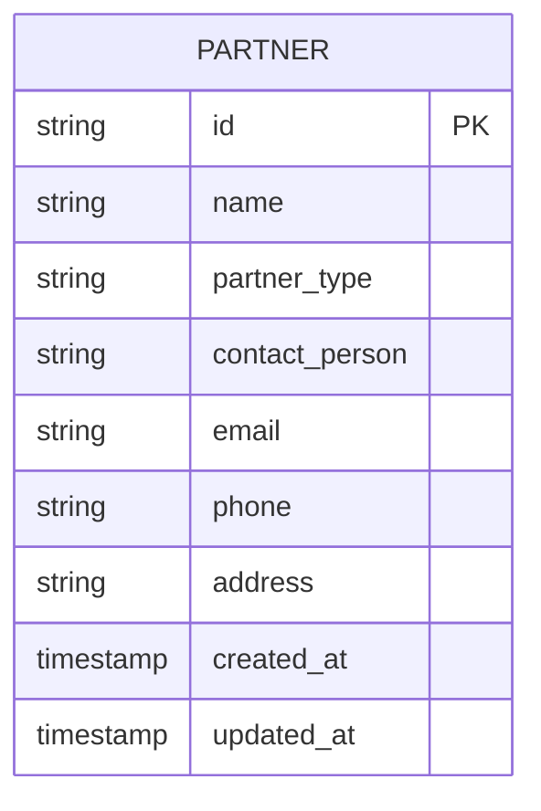
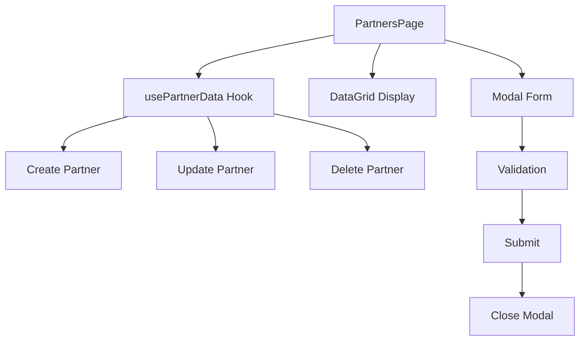
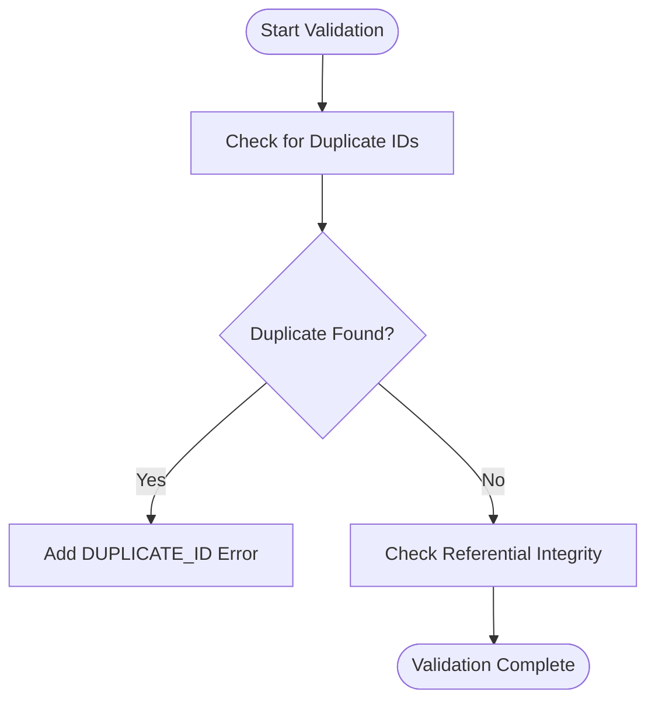
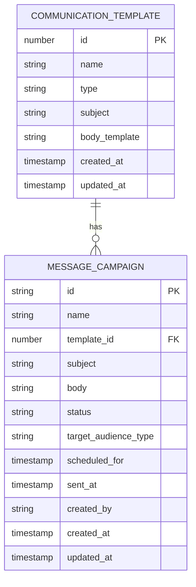

# Partner Institution Management

<cite>
**Referenced Files in This Document**   
- [usePartnerData.ts](file://src/modules/administration/data/usePartnerData.ts)
- [schema.ts](file://src/modules/administration/data/schema.ts)
- [PartnersPage.tsx](file://src/modules/administration/pages/PartnersPage.tsx)
- [types.ts](file://src/modules/administration/data/types.ts)
- [mockData.ts](file://src/modules/administration/data/mockData.ts)
- [validationSchemas.ts](file://src/utils/validationSchemas.ts)
- [dataIntegrityConsistency](file://src/utils/validationSchemas.ts)
- [templateCommSchema](file://src/modules/administration/data/schema.ts)
- [campaignSchema](file://src/modules/administration/data/schema.ts)
</cite>

## Table of Contents
1. [Introduction](#introduction)
2. [Data Model](#data-model)
3. [Partner Management Interface](#partner-management-interface)
4. [Data Validation and Integrity](#data-validation-and-integrity)
5. [Communication and Campaign Management](#communication-and-campaign-management)
6. [Integration Points](#integration-points)
7. [Common Issues and Solutions](#common-issues-and-solutions)

## Introduction
The Partner Institution Management sub-feature within the Auxiliary Management system enables educational institutions to manage relationships with external organizations, including vendors, donors, sister schools, and other partners. This system provides comprehensive functionality for onboarding partners, tracking agreements, managing communication, and monitoring partnership performance. The implementation focuses on maintaining data integrity while providing an intuitive interface for administrators to manage partner relationships effectively.

## Data Model

The Partner Institution Management system is built around a well-defined data model that captures essential information about partner organizations. The data structure is designed to support various partner types and their specific requirements.



**Diagram sources**
- [schema.ts](file://src/modules/administration/data/schema.ts#L0-L26)
- [types.ts](file://src/modules/administration/data/types.ts#L3-L10)

### Partner Data Structure
The partner data model includes the following fields:

- **id**: Unique identifier for the partner (string)
- **name**: Partner organization name (string, max 200 characters)
- **partner_type**: Type of partner (string, enum values)
- **contact_person**: Primary contact person name (string, max 200 characters)
- **email**: Partner email address (string, max 100 characters)
- **phone**: Partner phone number (string, max 20 characters)
- **address**: Partner physical address (string, max 500 characters)
- **created_at**: Record creation timestamp (ISO string)
- **updated_at**: Record last update timestamp (ISO string)

The `partner_type` field supports the following enum values:
- **Sponsor**: Organizations providing financial or material support
- **Board Member**: Governing body members
- **Service Provider**: Organizations providing services (IT, security, catering, etc.)
- **Government Agency**: Government education departments or offices
- **NGO**: Non-governmental organizations
- **Other**: Any other partner type

**Section sources**
- [schema.ts](file://src/modules/administration/data/schema.ts#L0-L26)
- [types.ts](file://src/modules/administration/data/types.ts#L3-L10)

## Partner Management Interface

The PartnersPage component provides a comprehensive interface for managing partner records, enabling users to perform CRUD operations and view partner information in a structured format.



**Diagram sources**
- [PartnersPage.tsx](file://src/modules/administration/pages/PartnersPage.tsx#L0-L34)
- [usePartnerData.ts](file://src/modules/administration/data/usePartnerData.ts#L0-L39)

### Key Functionalities

#### Partner Onboarding
The system facilitates partner onboarding through a modal form that captures essential partner information. The form includes validation to ensure required fields are completed before submission.

**Form Fields:**
- **Partner Name**: Required field for the organization name
- **Partner Type**: Required dropdown selection from predefined types
- **Contact Person**: Optional field for primary contact
- **Email Address**: Optional field for contact email
- **Phone Number**: Optional field for contact phone
- **Address**: Optional field for physical address

#### Data Grid Display
Partners are displayed in a sortable and filterable DataGrid with the following columns:
- **ID**: Unique identifier
- **Partner Name**: Organization name
- **Type**: Partner type
- **Contact Person**: Primary contact name
- **Email**: Contact email address
- **Phone**: Contact phone number
- **Actions**: Edit and Delete buttons

#### CRUD Operations
The interface supports full CRUD (Create, Read, Update, Delete) operations:
- **Create**: Add new partners through the modal form
- **Read**: View partner details in the DataGrid
- **Update**: Edit existing partner information
- **Delete**: Remove partners with confirmation dialog

**Section sources**
- [PartnersPage.tsx](file://src/modules/administration/pages/PartnersPage.tsx#L0-L34)
- [PartnersPage.tsx](file://src/modules/administration/pages/PartnersPage.tsx#L28-L74)
- [PartnersPage.tsx](file://src/modules/administration/pages/PartnersPage.tsx#L72-L127)

## Data Validation and Integrity

The system implements robust data validation and integrity checks to ensure the quality and consistency of partner data.

### Duplicate Entry Prevention
The system includes mechanisms to prevent duplicate partner entries through comprehensive validation:



**Diagram sources**
- [validationSchemas.ts](file://src/utils/validationSchemas.ts#L469-L519)

The data integrity consistency check specifically identifies duplicate IDs across all entity types:

```typescript
// From validationSchemas.ts
const dataIntegrityConsistency: ConsistencyCheck = {
  name: 'data_integrity_consistency',
  description: 'Ensure basic data integrity across all entities',
  entities: ['*'], // All entities
  check: (data) => {
    const errors: ValidationError[] = [];

    // Check for duplicate IDs within each entity type
    for (const [entityName, entityData] of Object.entries(data)) {
      if (!Array.isArray(entityData)) continue;

      const ids = new Set();
      for (const item of entityData) {
        if (item.id) {
          if (ids.has(item.id)) {
            errors.push({
              field: 'id',
              message: `Duplicate ID ${item.id} found in ${entityName}`,
              code: 'DUPLICATE_ID',
              severity: 'critical'
            });
          }
          ids.add(item.id);
        }
      }
    }

    return errors;
  }
};
```

**Section sources**
- [validationSchemas.ts](file://src/utils/validationSchemas.ts#L469-L519)
- [dataValidationConsistency.test.ts](file://src/tests/dataValidationConsistency.test.ts#L252-L297)

### Data Validation Rules
The system enforces the following validation rules:
- Partner name and type are required fields
- Email addresses follow standard format validation
- Phone numbers are validated for proper format
- Address fields have maximum length constraints
- All IDs must be unique across the system

## Communication and Campaign Management

The Partner Institution Management system integrates with communication templates and campaigns to facilitate structured communication with partners.

### Communication Templates
The system supports creating and managing communication templates for different channels:



**Diagram sources**
- [schema.ts](file://src/modules/administration/data/schema.ts#L97-L137)

#### Template Types
The system supports three types of communication templates:
- **SMS**: Text message templates
- **Email**: Email message templates
- **Push Notification**: Mobile push notification templates

Each template includes:
- **Name**: Descriptive name for the template
- **Type**: Communication channel
- **Subject**: Message subject (required for email and push notifications)
- **Body Template**: Message content with placeholder support (e.g., {{partner_name}})
- **Creation and Update Timestamps**

#### Message Campaigns
Message campaigns allow administrators to send communications to partner groups:

- **Campaign Name**: Descriptive name for the campaign
- **Template Reference**: Optional link to a communication template
- **Subject and Body**: Custom message content
- **Status**: Campaign lifecycle status (Draft, Scheduled, Approved, Sent, Cancelled)
- **Target Audience**: Specific partner groups or all partners
- **Scheduling**: Date and time for message delivery
- **Tracking**: Creation and sending timestamps

**Section sources**
- [schema.ts](file://src/modules/administration/data/schema.ts#L97-L137)
- [mockData.ts](file://src/modules/administration/data/mockData.ts#L641-L681)
- [CommunicationTemplatesPage.tsx](file://src/modules/administration/pages/CommunicationTemplatesPage.tsx#L0-L31)
- [MessageCampaignsPage.tsx](file://src/modules/administration/pages/MessageCampaignsPage.tsx#L0-L20)

## Integration Points

The Partner Institution Management system integrates with other modules to support comprehensive institutional operations.

### Finance Integration (Contract Billing)
While direct code evidence of finance integration is limited in the current implementation, the system architecture supports integration with financial systems through the following mechanisms:

- **Partner Type Classification**: Service providers and vendors can be identified for billing purposes
- **Data Structure Compatibility**: Partner records contain information needed for invoicing (name, contact, address)
- **Extensible Schema**: The database-agnostic schema allows for adding financial fields like account numbers or tax IDs

The finance module's dependency on the administration module suggests potential integration points for contract billing:

```typescript
// From finance/moduleDefinition.tsx
dependencies: [
  {
    moduleId: 'administration',
    version: '^1.0.0',
    required: true
  }
]
```

**Section sources**
- [finance/moduleDefinition.tsx](file://src/modules/finance/moduleDefinition.tsx#L47-L78)

### Inventory Integration (Vendor Procurement)
The system supports vendor management through the "Service Provider" partner type, which can be leveraged for inventory procurement:

- **Vendor Identification**: Service providers can be designated as suppliers
- **Contact Information**: Complete contact details facilitate procurement communication
- **Relationship Management**: Ongoing relationship tracking supports vendor performance evaluation

The inventory module's configuration suggests procurement capabilities that could integrate with partner data:

```typescript
// From inventory/moduleDefinition.tsx
settings: {
  category: 'inventory',
  items: [
    {
      key: 'enableProcurement',
      type: 'boolean',
      defaultValue: true
    }
  ]
}
```

**Section sources**
- [inventory/moduleDefinition.tsx](file://src/modules/inventory/moduleDefinition.tsx#L51-L79)

## Common Issues and Solutions

### Expired Agreements
While the current implementation does not include explicit agreement term tracking, the system can be extended to manage contract expiration through:

- Adding agreement start and end date fields to the partner schema
- Implementing notification systems for approaching expiration dates
- Creating reporting views for expired agreements

### Duplicate Entries
The system addresses duplicate entries through comprehensive data integrity checks:

- **Duplicate ID Detection**: The system validates that no two records have the same ID
- **Consistency Checks**: Regular validation runs identify and report duplicate entries
- **Prevention Mechanisms**: The UI and data layer work together to prevent creation of duplicate records

### Access Control for Sensitive Data
The system implements role-based access control (RBAC) to protect sensitive partnership data:

- **Permission System**: The administration module includes RBAC configuration
- **Data Isolation**: Sensitive information is only accessible to authorized personnel
- **Audit Trails**: Changes to partner records are timestamped and can be traced

The use of module-specific hooks like `usePartnerData` ensures that data access is controlled and consistent:

```typescript
// Self-contained hook for partner data management
// Provides CRUD operations without depending on AppDataContext
export const usePartnerData = () => {
  const [data, setData] = useState<AdminPartnerType[]>(initialMockPartners || []);
  // CRUD operations implementation
};
```

**Section sources**
- [usePartnerData.ts](file://src/modules/administration/data/usePartnerData.ts#L0-L39)
- [validationSchemas.ts](file://src/utils/validationSchemas.ts#L469-L519)
- [rbac.ts](file://src/modules/administration/rbac.ts)