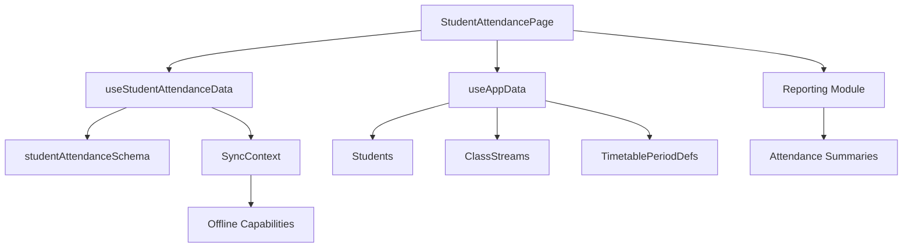
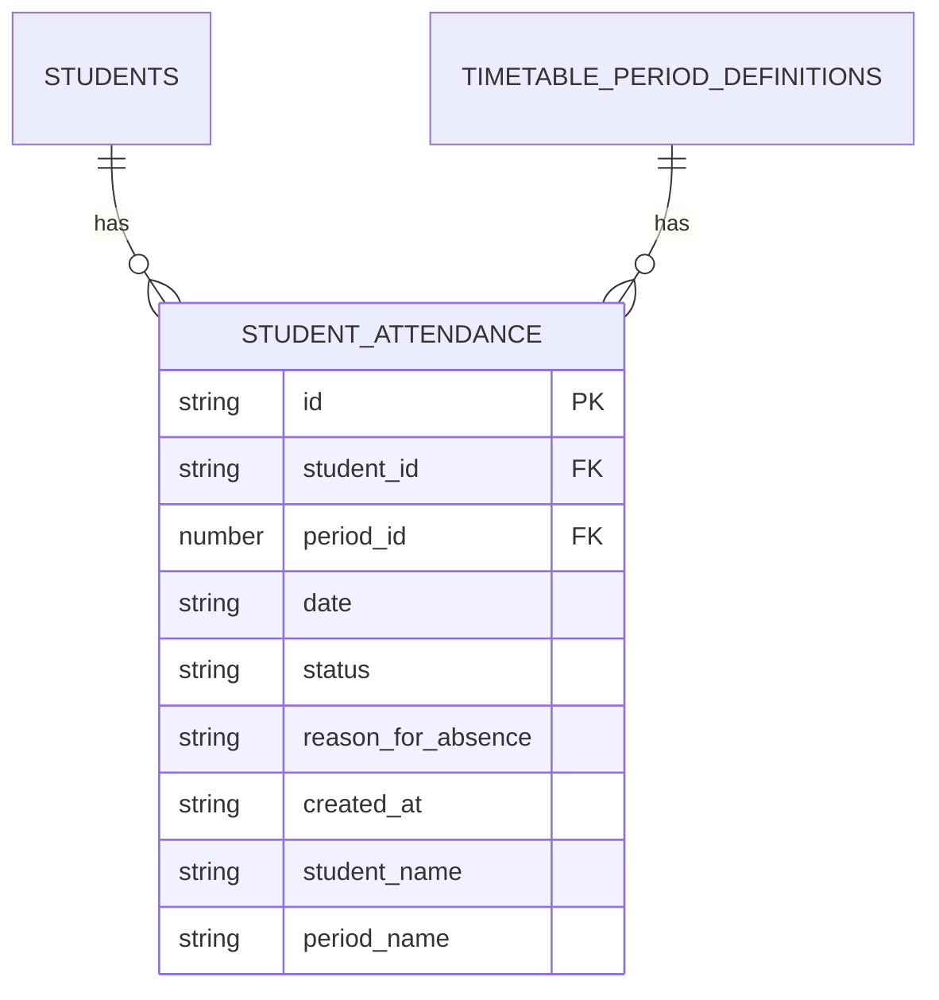
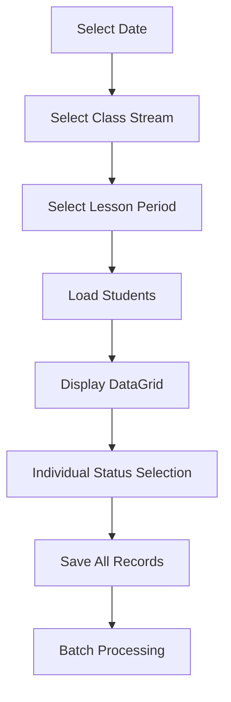
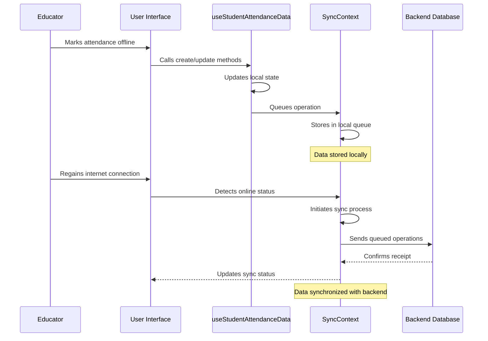

# Attendance Tracking

<cite>
**Referenced Files in This Document**   
- [StudentAttendancePage.tsx](file://src/modules/administration/pages/StudentAttendancePage.tsx)
- [schema.ts](file://src/modules/administration/data/schema.ts)
- [types.ts](file://src/modules/administration/data/types.ts)
- [useStudentAttendanceData.ts](file://src/modules/administration/data/useStudentAttendanceData.ts)
- [mockData.ts](file://src/modules/administration/data/mockData.ts)
- [SyncContext.tsx](file://src/contexts/SyncContext.tsx)
- [ReportsPage.tsx](file://src/modules/reports/pages/ReportsPage.tsx)
</cite>

## Table of Contents
1. [Introduction](#introduction)
2. [Core Components](#core-components)
3. [Student Attendance Data Model](#student-attendance-data-model)
4. [Daily Attendance Marking Implementation](#daily-attendance-marking-implementation)
5. [Status Categorization and Batch Entry](#status-categorization-and-batch-entry)
6. [useStudentAttendanceData Hook Analysis](#usestudentattendancedata-hook-analysis)
7. [Offline Capabilities and Sync Management](#offline-capabilities-and-sync-management)
8. [Edge Case Handling](#edge-case-handling)
9. [Reporting Integration](#reporting-integration)
10. [Performance Optimization](#performance-optimization)
11. [Best Practices](#best-practices)

## Introduction
The Attendance Tracking sub-feature within the Administration module provides a comprehensive solution for managing student attendance across various class streams and lesson periods. This system enables educators to mark daily attendance, categorize student status, and handle batch entry operations efficiently. Built with offline-first capabilities, the system ensures data integrity through robust synchronization mechanisms and conflict resolution strategies. The implementation leverages a well-defined data model with optimized indexing for high-frequency operations across large student populations. This documentation provides a detailed analysis of the system's architecture, functionality, and integration points, offering insights into best practices for ensuring data accuracy and optimal performance.

## Core Components

The Attendance Tracking system comprises several interconnected components that work together to provide a seamless user experience. The primary components include the StudentAttendancePage interface, the StudentAttendance data model, the useStudentAttendanceData hook for data management, and supporting infrastructure for offline capabilities and reporting integration. These components follow a modular architecture that promotes reusability and maintainability.



**Diagram sources**
- [StudentAttendancePage.tsx](file://src/modules/administration/pages/StudentAttendancePage.tsx)
- [useStudentAttendanceData.ts](file://src/modules/administration/data/useStudentAttendanceData.ts)
- [schema.ts](file://src/modules/administration/data/schema.ts)

**Section sources**
- [StudentAttendancePage.tsx](file://src/modules/administration/pages/StudentAttendancePage.tsx#L0-L213)
- [useStudentAttendanceData.ts](file://src/modules/administration/data/useStudentAttendanceData.ts#L0-L42)

## Student Attendance Data Model

The StudentAttendance data model is designed to capture comprehensive attendance information while maintaining referential integrity with related entities. The schema defines essential fields for tracking attendance records with appropriate data types, constraints, and indexing strategies to optimize query performance.

### Schema Definition
The data model is defined in the administration module's schema.ts file using database-agnostic schema definitions that can be utilized by various database providers.



**Diagram sources**
- [schema.ts](file://src/modules/administration/data/schema.ts#L97-L117)

### Field Specifications
The StudentAttendance model includes the following fields with their respective types and constraints:

: **id**: Unique identifier for the attendance record (string, primary key)
: **student_id**: Reference to the student entity (string, foreign key to students collection)
: **period_id**: Reference to the timetable period definition (number, foreign key to timetable_period_definitions collection)
: **date**: Attendance date in string format (string, maxLength: 20)
: **status**: Attendance status from predefined enum values (string, enum: PRESENT, ABSENT, LATE, EXCUSED)
: **reason_for_absence**: Optional reason for absence (string, maxLength: 200)
: **created_at**: Record creation timestamp (string, ISO format)
: **student_name**: Denormalized student name for display purposes (string, maxLength: 200)
: **period_name**: Denormalized period name for display purposes (string, maxLength: 100)

### Relationships and Indexing
The data model establishes foreign key relationships with the students and timetable_period_definitions collections to maintain data integrity. Strategic indexing is implemented on key fields to optimize query performance:

: **Foreign Key Relationships**:
  - student_id references the students collection
  - period_id references the timetable_period_definitions collection

: **Indexes**:
  - student_id: Optimizes queries filtering by specific student
  - date: Enhances performance for date-range queries
  - period_id: Improves lookup speed for period-specific attendance

These indexing strategies ensure efficient retrieval of attendance records when generating reports or displaying attendance data for specific date ranges, classes, or periods.

**Section sources**
- [schema.ts](file://src/modules/administration/data/schema.ts#L97-L117)
- [types.ts](file://src/modules/administration/data/types.ts#L108-L165)

## Daily Attendance Marking Implementation

The daily attendance marking functionality is implemented in the StudentAttendancePage component, providing an intuitive interface for educators to record attendance for students in specific class streams and lesson periods.

### User Interface Components
The interface consists of three primary selection controls that allow users to specify the context for attendance marking:

: **Attendance Date**: A date input field that defaults to the current date
: **Class Stream**: A dropdown selector populated with available class streams
: **Lesson Period**: A dropdown selector showing timetable periods with their start and end times

When these filters are selected, the system loads the students enrolled in the specified class stream and retrieves any existing attendance records for the selected date and period.

### Data Loading and Initialization
The implementation uses React's useEffect hook to manage the data loading lifecycle based on filter selections:

```typescript
useEffect(() => {
  if (selectedDate && selectedClassStreamId && selectedPeriodId) {
    setPageLoading(true);
    // Get existing attendance records
    const existingRecords = getStudentAttendanceByFilters(selectedDate, selectedClassStreamId, selectedPeriodId);
    const newAttendanceData: AttendanceData = {};
    studentsInSelectedStream.forEach(student => {
      const record = existingRecords.find((ar: StudentAttendance) => ar.student_id === student.id);
      newAttendanceData[student.id] = record ? record.status : AttendanceStatus.PRESENT; // Default to present
    });
    setAttendanceData(newAttendanceData);
    setPageLoading(false);
  } else {
    setAttendanceData({}); // Clear data if filters are not set
  }
}, [selectedDate, selectedClassStreamId, selectedPeriodId, studentsInSelectedStream, studentAttendance]);
```

This approach ensures that the attendance interface is populated with existing data when available, while providing a default "Present" status for students without existing records.

### Save Functionality
The attendance records are saved through the handleSaveAttendance function, which processes all students in the selected class stream:

```typescript
const handleSaveAttendance = async () => {
  if (!selectedDate || !selectedClassStreamId || !selectedPeriodId || studentsInSelectedStream.length === 0) {
    alert(t('validation.pleaseSelectDateClassStreamPeriodAndEnsureStudentsAreLoaded'));
    return;
  }
  setSaving(true);
  
  // Save each attendance record
  studentsInSelectedStream.forEach(student => {
    const attendanceRecord: Omit<StudentAttendance, 'id'> = {
      student_id: student.id,
      date: selectedDate,
      period_id: selectedPeriodId!,
      status: attendanceData[student.id] || AttendanceStatus.PRESENT,
      student_name: `${student.first_name} ${student.last_name}`,
      period_name: availablePeriods.find(p => p.id === selectedPeriodId)?.period_name,
    };
    addStudentAttendance(attendanceRecord);
  });
  
  setSaving(false);
  alert(t('messages.attendanceSavedSuccessfully'));
};
```

The function validates required fields, iterates through each student in the class stream, creates attendance records with appropriate denormalized data, and saves them using the addStudentAttendance method from the useStudentAttendanceData hook.

**Section sources**
- [StudentAttendancePage.tsx](file://src/modules/administration/pages/StudentAttendancePage.tsx#L0-L213)

## Status Categorization and Batch Entry

The system implements a comprehensive status categorization system and supports efficient batch entry of attendance records for entire class streams.

### Attendance Status Categories
The AttendanceStatus enum defines four distinct attendance categories that provide granular tracking of student presence:

: **PRESENT**: Student attended the full lesson period
: **ABSENT**: Student was completely absent from the lesson
: **LATE**: Student arrived after the lesson started
: **EXCUSED**: Student was absent with a valid excuse

These status values are defined in the administration module's types.ts file and are used consistently throughout the application:

```typescript
export enum AttendanceStatus {
    PRESENT = 'Present',
    ABSENT = 'Absent',
    LATE = 'Late',
    EXCUSED = 'Excused'
}
```

### Batch Entry Implementation
The system supports batch entry of attendance records through the DataGrid component, which displays all students in the selected class stream with their respective status selection controls:



The DataGrid renders a row for each student with radio button options for each attendance status. This interface allows educators to quickly mark attendance for multiple students in a single operation, significantly improving efficiency compared to individual record entry.

### UI Implementation Details
The attendance columns are defined with a custom render function that displays radio buttons for status selection:

```typescript
const attendanceColumns: DataGridColumn<Student>[] = [
  { 
    key: 'admission_no',
    header: 'Adm No.', 
    sortable: true,
    filterable: true,
    width: 120,
    render: (value, item) => item.admission_no
  },
  { 
    key: 'student_name',
    header: 'Student Name', 
    sortable: true,
    filterable: true,
    width: 200,
    render: (value, item) => `${item.first_name} ${item.last_name}`
  },
  {
    key: 'status',
    header: 'Status',
    sortable: false,
    filterable: false,
    width: 400,
    render: (value, student) => (
      <div className="flex space-x-2 items-center">
        {Object.values(AttendanceStatus).map(status => (
          <label key={status} className="flex items-center space-x-1 cursor-pointer text-sm">
            <input
              type="radio"
              name={`attendance-${student.id}`}
              value={status}
              checked={attendanceData[student.id] === status}
              onChange={() => handleStatusChange(student.id, status)}
              className="form-radio h-4 w-4 text-indigo-600 transition duration-150 ease-in-out"
            />
            <span>{status}</span>
          </label>
        ))}
      </div>
    ),
  },
];
```

This implementation provides a user-friendly interface for batch attendance marking while maintaining data consistency through the attendanceData state object.

**Section sources**
- [types.ts](file://src/modules/administration/data/types.ts#L50-L105)
- [StudentAttendancePage.tsx](file://src/modules/administration/pages/StudentAttendancePage.tsx#L122-L184)

## useStudentAttendanceData Hook Analysis

The useStudentAttendanceData hook provides the core data management functionality for the attendance system, implementing CRUD operations with state management for attendance records.

### Hook Implementation
The hook is implemented as a self-contained module that manages attendance data without depending on the AppDataContext, making it reusable across different components:

```typescript
export const useStudentAttendanceData = () => {
  const [data, setData] = useState<StudentAttendance[]>(initialMockStudentAttendance);

  const create = async (newItem: Partial<StudentAttendance>) => {
    const newDataItem: StudentAttendance = {
      ...newItem,
      id: Date.now(),
      created_at: new Date().toISOString(),
      updated_at: new Date().toISOString()
    } as StudentAttendance;
    setData((prev: StudentAttendance[]) => [...prev, newDataItem]);
    return newDataItem;
  };

  const update = async (id: number, updatedData: Partial<StudentAttendance>) => {
    setData((prev: StudentAttendance[]) => prev.map((item: StudentAttendance) => 
      item.id === id 
        ? { ...item, ...updatedData, updated_at: new Date().toISOString() }
        : item
    ));
  };

  const remove = async (id: number) => {
    setData((prev: StudentAttendance[]) => prev.filter((item: StudentAttendance) => item.id !== id));
  };

  return {
    data,
    create,
    update,
    remove
  };
};
```

### Key Features
The hook provides the following functionality:

: **State Management**: Uses React's useState hook to maintain the attendance data in component state
: **Create Operation**: Generates new attendance records with unique IDs and timestamps
: **Update Operation**: Modifies existing records while preserving data integrity
: **Remove Operation**: Deletes records from the collection
: **Initial Data**: Populates with mock data from initialMockStudentAttendance

### Data Structure
The hook works with the StudentAttendance interface defined in the types system:

```typescript
export interface AdminStudentAttendanceType {
  id: string;
  student_id: string;
  period_id: number;
  date: string;
  status: AttendanceStatus;
  reason_for_absence?: string;
  created_at?: string;
  student_name?: string;
  period_name?: string;
}
```

The hook exposes the data array and CRUD methods through a clean API that can be easily consumed by the StudentAttendancePage component.

**Section sources**
- [useStudentAttendanceData.ts](file://src/modules/administration/data/useStudentAttendanceData.ts#L0-L42)
- [types.ts](file://src/modules/administration/data/types.ts#L108-L165)

## Offline Capabilities and Sync Management

The attendance system implements robust offline capabilities, allowing users to record attendance even without an internet connection, with automatic synchronization when connectivity is restored.

### Offline Feature Availability
The system explicitly defines attendance tracking as an available offline feature in the SyncContext:

```typescript
const offlineCapabilities = useMemo((): OfflineCapability[] => [
  { feature: 'student-registration', available: true, alternativeAction: 'Data will sync when online' },
  { feature: 'grade-entry', available: true, alternativeAction: 'Grades will sync when online' },
  { feature: 'attendance-tracking', available: true, alternativeAction: 'Attendance will sync when online' }
], []);
```

This configuration ensures that users can continue marking attendance during network outages, with data queued for synchronization when the connection is restored.

### Synchronization Workflow
The synchronization process follows a well-defined workflow:



### Conflict Resolution
While the current implementation does not show explicit conflict resolution logic in the useStudentAttendanceData hook, the system is designed to handle potential conflicts through the synchronization framework. The SyncContext provides mechanisms for managing sync queues and handling errors, which would be leveraged to resolve any data conflicts that arise during the synchronization process.

The offline-first approach ensures business continuity during network disruptions while maintaining data integrity through reliable synchronization mechanisms.

**Diagram sources**
- [SyncContext.tsx](file://src/contexts/SyncContext.tsx#L127-L145)

**Section sources**
- [SyncContext.tsx](file://src/contexts/SyncContext.tsx#L127-L145)
- [useStudentAttendanceData.ts](file://src/modules/administration/data/useStudentAttendanceData.ts#L0-L42)

## Edge Case Handling

The attendance system addresses several edge cases to ensure data accuracy and system reliability in various scenarios.

### Mid-Day Enrollment Changes
While the current implementation does not explicitly show handling for mid-day enrollment changes, the system's architecture supports this scenario through its data model design. When a student is enrolled in a class stream during the day, the attendance interface will include them in subsequent period attendance records. The system uses the current_class_stream_id field from the student record to determine class membership at the time of attendance marking.

### Retroactive Attendance Updates
The system supports retroactive attendance updates through the standard update functionality in the useStudentAttendanceData hook. Educators can select a past date in the attendance interface, and the system will load existing records or allow new entries for that date. The update method allows modification of existing attendance records, enabling correction of previously entered data.

### Data Validation
The implementation includes basic validation to ensure required fields are provided before saving attendance records:

```typescript
if (!selectedDate || !selectedClassStreamId || !selectedPeriodId || studentsInSelectedStream.length === 0) {
  alert(t('validation.pleaseSelectDateClassStreamPeriodAndEnsureStudentsAreLoaded'));
  return;
}
```

This validation prevents incomplete attendance records from being saved to the system.

### Empty State Handling
The interface gracefully handles scenarios where no students are found for the selected class stream:

```tsx
emptyState={
  <div className="text-center py-12">
    <CalendarDaysIcon className="mx-auto h-12 w-12 text-gray-400" />
    <h3 className="mt-2 text-sm font-medium text-gray-900">No students found</h3>
    <p className="mt-1 text-sm text-gray-500">No students are enrolled in the selected class stream.</p>
  </div>
}
```

This provides clear feedback to users when no data is available for the selected filters.

**Section sources**
- [StudentAttendancePage.tsx](file://src/modules/administration/pages/StudentAttendancePage.tsx#L77-L122)
- [useStudentAttendanceData.ts](file://src/modules/administration/data/useStudentAttendanceData.ts#L0-L42)

## Reporting Integration

The attendance system integrates with the reporting module to generate attendance summaries and support data analysis.

### Report Generation
While the specific attendance report components are not visible in the current codebase, the system is designed to support reporting through its structured data model and indexing strategy. The student_attendance collection's indexes on student_id, date, and period_id enable efficient querying for various reporting scenarios:

: **Daily Attendance Summary**: Grouped by date and class stream
: **Student Attendance History**: Filtered by student_id and date range
: **Period-Specific Reports**: Filtered by period_id
: **Absence Analytics**: Filtered by status and date range

### Reporting Module Structure
The Reports module is configured to include various report types, though specific attendance reports are not explicitly listed:

```typescript
navigation: [
  { name: 'navigation:reports.accountLedger', path: '/reports/account-ledger', icon: DocumentReportIcon, page: 'AccountLedgerPage' },
  { name: 'navigation:reports.examResultsHorizontal', path: '/reports/exam-results-horizontal', icon: DocumentReportIcon, page: 'ExamResultsHorizontalPage' },
  { name: 'navigation:reports.feeCollectionSummary', path: '/reports/fee-collection-summary', icon: DocumentReportIcon, page: 'FeeCollectionSummaryPage' },
  // ... other reports
]
```

The presence of other report types suggests that attendance reports would follow a similar pattern, leveraging the same reporting infrastructure.

### Data Aggregation
The denormalized fields in the attendance data model (student_name and period_name) facilitate efficient report generation by reducing the need for joins when displaying attendance information. This optimization improves report performance, especially when generating summaries across large datasets.

**Section sources**
- [ReportsPage.tsx](file://src/modules/reports/pages/ReportsPage.tsx#L0-L116)
- [schema.ts](file://src/modules/administration/data/schema.ts#L97-L117)

## Performance Optimization

The attendance system incorporates several performance optimization strategies to handle high-frequency operations across large student populations.

### Database Indexing
The primary performance optimization is implemented through strategic indexing on the student_attendance collection:

: **Composite Index Consideration**: While the current implementation defines separate indexes on student_id, date, and period_id, optimal performance for common attendance queries would benefit from composite indexes on frequently queried field combinations such as (student_id, date) or (date, period_id).

: **Query Optimization**: The indexes enable efficient retrieval of attendance records for specific students, dates, or periods, reducing query execution time.

### State Management
The useStudentAttendanceData hook uses React's useState for local state management, which provides efficient re-rendering when attendance data changes:

```typescript
const [data, setData] = useState<StudentAttendance[]>(initialMockStudentAttendance);
```

This approach minimizes unnecessary re-renders by only updating components when the attendance data actually changes.

### Memoization
The StudentAttendancePage component uses useMemo to optimize performance by memoizing computed values:

```typescript
const availablePeriods = useMemo(() => timetablePeriodDefs || [], [timetablePeriodDefs]);

const studentsInSelectedStream = useMemo(() => {
  if (!selectedClassStreamId) return [];
  return students.filter(s => s.current_class_stream_id === selectedClassStreamId);
}, [students, selectedClassStreamId]);
```

This prevents unnecessary recalculations of these values on every render, improving overall performance.

### Batch Processing
The system's batch entry capability reduces the number of individual operations required to record attendance for an entire class, minimizing the performance impact of high-frequency attendance operations.

**Section sources**
- [schema.ts](file://src/modules/administration/data/schema.ts#L97-L117)
- [StudentAttendancePage.tsx](file://src/modules/administration/pages/StudentAttendancePage.tsx#L50-L60)

## Best Practices

To ensure data accuracy and optimal performance in the attendance tracking system, the following best practices should be observed:

### Data Accuracy
: **Regular Validation**: Implement server-side validation to ensure data integrity beyond client-side checks
: **Audit Trails**: Maintain comprehensive audit logs of attendance changes for accountability
: **Duplicate Prevention**: Implement checks to prevent duplicate attendance records for the same student, date, and period
: **Data Consistency**: Ensure synchronization between attendance records and student enrollment status

### Performance Optimization
: **Index Optimization**: Consider adding composite indexes for common query patterns to further improve performance
: **Pagination**: Implement pagination for large class streams to improve interface responsiveness
: **Caching**: Utilize browser caching for frequently accessed attendance data
: **Bulk Operations**: Optimize the save process to use bulk database operations rather than individual record inserts

### User Experience
: **Keyboard Navigation**: Enhance accessibility by supporting keyboard navigation through attendance records
: **Bulk Actions**: Implement bulk status updates for common scenarios (e.g., marking all students as present)
: **Undo Functionality**: Provide an undo option for accidental changes
: **Real-time Feedback**: Show immediate visual feedback when attendance is saved

### System Integration
: **Notification Integration**: Connect with the notification system to alert parents of chronic absenteeism
: **Analytics Integration**: Feed attendance data into analytics systems for trend analysis
: **Calendar Integration**: Sync attendance periods with the school calendar system
: **API Exposure**: Provide APIs for external systems to access attendance data securely

These best practices ensure the attendance tracking system remains reliable, performant, and user-friendly as the student population grows and usage patterns evolve.

**Section sources**
- [StudentAttendancePage.tsx](file://src/modules/administration/pages/StudentAttendancePage.tsx)
- [schema.ts](file://src/modules/administration/data/schema.ts)
- [useStudentAttendanceData.ts](file://src/modules/administration/data/useStudentAttendanceData.ts)
- [SyncContext.tsx](file://src/contexts/SyncContext.tsx)