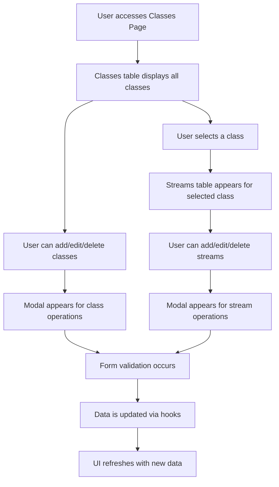
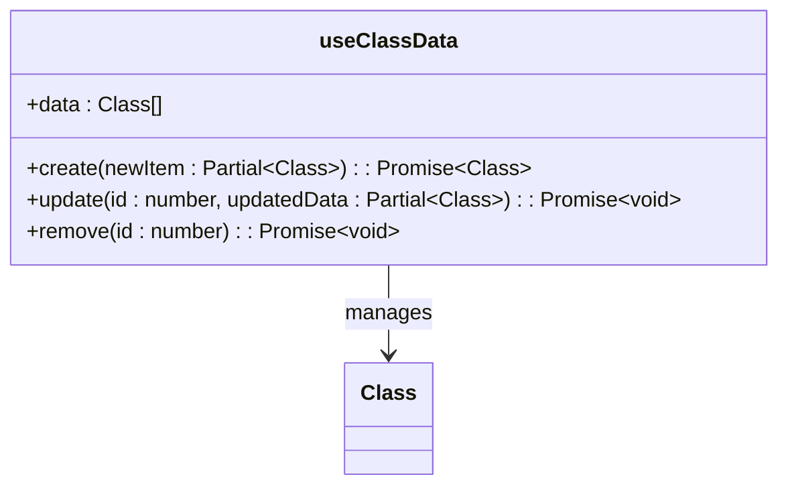
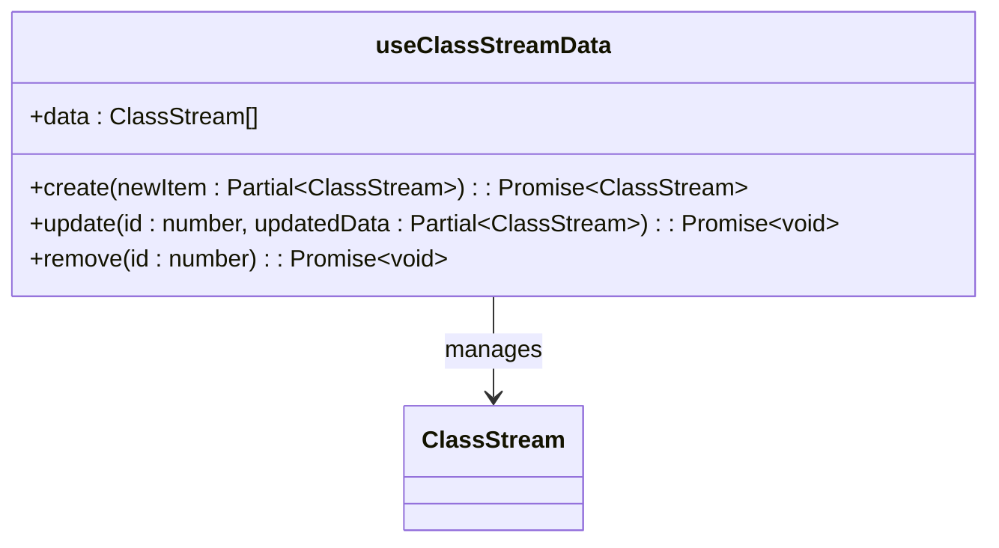
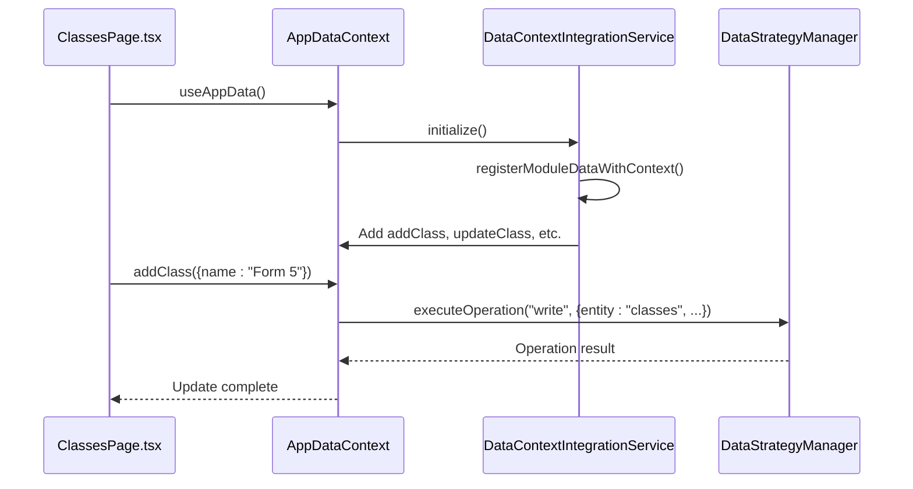

# Class Management

<cite>
**Referenced Files in This Document**   
- [ClassesPage.tsx](file://src/modules/administration/pages/ClassesPage.tsx)
- [useClassData.ts](file://src/modules/administration/data/useClassData.ts)
- [useClassStreamData.ts](file://src/modules/administration/data/useClassStreamData.ts)
- [mockData.ts](file://src/modules/administration/data/mockData.ts)
- [DataContextIntegrationService.ts](file://src/services/DataContextIntegrationService.ts)
</cite>

## Table of Contents
1. [Introduction](#introduction)
2. [Data Model](#data-model)
3. [Class and Stream Management Interface](#class-and-stream-management-interface)
4. [Hooks for Data Management](#hooks-for-data-management)
5. [Integration with AppDataContext](#integration-with-appdatacontext)
6. [Common Operations](#common-operations)
7. [Integration with Other Modules](#integration-with-other-modules)
8. [Performance Considerations](#performance-considerations)
9. [Best Practices](#best-practices)

## Introduction
The Class Management sub-feature within the Administration module enables administrators to manage academic classes and their associated streams. This includes creating classes, assigning class teachers, managing class rosters, and organizing students into streams. The implementation is centered around the `ClassesPage.tsx` component, which provides a user interface for these operations, backed by dedicated hooks for data management.

## Data Model
The data model for class management consists of two primary entities: `Class` and `ClassStream`. These entities are defined in the system's type definitions and instantiated with mock data for demonstration purposes.

### Class Entity
The `Class` entity represents an academic class (e.g., Form 1, Form 2). It contains the following primary fields:
- **id**: Unique identifier for the class
- **name**: Name of the class (e.g., "Form 1")

### ClassStream Entity
The `ClassStream` entity represents a subdivision within a class (e.g., Stream A, Stream B). It contains the following primary fields:
- **id**: Unique identifier for the stream
- **class_id**: Foreign key linking to the parent `Class`
- **name**: Name of the stream (e.g., "A", "B")
- **class_teacher_id**: ID of the staff member assigned as class teacher
- **class_name**: Denormalized field for the parent class name
- **class_teacher_name**: Denormalized field for the class teacher's full name

### Relationships
The data model establishes a one-to-many relationship between `Class` and `ClassStream`, where one class can have multiple streams. Students are associated with a specific `ClassStream` through the `current_class_stream_id` field in the student record.

```mermaid
erDiagram
CLASS {
number id PK
string name
}
CLASS_STREAM {
number id PK
number class_id FK
string name
string class_teacher_id
string class_name
string class_teacher_name
}
STUDENT {
string id
string admission_no
string first_name
string last_name
string gender
number current_class_stream_id FK
string current_class_name
string current_class_stream_name
}
CLASS ||--o{ CLASS_STREAM : contains
CLASS_STREAM ||--o{ STUDENT : contains
```

**Diagram sources**
- [mockData.ts](file://src/modules/administration/data/mockData.ts#L199-L398)

**Section sources**
- [mockData.ts](file://src/modules/administration/data/mockData.ts#L199-L398)

## Class and Stream Management Interface
The `ClassesPage.tsx` component provides a comprehensive interface for managing classes and streams. It features two main sections: a table for class management and a dynamic table for stream management that appears when a class is selected.

### Key Features
- **Class Table**: Displays all classes with their names and stream counts
- **Stream Table**: Displays streams for the selected class with class teacher assignments
- **Modals**: Provides forms for creating and editing classes and streams
- **Dynamic Actions**: Page actions change based on context (e.g., "Add Stream" appears when a class is selected)

### User Interaction Flow


**Diagram sources**
- [ClassesPage.tsx](file://src/modules/administration/pages/ClassesPage.tsx#L0-L300)

**Section sources**
- [ClassesPage.tsx](file://src/modules/administration/pages/ClassesPage.tsx#L0-L300)

## Hooks for Data Management
The class management functionality is powered by two custom hooks: `useClassData` and `useClassStreamData`. These hooks provide CRUD operations for their respective entities and maintain local state.

### useClassData Hook
The `useClassData` hook manages class entities with the following operations:



**Diagram sources**
- [useClassData.ts](file://src/modules/administration/data/useClassData.ts#L0-L42)

**Section sources**
- [useClassData.ts](file://src/modules/administration/data/useClassData.ts#L0-L42)

### useClassStreamData Hook
The `useClassStreamData` hook manages class stream entities with similar CRUD operations:



**Diagram sources**
- [useClassStreamData.ts](file://src/modules/administration/data/useClassStreamData.ts#L0-L42)

**Section sources**
- [useClassStreamData.ts](file://src/modules/administration/data/useClassStreamData.ts#L0-L42)

## Integration with AppDataContext
The class management hooks are integrated into the global `AppDataContext` through the `DataContextIntegrationService`. This service automatically registers data operations from module data hooks, making them available throughout the application.

### Registration Process
When the application initializes, the `DataContextIntegrationService` scans for registered module data entities and creates corresponding methods in the `AppDataContext`. For class management, this results in the following methods being available:
- `addClass(item)`
- `updateClass(id, updates)`
- `deleteClass(id)`
- `addClassStream(item)`
- `updateClassStream(id, updates)`
- `deleteClassStream(id)`

These methods are then accessible via the `useAppData` hook in components like `ClassesPage.tsx`.



**Diagram sources**
- [DataContextIntegrationService.ts](file://src/services/DataContextIntegrationService.ts#L8-L207)
- [ClassesPage.tsx](file://src/modules/administration/pages/ClassesPage.tsx#L0-L300)

**Section sources**
- [DataContextIntegrationService.ts](file://src/services/DataContextIntegrationService.ts#L8-L207)

## Common Operations
The class management system supports several common operations that administrators perform regularly.

### Bulk Class Assignment
While the current interface doesn't explicitly show bulk operations, the data model and hooks support programmatic assignment of students to classes. This could be implemented through:
- Import functionality that processes student data and assigns them to appropriate class streams
- Automated placement based on academic performance or other criteria
- Manual selection of multiple students and assignment to a target class stream

### Stream Reorganization
Stream reorganization can be accomplished through the existing interface by:
1. Creating new streams as needed
2. Updating student records to point to the new stream IDs
3. Deleting old streams after migration

The system maintains referential integrity through the foreign key relationship between students and class streams.

## Integration with Other Modules
The class management system integrates with several other modules to provide a cohesive educational management experience.

### Academics Module Integration
Class management is tightly coupled with the Academics module for timetable alignment. When classes and streams are created or modified, the timetable system can:
- Automatically generate timetable entries for new classes/streams
- Update existing timetables to reflect class reorganizations
- Ensure that subject allocations account for the current class structure

This integration ensures that academic scheduling remains synchronized with the organizational structure of the school.

### Student Detail Page Integration
The Student Detail page consumes class management data to:
- Display a student's current class and stream
- Show class teacher information
- Track enrollment history across different classes and streams
- Provide links to class-related information from the student record

The bidirectional relationship between students and class streams enables comprehensive enrollment tracking.

## Performance Considerations
When managing large numbers of classes and students, several performance considerations come into play.

### Data Loading
The current implementation loads all class and stream data at once, which may become problematic with large datasets. Potential optimizations include:
- Implementing pagination for class and stream lists
- Using virtualized rendering for large tables
- Implementing lazy loading of stream data only when a class is selected

### State Management
The hooks use local component state which is suitable for smaller datasets. For larger implementations, consider:
- Implementing a more sophisticated state management solution
- Adding caching mechanisms for frequently accessed data
- Implementing debounced updates to reduce re-renders

### Real-time Synchronization
The current mock implementation doesn't include real-time synchronization, but in a production environment, consider:
- Implementing WebSocket connections for real-time updates
- Adding optimistic updates to improve perceived performance
- Implementing conflict resolution for concurrent edits

## Best Practices
To ensure data consistency and optimal performance, follow these best practices when using the class management system.

### Data Consistency
- Always validate class and stream names for uniqueness
- Ensure that class teacher assignments reference valid staff members
- Maintain referential integrity when deleting classes or streams (consider soft deletes)
- Implement proper error handling for failed operations

### User Experience
- Provide clear feedback for all operations (success, error, loading states)
- Implement confirmation dialogs for destructive operations
- Use consistent naming conventions throughout the interface
- Provide keyboard navigation support for accessibility

### Scalability
- Design the system to handle growth in the number of classes and students
- Implement efficient data retrieval patterns
- Consider the impact of denormalized fields (like class_name in ClassStream) on data consistency
- Plan for data migration strategies when reorganizing class structures