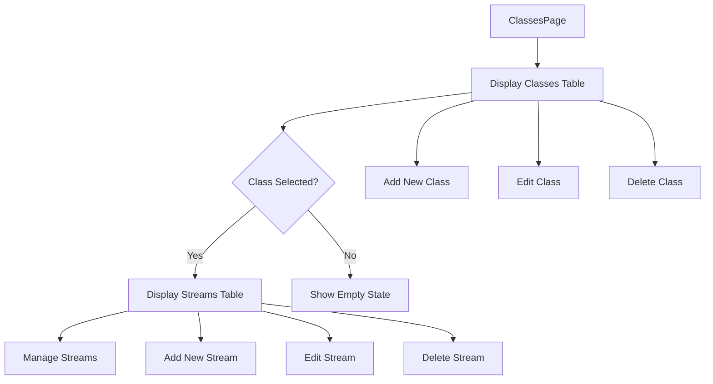
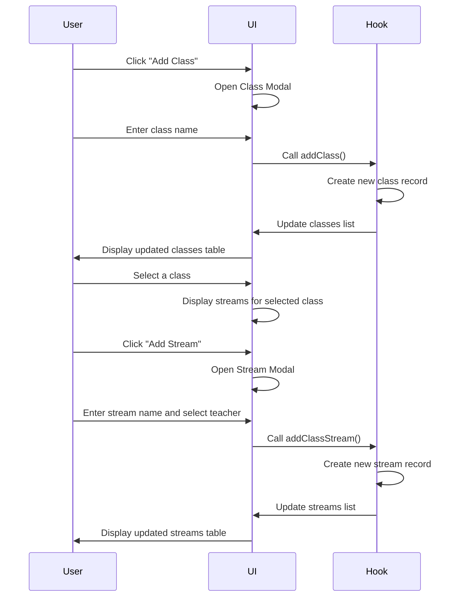
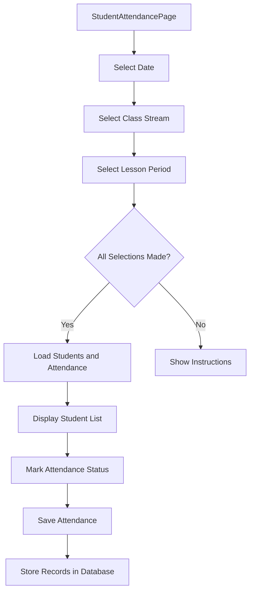
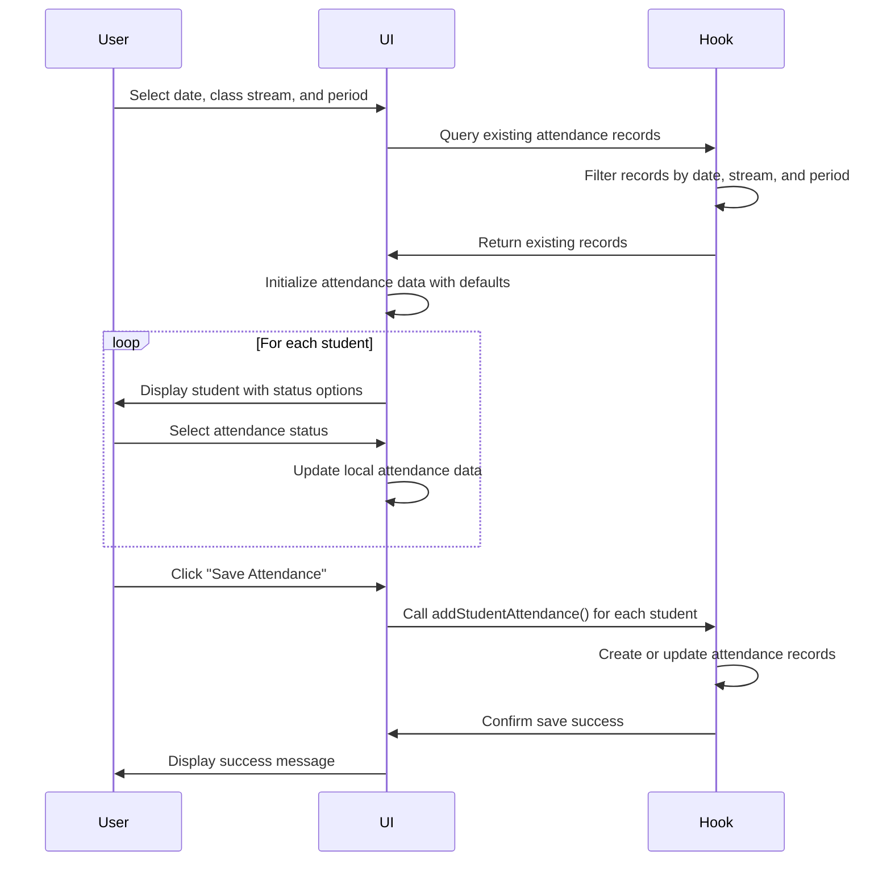
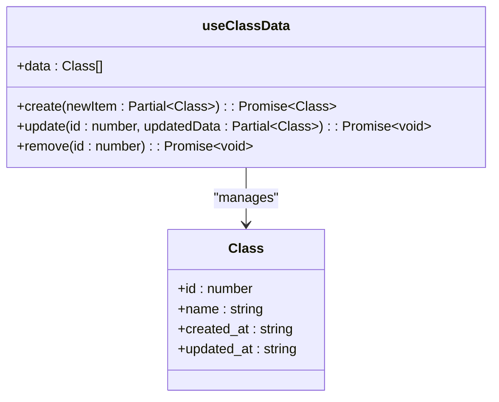
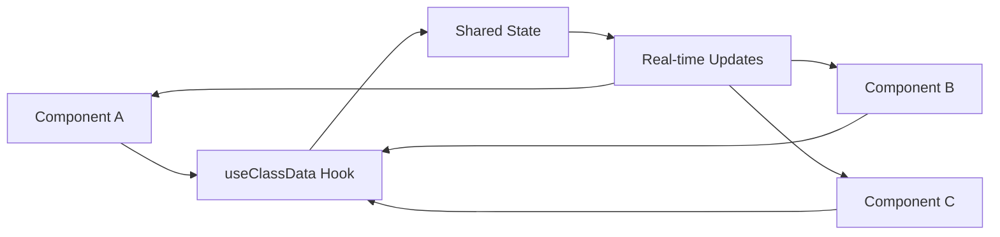
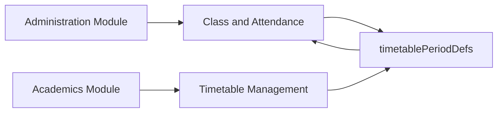

# Class and Attendance Management

<cite>
**Referenced Files in This Document**   
- [schema.ts](file://src/modules/administration/data/schema.ts)
- [types.ts](file://src/modules/administration/data/types.ts)
- [ClassesPage.tsx](file://src/modules/administration/pages/ClassesPage.tsx)
- [StudentAttendancePage.tsx](file://src/modules/administration/pages/StudentAttendancePage.tsx)
- [useClassData.ts](file://src/modules/administration/data/useClassData.ts)
- [useClassStreamData.ts](file://src/modules/administration/data/useClassStreamData.ts)
- [useStudentAttendanceData.ts](file://src/modules/administration/data/useStudentAttendanceData.ts)
</cite>

## Table of Contents
1. [Introduction](#introduction)
2. [Data Model](#data-model)
3. [Class Organization and Stream Management](#class-organization-and-stream-management)
4. [Daily Attendance Tracking](#daily-attendance-tracking)
5. [Data Synchronization and Hooks](#data-synchronization-and-hooks)
6. [Common Issues and Best Practices](#common-issues-and-best-practices)
7. [Integration Points](#integration-points)
8. [Performance Considerations](#performance-considerations)

## Introduction
The Class and Attendance Management sub-feature within the Administration module provides a comprehensive system for organizing academic classes, managing class streams, and recording daily student attendance. This document details the implementation of class structures, stream assignments, and attendance tracking mechanisms, including data models, user interfaces, and real-time data synchronization. The system supports hierarchical class organization, flexible stream management, and efficient attendance marking for individual lesson periods.

## Data Model

### Class and Attendance Data Structures
The data model for class and attendance management is defined in `schema.ts` and `types.ts` files within the administration module. It includes entities for classes, class streams, and student attendance records with well-defined relationships.

```mermaid
erDiagram
CLASS {
number id PK
string name
timestamp created_at
timestamp updated_at
}
CLASS_STREAM {
number id PK
number class_id FK
string name
string class_teacher_id
string class_teacher_name
string class_name
timestamp created_at
timestamp updated_at
}
STUDENT_ATTENDANCE {
string id PK
string student_id FK
number period_id FK
string date
string status
string reason_for_absence
string student_name
string period_name
timestamp created_at
}
CLASS ||--o{ CLASS_STREAM : "contains"
CLASS_STREAM }o--o{ STUDENT_ATTENDANCE : "has"
```

**Diagram sources**
- [schema.ts](file://src/modules/administration/data/schema.ts#L1-L483)
- [types.ts](file://src/modules/administration/data/types.ts#L1-L537)

**Section sources**
- [schema.ts](file://src/modules/administration/data/schema.ts#L1-L483)
- [types.ts](file://src/modules/administration/data/types.ts#L1-L537)

### Class Schema
The class entity represents academic classes (e.g., Grade 1, Grade 2). Each class can contain multiple streams (sections).

**Class Properties**
- `id`: Unique identifier for the class
- `name`: Class name (e.g., "Grade 1")
- `created_at`: Record creation timestamp
- `updated_at`: Record last update timestamp

### Class Stream Schema
Class streams represent sections within a class (e.g., Grade 1A, Grade 1B). Each stream is associated with a class and may have a designated class teacher.

**Class Stream Properties**
- `id`: Unique identifier for the stream
- `class_id`: Reference to the parent class
- `name`: Stream name (e.g., "A", "B")
- `class_teacher_id`: Reference to the staff member serving as class teacher
- `class_teacher_name`: Denormalized teacher name for display
- `class_name`: Denormalized class name for display

### Student Attendance Schema
The student attendance entity records attendance for individual students during specific lesson periods.

**Student Attendance Properties**
- `id`: Unique identifier for the attendance record
- `student_id`: Reference to the student
- `period_id`: Reference to the timetable period definition
- `date`: Attendance date in string format
- `status`: Attendance status (Present, Absent, Late, Excused)
- `reason_for_absence`: Optional reason for absence
- `student_name`: Denormalized student name for display
- `period_name`: Denormalized period name for display

### Attendance Status Enum
The system defines four attendance statuses:

**AttendanceStatus Enum**
- `PRESENT`: Student is present
- `ABSENT`: Student is absent
- `LATE`: Student arrived late
- `EXCUSED`: Student absence is excused

## Class Organization and Stream Management

### ClassesPage Implementation
The `ClassesPage` component provides a user interface for managing classes and their streams. It displays classes in a primary table and streams in a secondary table that appears when a class is selected.



**Diagram sources**
- [ClassesPage.tsx](file://src/modules/administration/pages/ClassesPage.tsx#L1-L300)

**Section sources**
- [ClassesPage.tsx](file://src/modules/administration/pages/ClassesPage.tsx#L1-L300)

### User Interface Components
The page uses several UI components to provide a rich interactive experience:

**Classes Table Features**
- Displays class ID, name, and stream count
- Provides action buttons for editing, deleting, and managing streams
- Shows an empty state with a call-to-action when no classes exist

**Streams Table Features**
- Displays stream ID, name, and class teacher
- Provides action buttons for editing and deleting streams
- Shows an empty state when no streams exist for the selected class

### Class and Stream Management Workflow
The management workflow follows a modal-based approach for creating and editing records.



**Diagram sources**
- [ClassesPage.tsx](file://src/modules/administration/pages/ClassesPage.tsx#L1-L300)
- [useClassData.ts](file://src/modules/administration/data/useClassData.ts#L1-L43)
- [useClassStreamData.ts](file://src/modules/administration/data/useClassStreamData.ts#L1-L43)

**Section sources**
- [ClassesPage.tsx](file://src/modules/administration/pages/ClassesPage.tsx#L1-L300)

## Daily Attendance Tracking

### StudentAttendancePage Implementation
The `StudentAttendancePage` component enables users to mark attendance for students in a specific class stream during a particular lesson period.



**Diagram sources**
- [StudentAttendancePage.tsx](file://src/modules/administration/pages/StudentAttendancePage.tsx#L1-L212)

**Section sources**
- [StudentAttendancePage.tsx](file://src/modules/administration/pages/StudentAttendancePage.tsx#L1-L212)

### Attendance Marking Interface
The interface provides a streamlined workflow for marking attendance:

**Selection Controls**
- Date picker for selecting the attendance date
- Dropdown for selecting the class stream
- Dropdown for selecting the lesson period

**Attendance Grid**
- Displays students enrolled in the selected class stream
- For each student, provides radio buttons for selecting attendance status
- Shows student admission number and full name

**Save Functionality**
- Validates that all required selections are made
- Saves attendance records for all students in the stream
- Provides feedback upon successful save

### Attendance Workflow
The attendance marking process follows a specific sequence to ensure data consistency.



**Diagram sources**
- [StudentAttendancePage.tsx](file://src/modules/administration/pages/StudentAttendancePage.tsx#L1-L212)
- [useStudentAttendanceData.ts](file://src/modules/administration/data/useStudentAttendanceData.ts#L1-L43)

**Section sources**
- [StudentAttendancePage.tsx](file://src/modules/administration/pages/StudentAttendancePage.tsx#L1-L212)

## Data Synchronization and Hooks

### useClassData Hook
The `useClassData` hook provides CRUD operations for class entities with real-time synchronization.



**Diagram sources**
- [useClassData.ts](file://src/modules/administration/data/useClassData.ts#L1-L43)

**Section sources**
- [useClassData.ts](file://src/modules/administration/data/useClassData.ts#L1-L43)

#### Implementation Details
The hook uses React's useState and useEffect hooks to manage class data:

**State Management**
- Maintains class data in local state
- Initializes with mock data from `initialMockClasses`
- Updates state immutably on create, update, and delete operations

**CRUD Operations**
- `create`: Adds a new class with generated ID and timestamps
- `update`: Modifies an existing class and updates the timestamp
- `remove`: Deletes a class by filtering from the array

### useClassStreamData Hook
The `useClassStreamData` hook manages class stream entities with similar CRUD functionality.

**Hook Features**
- Manages stream data in local state
- Provides create, update, and delete operations
- Handles relationships with parent classes
- Maintains denormalized fields for display purposes

### useStudentAttendanceData Hook
The `useStudentAttendanceData` hook handles student attendance records with real-time synchronization.

**Hook Features**
- Manages attendance data in local state
- Provides function to add attendance records
- Automatically handles denormalization of student and period names
- Ensures data consistency across related entities

### Data Synchronization Strategy
The hooks implement a client-side state management approach that synchronizes data across components.



**Diagram sources**
- [useClassData.ts](file://src/modules/administration/data/useClassData.ts#L1-L43)
- [useClassStreamData.ts](file://src/modules/administration/data/useClassStreamData.ts#L1-L43)
- [useStudentAttendanceData.ts](file://src/modules/administration/data/useStudentAttendanceData.ts#L1-L43)

**Section sources**
- [useClassData.ts](file://src/modules/administration/data/useClassData.ts#L1-L43)
- [useClassStreamData.ts](file://src/modules/administration/data/useClassStreamData.ts#L1-L43)
- [useStudentAttendanceData.ts](file://src/modules/administration/data/useStudentAttendanceData.ts#L1-L43)

## Common Issues and Best Practices

### Handling Partial Attendance
When marking attendance for large classes, users may need to save partial records. The current implementation requires marking attendance for all students in a stream at once.

**Recommendations**
- Implement a "Save Progress" feature to save partially completed attendance
- Add pagination or virtual scrolling for large class streams
- Provide a "Mark All Present" shortcut button
- Allow bulk status changes for multiple students

### Data Integrity Best Practices
To maintain accurate attendance records, follow these best practices:

**Validation Rules**
- Ensure date is not in the future
- Verify that class stream has enrolled students
- Confirm that period exists in the timetable
- Prevent duplicate attendance records for the same student, date, and period

**Audit Trail**
- Maintain creation and update timestamps
- Track the user who recorded attendance
- Implement versioning for attendance corrections

### User Experience Considerations
Optimize the attendance marking process for efficiency:

**Efficiency Features**
- Implement keyboard navigation for quick status selection
- Add search and filter capabilities for large student lists
- Provide visual indicators for students with frequent absences
- Enable offline attendance marking with synchronization

## Integration Points

### Academics Module Integration
The Class and Attendance Management system integrates with the Academics module for timetable alignment.

**Integration Points**
- Shares `timetablePeriodDefs` data structure
- Uses period definitions to ensure attendance is marked for valid lesson periods
- Aligns class structures with academic subject allocations



**Diagram sources**
- [StudentAttendancePage.tsx](file://src/modules/administration/pages/StudentAttendancePage.tsx#L1-L212)
- [schema.ts](file://src/modules/administration/data/schema.ts#L1-L483)

**Section sources**
- [StudentAttendancePage.tsx](file://src/modules/administration/pages/StudentAttendancePage.tsx#L1-L212)

### Reporting Module Integration
Attendance data serves as a foundation for various reports.

**Report Types**
- Daily attendance summaries
- Student attendance history
- Class-wise attendance statistics
- Absenteeism trends and analysis

**Data Flow**
- Attendance records are aggregated by date, class, and student
- Reports calculate attendance percentages and identify patterns
- Data is visualized in charts and tables for administrative review

## Performance Considerations

### Large-Scale Attendance Operations
When dealing with large numbers of students, performance optimization is critical.

**Optimization Strategies**
- Implement virtualized rendering for student lists
- Use memoization to prevent unnecessary re-renders
- Batch database operations for attendance saves
- Implement pagination for historical attendance data

### Data Loading Performance
Optimize data retrieval for the attendance marking interface.

**Loading Sequence**
- Load class streams and periods on initial page load
- Only load students and existing attendance when all filters are selected
- Use loading states to provide feedback during data retrieval

### Memory Management
Prevent memory leaks and excessive memory usage.

**Best Practices**
- Clean up event listeners and subscriptions
- Use React.memo for expensive components
- Implement proper cleanup in useEffect hooks
- Monitor and optimize state updates