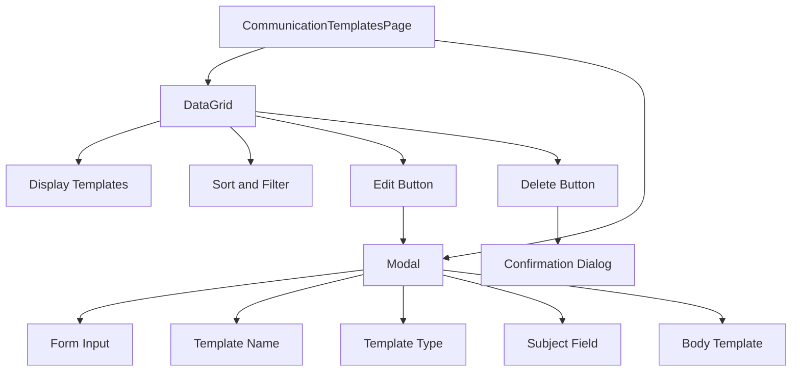
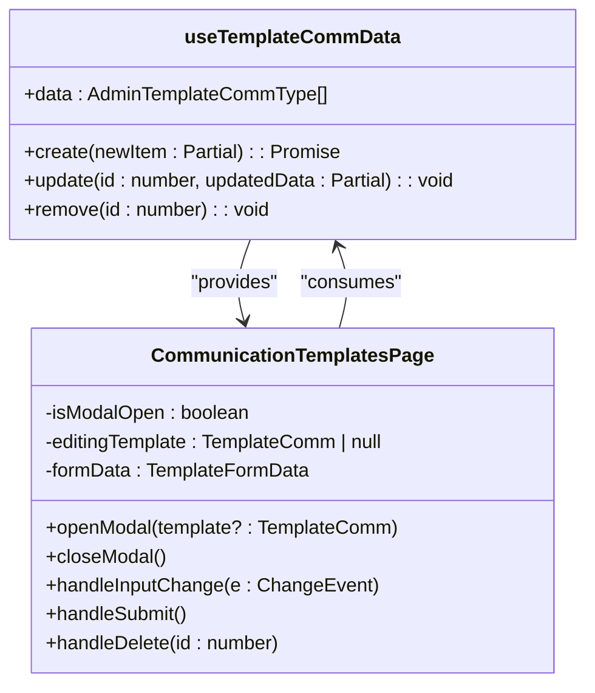
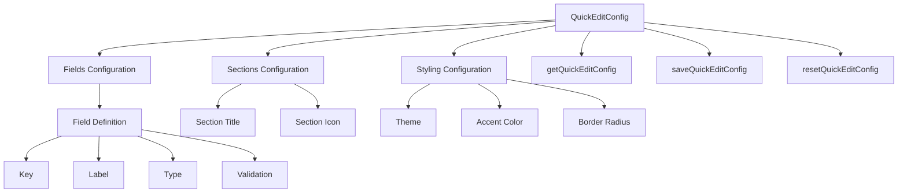

# Communication Templates

<cite>
**Referenced Files in This Document**   
- [CommunicationTemplatesPage.tsx](file://src/modules/administration/pages/CommunicationTemplatesPage.tsx)
- [types.ts](file://src/modules/administration/data/types.ts)
- [mockData.ts](file://src/modules/administration/data/mockData.ts)
- [useTemplateCommData.ts](file://src/modules/administration/data/useTemplateCommData.ts)
- [quickEditConfig.ts](file://src/modules/administration/config/quickEditConfig.ts)
</cite>

## Table of Contents
1. [Introduction](#introduction)
2. [Data Model](#data-model)
3. [Template Management Interface](#template-management-interface)
4. [CRUD Operations and Data Access](#crud-operations-and-data-access)
5. [Template Variables and Content Interpolation](#template-variables-and-content-interpolation)
6. [Configuration for Inline Editing](#configuration-for-inline-editing)
7. [Best Practices and Common Issues](#best-practices-and-common-issues)

## Introduction
The Communication Templates feature within the Administration module enables administrators to create, manage, and reuse standardized message templates for various communication channels including SMS, email, and push notifications. This system supports dynamic content insertion through variable placeholders, allowing personalized messaging at scale. The implementation follows a modular architecture with dedicated components for data management, user interface, and configuration.

**Section sources**
- [CommunicationTemplatesPage.tsx](file://src/modules/administration/pages/CommunicationTemplatesPage.tsx#L1-L257)

## Data Model
The communication template data model is defined by the `AdminTemplateCommType` interface in the administration module's types file. This interface specifies the structure and constraints for all communication templates in the system.

```typescript
export interface AdminTemplateCommType {
  id: number;
  name: string;
  type: TemplateType;
  subject?: string;
  body_template: string;
  created_at: string;
  updated_at: string;
}
```

The template type is defined by the `TemplateType` enum, which supports three communication channels:
- SMS
- Email
- Push Notification

The data model includes required fields such as `name`, `type`, and `body_template`, with optional fields like `subject` that are conditionally required based on the template type. For example, email and push notification templates require a subject line, while SMS templates do not.

**Section sources**
- [types.ts](file://src/modules/administration/data/types.ts#L38-L45)

## Template Management Interface
The CommunicationTemplatesPage component provides a comprehensive user interface for managing communication templates. The interface consists of a data grid displaying all existing templates and a modal form for creating and editing templates.



**Diagram sources**
- [CommunicationTemplatesPage.tsx](file://src/modules/administration/pages/CommunicationTemplatesPage.tsx#L18-L253)

**Section sources**
- [CommunicationTemplatesPage.tsx](file://src/modules/administration/pages/CommunicationTemplatesPage.tsx#L18-L253)

The interface displays templates in a tabular format with columns for ID, template name, type, subject, and body preview. Each row includes action buttons for editing and deleting templates. The page features an "Add Template" button that opens a modal form with input fields for all template properties.

The modal form includes validation to ensure required fields are completed before submission. When editing an SMS template, the subject field is conditionally hidden, while email and push notification templates require a subject. The form provides guidance on available placeholder variables that can be used in template content.

## CRUD Operations and Data Access
The `useTemplateCommData` hook provides reactive data access and CRUD operations for communication templates. This custom hook encapsulates all data management logic, allowing the UI component to remain focused on presentation.



**Diagram sources**
- [useTemplateCommData.ts](file://src/modules/administration/data/useTemplateCommData.ts#L5-L43)
- [CommunicationTemplatesPage.tsx](file://src/modules/administration/pages/CommunicationTemplatesPage.tsx#L18-L253)

**Section sources**
- [useTemplateCommData.ts](file://src/modules/administration/data/useTemplateCommData.ts#L5-L43)

The hook maintains template data in local state using React's `useState` hook, initialized with mock data from the administration module. It provides three main functions:
- `create`: Adds a new template with a generated ID and timestamps
- `update`: Modifies an existing template by ID, updating the timestamp
- `remove`: Deletes a template by ID

These operations are implemented as asynchronous functions to maintain consistency with typical data access patterns, even though they operate synchronously on client-side state in the current implementation.

## Template Variables and Content Interpolation
The communication template system supports dynamic content through variable interpolation using double curly brace syntax (e.g., `{{student_name}}`). This allows templates to be personalized when sent to recipients.

The system supports various placeholder variables that represent different data points:
- Student information: `{{student_name}}`, `{{first_name}}`, `{{last_name}}`, `{{admission_no}}`, `{{class_name}}`
- Parent/guardian information: `{{parent_name}}`
- Financial information: `{{balance}}`, `{{due_date}}`
- Event information: `{{event_name}}`
- School information: `{{school_name}}`

When a template is used to send a message, these placeholders are replaced with actual values from the relevant data context. The template body field provides guidance on available placeholders, helping administrators create effective templates.

Example template usage:
- Welcome message: "Welcome {{student_name}} to {{school_name}}!"
- Fee reminder: "Dear {{parent_name}}, this is a reminder that the school fees for {{student_name}} are due on {{due_date}}."

**Section sources**
- [CommunicationTemplatesPage.tsx](file://src/modules/administration/pages/CommunicationTemplatesPage.tsx#L230-L238)

## Configuration for Inline Editing
The administration module includes configuration capabilities for inline editing through the `quickEditConfig.ts` file. Although this configuration is primarily designed for student management, it demonstrates the system's approach to configurable editing interfaces.

The configuration system defines editable fields with properties such as:
- Field key and label
- Input type (text, select, date, number)
- Validation rules
- Section organization
- Styling preferences



**Diagram sources**
- [quickEditConfig.ts](file://src/modules/administration/config/quickEditConfig.ts#L1-L133)

**Section sources**
- [quickEditConfig.ts](file://src/modules/administration/config/quickEditConfig.ts#L1-L133)

The configuration supports user preferences through localStorage, allowing administrators to customize their editing experience. Functions are provided to get, save, and reset configuration settings, enabling a personalized workflow.

## Best Practices and Common Issues
### Template Design Best Practices
- Use clear, descriptive template names that indicate purpose and audience
- Include relevant placeholders to personalize messages
- Keep template content concise, especially for SMS templates with character limitations
- Test templates with actual data to ensure proper variable replacement
- Use consistent formatting and tone across all templates

### Common Issues and Solutions
**Template Versioning**: The current implementation does not support template versioning. To address this, consider implementing a version history feature that tracks changes to templates over time, allowing administrators to revert to previous versions if needed.

**HTML Content Escaping**: When displaying template content in the UI, ensure proper escaping of HTML content to prevent XSS vulnerabilities. The current implementation uses React's built-in escaping, but additional sanitization may be needed for rich text content.

**Broken Variable Syntax**: Prevent common errors like missing closing braces or incorrect variable names by implementing syntax validation in the template editor. Consider adding autocomplete suggestions for available variables.

**Accessibility**: Ensure templates are accessible by using semantic HTML in email templates, providing alternative text for images, and maintaining sufficient color contrast.

**Localization**: Support multilingual templates by integrating with the system's i18n framework, allowing administrators to create templates in multiple languages based on recipient preferences.

**Security**: Validate and sanitize template content to prevent injection attacks. Implement role-based access control to ensure only authorized users can create or modify templates.

**Performance**: For systems with many templates, implement pagination or virtual scrolling in the template management interface to maintain performance.