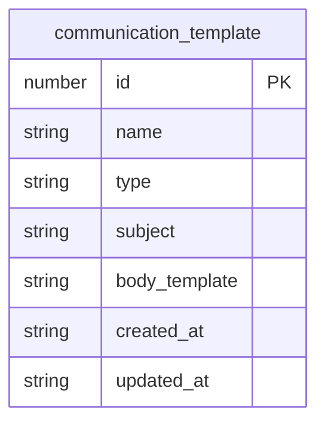
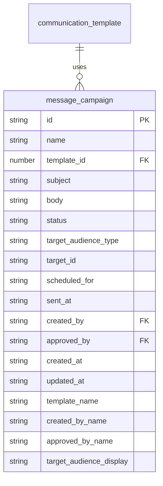
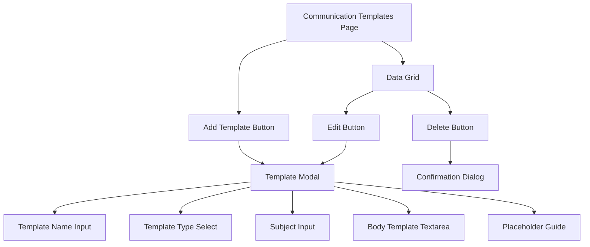
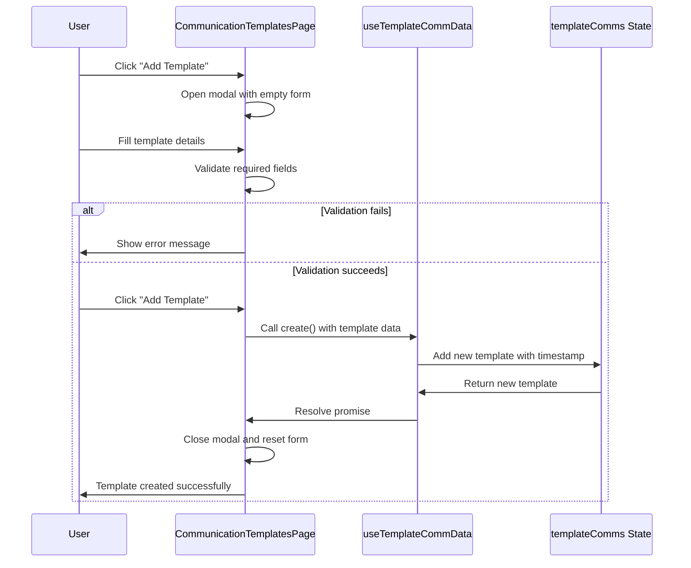
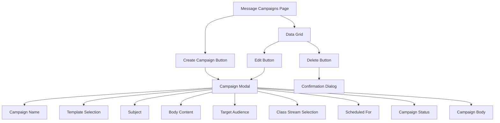
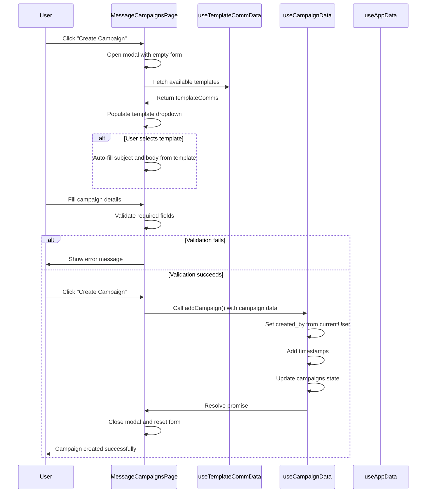
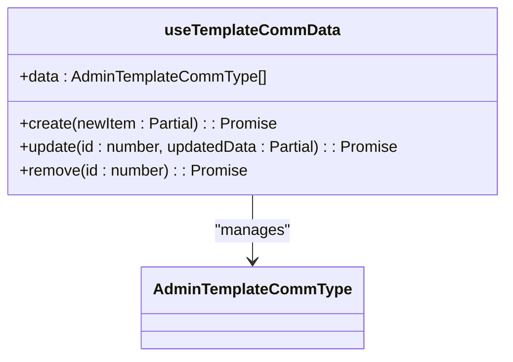
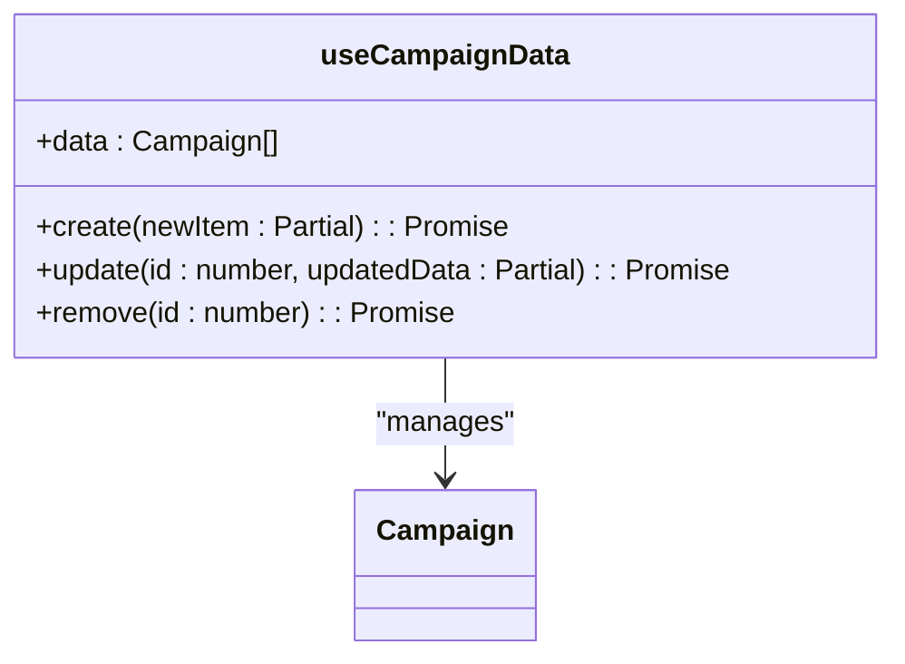
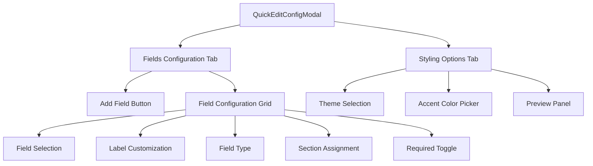
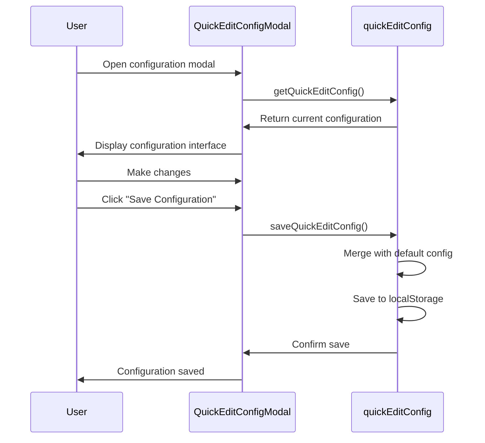

# Communication and Messaging

<cite>
**Referenced Files in This Document**   
- [CommunicationTemplatesPage.tsx](file://src/modules/administration/pages/CommunicationTemplatesPage.tsx)
- [MessageCampaignsPage.tsx](file://src/modules/administration/pages/MessageCampaignsPage.tsx)
- [useTemplateCommData.ts](file://src/modules/administration/data/useTemplateCommData.ts)
- [useCampaignData.ts](file://src/modules/administration/data/useCampaignData.ts)
- [schema.ts](file://src/modules/administration/data/schema.ts)
- [types.ts](file://src/modules/administration/data/types.ts)
- [QuickEditConfigModal.tsx](file://src/modules/administration/components/QuickEditConfigModal.tsx)
- [quickEditConfig.ts](file://src/modules/administration/config/quickEditConfig.ts)
</cite>

## Table of Contents
1. [Introduction](#introduction)
2. [Data Model](#data-model)
3. [Communication Templates](#communication-templates)
4. [Message Campaigns](#message-campaigns)
5. [Hooks and Data Management](#hooks-and-data-management)
6. [Quick Edit Configuration](#quick-edit-configuration)
7. [Integration Points](#integration-points)
8. [Best Practices](#best-practices)

## Introduction
The Communication and Messaging sub-feature within the Administration module provides a comprehensive system for managing communication templates and message campaigns across various channels including SMS, Email, and Push Notifications. This system enables administrators to create reusable templates, design targeted messaging campaigns, and manage bulk communications efficiently. The implementation follows a modular architecture with dedicated components, hooks, and data models to ensure maintainability and scalability.

## Data Model

### Communication Template Schema
The communication template data model defines the structure for reusable message templates used across the system. Templates support multiple communication channels and include content variables for personalization.



**Diagram sources**
- [schema.ts](file://src/modules/administration/data/schema.ts#L117-L137)
- [types.ts](file://src/modules/administration/data/types.ts#L34-L42)

### Message Campaign Schema
The message campaign data model represents scheduled or sent communication campaigns that can use templates or custom content. Campaigns include status tracking, scheduling, and audience targeting capabilities.



**Diagram sources**
- [schema.ts](file://src/modules/administration/data/schema.ts#L139-L183)
- [types.ts](file://src/modules/administration/data/types.ts#L44-L65)

### Data Model Details
The data model includes the following key components:

**: TemplateType**
- SMS
- Email
- Push Notification

**: CampaignStatus**
- Draft
- Scheduled
- Approved
- Sent
- Cancelled

**: CampaignAudienceType**
- All Students
- All Parents
- All Staff
- Students of Class
- Parents of Class

The schema includes denormalized fields such as `template_name`, `created_by_name`, and `target_audience_display` to optimize read performance and reduce join operations when displaying campaign information.

**Section sources**
- [schema.ts](file://src/modules/administration/data/schema.ts)
- [types.ts](file://src/modules/administration/data/types.ts)

## Communication Templates

### Template Management Interface
The CommunicationTemplatesPage component provides a user interface for creating, editing, and managing communication templates. The interface includes a data grid for viewing existing templates and a modal form for template creation and editing.



**Diagram sources**
- [CommunicationTemplatesPage.tsx](file://src/modules/administration/pages/CommunicationTemplatesPage.tsx)

### Template Creation Workflow
The template creation process follows a structured workflow that ensures data integrity and provides a user-friendly experience:



**Diagram sources**
- [CommunicationTemplatesPage.tsx](file://src/modules/administration/pages/CommunicationTemplatesPage.tsx#L65-L111)
- [useTemplateCommData.ts](file://src/modules/administration/data/useTemplateCommData.ts)

### Template Features
Communication templates support several key features:

**: Content Variables**
Templates support placeholders for dynamic content personalization:
- {"{{student_name}}"}
- {"{{parent_name}}"}
- {"{{first_name}}"}
- {"{{last_name}}"}
- {"{{admission_no}}"}
- {"{{class_name}}"}
- {"{{balance}}"}
- {"{{due_date}}"}
- {"{{event_name}}"}
- {"{{school_name}}."}

**: Channel-Specific Requirements**
- SMS templates require only name and body_template
- Email and Push Notification templates require subject field
- Type field determines available options and validation rules

**: Validation Rules**
- Template name, type, and body_template are required
- Subject is required for Email and Push Notification templates
- Body template has a maximum length of 2000 characters

**Section sources**
- [CommunicationTemplatesPage.tsx](file://src/modules/administration/pages/CommunicationTemplatesPage.tsx)
- [schema.ts](file://src/modules/administration/data/schema.ts)

## Message Campaigns

### Campaign Management Interface
The MessageCampaignsPage component provides a comprehensive interface for managing message campaigns. The interface includes campaign status visualization, audience targeting options, and scheduling capabilities.



**Diagram sources**
- [MessageCampaignsPage.tsx](file://src/modules/administration/pages/MessageCampaignsPage.tsx)

### Campaign Creation Workflow
The campaign creation process integrates template selection with custom content options and audience targeting:



**Diagram sources**
- [MessageCampaignsPage.tsx](file://src/modules/administration/pages/MessageCampaignsPage.tsx)
- [useCampaignData.ts](file://src/modules/administration/data/useCampaignData.ts)

### Campaign Features
Message campaigns support advanced features for targeted communication:

**: Template Integration**
- Campaigns can use existing communication templates
- Template selection auto-populates subject and body fields
- Custom content can be used without a template

**: Audience Targeting**
- Broadcast to all students, parents, or staff
- Target specific class streams
- Future extensibility for additional audience types

**: Scheduling**
- Immediate sending (status: Sent)
- Scheduled sending (scheduled_for timestamp)
- Draft campaigns can be edited before approval

**: Status Management**
- Draft: Campaign is being created
- Scheduled: Campaign is queued for sending
- Approved: Campaign has been approved for sending
- Sent: Campaign has been delivered
- Cancelled: Campaign has been cancelled

**: Validation Rules**
- Campaign name and status are required
- Body content is required
- Subject is required if based on Email or Push Notification template
- Class stream must be selected for class-specific audiences

**Section sources**
- [MessageCampaignsPage.tsx](file://src/modules/administration/pages/MessageCampaignsPage.tsx)
- [schema.ts](file://src/modules/administration/data/schema.ts)

## Hooks and Data Management

### useTemplateCommData Hook
The useTemplateCommData hook provides CRUD operations for communication templates with state management:



**Diagram sources**
- [useTemplateCommData.ts](file://src/modules/administration/data/useTemplateCommData.ts)

The hook implements the following functionality:
- State management using React useState hook
- Automatic timestamp generation for created_at and updated_at
- Unique ID generation using Date.now()
- Array operations for create, update, and delete
- Self-contained data management without dependency on AppDataContext

**: Implementation Details**
```typescript
export const useTemplateCommData = () => {
  const [data, setData] = useState<AdminTemplateCommType[]>(initialMockTemplateComms);

  const create = async (newItem: Partial<AdminTemplateCommType>) => {
    const newDataItem: AdminTemplateCommType = {
      ...newItem,
      id: Date.now(),
      created_at: new Date().toISOString(),
      updated_at: new Date().toISOString()
    } as AdminTemplateCommType;
    setData((prev: AdminTemplateCommType[]) => [...prev, newDataItem]);
    return newDataItem;
  };

  const update = async (id: number, updatedData: Partial<AdminTemplateCommType>) => {
    setData((prev: AdminTemplateCommType[]) => prev.map((item: AdminTemplateCommType) => 
      item.id === id 
        ? { ...item, ...updatedData, updated_at: new Date().toISOString() }
        : item
    ));
  };

  const remove = async (id: number) => {
    setData((prev: AdminTemplateCommType[]) => prev.filter((item: AdminTemplateCommType) => item.id !== id));
  };

  return {
    data,
    create,
    update,
    remove
  };
};
```

**Section sources**
- [useTemplateCommData.ts](file://src/modules/administration/data/useTemplateCommData.ts)

### useCampaignData Hook
The useCampaignData hook provides CRUD operations for message campaigns with state management:



**Diagram sources**
- [useCampaignData.ts](file://src/modules/administration/data/useCampaignData.ts)

The hook implements similar functionality to useTemplateCommData but for campaign entities:
- State management using React useState hook
- Automatic timestamp generation
- Unique ID generation
- Array operations for CRUD operations
- Self-contained data management

**: Implementation Details**
```typescript
export const useCampaignData = () => {
  const [data, setData] = useState<Campaign[]>(initialMockCampaigns);

  const create = async (newItem: Partial<Campaign>) => {
    const newDataItem: Campaign = {
      ...newItem,
      id: Date.now(),
      created_at: new Date().toISOString(),
      updated_at: new Date().toISOString()
    } as Campaign;
    setData((prev: Campaign[]) => [...prev, newDataItem]);
    return newDataItem;
  };

  // Update and remove methods follow similar patterns
};
```

**Section sources**
- [useCampaignData.ts](file://src/modules/administration/data/useCampaignData.ts)

## Quick Edit Configuration

### QuickEditConfigModal Component
The QuickEditConfigModal component allows administrators to customize the fields available in the quick edit interface for student management:



**Diagram sources**
- [QuickEditConfigModal.tsx](file://src/modules/administration/components/QuickEditConfigModal.tsx)

### Configuration Structure
The quick edit configuration follows a structured format that defines available fields, sections, and styling options:

**: QuickEditConfig Interface**
```typescript
export interface QuickEditConfig {
  fields: QuickEditField[];
  sections: {
    basic: { title: string; icon: string };
    academic: { title: string; icon: string };
    guardian: { title: string; icon: string };
  };
  styling: {
    theme: 'dark' | 'light';
    accentColor: string;
    borderRadius: string;
  };
}
```

**: QuickEditField Interface**
```typescript
export interface QuickEditField {
  key: keyof Student | string;
  label: string;
  type: 'text' | 'select' | 'date' | 'number';
  required?: boolean;
  options?: { value: any; label: string }[];
  section?: 'basic' | 'academic' | 'guardian';
  placeholder?: string;
  validation?: {
    minLength?: number;
    maxLength?: number;
    pattern?: RegExp;
    min?: number;
    max?: number;
  };
}
```

**: Default Configuration**
The system provides a default configuration with commonly used fields:
- First Name, Last Name (Basic Information)
- Status, Class Stream (Academic Details)
- Guardian Name, Guardian Phone (Guardian Information)

**: Configuration Management**
The configuration system includes three key functions:
- getQuickEditConfig(): Retrieves configuration from localStorage or returns default
- saveQuickEditConfig(): Saves configuration to localStorage
- resetQuickEditConfig(): Removes configuration from localStorage



**Diagram sources**
- [QuickEditConfigModal.tsx](file://src/modules/administration/components/QuickEditConfigModal.tsx)
- [quickEditConfig.ts](file://src/modules/administration/config/quickEditConfig.ts)

**Section sources**
- [QuickEditConfigModal.tsx](file://src/modules/administration/components/QuickEditConfigModal.tsx)
- [quickEditConfig.ts](file://src/modules/administration/config/quickEditConfig.ts)

## Integration Points

### Student Management Integration
The messaging system integrates with student management for targeted communications:

**: Class Stream Targeting**
- MessageCampaignsPage uses useAppData() to access classStreams
- Campaigns can target "Students of Class" or "Parents of Class"
- Class stream selection dropdown populated from classStreams data

**: Student Data Personalization**
- Templates support student-specific placeholders
- Campaign system can leverage student data for personalized messaging
- Future integration could include automated triggers based on student events

### External Notification Services
While the current implementation uses mock data, the system is designed for integration with external notification services:

**: SMS Gateway**
- TemplateType.SMS suggests integration with SMS gateway
- Future implementation would send messages through SMS API
- Delivery status tracking would be enhanced with delivery receipts

**: Email Service**
- TemplateType.Email suggests integration with email service
- Integration with SMTP server or email API (e.g., SendGrid, Mailgun)
- Support for HTML emails and attachments in future versions

**: Push Notification Service**
- TemplateType.Push Notification suggests integration with push service
- Integration with Firebase Cloud Messaging (FCM) or Apple Push Notification Service (APNs)
- Device token management for targeted push notifications

**: API Integration Points**
The system could be extended with the following integration points:
- REST API endpoints for programmatic template and campaign management
- Webhooks for campaign status updates
- Integration with analytics services for message delivery tracking

**Section sources**
- [MessageCampaignsPage.tsx](file://src/modules/administration/pages/MessageCampaignsPage.tsx)
- [useAppData.ts](file://src/hooks/useAppData.ts)

## Best Practices

### Template Management Best Practices
**: Template Versioning**
Although the current system doesn't implement versioning, consider these best practices:
- Maintain a version history for templates
- Allow rollback to previous versions
- Track who made changes and when

**: Template Organization**
- Use consistent naming conventions
- Categorize templates by purpose or department
- Document template usage guidelines

**: Content Personalization**
- Use appropriate placeholders for personalization
- Test templates with actual data to ensure proper rendering
- Consider message length limitations for SMS

### Campaign Execution Best Practices
**: Audience Targeting**
- Be specific with audience selection to avoid spam
- Use class-specific campaigns for relevant announcements
- Consider timing and frequency to avoid message fatigue

**: Scheduling**
- Schedule messages during appropriate hours
- Consider time zones for geographically dispersed audiences
- Use draft status for campaigns that need approval

**: Testing**
- Test campaigns with a small audience first
- Verify placeholder replacement works correctly
- Check message formatting across different devices

### System Maintenance
**: Data Management**
- Regularly review and clean up unused templates
- Archive old campaigns to maintain performance
- Monitor storage usage for message history

**: Security**
- Ensure templates don't contain sensitive information
- Implement approval workflows for sensitive campaigns
- Restrict access to template and campaign management

**: Performance**
- Optimize data fetching for large template/campaign lists
- Implement pagination for data grids
- Use efficient state management patterns