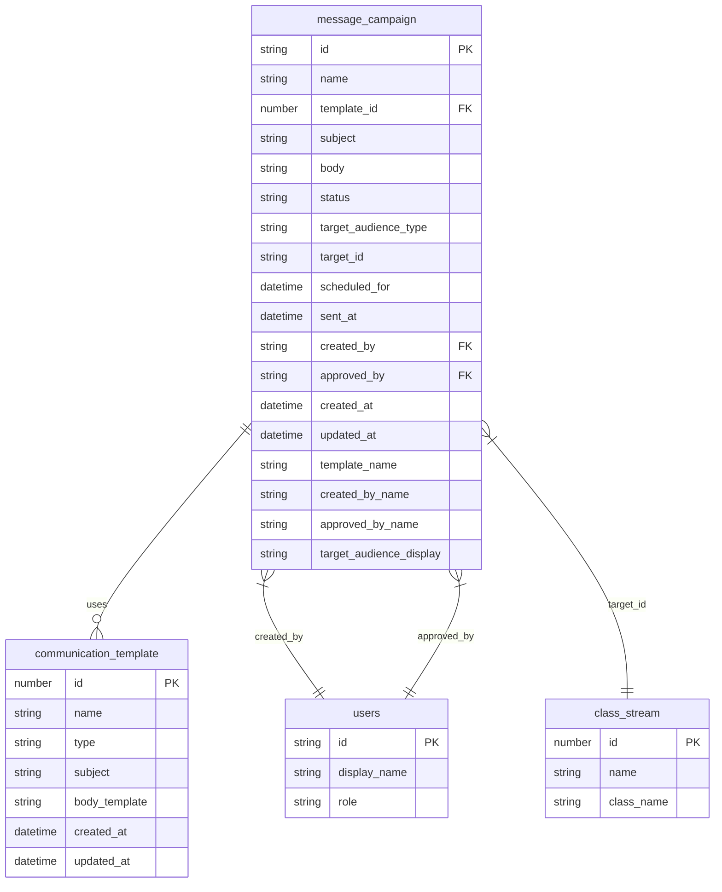
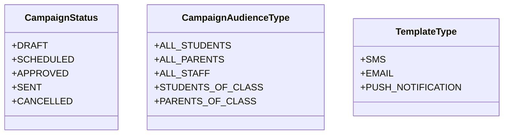
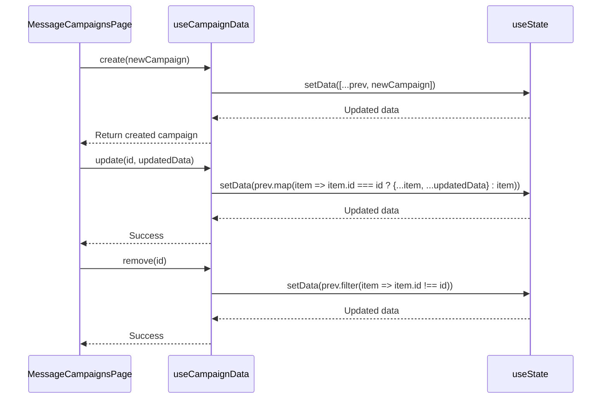
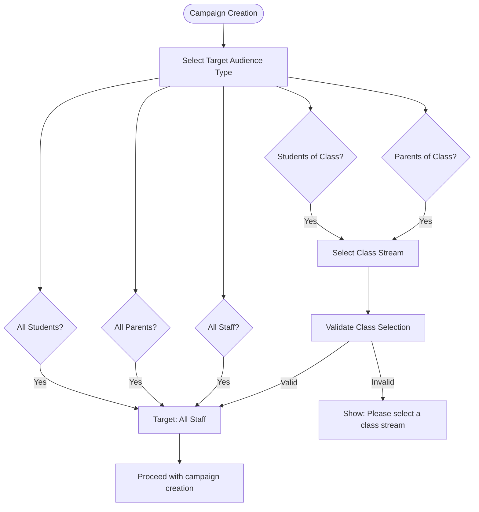
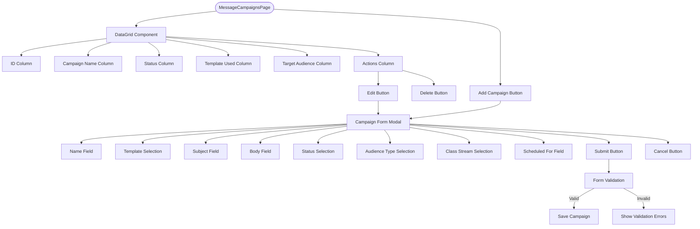
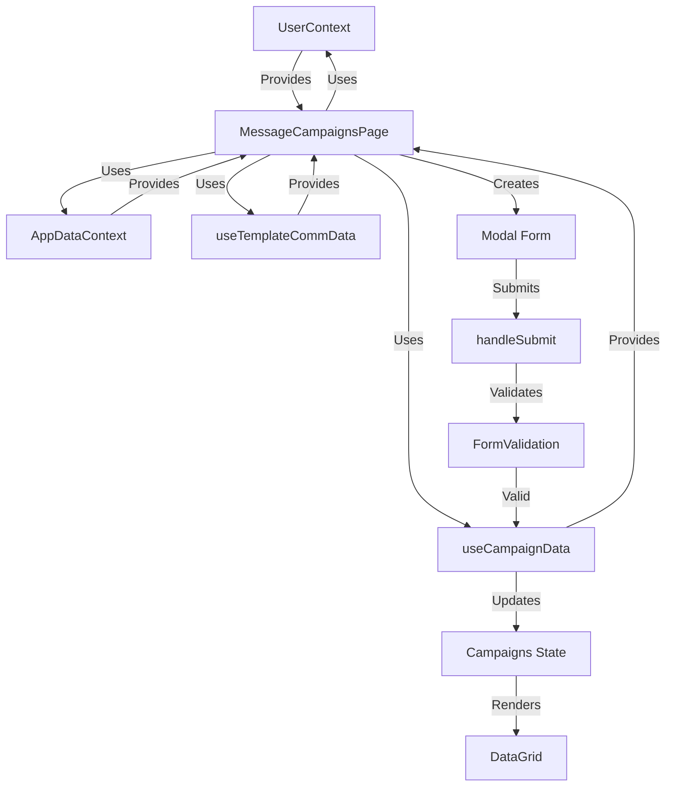

# Message Campaigns

<cite>
**Referenced Files in This Document**   
- [MessageCampaignsPage.tsx](file://src/modules/administration/pages/MessageCampaignsPage.tsx)
- [schema.ts](file://src/modules/administration/data/schema.ts)
- [types.ts](file://src/modules/administration/data/types.ts)
- [useCampaignData.ts](file://src/modules/administration/data/useCampaignData.ts)
- [useTemplateCommData.ts](file://src/modules/administration/data/useTemplateCommData.ts)
- [mockData.ts](file://src/modules/administration/data/mockData.ts)
- [useAppData.ts](file://src/hooks/useAppData.ts)
- [AppDataContext.tsx](file://src/contexts/AppDataContext.tsx)
- [UserContext.tsx](file://src/contexts/UserContext.tsx)
</cite>

## Table of Contents
1. [Introduction](#introduction)
2. [Data Model](#data-model)
3. [Campaign Lifecycle Management](#campaign-lifecycle-management)
4. [Recipient Segmentation and Targeting](#recipient-segmentation-and-targeting)
5. [Template Integration and Personalization](#template-integration-and-personalization)
6. [User Interface and Workflow](#user-interface-and-workflow)
7. [State Management and Data Flow](#state-management-and-data-flow)
8. [Best Practices and Considerations](#best-practices-and-considerations)

## Introduction
The Message Campaigns feature in the Administration module enables school administrators to create, schedule, and send targeted communications to various stakeholders including students, parents, and staff. This system supports multiple delivery channels such as SMS, email, and push notifications, with comprehensive targeting options based on audience type and class streams. The implementation follows a modular architecture with clear separation of concerns between data management, user interface, and business logic.

The core functionality revolves around campaign creation, scheduling, approval workflows, and delivery tracking. Campaigns can be created from scratch or based on predefined templates, allowing for consistent messaging across the institution. The system incorporates validation, status tracking, and audit capabilities to ensure reliable message delivery and compliance with communication policies.

## Data Model

The campaign data model is defined in the administration module's schema and types, establishing a comprehensive structure for message campaigns, templates, and related entities.



**Diagram sources**
- [schema.ts](file://src/modules/administration/data/schema.ts#L150-L185)
- [types.ts](file://src/modules/administration/data/types.ts#L80-L115)

**Section sources**
- [schema.ts](file://src/modules/administration/data/schema.ts#L150-L185)
- [types.ts](file://src/modules/administration/data/types.ts#L80-L115)

### Campaign Schema
The `campaignSchema` defines the structure for message campaigns with the following key properties:

- **id**: Unique identifier for the campaign
- **name**: Campaign name (required, max 200 characters)
- **template_id**: Reference to communication template
- **subject**: Campaign subject line
- **body**: Campaign body content (required, max 2000 characters)
- **status**: Current campaign status (Draft, Scheduled, Approved, Sent, Cancelled)
- **target_audience_type**: Audience type (All Students, All Parents, Students of Class, etc.)
- **target_id**: Target ID for specific audience (e.g., class stream ID)
- **scheduled_for**: Scheduled send time
- **sent_at**: Actual send time when campaign is delivered
- **created_by**: Reference to user who created the campaign
- **approved_by**: Reference to user who approved the campaign
- **created_at**: Record creation timestamp
- **updated_at**: Record last update timestamp
- **template_name**: Denormalized template name for display
- **created_by_name**: Denormalized creator name for display
- **approved_by_name**: Denormalized approver name for display
- **target_audience_display**: Denormalized target audience display name

The schema includes indexes on name, status, and target_audience_type for efficient querying and filtering.

### Status and Audience Types
The system defines specific enums for campaign status and audience types:



**Diagram sources**
- [types.ts](file://src/modules/administration/data/types.ts#L60-L80)

**Section sources**
- [types.ts](file://src/modules/administration/data/types.ts#L60-L80)

## Campaign Lifecycle Management

The campaign lifecycle is managed through the `useCampaignData` hook, which provides CRUD operations for campaign entities and maintains campaign state throughout its lifecycle.



**Diagram sources**
- [useCampaignData.ts](file://src/modules/administration/data/useCampaignData.ts#L7-L39)

**Section sources**
- [useCampaignData.ts](file://src/modules/administration/data/useCampaignData.ts#L7-L39)

### Lifecycle Operations
The `useCampaignData` hook implements the following lifecycle operations:

- **Create**: Adds a new campaign with required fields including id, creation timestamp, and current user as creator
- **Update**: Modifies existing campaign data while preserving creation metadata
- **Remove**: Deletes a campaign by filtering it from the data array

The hook uses React's `useState` to manage campaign data in memory, with initial data populated from `initialMockCampaigns`. In a production environment, this would be replaced with database-backed persistence.

### Status Transitions
Campaigns progress through the following status states:

1. **Draft**: Initial state when campaign is created
2. **Scheduled**: Campaign has been approved and scheduled for future delivery
3. **Approved**: Campaign has been reviewed and approved for sending
4. **Sent**: Campaign has been successfully delivered
5. **Cancelled**: Campaign has been cancelled before delivery

The UI displays status with color-coded badges for easy identification:
- Draft: Yellow
- Scheduled: Blue
- Sent: Green
- Cancelled: Red

## Recipient Segmentation and Targeting

The system supports multiple audience targeting options, allowing administrators to send messages to specific groups within the school community.



**Diagram sources**
- [MessageCampaignsPage.tsx](file://src/modules/administration/pages/MessageCampaignsPage.tsx#L150-L200)

**Section sources**
- [MessageCampaignsPage.tsx](file://src/modules/administration/pages/MessageCampaignsPage.tsx#L150-L200)

### Targeting Implementation
The recipient targeting functionality is implemented in the `MessageCampaignsPage` component with the following key features:

- **Audience Type Selection**: Dropdown allows selection of audience type (All Students, All Parents, All Staff, Students of Class, Parents of Class)
- **Class Stream Targeting**: When targeting specific classes, a class stream selection field appears
- **Conditional Validation**: The form validates that a class stream is selected when using class-specific audience types
- **Dynamic UI Updates**: The interface updates based on audience type selection, showing or hiding the class stream selector

The `classStreams` data is obtained through the `useAppData` hook, which provides access to application-wide data including class configurations.

## Template Integration and Personalization

The system supports message templates with variable substitution, enabling personalized communications while maintaining consistent messaging.

```mermaid
classDiagram
class AdminTemplateCommType {
+id : number
+name : string
+type : TemplateType
+subject : string
+body_template : string
+created_at : string
+updated_at : string
}
class TemplateVariables {
+{{student_name}}
+{{parent_name}}
+{{due_date}}
+{{school_name}}
}
AdminTemplateCommType --> TemplateVariables : "contains"
```

**Diagram sources**
- [types.ts](file://src/modules/administration/data/types.ts#L70-L80)
- [mockData.ts](file://src/modules/administration/data/mockData.ts#L640-L660)

**Section sources**
- [types.ts](file://src/modules/administration/data/types.ts#L70-L80)
- [mockData.ts](file://src/modules/administration/data/mockData.ts#L640-L660)

### Template Management
Templates are managed through the `useTemplateCommData` hook, which provides CRUD operations similar to the campaign data hook:

```typescript
export const useTemplateCommData = () => {
  const [data, setData] = useState<AdminTemplateCommType[]>(initialMockTemplateComms);

  const create = async (newItem: Partial<AdminTemplateCommType>) => {
    const newDataItem: AdminTemplateCommType = {
      ...newItem,
      id: Date.now(),
      created_at: new Date().toISOString(),
      updated_at: new Date().toISOString()
    } as AdminTemplateCommType;
    setData((prev: AdminTemplateCommType[]) => [...prev, newDataItem]);
    return newDataItem;
  };

  // Update and remove operations...
};
```

### Template Usage Workflow
When creating a campaign, users can select from existing templates:

1. Template selection updates the campaign form with the template's subject and body
2. The template body may contain variables (e.g., `{{student_name}}`) that will be replaced with actual values during delivery
3. Users can modify the pre-filled content before saving the campaign
4. The system validates that required fields (subject for email/push notifications) are present

The `initialMockTemplateComms` contains sample templates demonstrating different message types:

- **Welcome Message**: SMS template with student name personalization
- **Fee Reminder**: Email template with parent name, student name, and due date variables

## User Interface and Workflow

The Message Campaigns page provides a comprehensive interface for managing campaigns with a data grid for listing and a modal form for creation and editing.



**Diagram sources**
- [MessageCampaignsPage.tsx](file://src/modules/administration/pages/MessageCampaignsPage.tsx#L0-L358)

**Section sources**
- [MessageCampaignsPage.tsx](file://src/modules/administration/pages/MessageCampaignsPage.tsx#L0-L358)

### Key UI Components
The page implements the following components:

- **DataGrid**: Displays existing campaigns with sortable and filterable columns
- **Modal Form**: Provides a form for creating and editing campaigns
- **Add Button**: Opens the modal form for new campaigns
- **Action Buttons**: Edit and delete buttons for each campaign

### Form Validation
The system implements comprehensive form validation:

- Campaign name and status are required
- Campaign body content is required
- Subject is required for email and push notification campaigns
- Class stream must be selected for class-specific audience types
- Validation messages are displayed using the translation system

## State Management and Data Flow

The application uses a combination of React hooks and context providers to manage state and data flow across components.



**Diagram sources**
- [MessageCampaignsPage.tsx](file://src/modules/administration/pages/MessageCampaignsPage.tsx#L0-L358)
- [useCampaignData.ts](file://src/modules/administration/data/useCampaignData.ts#L7-L39)
- [AppDataContext.tsx](file://src/contexts/AppDataContext.tsx#L0-L169)
- [UserContext.tsx](file://src/contexts/UserContext.tsx#L0-L40)

**Section sources**
- [MessageCampaignsPage.tsx](file://src/modules/administration/pages/MessageCampaignsPage.tsx#L0-L358)
- [useCampaignData.ts](file://src/modules/administration/data/useCampaignData.ts#L7-L39)
- [AppDataContext.tsx](file://src/contexts/AppDataContext.tsx#L0-L169)
- [UserContext.tsx](file://src/contexts/UserContext.tsx#L0-L40)

### Data Flow
The data flow follows this pattern:

1. **Context Providers**: AppDataContext and UserContext provide application-wide data
2. **Custom Hooks**: useCampaignData and useTemplateCommData provide module-specific data
3. **Component Consumption**: MessageCampaignsPage consumes data from all sources
4. **User Interaction**: Users create/edit campaigns through the modal form
5. **State Update**: Form submission triggers validation and data updates
6. **UI Update**: State changes trigger re-rendering of the data grid

### Key Hooks
- **useAppData**: Provides access to application data including class streams
- **useUser**: Provides current user information for campaign creation metadata
- **useCampaignData**: Manages campaign CRUD operations and state
- **useTemplateCommData**: Manages template CRUD operations and state
- **useTranslation**: Provides internationalization support (implementation not shown)

## Best Practices and Considerations

### Implementation Best Practices
- **State Management**: Use custom hooks to encapsulate data logic and promote reusability
- **Form Validation**: Implement client-side validation with clear error messages
- **User Experience**: Use modals for complex forms to maintain context
- **Data Consistency**: Denormalize frequently accessed data (names, display values) to reduce lookups
- **Error Handling**: Provide meaningful error messages and recovery options

### Limitations and Future Improvements
- **Current Limitations**:
  - Uses in-memory state rather than persistent storage
  - Limited template variables and personalization options
  - No delivery status tracking for individual recipients
  - No A/B testing capabilities
  - No integration with external messaging gateways

- **Recommended Improvements**:
  - Implement database persistence for campaigns and templates
  - Add delivery status tracking (queued, sent, failed) for individual messages
  - Implement retry mechanisms for failed deliveries
  - Add rate limiting to prevent message flooding
  - Implement spam compliance features (opt-out management)
  - Add A/B testing for message content
  - Integrate with external messaging services (Twilio, SendGrid, etc.)
  - Add analytics for delivery success rates and engagement
  - Implement message scheduling with timezone support
  - Add audit logging for campaign creation and modification

### Performance Considerations
For large recipient lists, consider:
- **Batch Processing**: Process recipients in batches to avoid memory issues
- **Background Jobs**: Use background workers for message delivery
- **Progress Indicators**: Show progress during long-running operations
- **Optimistic Updates**: Update UI immediately while processing in background
- **Pagination**: Implement pagination for large campaign lists

The current implementation uses mock data and in-memory state, which is suitable for development and demonstration but requires enhancement for production use with real data volumes and persistence requirements.