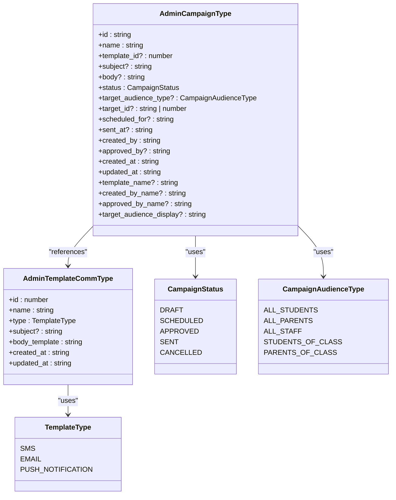
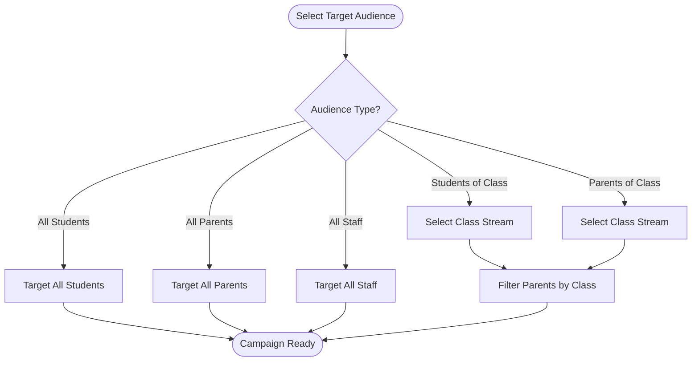
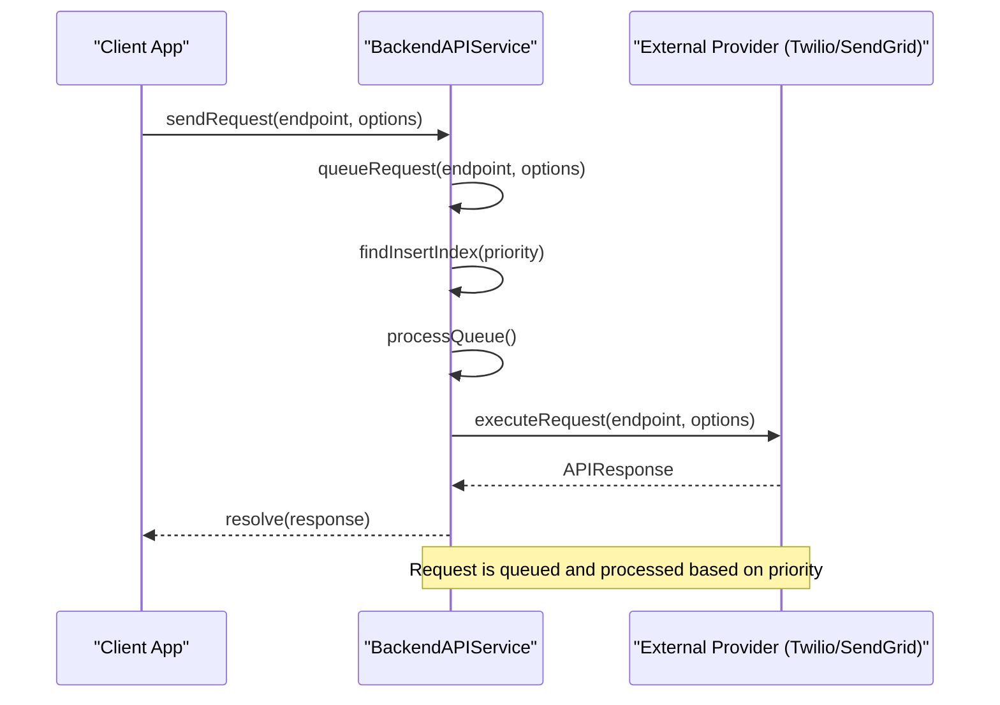
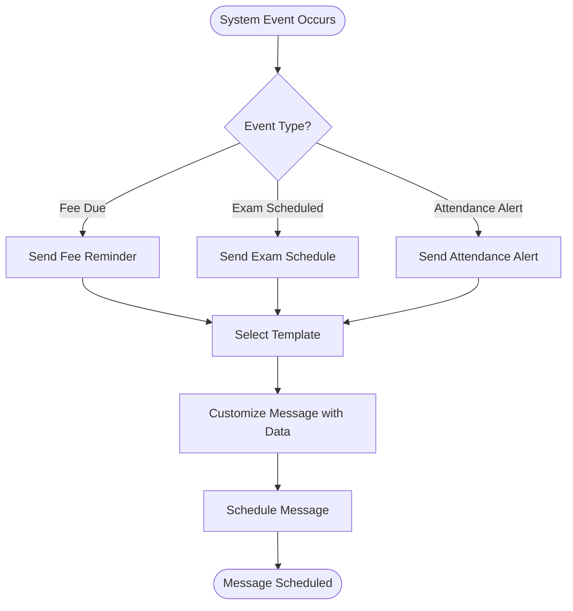
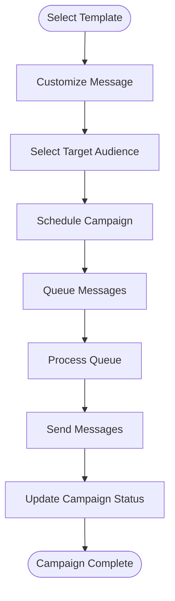
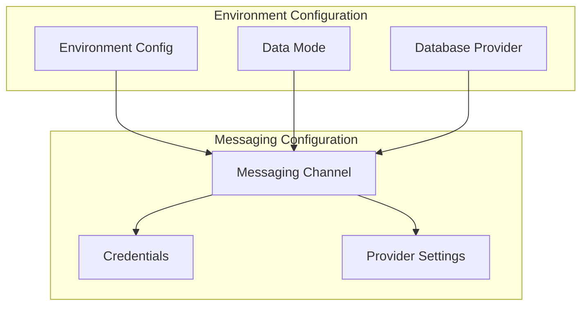

# Messaging Integrations and Workflows

<cite>
**Referenced Files in This Document**   
- [useCampaignData.ts](file://src\modules\administration\data\useCampaignData.ts)
- [types.ts](file://src\modules\administration\data\types.ts)
- [mockData.ts](file://src\modules\administration\data\mockData.ts)
- [schema.ts](file://src\modules\administration\data\schema.ts)
- [MessageCampaignsPage.tsx](file://src\modules\administration\pages\MessageCampaignsPage.tsx)
- [BackendAPIService.ts](file://src\services\BackendAPIService.ts)
- [unifiedConfig.ts](file://src\config\unifiedConfig.ts)
- [environmentMatrix.ts](file://src\config\environmentMatrix.ts)
</cite>

## Table of Contents
1. [Introduction](#introduction)
2. [Communication Templates and Message Campaigns](#communication-templates-and-message-campaigns)
3. [Integration with Student Management](#integration-with-student-management)
4. [Backend API Integration](#backend-api-integration)
5. [Event-Driven Workflows](#event-driven-workflows)
6. [Data Flow and Campaign Execution](#data-flow-and-campaign-execution)
7. [Error Handling and Fallback Strategies](#error-handling-and-fallback-strategies)
8. [Configuration of Messaging Channels](#configuration-of-messaging-channels)
9. [Troubleshooting Guide](#troubleshooting-guide)

## Introduction
This document provides a comprehensive overview of the messaging integrations and workflows within the Education Management System. It details how communication templates and message campaigns are integrated with various modules, particularly Student Management, for targeted messaging based on enrollment, attendance, or financial status. The document also covers backend API integration for sending messages through external providers, event-driven workflows for automated reminders, data flow from template selection to campaign execution, error handling in message queuing, fallback strategies, logging for compliance, configuration of messaging channels, and troubleshooting guidance for common integration failures and performance bottlenecks in bulk messaging.

## Communication Templates and Message Campaigns

### Template and Campaign Data Structures
The system defines communication templates and message campaigns using TypeScript interfaces in the `types.ts` file. These structures ensure consistency and type safety across the application.



**Diagram sources**
- [types.ts](file://src\modules\administration\data\types.ts#L100-L150)

**Section sources**
- [types.ts](file://src\modules\administration\data\types.ts#L100-L150)

### Template and Campaign Management
The `useCampaignData` hook provides CRUD operations for managing message campaigns. It uses mock data for development and demo modes, ensuring the system can function without external dependencies.

```typescript
export const useCampaignData = () => {
  const [data, setData] = useState<Campaign[]>(initialMockCampaigns);

  const create = async (newItem: Partial<Campaign>) => {
    const newDataItem: Campaign = {
      ...newItem,
      id: Date.now(),
      created_at: new Date().toISOString(),
      updated_at: new Date().toISOString()
    } as Campaign;
    setData((prev: Campaign[]) => [...prev, newDataItem]);
    return newDataItem;
  };

  const update = async (id: number, updatedData: Partial<Campaign>) => {
    setData((prev: Campaign[]) => prev.map((item: Campaign) => 
      item.id === id 
        ? { ...item, ...updatedData, updated_at: new Date().toISOString() }
        : item
    ));
  };

  const remove = async (id: number) => {
    setData((prev: Campaign[]) => prev.filter((item: Campaign) => item.id !== id));
  };

  return {
    data,
    create,
    update,
    remove
  };
};
```

**Section sources**
- [useCampaignData.ts](file://src\modules\administration\data\useCampaignData.ts#L10-L50)

## Integration with Student Management

### Target Audience Selection
Message campaigns can be targeted to specific audiences based on student enrollment, attendance, or financial status. The `CampaignAudienceType` enum defines the possible target audiences, including all students, all parents, all staff, students of a specific class, and parents of a specific class.



**Diagram sources**
- [types.ts](file://src\modules\administration\data\types.ts#L130-L140)
- [MessageCampaignsPage.tsx](file://src\modules\administration\pages\MessageCampaignsPage.tsx#L30-L50)

**Section sources**
- [types.ts](file://src\modules\administration\data\types.ts#L130-L140)
- [MessageCampaignsPage.tsx](file://src\modules\administration\pages\MessageCampaignsPage.tsx#L30-L50)

## Backend API Integration

### BackendAPIService for External Providers
The `BackendAPIService` handles communication with external providers such as Twilio and SendGrid. It manages request queuing, caching, and error handling to ensure reliable message delivery.



**Diagram sources**
- [BackendAPIService.ts](file://src\services\BackendAPIService.ts#L163-L213)

**Section sources**
- [BackendAPIService.ts](file://src\services\BackendAPIService.ts#L163-L213)

### Request Queue and Processing
The `BackendAPIService` implements a request queue with priority-based processing. Requests are inserted into the queue based on their priority, and the queue is processed when the network is available.

```typescript
private async queueRequest<T>(
  endpoint: string,
  options: RequestOptions
): Promise<APIResponse<T>> {
  return new Promise((resolve, reject) => {
    const queueItem: RequestQueueItem = {
      id: this.generateRequestId(),
      endpoint,
      options,
      resolve,
      reject,
      timestamp: new Date(),
      retryCount: 0,
      priority: options.priority || 'normal'
    };

    // Insert based on priority
    const insertIndex = this.findInsertIndex(queueItem.priority);
    this.requestQueue.splice(insertIndex, 0, queueItem);

    // Try to process queue immediately
    this.processQueue();
  });
}
```

**Section sources**
- [BackendAPIService.ts](file://src\services\BackendAPIService.ts#L163-L180)

## Event-Driven Workflows

### Automated Reminders
The system supports event-driven workflows for automated reminders, such as fee payment reminders or exam schedule notifications. These workflows are triggered by system events and can be scheduled for specific times.



**Diagram sources**
- [MessageCampaignsPage.tsx](file://src\modules\administration\pages\MessageCampaignsPage.tsx#L314-L356)

**Section sources**
- [MessageCampaignsPage.tsx](file://src\modules\administration\pages\MessageCampaignsPage.tsx#L314-L356)

## Data Flow and Campaign Execution

### From Template Selection to Delivery
The data flow from template selection to campaign execution involves several steps, including template selection, message customization, audience targeting, scheduling, and delivery.



**Diagram sources**
- [MessageCampaignsPage.tsx](file://src\modules\administration\pages\MessageCampaignsPage.tsx#L19-L56)
- [BackendAPIService.ts](file://src\services\BackendAPIService.ts#L209-L253)

**Section sources**
- [MessageCampaignsPage.tsx](file://src\modules\administration\pages\MessageCampaignsPage.tsx#L19-L56)
- [BackendAPIService.ts](file://src\services\BackendAPIService.ts#L209-L253)

## Error Handling and Fallback Strategies

### Message Queuing and Retry Logic
The `BackendAPIService` implements robust error handling and fallback strategies for message queuing. Failed requests are retried with exponential backoff, and the queue is processed when the network becomes available.

```typescript
private async processQueue(): Promise<void> {
  if (this.isProcessingQueue || this.requestQueue.length === 0) {
    return;
  }

  const networkManager = await this.networkManager;
  const networkState = networkManager.getState();
  
  if (!networkState.isOnline || !networkState.backendAvailable) {
    return;
  }

  this.isProcessingQueue = true;

  while (this.requestQueue.length > 0) {
    const networkState = networkManager.getState();
    
    if (!networkState.isOnline || !networkState.backendAvailable) {
      break; // Stop processing if network becomes unavailable
    }

    const item = this.requestQueue.shift()!;
    
    try {
      const result = await this.executeRequest(item.endpoint, item.options);
      item.resolve(result);
    } catch (error) {
      if (item.retryCount < this.MAX_RETRY_COUNT) {
        item.retryCount++;
        // Re-queue with exponential backoff
        setTimeout(() => {
          this.requestQueue.unshift(item);
        }, Math.pow(2, item.retryCount) * 1000);
      } else {
        this.logError('Request execution failed', error instanceof Error ? error : new Error(String(error)));
        item.reject(error instanceof Error ? error : new Error(String(error)));
      }
    }
  }

  this.isProcessingQueue = false;
}
```

**Section sources**
- [BackendAPIService.ts](file://src\services\BackendAPIService.ts#L209-L253)

## Configuration of Messaging Channels

### Environment Settings and Credentials
The configuration of messaging channels and credentials is managed through environment settings. The `unifiedConfig.ts` and `environmentMatrix.ts` files define the environment-specific configurations, including the default data mode, allowed data modes, and database provider.



**Diagram sources**
- [unifiedConfig.ts](file://src\config\unifiedConfig.ts#L96-L118)
- [environmentMatrix.ts](file://src\config\environmentMatrix.ts#L84-L132)

**Section sources**
- [unifiedConfig.ts](file://src\config\unifiedConfig.ts#L96-L118)
- [environmentMatrix.ts](file://src\config\environmentMatrix.ts#L84-L132)

## Troubleshooting Guide

### Common Integration Failures
Common integration failures include network connectivity issues, incorrect credentials, and misconfigured messaging channels. The following steps can help diagnose and resolve these issues:

1. **Check Network Connectivity**: Ensure the application has a stable network connection.
2. **Verify Credentials**: Confirm that the credentials for the external provider are correct and up-to-date.
3. **Review Configuration**: Check the environment settings and ensure the messaging channels are correctly configured.
4. **Monitor Logs**: Review the application logs for any error messages or warnings.

### Performance Bottlenecks in Bulk Messaging
Performance bottlenecks in bulk messaging can occur due to high message volume, slow external provider response times, or inefficient message queuing. The following strategies can help mitigate these issues:

1. **Optimize Message Queuing**: Use priority-based queuing to ensure high-priority messages are processed first.
2. **Implement Caching**: Cache frequently used data to reduce the number of requests to external providers.
3. **Monitor Queue Length**: Regularly monitor the message queue length and adjust the processing rate as needed.
4. **Scale Resources**: Increase the resources allocated to the messaging service to handle high message volumes.

**Section sources**
- [BackendAPIService.ts](file://src\services\BackendAPIService.ts#L209-L253)
- [unifiedConfig.ts](file://src\config\unifiedConfig.ts#L96-L118)
- [environmentMatrix.ts](file://src\config\environmentMatrix.ts#L84-L132)