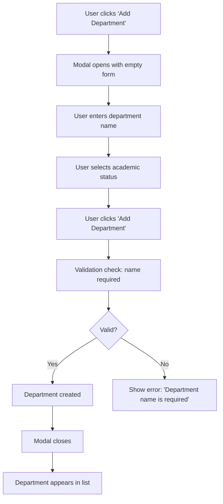
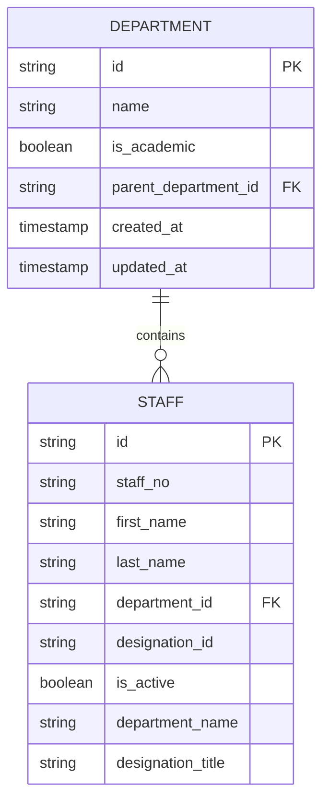
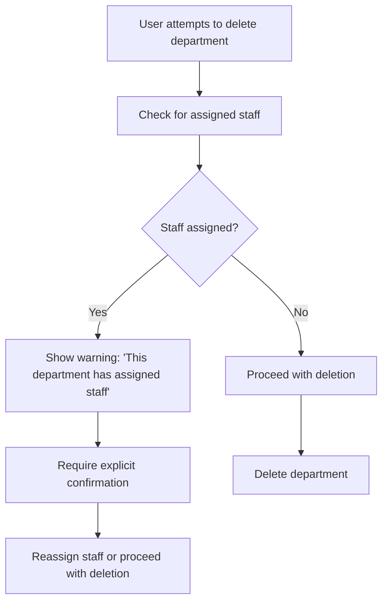

# Department Management

<cite>
**Referenced Files in This Document**   
- [DepartmentsPage.tsx](file://src/modules/administration/pages/DepartmentsPage.tsx)
- [useDepartmentData.ts](file://src/modules/administration/data/useDepartmentData.ts)
- [administration.json](file://src/i18n/locales/en/administration.json)
- [types.ts](file://src/core/types.ts)
- [rbac.ts](file://src/modules/administration/rbac.ts)
</cite>

## Table of Contents
1. [Department Management](#department-management)
2. [Core Functionality](#core-functionality)
3. [Department Creation and Editing](#department-creation-and-editing)
4. [Hierarchical Organization](#hierarchical-organization)
5. [CRUD Operations and State Management](#crud-operations-and-state-management)
6. [Staff Integration and Organizational Implications](#staff-integration-and-organizational-implications)
7. [Validation Rules](#validation-rules)
8. [Change Propagation](#change-propagation)
9. [Edge Cases](#edge-cases)
10. [RBAC Integration](#rbac-integration)

## Core Functionality

The Department Management feature provides a comprehensive interface for managing organizational departments within the educational institution. This system enables administrators to create, edit, and organize departments in a hierarchical structure, facilitating effective organizational reporting and access control.

The primary implementation is located in the `DepartmentsPage.tsx` component, which serves as the user interface for department management. This component leverages the `useDepartmentData` hook to perform CRUD operations and maintain state synchronization across the application.

**Section sources**
- [DepartmentsPage.tsx](file://src/modules/administration/pages/DepartmentsPage.tsx#L1-L170)

## Department Creation and Editing

The department creation and editing functionality is implemented through a modal interface that appears when users click the "Add Department" button or edit an existing department. The form contains two primary fields:

- **Department Name**: A required text field for the department's name
- **Academic Department**: A checkbox indicating whether the department is academic in nature



**Diagram sources**
- [DepartmentsPage.tsx](file://src/modules/administration/pages/DepartmentsPage.tsx#L25-L75)

**Section sources**
- [DepartmentsPage.tsx](file://src/modules/administration/pages/DepartmentsPage.tsx#L112-L147)

## Hierarchical Organization

The department system supports hierarchical organization, allowing departments to be structured in a parent-child relationship. This hierarchy enables the creation of a comprehensive organizational structure that reflects the actual administrative and academic divisions within the institution.

While the current implementation in `DepartmentsPage.tsx` focuses on flat department management, the underlying data model supports hierarchical relationships through the `parent_department_id` field in the Department interface. This allows for the creation of sub-departments and divisional structures.

The hierarchical organization facilitates:
- Organizational reporting by departmental hierarchy
- Resource allocation based on departmental structure
- Administrative oversight through reporting lines
- Budget management by departmental levels

**Section sources**
- [types.ts](file://src/core/types.ts#L456-L477)

## CRUD Operations and State Management

The Department Management system implements CRUD (Create, Read, Update, Delete) operations through the `useDepartmentData` hook, which provides a clean API for interacting with department data.

```mermaid
classDiagram
class DepartmentsPage {
+departments : Department[]
+isModalOpen : boolean
+editingDepartment : Department | null
+formData : DepartmentFormData
+openModal(dept? : Department)
+closeModal()
+handleInputChange(e : ChangeEvent)
+handleSubmit()
+handleDelete(id : string)
}
class useDepartmentData {
+departments : Department[] | null
+loading : boolean
+error : string | null
+addDepartment(data : DepartmentCreateData) : Promise<void>
+updateDepartment(data : DepartmentUpdateData) : Promise<void>
+deleteDepartment(id : string) : Promise<void>
}
DepartmentsPage --> useDepartmentData : "uses"
useDepartmentData --> "DataService" : "delegates"
```

**Diagram sources**
- [DepartmentsPage.tsx](file://src/modules/administration/pages/DepartmentsPage.tsx#L30-L35)
- [useDepartmentData.ts](file://src/modules/administration/data/useDepartmentData.ts)

**Section sources**
- [DepartmentsPage.tsx](file://src/modules/administration/pages/DepartmentsPage.tsx#L30-L35)
- [useDepartmentData.ts](file://src/modules/administration/data/useDepartmentData.ts)

## Staff Integration and Organizational Implications

Departments are intrinsically linked to staff records through the `department_id` field in the Staff interface. This relationship enables comprehensive organizational reporting and access control mechanisms.



**Diagram sources**
- [types.ts](file://src/core/types.ts#L456-L477)

The integration has several organizational implications:

- **Reporting**: Enables generation of organizational charts and departmental staffing reports
- **Access Control**: Department membership determines access to department-specific resources and data
- **Budgeting**: Facilitates department-level budget allocation and tracking
- **Performance Management**: Allows for department-level performance evaluation

When a staff member is assigned to a department, the system denormalizes the department name into the staff record (via the `department_name` field) to optimize query performance and ensure consistency in reporting.

**Section sources**
- [types.ts](file://src/core/types.ts#L456-L477)

## Validation Rules

The Department Management system implements validation rules to ensure data integrity. Currently, the primary validation is client-side and focuses on required fields.

The validation rules include:
- Department name is required
- Department name must be a non-empty string
- No duplicate department names are enforced at the application level

The validation is implemented directly in the `handleSubmit` function of the `DepartmentsPage` component, using a simple check before submitting the form:

```typescript
if (!formData.name) {
  alert(t('validation.departmentNameIsRequired'));
  return;
}
```

While the current implementation uses a simple alert for validation feedback, the system is designed to integrate with the global validation framework through the `globalDataValidator` instance, which could provide more sophisticated validation in the future.

**Section sources**
- [DepartmentsPage.tsx](file://src/modules/administration/pages/DepartmentsPage.tsx#L25-L75)

## Change Propagation

When department information changes, the system must propagate these changes to associated staff members and other dependent systems. The current implementation handles this through state management and data synchronization.

When a department is:
- **Created**: The new department becomes available for assignment to staff members
- **Updated**: Changes to the department name or academic status are reflected in all associated staff records through the denormalized `department_name` field
- **Deleted**: Staff members assigned to the deleted department become orphaned and must be reassigned

The `useDepartmentData` hook ensures that changes are synchronized across all components that consume department data, maintaining consistency throughout the application.

**Section sources**
- [useDepartmentData.ts](file://src/modules/administration/data/useDepartmentData.ts)

## Edge Cases

The Department Management system must handle several edge cases to maintain data integrity and usability.

### Merging Departments

While not explicitly implemented in the current code, merging departments would require:
- Transferring all staff members from the source department to the target department
- Updating any references to the source department in other systems
- Preserving historical data and audit trails
- Handling potential conflicts in department names or codes

### Orphaned Staff Records

When a department is deleted, staff members who were assigned to that department become orphaned. The system should:
- Prevent deletion of departments with active staff members, or
- Automatically reassign staff members to a default department, or
- Mark staff members as having no department assignment

The current implementation uses a simple confirmation dialog before deletion, but does not prevent deletion if staff members are assigned to the department.



**Diagram sources**
- [DepartmentsPage.tsx](file://src/modules/administration/pages/DepartmentsPage.tsx#L70-L75)

**Section sources**
- [DepartmentsPage.tsx](file://src/modules/administration/pages/DepartmentsPage.tsx#L70-L75)

## RBAC Integration

The Department Management feature integrates with the Role-Based Access Control (RBAC) system defined in `rbac.ts` to enforce appropriate permissions. Access to department management functionality is restricted based on user roles and permissions.

The RBAC integration ensures that:
- Only users with appropriate administrative privileges can create, edit, or delete departments
- Department heads can view and manage staff within their own department
- Regular staff members can only view department information relevant to them

The `useRBAC` hook is used throughout the application to check user permissions before allowing access to department management features. This integration is critical for maintaining data security and ensuring that organizational changes are made only by authorized personnel.

**Section sources**
- [rbac.ts](file://src/modules/administration/rbac.ts)