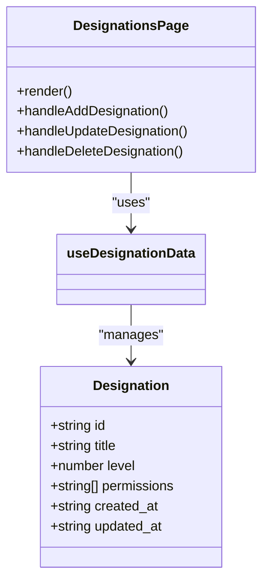
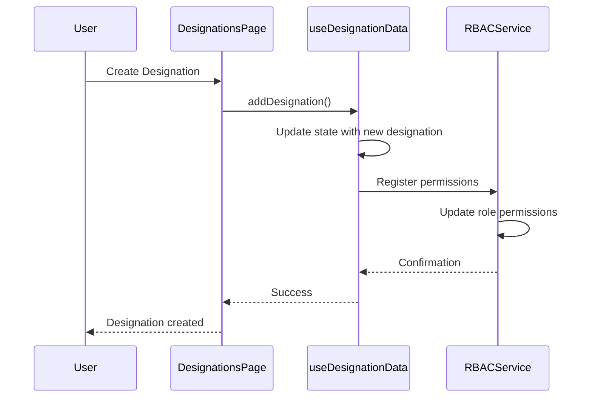
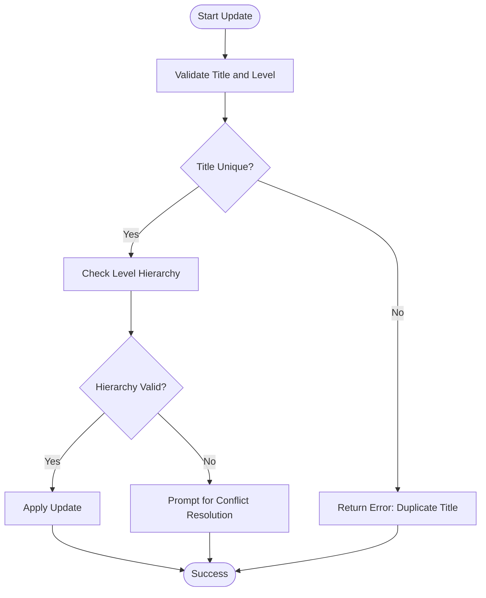
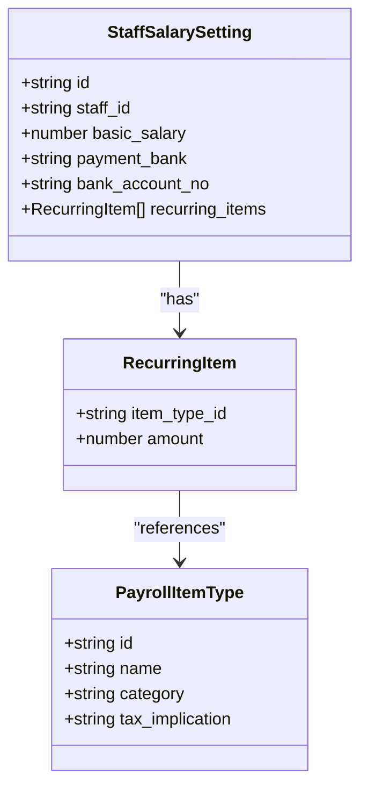
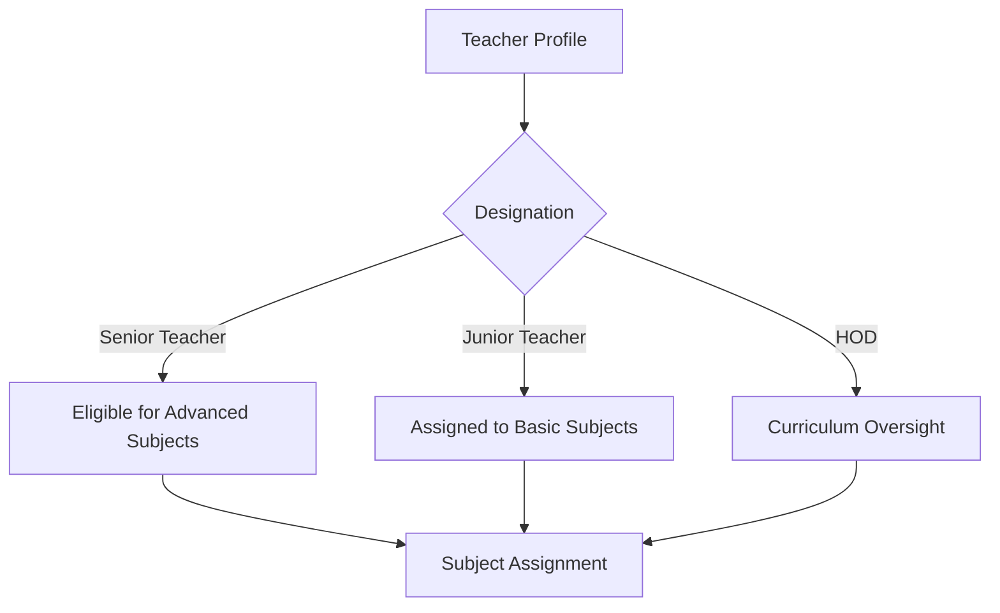
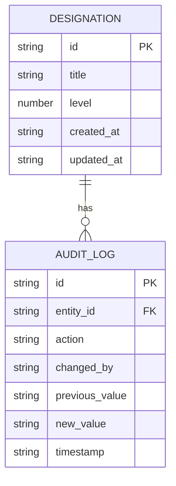

# Designation Management

<cite>
**Referenced Files in This Document**   
- [DesignationsPage.tsx](file://src/modules/administration/pages/DesignationsPage.tsx)
- [useDesignationData.ts](file://src/modules/administration/data/useDesignationData.ts)
- [schema.ts](file://src/modules/administration/data/schema.ts)
- [rbacService.ts](file://src/core/rbacService.ts)
- [staffSalarySettingsSchema.ts](file://src/modules/hr/data/schema.ts)
- [teacherSubjectAssignmentData.ts](file://src/modules/academics/data/useTeacherSubjectAssignmentData.ts)
</cite>

## Table of Contents
1. [Introduction](#introduction)
2. [Role-Based Designation Definitions](#role-based-designation-definitions)
3. [Use of useDesignationData Hook](#use-of-usedesignationdata-hook)
4. [Integration with RBAC System](#integration-with-rbac-system)
5. [Validation Rules and Conflict Resolution](#validation-rules-and-conflict-resolution)
6. [Impact on Payroll Processing](#impact-on-payroll-processing)
7. [Impact on Teaching Assignments](#impact-on-teaching-assignments)
8. [Audit Requirements for Designation History](#audit-requirements-for-designation-history)

## Introduction
The Designation Management sub-feature enables role-based designation definitions within the educational institution's administrative system. It allows administrators to define titles, levels, and associated permissions for staff roles, ensuring structured access control and operational clarity across modules. This document details the implementation of designations, their integration with the Role-Based Access Control (RBAC) system, validation mechanisms, and downstream impacts on HR and Academics modules.

**Section sources**
- [DesignationsPage.tsx](file://src/modules/administration/pages/DesignationsPage.tsx#L1-L50)
- [useDesignationData.ts](file://src/modules/administration/data/useDesignationData.ts#L1-L35)

## Role-Based Designation Definitions
Designations are defined through a structured schema that includes title, level, and permission mappings. Each designation is stored as a `Designation` entity with properties such as `id`, `title`, `level`, and `permissions`. The `DesignationsPage.tsx` component provides a user interface for creating, viewing, updating, and deleting designations.

The designation schema supports hierarchical relationships where higher-level designations inherit permissions from lower-level ones, enabling granular access control. For example, a "Senior Teacher" designation may include all permissions of a "Teacher" plus additional administrative rights.



**Diagram sources**
- [DesignationsPage.tsx](file://src/modules/administration/pages/DesignationsPage.tsx#L1-L100)
- [schema.ts](file://src/modules/administration/data/schema.ts#L300-L350)

**Section sources**
- [DesignationsPage.tsx](file://src/modules/administration/pages/DesignationsPage.tsx#L1-L100)
- [schema.ts](file://src/modules/administration/data/schema.ts#L300-L350)

## Use of useDesignationData Hook
The `useDesignationData` hook is a self-contained React hook responsible for managing designation records. It provides CRUD operations—`addDesignation`, `updateDesignation`, and `deleteDesignation`—without depending on global application state like `AppDataContext`.

This hook maintains local state using `useState` for storing designation data and loading status. When a new designation is added, it generates a unique `id` using `Date.now()` and sets creation and update timestamps. Updates modify the relevant record while preserving immutability.

```typescript
export const useDesignationData = () => {
  const [data, setData] = useState<Designation[]>(initialMockDesignations || []);
  const [loading, setLoading] = useState({ designations: false });

  const addDesignation = async (newItem: Omit<Designation, 'id' | 'created_at' | 'updated_at'>) => {
    setLoading(prev => ({ ...prev, designations: true }));
    try {
      const newDataItem: Designation = {
        ...newItem,
        id: Date.now(),
        created_at: new Date().toISOString(),
        updated_at: new Date().toISOString()
      };
      setData((prev: Designation[]) => [...prev, newDataItem]);
      return newDataItem;
    } finally {
      setLoading(prev => ({ ...prev, designations: false }));
    }
  };
  // ... update and delete methods
};
```

**Diagram sources**
- [useDesignationData.ts](file://src/modules/administration/data/useDesignationData.ts#L1-L64)

**Section sources**
- [useDesignationData.ts](file://src/modules/administration/data/useDesignationData.ts#L1-L64)

## Integration with RBAC System
Designations are tightly integrated with the RBAC system to enforce access control across modules. The `rbacService` maps each designation to a set of permissions that determine what actions users can perform in different modules.

When a user is assigned a designation, their role is updated in the `userRoles` map within the `RBACService`. This service checks module access and permission grants dynamically during navigation and action execution.



**Diagram sources**
- [useDesignationData.ts](file://src/modules/administration/data/useDesignationData.ts#L1-L64)
- [rbacService.ts](file://src/core/rbacService.ts#L1-L100)

**Section sources**
- [rbacService.ts](file://src/core/rbacService.ts#L1-L100)
- [useDesignationData.ts](file://src/modules/administration/data/useDesignationData.ts#L1-L64)

## Validation Rules and Conflict Resolution
Designation hierarchies are validated to prevent conflicts such as duplicate titles or invalid level sequences. While the current implementation uses mock data and lacks server-side validation, the framework supports integration with `DataValidator` for enforcing business rules.

For example, a validation rule could ensure that no two designations have the same title at the same level. During updates, conflict resolution involves checking existing designations and preventing overwrites unless explicitly allowed.



**Section sources**
- [useDesignationData.ts](file://src/modules/administration/data/useDesignationData.ts#L1-L64)
- [validationSchemas.ts](file://src/utils/validationSchemas.ts#L1-L50)

## Impact on Payroll Processing
Changes in designations directly affect payroll processing in the HR module. The `staffSalarySettingsSchema` includes a reference to the staff member’s designation, which determines salary scales, allowances, and deductions.

When a designation is updated, the system recalculates the basic salary and recurring items (e.g., housing allowance, transport) based on the new designation’s pay band. This ensures that payroll adjustments are automatically reflected in the next payroll cycle.



**Diagram sources**
- [schema.ts](file://src/modules/hr/data/schema.ts#L50-L100)

**Section sources**
- [schema.ts](file://src/modules/hr/data/schema.ts#L50-L100)

## Impact on Teaching Assignments
In the Academics module, designations influence teaching assignments by defining eligibility criteria for subject allocation. Teachers with specific designations (e.g., "Head of Department") may be assigned leadership roles in curriculum planning or mentoring.

The `teacherSubjectAssignmentData` service checks the teacher’s designation before allowing assignment to advanced or specialized subjects. This ensures that only qualified personnel are assigned to high-responsibility roles.



**Diagram sources**
- [useTeacherSubjectAssignmentData.ts](file://src/modules/academics/data/useTeacherSubjectAssignmentData.ts#L1-L30)

**Section sources**
- [useTeacherSubjectAssignmentData.ts](file://src/modules/academics/data/useTeacherSubjectAssignmentData.ts#L1-L30)

## Audit Requirements for Designation History
To maintain accountability, all changes to designations must be audited. Although the current implementation does not include audit logging, the system is designed to integrate with an `AuditTrailService` that records creation, modification, and deletion events.

Each audit log entry includes the user who made the change, timestamp, previous and new values, and the nature of the action. This supports compliance with institutional governance policies and facilitates forensic analysis when needed.



**Section sources**
- [useDesignationData.ts](file://src/modules/administration/data/useDesignationData.ts#L1-L64)
- [AuditTrailService.ts](file://src/modules/academics/services/AuditTrailService.ts#L1-L10)