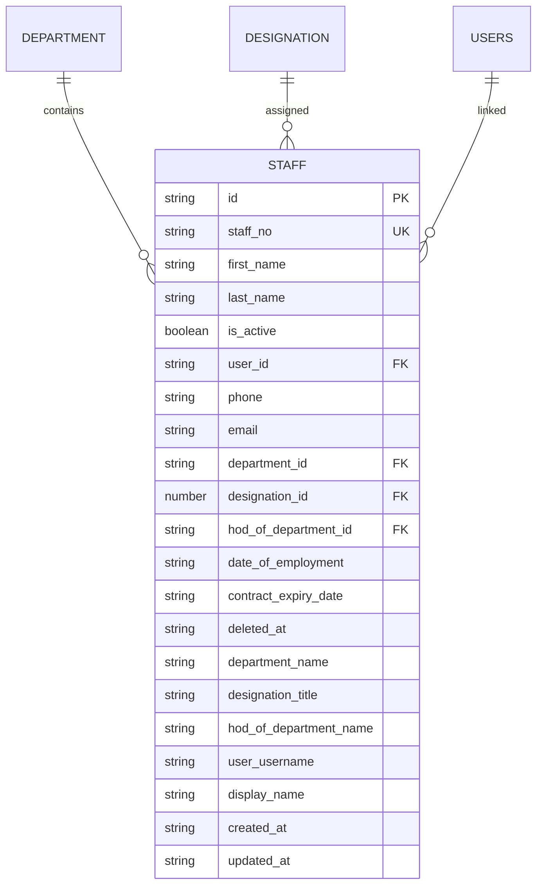
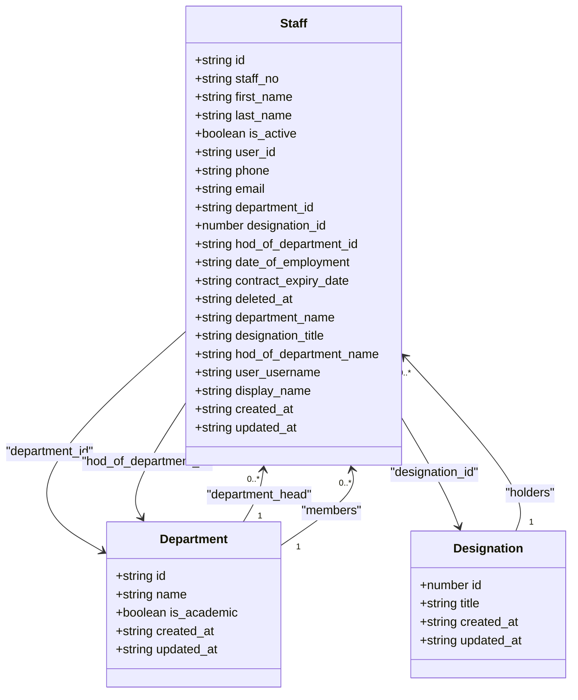
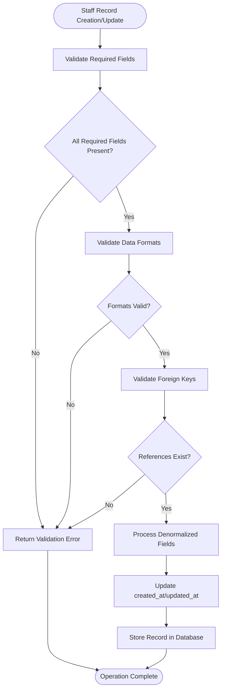
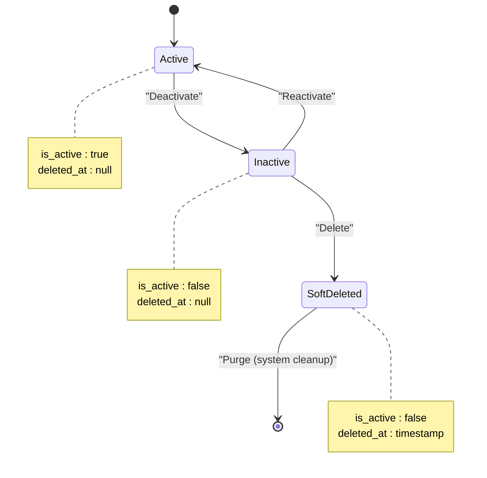
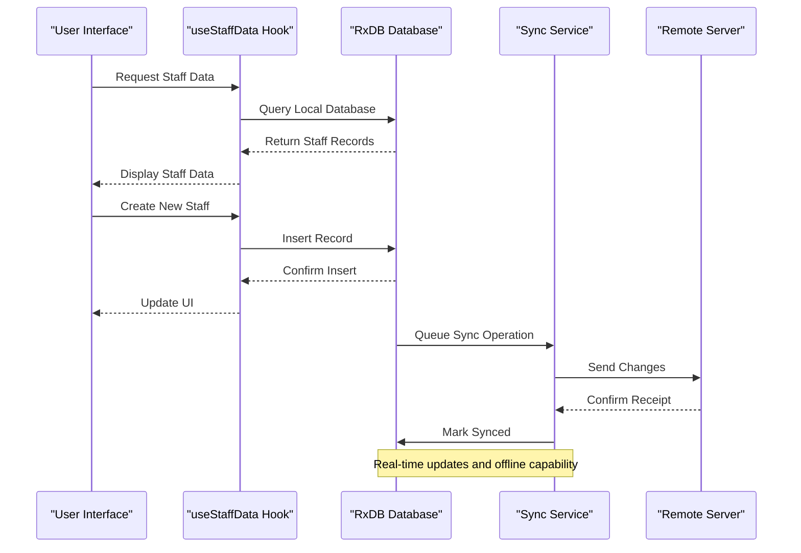
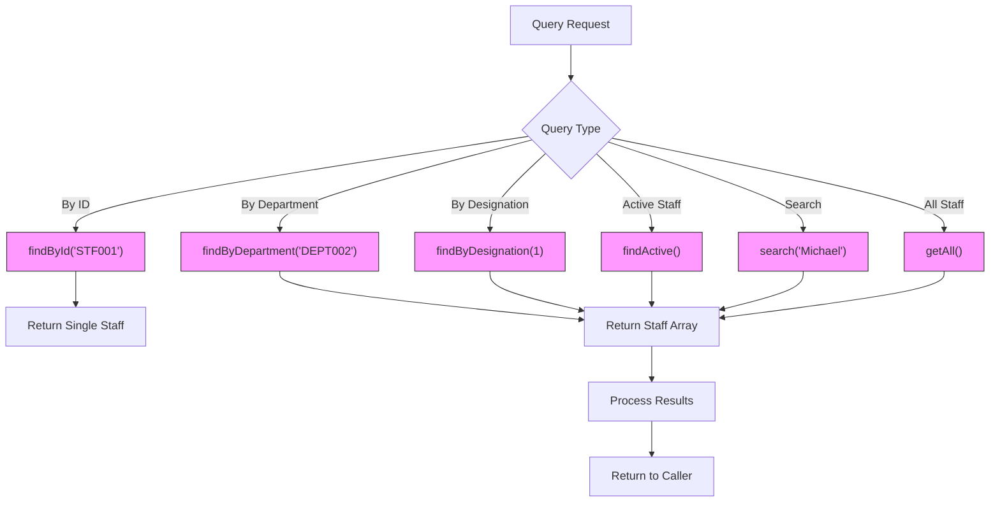

# Staff Data Model

<cite>
**Referenced Files in This Document**   
- [schema.ts](file://src/modules/administration/data/schema.ts)
- [collections.ts](file://src/modules/administration/data/collections.ts)
- [types.ts](file://src/core/types.ts)
- [useStaffData.ts](file://src/modules/administration/data/useStaffData.ts)
- [rxdbService.ts](file://src/services/rxdbService.ts)
- [mockData.ts](file://src/modules/administration/data/mockData.ts)
- [useDepartmentData.ts](file://src/modules/administration/data/useDepartmentData.ts)
- [useDesignationData.ts](file://src/modules/administration/data/useDesignationData.ts)
</cite>

## Table of Contents
1. [Introduction](#introduction)
2. [Staff Entity Schema](#staff-entity-schema)
3. [Relationships with Department and Designation](#relationships-with-department-and-designation)
4. [Validation Rules and Data Types](#validation-rules-and-data-types)
5. [Data Lifecycle Management](#data-lifecycle-management)
6. [RxDB Collection Configuration](#rxdb-collection-configuration)
7. [Query Patterns and Data Access](#query-patterns-and-data-access)
8. [Conclusion](#conclusion)

## Introduction
This document provides comprehensive documentation for the Staff data model within the Administration module of the SchoolPilot system. The Staff entity represents employees within the educational institution and serves as a central component for human resource management, academic administration, and organizational structure. The model is designed to support real-time updates and offline-first capabilities through RxDB, enabling seamless operation across various network conditions. This documentation details the schema structure, relationships, validation rules, and data access patterns to provide a complete understanding of the Staff entity implementation.

## Staff Entity Schema

The Staff entity schema defines the structure and properties of staff records within the system. The schema is implemented using a database-agnostic approach that supports both RxDB and PouchDB services, ensuring flexibility in data storage and synchronization.

**Diagram sources**
- [schema.ts](file://src/modules/administration/data/schema.ts)
- [types.ts](file://src/core/types.ts)

**Section sources**
- [schema.ts](file://src/modules/administration/data/schema.ts#L0-L500)
- [types.ts](file://src/core/types.ts#L400-L600)

### Field Definitions
The Staff entity contains the following fields with their respective data types and constraints:

:staff_id: Unique identifier for the staff member (string, primary key, maxLength: 100)  
:staff_no: Employee identification number (string, unique, maxLength: 50)  
:first_name: Staff member's first name (string, required, maxLength: 100)  
:last_name: Staff member's last name (string, required, maxLength: 100)  
:is_active: Employment status indicator (boolean, required, default: true)  
:user_id: Reference to the associated user account (string, foreign key to users collection)  
:phone: Contact phone number (string, maxLength: 50)  
:email: Official email address (string, format: email, maxLength: 255)  
:department_id: Reference to the staff member's department (string, foreign key to departments collection)  
:designation_id: Reference to the staff member's job title (number, foreign key to designations collection)  
:hod_of_department_id: Reference to the department this staff member heads (string, foreign key to departments collection, nullable)  
:date_of_employment: Start date of employment (string, format: date)  
:contract_expiry_date: End date of current contract (string, format: date)  
:deleted_at: Timestamp for soft deletion (string, format: date-time)  
:department_name: Denormalized department name for display (string, maxLength: 200)  
:designation_title: Denormalized designation title for display (string, maxLength: 200)  
:hod_of_department_name: Denormalized name of department headed (string, maxLength: 200)  
:user_username: Denormalized username from associated user (string, maxLength: 100)  
:display_name: Full name for display purposes (string, maxLength: 200)  
:created_at: Record creation timestamp (string, format: date-time, required)  
:updated_at: Record last update timestamp (string, format: date-time, required)

## Relationships with Department and Designation

The Staff entity maintains critical relationships with both Department and Designation entities, forming the organizational structure of the institution. These relationships are implemented through foreign key constraints and referential integrity mechanisms.

**Diagram sources**
- [types.ts](file://src/core/types.ts#L400-L600)
- [schema.ts](file://src/modules/administration/data/schema.ts)

**Section sources**
- [types.ts](file://src/core/types.ts#L400-L600)
- [useDepartmentData.ts](file://src/modules/administration/data/useDepartmentData.ts)
- [useDesignationData.ts](file://src/modules/administration/data/useDesignationData.ts)

### Department Relationship
The relationship between Staff and Department is bidirectional and supports multiple roles:

1. **Membership Relationship**: Each staff member belongs to one department through the `department_id` field, establishing their primary organizational affiliation.

2. **Leadership Relationship**: A staff member can serve as the Head of Department (HOD) for one department through the `hod_of_department_id` field, creating a hierarchical leadership structure.

3. **Referential Integrity**: The `department_id` and `hod_of_department_id` fields are foreign keys that reference the `id` field in the Department collection, ensuring data consistency.

4. **Denormalization**: The `department_name` and `hod_of_department_name` fields contain denormalized data to optimize read performance and reduce the need for frequent joins.

### Designation Relationship
The relationship between Staff and Designation establishes the job role and responsibilities:

1. **Position Assignment**: Each staff member is assigned one designation through the `designation_id` field, which references the `id` field in the Designation collection.

2. **Title Management**: The Designation entity contains the `title` field that defines the job title (e.g., "Principal", "Teacher", "Accountant").

3. **Referential Integrity**: The foreign key constraint ensures that staff members can only be assigned to existing designations, preventing orphaned records.

4. **Denormalization**: The `designation_title` field contains the denormalized title for efficient display without requiring additional queries.

## Validation Rules and Data Types

The Staff data model implements comprehensive validation rules to ensure data integrity and consistency across the system. These rules are defined at both the schema level and through application logic.

**Diagram sources**
- [schema.ts](file://src/modules/administration/data/schema.ts)
- [rxdbService.ts](file://src/services/rxdbService.ts)

**Section sources**
- [schema.ts](file://src/modules/administration/data/schema.ts#L90-L150)
- [rxdbService.ts](file://src/services/rxdbService.ts#L90-L92)

### Schema-Level Validation
The Staff schema enforces the following validation rules:

:required_fields: id, staff_no, first_name, last_name, is_active, created_at, updated_at  
:string_length: Maximum lengths enforced for all string fields (e.g., staff_no: 50, email: 255)  
:email_format: Email field validated against standard email format using format: 'email'  
:date_format: date_of_employment and contract_expiry_date validated as valid dates using format: 'date'  
:timestamp_format: created_at, updated_at, and deleted_at validated as ISO date-time strings using format: 'date-time'  
:boolean_type: is_active field strictly boolean  
:numeric_type: designation_id field strictly numeric

### Indexing Strategy
The Staff collection implements the following indexing strategy to optimize query performance:

:index_staff_no: Unique index on staff_no field to ensure employee number uniqueness and enable fast lookups  
:index_department_id: Index on department_id field to optimize queries by department affiliation  
:index_designation_id: Index on designation_id field to optimize queries by job title  
:index_hod_of_department_id: Index on hod_of_department_id field to optimize queries for department heads  
:index_is_active: Index on is_active field to optimize queries for active vs. inactive staff  
:compound_index: Composite indexes on frequently queried field combinations

## Data Lifecycle Management

The Staff data model implements a comprehensive data lifecycle management strategy that distinguishes between deactivation and deletion, preserving historical data while maintaining system integrity.

**Diagram sources**
- [types.ts](file://src/core/types.ts#L400-L600)
- [useStaffData.ts](file://src/modules/administration/data/useStaffData.ts)

**Section sources**
- [types.ts](file://src/core/types.ts#L400-L600)
- [useStaffData.ts](file://src/modules/administration/data/useStaffData.ts)

### Deactivation vs. Deletion
The system implements a two-stage approach to staff record management:

1. **Deactivation (is_active field)**:
   - Changes the `is_active` field from true to false
   - Preserves all historical data and relationships
   - Removes the staff member from active rosters and schedules
   - Allows for future reactivation without data loss
   - Used for temporary leaves, sabbaticals, or role changes

2. **Soft Deletion (deleted_at field)**:
   - Sets the `deleted_at` field to the current timestamp
   - Maintains the record in the database for historical purposes
   - Excludes the record from standard queries and UI listings
   - Preserves referential integrity with related records
   - Used for permanent terminations or departures

3. **Hard Deletion**:
   - Not implemented in the current system
   - Reserved for system cleanup operations
   - Requires administrative approval and audit logging

### Lifecycle Events
The following events trigger specific actions in the staff data lifecycle:

:staff_hired: Sets is_active: true, populates date_of_employment, creates user account  
:staff_transferred: Updates department_id, department_name, and updated_at timestamp  
:staff_promoted: Updates designation_id, designation_title, and updated_at timestamp  
:staff_terminated: Sets is_active: false, sets deleted_at timestamp, removes from active systems  
:staff_reinstated: Sets is_active: true, clears deleted_at, updates updated_at timestamp  
:staff_retired: Sets is_active: false, sets deleted_at, adds retirement notes

## RxDB Collection Configuration

The Staff entity is configured as an RxDB collection to support real-time updates and offline-first capabilities, enabling seamless operation across various network conditions.

**Diagram sources**
- [collections.ts](file://src/modules/administration/data/collections.ts)
- [rxdbService.ts](file://src/services/rxdbService.ts)

**Section sources**
- [collections.ts](file://src/modules/administration/data/collections.ts)
- [rxdbService.ts](file://src/services/rxdbService.ts#L90-L289)

### Collection Configuration
The Staff collection is configured through the following components:

1. **Schema Definition**: The Staff schema is defined in the administration module's schema.ts file and imported into the collections configuration.

2. **Collection Registration**: The collection is registered in the rxdbService.ts file as part of the collectionsDefinition object with the key "staff".

3. **Real-time Capabilities**: RxDB provides real-time updates through reactive queries, automatically notifying subscribers of data changes.

4. **Offline-First Design**: All operations are performed against the local database first, with changes synchronized to the server when connectivity is available.

5. **Conflict Resolution**: The system implements conflict detection and resolution strategies to handle concurrent modifications.

### Synchronization Strategy
The RxDB configuration supports the following synchronization features:

:data_replication: Bidirectional replication between local and remote databases  
:change_tracking: Automatic tracking of document changes for efficient synchronization  
:conflict_detection: Identification of conflicting changes from multiple clients  
:retry_mechanism: Automatic retry of failed synchronization operations  
:batch_processing: Grouping of multiple changes into batches for efficient transmission  
:connection_monitoring: Detection of online/offline status to optimize synchronization timing

## Query Patterns and Data Access

The Staff data model supports various query patterns for staff lookups and reporting, implemented through dedicated data access hooks and services.

**Diagram sources**
- [useStaffData.ts](file://src/modules/administration/data/useStaffData.ts)
- [rxdbService.ts](file://src/services/rxdbService.ts)

**Section sources**
- [useStaffData.ts](file://src/modules/administration/data/useStaffData.ts)
- [rxdbService.ts](file://src/services/rxdbService.ts)

### Data Access Methods
The useStaffData hook provides the following methods for staff data access:

:addStaffMember: Asynchronous method to create a new staff record with automatic timestamp generation  
:updateStaffMember: Asynchronous method to update an existing staff record with updated_at timestamp  
:deleteStaffMember: Asynchronous method to remove a staff record from the local collection  
:findActive: Method to retrieve all currently active staff members (is_active: true)  
:findByDepartment: Method to retrieve all staff members belonging to a specific department  
:findByDesignation: Method to retrieve all staff members with a specific designation  
:search: Method to search staff records by name or staff number  
:getAll: Method to retrieve all staff records regardless of status

### Common Query Patterns
The following query patterns are commonly used for staff lookups and reporting:

:staff_directory: getAll() with sorting by last_name, first_name for comprehensive staff listings  
:department_roster: findByDepartment(departmentId) for department-specific staff lists  
:leadership_hierarchy: findByDepartment(departmentId) with filter for hod_of_department_id matches  
:position_analysis: findByDesignation(designationId) for analyzing staffing by job title  
:active_personnel: findActive() for current employee counts and reporting  
:search_functionality: search(query) for quick lookups by name or staff number  
:organizational_chart: Complex query joining staff, department, and designation data for hierarchy visualization

## Conclusion
The Staff data model in the Administration module provides a robust foundation for managing personnel information within the educational institution. Through its comprehensive schema, well-defined relationships with Department and Designation entities, and implementation of validation rules, the model ensures data integrity and consistency. The integration with RxDB enables real-time updates and offline-first capabilities, supporting seamless operation across various network conditions. The distinction between deactivation and deletion preserves historical data while maintaining system integrity, and the defined query patterns support efficient staff lookups and reporting. This well-structured data model serves as a critical component of the institution's administrative and human resource management systems.