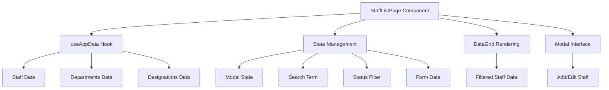
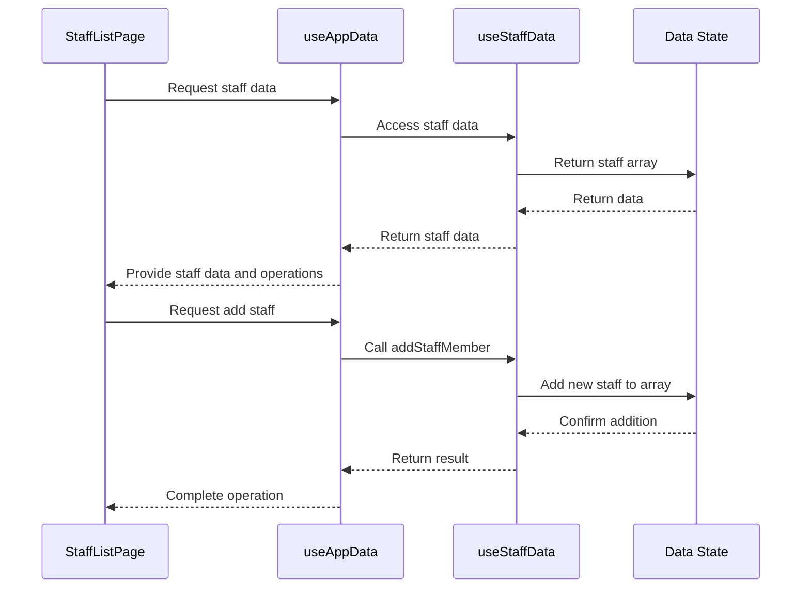
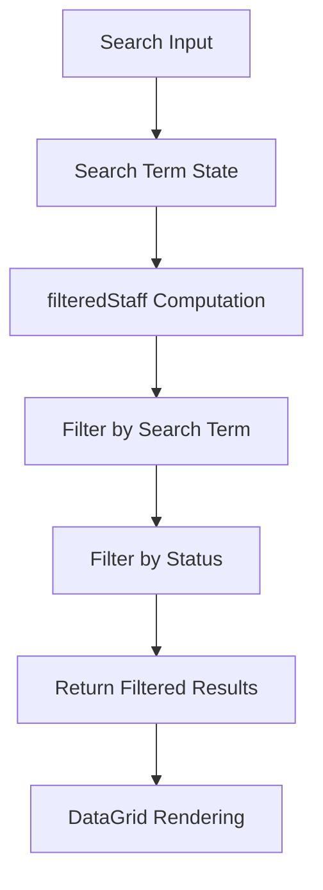
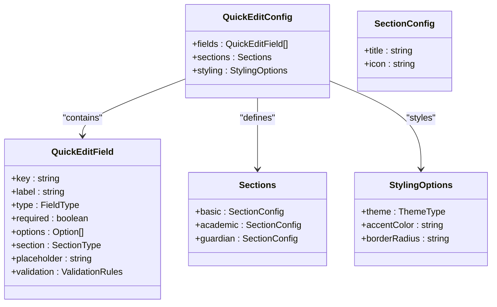
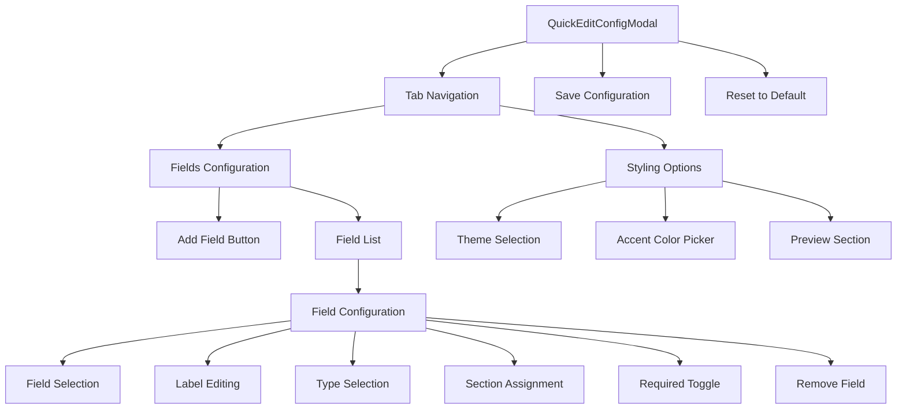

# Staff List Operations

<cite>
**Referenced Files in This Document**   
- [StaffListPage.tsx](file://src/modules/administration/pages/StaffListPage.tsx#L0-L282)
- [useStaffData.ts](file://src/modules/administration/data/useStaffData.ts#L0-L64)
- [quickEditConfig.ts](file://src/modules/administration/config/quickEditConfig.ts#L0-L133)
- [QuickEditConfigModal.tsx](file://src/modules/administration/components/QuickEditConfigModal.tsx#L0-L278)
- [useAppData.ts](file://src/hooks/useAppData.ts)
</cite>

## Table of Contents
1. [Staff List Interface Overview](#staff-list-interface-overview)
2. [StaffListPage Component Implementation](#stafflistpage-component-implementation)
3. [Data Loading and Management](#data-loading-and-management)
4. [Filtering, Sorting, and Search Mechanisms](#filtering-sorting-and-search-mechanisms)
5. [Bulk Editing and Inline Update Capabilities](#bulk-editing-and-inline-update-capabilities)
6. [Performance Optimization Techniques](#performance-optimization-techniques)
7. [User Experience Features](#user-experience-features)
8. [Error Handling and Data Consistency](#error-handling-and-data-consistency)
9. [Administrative Workflows](#administrative-workflows)
10. [Conclusion](#conclusion)

## Staff List Interface Overview

The Staff List interface provides a comprehensive solution for managing staff members within an educational institution. This interface enables administrators to view, add, edit, and delete staff records, with advanced features for filtering, searching, and bulk operations. The system is designed to handle large directories efficiently while maintaining a responsive user experience.

The interface follows a modular architecture with clear separation of concerns between data management, user interface components, and configuration systems. It leverages React's component-based architecture and hooks system to create a dynamic and interactive experience for users managing staff information.

**Section sources**
- [StaffListPage.tsx](file://src/modules/administration/pages/StaffListPage.tsx#L0-L282)

## StaffListPage Component Implementation

The StaffListPage component serves as the primary interface for staff management operations. Implemented as a React functional component, it orchestrates data retrieval, user interactions, and rendering of the staff directory.



**Diagram sources**
- [StaffListPage.tsx](file://src/modules/administration/pages/StaffListPage.tsx#L0-L282)

The component utilizes several React hooks to manage state and side effects:
- `useState` for managing modal visibility, editing state, search parameters, and form data
- `useMemo` for memoizing filtered staff data to optimize performance
- `useAppData` for accessing staff, department, and designation data along with CRUD operations

The interface is divided into two main sections: the staff directory display and the modal form for adding/editing staff members. The directory displays staff information in a tabular format with actions for editing and deletion, while the modal provides a form interface for creating new staff records or modifying existing ones.

**Section sources**
- [StaffListPage.tsx](file://src/modules/administration/pages/StaffListPage.tsx#L0-L282)

## Data Loading and Management

The Staff List interface implements a robust data management system through the use of custom hooks and data providers. The primary data operations are handled by the `useAppData` hook, which aggregates data from various modules including staff, departments, and designations.



**Diagram sources**
- [useAppData.ts](file://src/hooks/useAppData.ts)
- [useStaffData.ts](file://src/modules/administration/data/useStaffData.ts#L0-L64)

The `useStaffData` hook provides a self-contained solution for staff data management with full CRUD (Create, Read, Update, Delete) operations:

- **addStaffMember**: Creates a new staff record with a generated ID and timestamps
- **updateStaffMember**: Updates an existing staff record while preserving the ID
- **deleteStaffMember**: Removes a staff record from the data array
- **Loading state**: Tracks loading status during data operations

Each operation implements proper loading state management, setting loading indicators before the operation and clearing them in a finally block to ensure the UI accurately reflects the data state regardless of operation success or failure.

The data structure for staff members includes essential fields such as staff number, name components, contact information, department and designation assignments, and active status. The hook maintains data consistency by automatically updating timestamps during create and update operations.

**Section sources**
- [useStaffData.ts](file://src/modules/administration/data/useStaffData.ts#L0-L64)
- [StaffListPage.tsx](file://src/modules/administration/pages/StaffListPage.tsx#L0-L282)

## Filtering, Sorting, and Search Mechanisms

The Staff List interface implements comprehensive filtering and search capabilities to help users quickly locate specific staff members within potentially large directories.

### Search Functionality

The interface provides a text-based search feature that filters staff records across multiple fields simultaneously. The search operates on a case-insensitive basis, matching against:
- First name
- Last name
- Staff number
- Email address
- Department name
- Designation title



**Diagram sources**
- [StaffListPage.tsx](file://src/modules/administration/pages/StaffListPage.tsx#L83-L131)

The search implementation uses React's `useMemo` hook to memoize the filtered results, ensuring that the filtering computation only occurs when the underlying data or search parameters change. This optimization prevents unnecessary re-computations during rendering cycles.

### Status Filtering

In addition to text search, the interface provides a dedicated status filter that allows users to view only active or inactive staff members. The status filter is implemented as a select dropdown with three options:
- All Statuses (default)
- Active
- Inactive

The filtering logic is applied after the text search, creating a compound filter that narrows results based on both text matching and status criteria.

### Column Sorting

The DataGrid component supports column sorting functionality, allowing users to sort staff records by clicking on column headers. The sortable columns include:
- Staff No
- Name
- Department
- Designation
- Phone
- Email
- Status

The sorting is handled by the DataGrid component itself, with the StaffListPage passing the sortable prop to enable this functionality across appropriate columns.

**Section sources**
- [StaffListPage.tsx](file://src/modules/administration/pages/StaffListPage.tsx#L83-L131)

## Bulk Editing and Inline Update Capabilities

While the current implementation focuses on individual staff record management, the system includes infrastructure for bulk editing capabilities through the QuickEditConfig system. This configuration framework is designed to support future expansion of bulk operations.

### Quick Edit Configuration System

The quick edit functionality is governed by a configurable system that determines which fields are available for quick editing and how they are presented to users.



**Diagram sources**
- [quickEditConfig.ts](file://src/modules/administration/config/quickEditConfig.ts#L0-L133)

The `QuickEditConfig` interface defines the structure for configuring quick edit fields, including:
- **Fields**: An array of field configurations specifying which data fields are editable
- **Sections**: Organizational sections for grouping related fields
- **Styling**: Visual presentation options for the quick edit interface

### QuickEditConfigModal Component

The QuickEditConfigModal component provides a user interface for customizing the quick edit configuration. This modal allows administrators to:

- Add or remove fields from the quick edit interface
- Configure field properties (label, type, section)
- Set field validation requirements
- Customize the visual appearance of the quick edit interface



**Diagram sources**
- [QuickEditConfigModal.tsx](file://src/modules/administration/components/QuickEditConfigModal.tsx#L0-L278)

The modal implements a tabbed interface with two main sections:
1. **Fields Configuration**: Allows adding, removing, and configuring individual fields
2. **Styling Options**: Enables customization of the interface theme, accent color, and border radius

Configuration changes are persisted to localStorage through the `saveQuickEditConfig` function, allowing users to maintain their preferred settings across sessions. The system also provides a `resetQuickEditConfig` function to restore default settings if needed.

**Section sources**
- [quickEditConfig.ts](file://src/modules/administration/config/quickEditConfig.ts#L0-L133)
- [QuickEditConfigModal.tsx](file://src/modules/administration/components/QuickEditConfigModal.tsx#L0-L278)

## Performance Optimization Techniques

The Staff List interface implements several performance optimization techniques to ensure smooth operation even with large staff directories.

### Memoization of Filtered Data

The interface uses React's `useMemo` hook to memoize the results of the filtering operation:

```typescript
const filteredStaff = useMemo(() => {
  return staff
    .filter(s => /* search filter */)
    .filter(s => /* status filter */);
}, [staff, searchTerm, statusFilter]);
```

This optimization ensures that the filtering computation only occurs when the staff data, search term, or status filter actually changes, preventing unnecessary re-computations during other state updates.

### Efficient State Management

The component minimizes re-renders by using appropriate state management patterns:
- Individual state variables for different concerns (modal state, search term, filter, form data)
- Proper dependency arrays in hooks to avoid unnecessary executions
- Event handlers defined outside of render to prevent recreation

### Loading State Management

The interface implements granular loading states to provide feedback during data operations:

```typescript
const pageIsLoading = loading.staff || loading.all;
```

This approach allows the interface to display loading indicators only when necessary, improving perceived performance by avoiding unnecessary loading states during modal operations.

### Virtualized Rendering (Implied)

While not explicitly visible in the code, the use of a DataGrid component suggests the potential for virtualized rendering of large datasets. This technique would only render visible rows in the viewport, significantly improving performance with large staff directories.

**Section sources**
- [StaffListPage.tsx](file://src/modules/administration/pages/StaffListPage.tsx#L83-L131)

## User Experience Features

The Staff List interface incorporates several user experience features designed to make staff management intuitive and efficient.

### Modal-Based Data Entry

The interface uses a modal dialog for adding and editing staff records, keeping the primary staff directory visible in the background. This design choice:
- Maintains context by showing the existing staff list
- Provides a focused interface for data entry
- Supports both creation and editing workflows with the same interface

The modal automatically generates staff numbers for new entries by analyzing existing staff numbers and incrementing the sequence, reducing data entry burden.

### Responsive Layout

The interface implements a responsive grid layout that adapts to different screen sizes:
- Single column layout on mobile devices
- Three-column layout on medium and larger screens
- Sticky actions column that remains visible during horizontal scrolling

### Action Buttons and Icons

The interface uses consistent button styling and iconography to indicate actions:
- Plus icon for adding new staff
- Edit icon for modifying existing records
- Delete icon for removing staff members
- Spinner for indicating loading states

### Empty State Handling

The interface provides a clear empty state message when no staff members are found, including both a visual icon and descriptive text to guide new users:

```jsx
emptyState={
  <div className="text-center py-12">
    <UserGroupIcon className="mx-auto h-12 w-12 text-gray-400" />
    <h3 className="mt-2 text-sm font-medium text-gray-900">No staff members found</h3>
    <p className="mt-1 text-sm text-gray-500">Get started by adding your first staff member.</p>
  </div>
}
```

### Form Validation

The interface implements basic form validation:
- Required fields for staff number, first name, and last name
- Type-specific input controls (text, select, checkbox)
- Visual feedback for required fields

**Section sources**
- [StaffListPage.tsx](file://src/modules/administration/pages/StaffListPage.tsx#L0-L282)

## Error Handling and Data Consistency

The Staff List interface implements several error handling and data consistency mechanisms to ensure reliable operation.

### Operation-Level Error Handling

Each data operation includes proper error handling with loading state management:

```typescript
const addStaffMember = async (newItem) => {
  setLoading(prev => ({ ...prev, staff: true }));
  try {
    // Operation logic
  } finally {
    setLoading(prev => ({ ...prev, staff: false }));
  }
};
```

This pattern ensures that loading states are properly reset even if an operation fails, preventing the interface from becoming stuck in a loading state.

### User Confirmation for Destructive Actions

The interface requires user confirmation before deleting staff records:

```typescript
const handleDelete = async (staffId: string) => {
  if (window.confirm('Are you sure you want to delete this staff member?')) {
    await mockDeleteStaff(staffId);
  }
};
```

This safeguard prevents accidental data loss from accidental clicks on delete buttons.

### Data Integrity Preservation

The system maintains data integrity through several mechanisms:
- Automatic timestamp generation for created and updated records
- Preservation of immutable fields like ID during updates
- Proper type conversion for form inputs (e.g., parsing numeric IDs from select elements)
- Consistent data structure across operations

### Configuration Error Handling

The quick edit configuration system includes error handling for configuration operations:

```typescript
export const getQuickEditConfig = (): QuickEditConfig => {
  const userConfig = localStorage.getItem('quickEditConfig');
  
  if (userConfig) {
    try {
      const parsed = JSON.parse(userConfig);
      return { ...DEFAULT_QUICK_EDIT_CONFIG, ...parsed };
    } catch (error) {
      console.warn('Failed to parse quick edit config from localStorage:', error);
    }
  }
  
  return DEFAULT_QUICK_EDIT_CONFIG;
};
```

This defensive programming approach ensures that configuration errors do not break the application, falling back to default settings when user configurations cannot be parsed.

**Section sources**
- [useStaffData.ts](file://src/modules/administration/data/useStaffData.ts#L0-L64)
- [quickEditConfig.ts](file://src/modules/administration/config/quickEditConfig.ts#L0-L133)

## Administrative Workflows

The Staff List interface supports several common administrative workflows for managing staff members.

### Onboarding New Staff

The process for adding new staff members follows these steps:
1. Click the "Add Staff" button to open the modal
2. Enter staff information in the form fields
3. Select department and designation from dropdowns
4. Optionally assign as Head of Department
5. Set active status with the checkbox
6. Click "Add Staff Member" to save

The system automatically generates a staff number based on existing numbers, following the EMPXXX format where XXX is a zero-padded sequence number.

### Updating Staff Information

To modify existing staff records:
1. Click the "Edit" button on the desired staff member's row
2. Make changes to the information in the modal form
3. Click "Save Changes" to update the record

The interface clearly indicates whether the modal is in create or edit mode through the title text.

### Deactivating Staff Members

When staff members leave the institution, administrators can deactivate their records:
1. Edit the staff member's record
2. Uncheck the "Is Active Staff Member" checkbox
3. Save the changes

This approach preserves historical data while indicating that the staff member is no longer active.

### Bulk Configuration Management

The QuickEditConfigModal enables administrators to customize the staff management interface:
1. Access configuration options through a settings interface (not shown in code)
2. Add or remove fields from the quick edit interface
3. Rearrange field organization into different sections
4. Customize visual styling of the interface
5. Save configuration for future sessions

This workflow allows organizations to tailor the interface to their specific data management needs and priorities.

**Section sources**
- [StaffListPage.tsx](file://src/modules/administration/pages/StaffListPage.tsx#L0-L282)
- [QuickEditConfigModal.tsx](file://src/modules/administration/components/QuickEditConfigModal.tsx#L0-L278)

## Conclusion

The Staff List interface provides a comprehensive solution for managing staff members within an educational institution. Built on a modular architecture with clear separation of concerns, the system offers robust functionality for viewing, creating, editing, and deleting staff records.

Key strengths of the implementation include:
- Clean separation of data management and user interface concerns
- Efficient filtering and search capabilities for large directories
- Responsive design that works across device sizes
- Proper loading state management for smooth user experience
- Configurable interface elements that can be customized to organizational needs

The system demonstrates thoughtful design patterns, including proper use of React hooks for state management, memoization for performance optimization, and defensive programming for error handling. While the current implementation focuses on individual record management, the infrastructure for bulk operations is in place and can be extended as needed.

Future enhancements could include:
- Implementation of true bulk editing capabilities
- Export functionality for staff data
- Advanced filtering with multiple criteria
- Integration with authentication systems for staff accounts
- Audit logging for staff record changes

Overall, the Staff List interface provides a solid foundation for staff management operations that balances functionality, performance, and user experience.