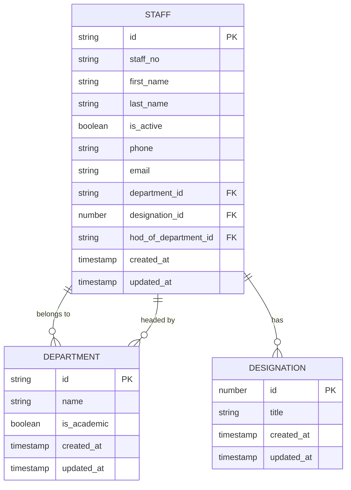
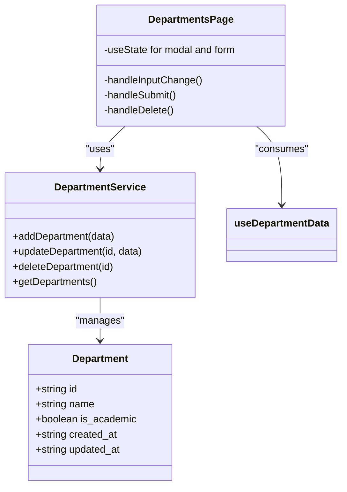
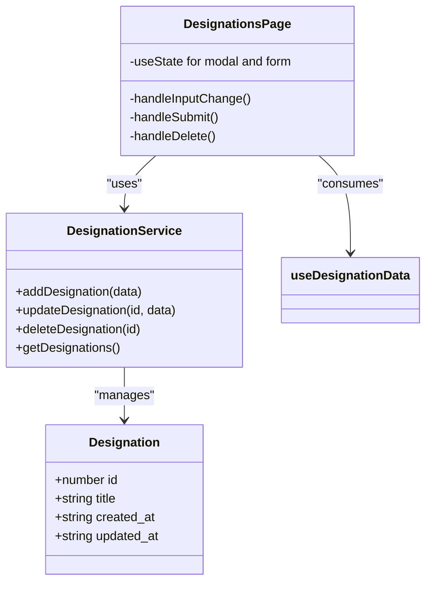
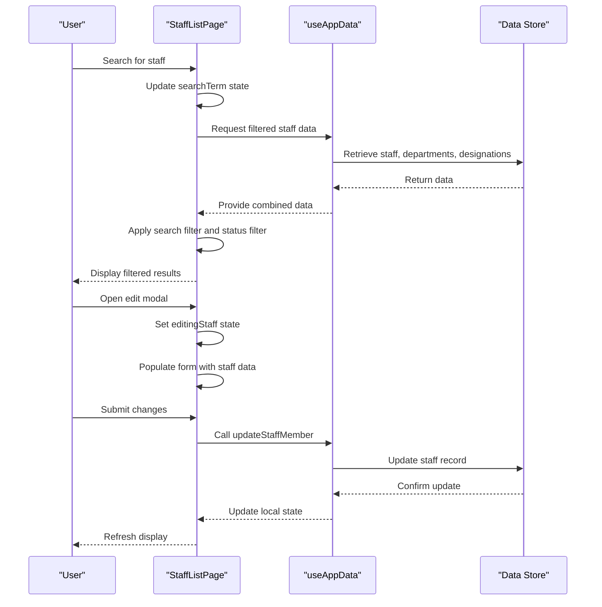
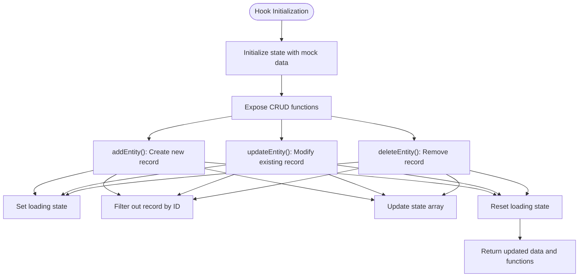

# Staff Management

<cite>
**Referenced Files in This Document**   
- [StaffListPage.tsx](file://src/modules/administration/pages/StaffListPage.tsx)
- [useStaffData.ts](file://src/modules/administration/data/useStaffData.ts)
- [useDepartmentData.ts](file://src/modules/administration/data/useDepartmentData.ts)
- [useDesignationData.ts](file://src/modules/administration/data/useDesignationData.ts)
- [types.ts](file://src/modules/administration/data/types.ts)
- [rxdbService.ts](file://src/services/rxdbService.ts)
- [mockData.ts](file://src/modules/administration/data/mockData.ts)
</cite>

## Table of Contents
1. [Introduction](#introduction)
2. [Data Model Relationships](#data-model-relationships)
3. [Staff Directory Management](#staff-directory-management)
4. [Departmental Organization](#departmental-organization)
5. [Role-Based Designation Assignment](#role-based-designation-assignment)
6. [StaffListPage Component Functionality](#stafflistpage-component-functionality)
7. [Custom Hooks for Data Access](#custom-hooks-for-data-access)
8. [Staff Transfers and Historical Records](#staff-transfers-and-historical-records)
9. [Integration with HR and Academics Modules](#integration-with-hr-and-academics-modules)
10. [Data Consistency Patterns](#data-consistency-patterns)

## Introduction
The Staff Management sub-feature within the Administration module provides a comprehensive system for managing staff directory information, departmental organization, and role-based designation assignment. This documentation details the implementation of these features, focusing on the data model relationships, component functionality, and integration points with other modules. The system enables educational institutions to efficiently organize their workforce, assign appropriate roles, and maintain accurate records across organizational changes.

## Data Model Relationships

The staff management system implements a relational data model with three primary entities: Staff, Department, and Designation. These entities are interconnected through foreign key relationships that establish the organizational structure of the institution.



**Diagram sources**
- [types.ts](file://src/modules/administration/data/types.ts#L486-L536)
- [rxdbService.ts](file://src/services/rxdbService.ts#L91-L94)

**Section sources**
- [types.ts](file://src/modules/administration/data/types.ts#L486-L536)
- [rxdbService.ts](file://src/services/rxdbService.ts#L91-L94)

### Entity Relationships
The data model establishes the following relationships:
- **Staff to Department**: Each staff member belongs to one department through the `department_id` foreign key
- **Staff to Designation**: Each staff member has one designation through the `designation_id` foreign key
- **Department to Staff (HOD)**: A department can have one Head of Department (HOD) through the `hod_of_department_id` field in the Staff entity
- **Academic Departments**: Departments are classified as academic or non-academic through the `is_academic` boolean field

The schema also includes denormalized fields such as `department_name`, `designation_title`, and `hod_of_department_name` to optimize read performance and reduce the need for frequent joins when displaying staff information.

## Staff Directory Management

The staff directory management system provides a centralized interface for maintaining comprehensive staff records. The system supports CRUD (Create, Read, Update, Delete) operations for staff members and maintains essential information for institutional operations.

### Staff Entity Structure
The Staff interface defines the complete data model for staff members with the following properties:

**Staff Properties**
- `id`: Unique identifier (string)
- `staff_no`: Employee identification number
- `first_name` and `last_name`: Personal identification
- `is_active`: Employment status indicator
- `phone` and `email`: Contact information
- `department_id`: Reference to the staff member's department
- `designation_id`: Reference to the staff member's role
- `hod_of_department_id`: Reference if the staff member is a Head of Department
- `created_at` and `updated_at`: Timestamps for record management

The implementation includes computed fields such as `display_name`, `department_name`, and `designation_title` which are derived from related entities to enhance user experience and reduce database queries.

### Data Validation and Integrity
The system enforces data integrity through validation rules and constraints:
- Staff numbers are automatically generated following a consistent pattern (e.g., EMP001, EMP002)
- Required fields include staff number, first name, last name, and department assignment
- Email addresses are validated for proper format
- Phone numbers are stored as strings to accommodate international formats

**Section sources**
- [useStaffData.ts](file://src/modules/administration/data/useStaffData.ts#L7-L61)
- [mockData.ts](file://src/modules/administration/data/mockData.ts#L72-L79)

## Departmental Organization

The departmental organization system enables institutions to structure their workforce into logical units based on functional areas. The system supports both academic and administrative departments, providing flexibility for various institutional configurations.

### Department Entity Structure
The Department interface defines the organizational units within the institution:

**Department Properties**
- `id`: Unique identifier (string)
- `name`: Department name (e.g., "Sciences", "Administration")
- `is_academic`: Boolean flag indicating if the department is academic
- `created_at` and `updated_at`: Management timestamps

The `is_academic` field serves as a critical discriminator that affects system behavior, particularly in relation to academic functions and reporting structures.

### Department Management Interface
The DepartmentsPage component provides a user-friendly interface for managing department records:

- **Add Department**: Modal form for creating new departments with name and academic status
- **Edit Department**: Inline editing capability for existing departments
- **Delete Department**: Confirmation-based deletion with cascade implications
- **Filtering**: Ability to view academic vs. non-academic departments separately

The interface enforces business rules such as preventing deletion of departments that currently have staff assigned or serve as HOD departments.



**Diagram sources**
- [DepartmentsPage.tsx](file://src/modules/administration/pages/DepartmentsPage.tsx)
- [useDepartmentData.ts](file://src/modules/administration/data/useDepartmentData.ts#L7-L61)

**Section sources**
- [DepartmentsPage.tsx](file://src/modules/administration/pages/DepartmentsPage.tsx)
- [useDepartmentData.ts](file://src/modules/administration/data/useDepartmentData.ts#L7-L61)

## Role-Based Designation Assignment

The designation system implements role-based access control by assigning specific titles and responsibilities to staff members. This enables proper authorization and reflects the organizational hierarchy.

### Designation Entity Structure
The Designation interface defines the roles within the institution:

**Designation Properties**
- `id`: Unique identifier (number)
- `title`: Role name (e.g., "Principal", "Teacher", "Secretary")
- `created_at` and `updated_at`: Management timestamps

The system includes a predefined set of common designations that can be extended based on institutional needs.

### Designation Management
The DesignationsPage component provides comprehensive management capabilities:

- **Add Designation**: Form for creating new roles with title specification
- **Edit Designation**: Modification of existing role titles
- **Delete Designation**: Removal of roles with validation to prevent deletion of assigned designations
- **Assignment Validation**: The system checks for existing staff assignments before allowing deletion

The interface is designed to maintain data integrity by preventing orphaned references when designations are modified or removed.



**Diagram sources**
- [DesignationsPage.tsx](file://src/modules/administration/pages/DesignationsPage.tsx)
- [useDesignationData.ts](file://src/modules/administration/data/useDesignationData.ts#L7-L61)

**Section sources**
- [DesignationsPage.tsx](file://src/modules/administration/pages/DesignationsPage.tsx)
- [useDesignationData.ts](file://src/modules/administration/data/useDesignationData.ts#L7-L61)

## StaffListPage Component Functionality

The StaffListPage component serves as the primary interface for staff directory management, providing comprehensive functionality for viewing, filtering, and modifying staff records.

### Component Architecture
The component implements a modular design with the following key elements:

- **State Management**: Uses React hooks (useState, useMemo) for local state
- **Data Integration**: Consumes staff, department, and designation data through useAppData
- **Form Handling**: Modal-based forms for creating and editing staff records
- **Data Display**: DataGrid component for presenting staff information

### Filtering and Sorting Capabilities
The component provides robust filtering and sorting features:

**Filtering Options**
- **Search Term**: Full-text search across staff name, number, email, department, and designation
- **Status Filter**: Toggle between active, inactive, or all staff members
- **Column Filtering**: Individual column filters for precise data refinement

**Sorting Features**
- Clickable column headers for ascending/descending sort
- Multi-column sorting capability
- Persistent sort state during pagination

### Bulk Operations
While the current implementation focuses on individual operations, the architecture supports potential bulk operations through:

- **Selection Mechanism**: Checkbox-based selection (implied by DataGrid capabilities)
- **Batch Processing**: Framework for applying changes to multiple records
- **Confirmation Dialogs**: Safety measures for destructive operations

The component's design anticipates future enhancement to include explicit bulk operations such as status updates, department transfers, or designation changes across multiple staff members.



**Diagram sources**
- [StaffListPage.tsx](file://src/modules/administration/pages/StaffListPage.tsx#L21-L279)
- [useAppData.ts](file://src/hooks/useAppData.ts)

**Section sources**
- [StaffListPage.tsx](file://src/modules/administration/pages/StaffListPage.tsx#L21-L279)

## Custom Hooks for Data Access

The system implements a custom hook pattern to encapsulate data access and state management logic, promoting reusability and maintainable code.

### useStaffData Hook
The useStaffData hook provides CRUD operations for staff records:

**Key Functions**
- `addStaffMember()`: Creates new staff records with auto-generated IDs
- `updateStaffMember()`: Updates existing staff records with timestamp management
- `deleteStaffMember()`: Removes staff records with confirmation
- Returns staff array and loading state for consumer components

The hook manages local state and provides loading indicators to enhance user experience during data operations.

### useDepartmentData Hook
The useDepartmentData hook manages department records with similar CRUD functionality:

**Key Functions**
- `addDepartment()`: Creates new departments with timestamp tracking
- `updateDepartment()`: Modifies existing department information
- `deleteDepartment()`: Removes departments from the system
- Returns departments array and loading state

### useDesignationData Hook
The useDesignationData hook handles designation records:

**Key Functions**
- `addDesignation()`: Adds new roles to the system
- `updateDesignation()`: Updates existing role titles
- `deleteDesignation()`: Removes roles (with validation considerations)
- Returns designations array and loading state

### Hook Design Pattern
All three hooks follow a consistent design pattern:



**Diagram sources**
- [useStaffData.ts](file://src/modules/administration/data/useStaffData.ts#L7-L61)
- [useDepartmentData.ts](file://src/modules/administration/data/useDepartmentData.ts#L7-L61)
- [useDesignationData.ts](file://src/modules/administration/data/useDesignationData.ts#L7-L61)

**Section sources**
- [useStaffData.ts](file://src/modules/administration/data/useStaffData.ts#L7-L61)
- [useDepartmentData.ts](file://src/modules/administration/data/useDepartmentData.ts#L7-L61)
- [useDesignationData.ts](file://src/modules/administration/data/useDesignationData.ts#L7-L61)

## Staff Transfers and Historical Records

The system addresses the common institutional need for staff transfers between departments while maintaining historical records for reporting and compliance purposes.

### Current Implementation
The existing implementation supports staff transfers through the standard edit functionality:

1. Open the staff member's record in edit mode
2. Select a new department from the department dropdown
3. Save the changes

When a transfer occurs, the system:
- Updates the `department_id` field with the new department
- Updates the `department_name` denormalized field
- Records the change timestamp in `updated_at`
- Maintains the staff member's historical department association through audit trails

### Historical Record Considerations
While the current system does not implement explicit historical tracking, the data model supports potential enhancement:

- **Audit Trail**: The `created_at` and `updated_at` timestamps provide basic change tracking
- **Data Retention**: Deleted staff records are soft-deleted with `deleted_at` timestamp
- **HOD Transitions**: When a staff member ceases to be HOD, the `hod_of_department_id` is set to null

For comprehensive historical tracking, future enhancements could include:
- Dedicated audit log table for staff changes
- Versioning of staff records
- Reporting interface for historical department assignments

**Section sources**
- [useStaffData.ts](file://src/modules/administration/data/useStaffData.ts#L7-L61)
- [StaffListPage.tsx](file://src/modules/administration/pages/StaffListPage.tsx#L21-L279)

## Integration with HR and Academics Modules

The staff management system serves as a foundational component that integrates with other institutional modules, particularly HR (payroll) and Academics (teacher assignments).

### HR Module Integration
The integration with the HR module focuses on payroll processing:

**Data Sharing**
- Staff records provide employee identification for payroll processing
- Designation information informs salary scales and benefits
- Active status determines payroll eligibility
- Contact information supports tax documentation

**Synchronization Points**
- New staff creation triggers HR record initialization
- Status changes (active/inactive) update payroll eligibility
- Designation changes may trigger salary adjustments
- Department assignments may affect departmental budgeting

The hr module's staffSalarySettingsSchema references staff records through the `staff_id` field, establishing a direct relationship between staff management and payroll configuration.

### Academics Module Integration
The integration with the academics module supports educational operations:

**Teacher Assignment**
- Academic department membership identifies teaching staff
- Designation information distinguishes between teachers, HODs, and administrators
- Active status determines teaching eligibility

**Scheduling and Timetabling**
- Staff availability is derived from employment status
- Departmental affiliation informs subject specialization
- HOD status grants curriculum approval authority

**Performance Management**
- Teaching staff are evaluated within their academic departments
- Subject assignments are linked to departmental organization
- Professional development is tracked by designation level

The integration enables seamless coordination between administrative staffing decisions and academic operations, ensuring that teacher assignments align with organizational structure.

```mermaid
graph TB
subgraph "Administration Module"
A[Staff Management]
end
subgraph "HR Module"
B[Payroll Processing]
C[Benefits Administration]
end
subgraph "Academics Module"
D[Teacher Assignments]
E[Timetabling]
F[Performance Evaluation]
end
A --> B : "Staff data, status, designation"
A --> C : "Employee eligibility"
A --> D : "Teacher identification"
A --> E : "Staff availability"
A --> F : "Evaluation framework"
B --> A : "Payroll status feedback"
D --> A : "Teaching load feedback"
```

**Diagram sources**
- [hr/data/schema.ts](file://src/modules/hr/data/schema.ts#L50-L73)
- [academics/data/schema.ts](file://src/modules/academics/data/schema.ts)
- [StaffListPage.tsx](file://src/modules/administration/pages/StaffListPage.tsx)

**Section sources**
- [hr/data/schema.ts](file://src/modules/hr/data/schema.ts#L50-L73)
- [StaffListPage.tsx](file://src/modules/administration/pages/StaffListPage.tsx)

## Data Consistency Patterns

The system implements several patterns to ensure data consistency across organizational changes and module interactions.

### Referential Integrity
The data model maintains referential integrity through:

- **Foreign Key Constraints**: Database-level constraints prevent orphaned references
- **Cascade Validation**: Before deleting a department, the system checks for assigned staff
- **Denormalized Fields**: Redundant data (department_name, designation_title) improves read performance while requiring update synchronization

### State Management Pattern
The custom hooks implement a consistent state management pattern:

- **Single Source of Truth**: Each hook maintains its own state
- **Loading States**: Explicit loading indicators for asynchronous operations
- **Error Handling**: Try-finally blocks ensure loading state cleanup
- **Immutability**: State updates use functional patterns to avoid mutation

### Change Propagation
When organizational changes occur, the system propagates updates appropriately:

**Department Name Change**
1. Update department record
2. All staff records with that department automatically reflect the new name through denormalized fields
3. Related modules receive updated information through data subscriptions

**Designation Change**
1. Update designation title
2. All staff with that designation reflect the new title
3. Authorization rules are re-evaluated based on new designation

**Staff Transfer**
1. Update staff record with new department_id
2. Department membership changes take effect immediately
3. Academic and HR modules receive updated assignment information

These patterns ensure that organizational changes are consistently reflected across the system, maintaining data accuracy and supporting institutional decision-making.

**Section sources**
- [useStaffData.ts](file://src/modules/administration/data/useStaffData.ts#L7-L61)
- [useDepartmentData.ts](file://src/modules/administration/data/useDepartmentData.ts#L7-L61)
- [useDesignationData.ts](file://src/modules/administration/data/useDesignationData.ts#L7-L61)
- [rxdbService.ts](file://src/services/rxdbService.ts#L91-L94)