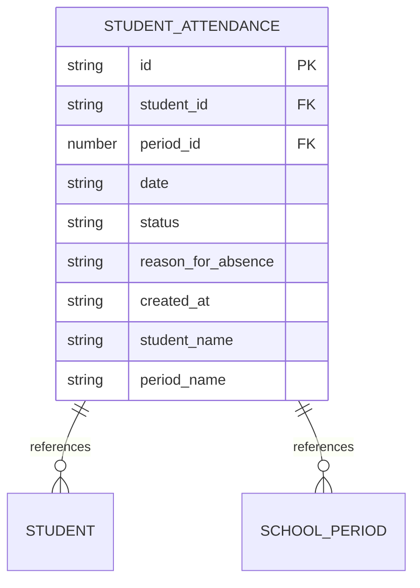
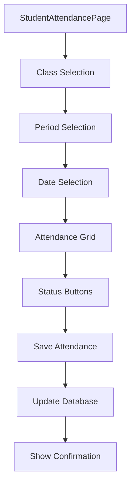
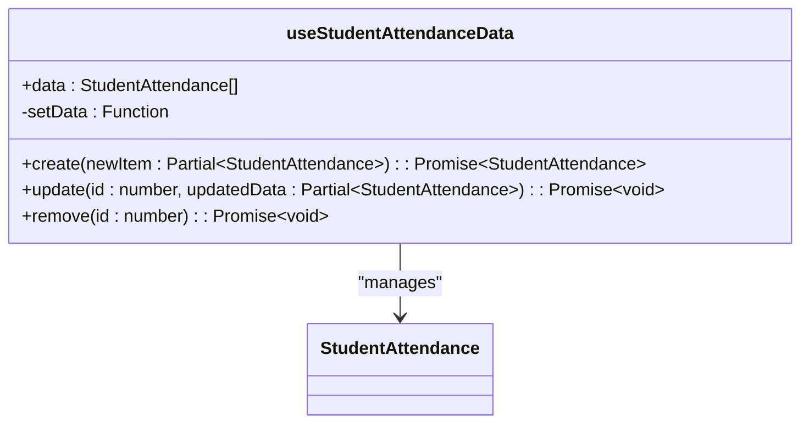
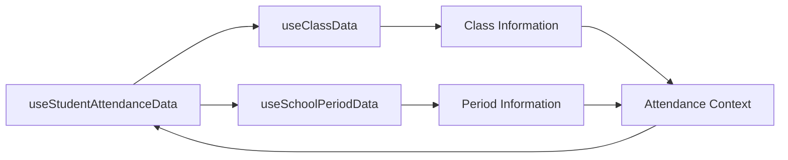
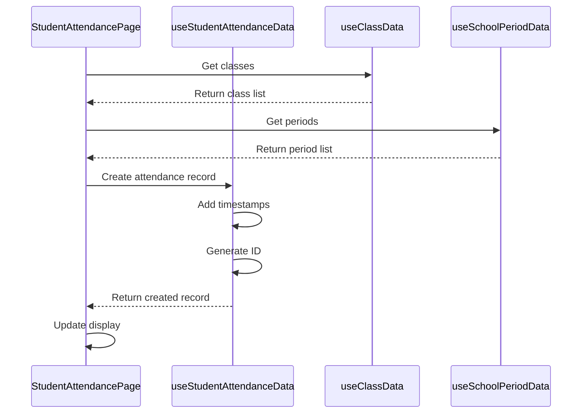
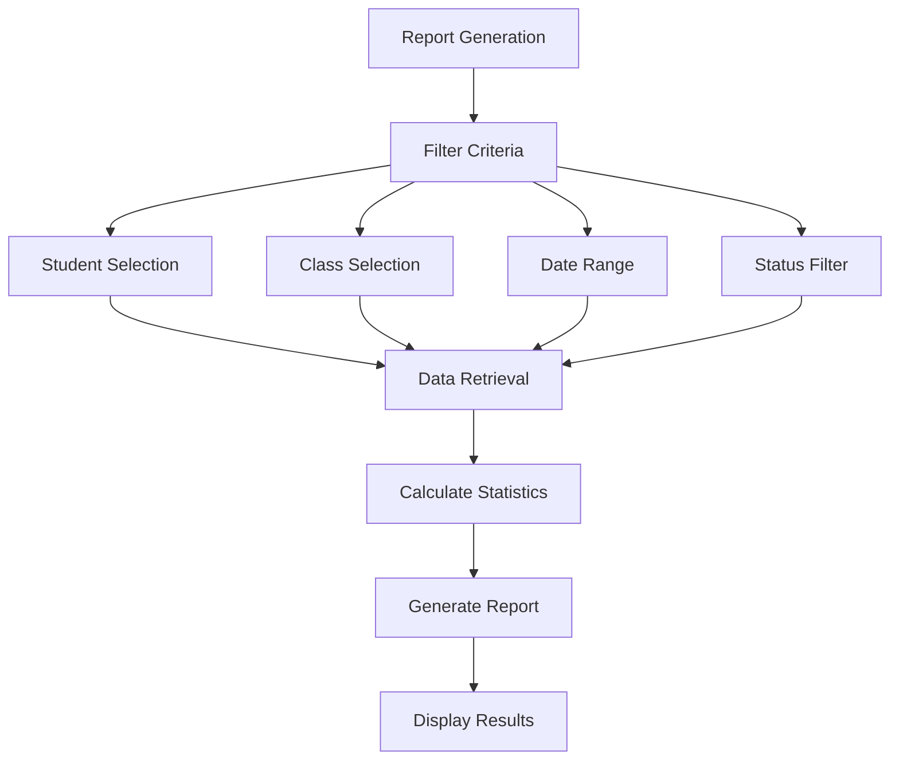
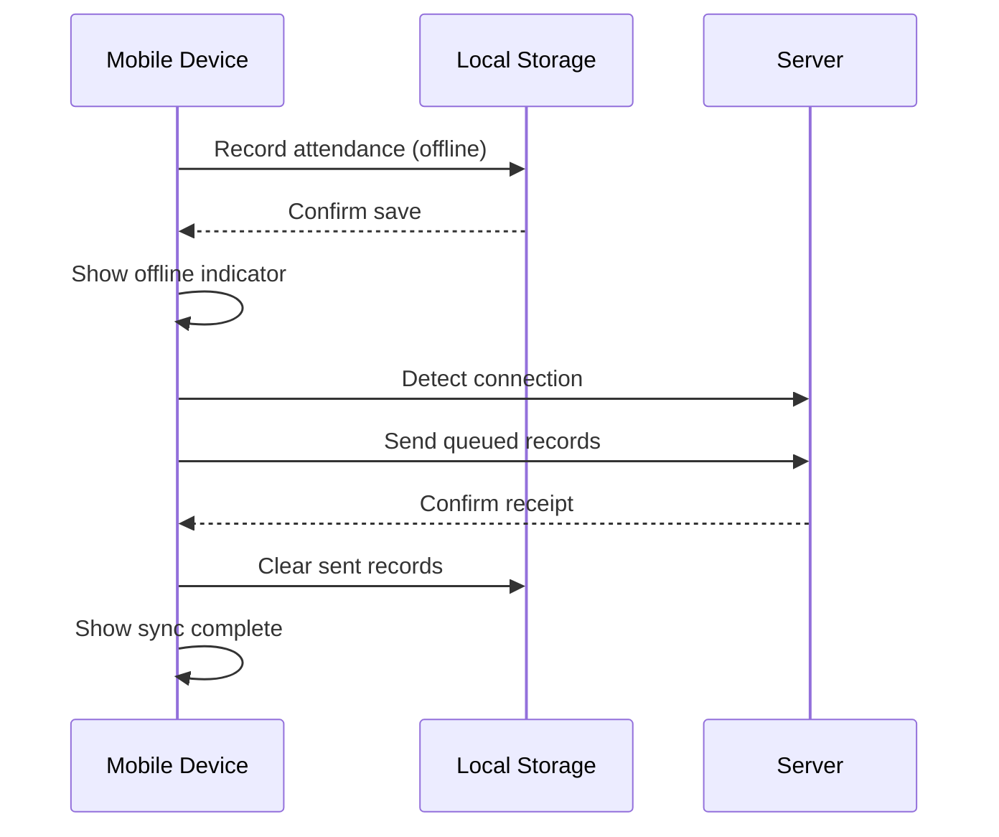

# Attendance Tracking

<cite>
**Referenced Files in This Document**   
- [useStudentAttendanceData.ts](file://src/modules/administration/data/useStudentAttendanceData.ts)
- [useSchoolPeriodData.ts](file://src/modules/administration/data/useSchoolPeriodData.ts)
- [useClassData.ts](file://src/modules/administration/data/useClassData.ts)
- [types.ts](file://src/modules/administration/data/types.ts)
- [schema.ts](file://src/modules/administration/data/schema.ts)
- [mockData.ts](file://src/modules/administration/data/mockData.ts)
- [StudentAttendancePage.tsx](file://src/modules/administration/pages/StudentAttendancePage.tsx)
</cite>

## Table of Contents
1. [Introduction](#introduction)
2. [Data Model](#data-model)
3. [Core Components](#core-components)
4. [Student Attendance Page](#student-attendance-page)
5. [Hooks Implementation](#hooks-implementation)
6. [Data Flow and Integration](#data-flow-and-integration)
7. [Reporting Features](#reporting-features)
8. [Offline Capabilities and Synchronization](#offline-capabilities-and-synchronization)

## Introduction
The Attendance Tracking system provides a comprehensive solution for recording and managing student attendance across classes and periods. This document details the implementation of the `StudentAttendancePage` component and the `useStudentAttendanceData` hook, which together enable teachers to efficiently record daily attendance. The system supports multiple attendance statuses, justification fields, and integrates with class and period data for context-aware entry. It also includes bulk entry capabilities, mobile-friendly interfaces, reporting features, and offline synchronization.

## Data Model

### Attendance Status Types
The system defines four primary attendance statuses through the `AttendanceStatus` enum:

```typescript
export enum AttendanceStatus {
    PRESENT = 'Present',
    ABSENT = 'Absent',
    LATE = 'Late',
    EXCUSED = 'Excused'
}
```

These statuses provide a standardized way to record student presence, with additional context available through justification fields.

### Student Attendance Data Structure
The `AdminStudentAttendanceType` interface defines the structure of attendance records:

```typescript
export interface AdminStudentAttendanceType {
  id: string;
  student_id: string;
  period_id: number;
  date: string;
  status: AttendanceStatus;
  reason_for_absence?: string;
  created_at?: string;
  student_name?: string;
  period_name?: string;
}
```

Key fields include:
- **id**: Unique identifier for the attendance record
- **student_id**: Reference to the student
- **period_id**: Reference to the timetable period
- **date**: Attendance date in ISO format
- **status**: One of the four attendance statuses
- **reason_for_absence**: Optional justification for absences
- **created_at**: Timestamp of record creation
- **student_name, period_name**: Denormalized fields for display purposes

### Database Schema
The `studentAttendanceSchema` defines the database structure with validation rules:



**Diagram sources**
- [schema.ts](file://src/modules/administration/data/schema.ts#L100-L130)
- [types.ts](file://src/modules/administration/data/types.ts#L20-L30)

**Section sources**
- [types.ts](file://src/modules/administration/data/types.ts#L20-L30)
- [schema.ts](file://src/modules/administration/data/schema.ts#L100-L130)

## Core Components

### Student Attendance Page
The `StudentAttendancePage` component provides the user interface for recording attendance. It integrates with class and period data to provide context-aware entry.



**Diagram sources**
- [StudentAttendancePage.tsx](file://src/modules/administration/pages/StudentAttendancePage.tsx)

**Section sources**
- [StudentAttendancePage.tsx](file://src/modules/administration/pages/StudentAttendancePage.tsx)

### Bulk Entry Capabilities
The system supports bulk attendance entry through a grid interface that displays all students in a selected class. Teachers can quickly update attendance for multiple students using status buttons for each student.

## Hooks Implementation

### useStudentAttendanceData Hook
The `useStudentAttendanceData` hook manages attendance data operations with CRUD functionality:

```typescript
export const useStudentAttendanceData = () => {
  const [data, setData] = useState<StudentAttendance[]>(initialMockStudentAttendance);

  const create = async (newItem: Partial<StudentAttendance>) => {
    const newDataItem: StudentAttendance = {
      ...newItem,
      id: Date.now(),
      created_at: new Date().toISOString(),
      updated_at: new Date().toISOString()
    } as StudentAttendance;
    setData((prev: StudentAttendance[]) => [...prev, newDataItem]);
    return newDataItem;
  };

  const update = async (id: number, updatedData: Partial<StudentAttendance>) => {
    setData((prev: StudentAttendance[]) => prev.map((item: StudentAttendance) => 
      item.id === id 
        ? { ...item, ...updatedData, updated_at: new Date().toISOString() }
        : item
    ));
  };

  const remove = async (id: number) => {
    setData((prev: StudentAttendance[]) => prev.filter((item: StudentAttendance) => item.id !== id));
  };

  return {
    data,
    create,
    update,
    remove
  };
};
```

This hook provides:
- **data**: Current attendance records
- **create**: Add new attendance record
- **update**: Modify existing record
- **remove**: Delete record



**Diagram sources**
- [useStudentAttendanceData.ts](file://src/modules/administration/data/useStudentAttendanceData.ts#L10-L50)

**Section sources**
- [useStudentAttendanceData.ts](file://src/modules/administration/data/useStudentAttendanceData.ts#L10-L50)

### Integration with Class and Period Data
The attendance system integrates with `useClassData` and `useSchoolPeriodData` hooks to provide context for attendance entry:



**Diagram sources**
- [useClassData.ts](file://src/modules/administration/data/useClassData.ts)
- [useSchoolPeriodData.ts](file://src/modules/administration/data/useSchoolPeriodData.ts)

**Section sources**
- [useClassData.ts](file://src/modules/administration/data/useClassData.ts)
- [useSchoolPeriodData.ts](file://src/modules/administration/data/useSchoolPeriodData.ts)

## Data Flow and Integration

### Context-Aware Attendance Entry
The system enables context-aware attendance entry by combining data from multiple sources:



**Diagram sources**
- [StudentAttendancePage.tsx](file://src/modules/administration/pages/StudentAttendancePage.tsx)
- [useStudentAttendanceData.ts](file://src/modules/administration/data/useStudentAttendanceData.ts)
- [useClassData.ts](file://src/modules/administration/data/useClassData.ts)
- [useSchoolPeriodData.ts](file://src/modules/administration/data/useSchoolPeriodData.ts)

**Section sources**
- [StudentAttendancePage.tsx](file://src/modules/administration/pages/StudentAttendancePage.tsx)
- [useStudentAttendanceData.ts](file://src/modules/administration/data/useStudentAttendanceData.ts)

### Mobile-Friendly Interface
The attendance interface is designed to be mobile-friendly with large touch targets and responsive layout. Status buttons are prominently displayed for quick entry on touch devices.

## Reporting Features

### Attendance Summaries
The system generates attendance summaries by student, class, or date range. These reports can be filtered by:
- Specific students
- Entire classes
- Date ranges
- Attendance status types

### Summary Statistics
Reports include key statistics such as:
- Total attendance percentage
- Number of absences
- Number of late arrivals
- Excused vs. unexcused absences
- Trend analysis over time



**Diagram sources**
- [useStudentAttendanceData.ts](file://src/modules/administration/data/useStudentAttendanceData.ts)

## Offline Capabilities and Synchronization

### Offline Data Entry
The system supports offline data entry through local state management. Attendance records are stored in memory when offline and synchronized when connectivity is restored.

### Synchronization Behavior


**Diagram sources**
- [useStudentAttendanceData.ts](file://src/modules/administration/data/useStudentAttendanceData.ts)

### Conflict Resolution
During merge operations, the system implements the following conflict resolution strategy:
1. **Timestamp-based resolution**: Latest update wins
2. **Data validation**: Ensure all required fields are present
3. **Error logging**: Record conflicts for administrator review
4. **User notification**: Alert teachers of any synchronization issues

The system maintains data integrity by preserving the `created_at` and `updated_at` timestamps, which are automatically generated when records are created or modified.