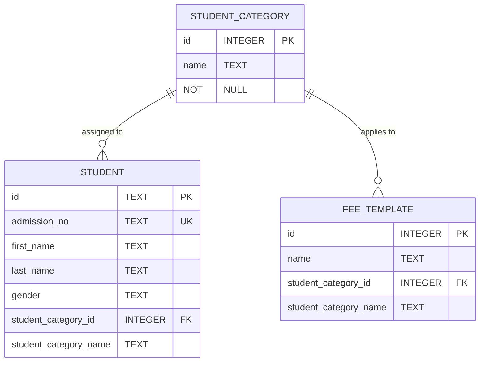
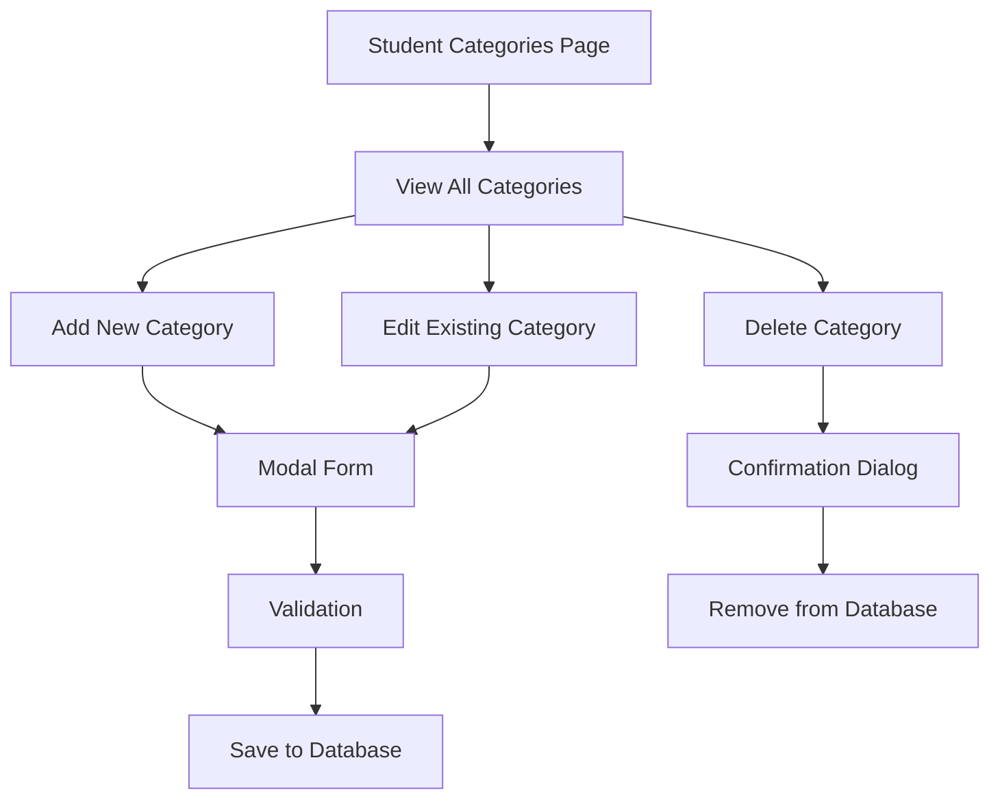
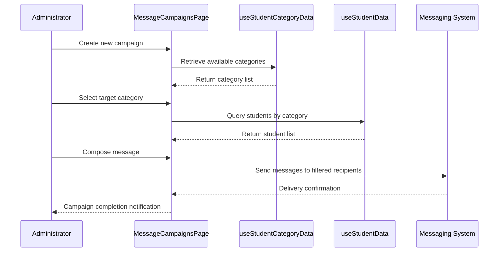

# Demographics & Categorization

<cite>
**Referenced Files in This Document**   
- [StudentCategoriesPage.tsx](file://src/modules/administration/pages/StudentCategoriesPage.tsx)
- [useStudentCategoryData.ts](file://src/modules/administration/data/useStudentCategoryData.ts)
- [types.ts](file://src/core/types.ts)
- [schema.ts](file://src/livestore/schema.ts)
- [mockData.ts](file://src/modules/administration/data/mockData.ts)
- [MessageCampaignsPage.tsx](file://src/modules/administration/pages/MessageCampaignsPage.tsx)
</cite>

## Table of Contents
1. [Student Category Schema and Data Model](#student-category-schema-and-data-model)
2. [Student Categories Management Interface](#student-categories-management-interface)
3. [Category-Based Reporting and Filtering](#category-based-reporting-and-filtering)
4. [Targeted Communications Using Categories](#targeted-communications-using-categories)
5. [Data Governance and Category Lifecycle](#data-governance-and-category-lifecycle)

## Student Category Schema and Data Model

The student categorization system is built around a simple yet effective data model that enables flexible classification of students based on various attributes. The core schema defines the structure for student categories and their relationships with other entities in the system.



**Diagram sources**
- [types.ts](file://src/core/types.ts#L534-L537)
- [schema.ts](file://src/livestore/schema.ts#L31-L381)

The `StudentCategory` interface is defined with minimal but essential properties:

```typescript
export interface StudentCategory {
    id: number;
    name: string;
}
```

This schema is implemented in the database with the following structure:

```sql
studentCategories: State.SQLite.table<StudentCategory>({
  name: 'student_categories',
  columns: {
    id: 'INTEGER PRIMARY KEY',
    name: 'TEXT NOT NULL'
  }
})
```

Student records reference categories through the `student_category_id` foreign key, which establishes the relationship between students and their classification. The system also denormalizes the category name into the student record (`student_category_name`) for performance optimization, avoiding joins during frequent read operations.

The mock data demonstrates common category types used in educational institutions:

```typescript
export const initialMockStudentCategories: StudentCategory[] = [
  { id: 1, name: 'Boarder' },
  { id: 2, name: 'Day Scholar' },
  { id: 3, name: 'Special Needs' },
];
```

These categories represent fundamental distinctions in how students engage with the school, affecting everything from accommodation and transportation to academic support and fee structures.

**Section sources**
- [types.ts](file://src/core/types.ts#L534-L537)
- [schema.ts](file://src/livestore/schema.ts#L31-L381)
- [mockData.ts](file://src/modules/administration/data/mockData.ts#L689-L691)

## Student Categories Management Interface

The `StudentCategoriesPage` component provides a comprehensive interface for administrators to manage student categories throughout their lifecycle. This interface supports creation, editing, and deprecation of categories, ensuring that the classification system remains current and relevant.



**Diagram sources**
- [StudentCategoriesPage.tsx](file://src/modules/administration/pages/StudentCategoriesPage.tsx#L1-L149)

The interface is built using modern React patterns with TypeScript for type safety. Key features include:

- **Data Grid Display**: Categories are presented in a sortable, filterable DataGrid component that supports pagination and search
- **Modal-Based Forms**: Add and edit operations use a modal dialog to maintain context and focus
- **Form Validation**: Client-side validation ensures required fields are completed before submission
- **Confirmation for Deletion**: Critical delete operations require explicit confirmation to prevent accidental data loss
- **Loading States**: Visual feedback is provided during data loading and submission processes

The component leverages the `useAppData` hook to access category data and CRUD operations:

```typescript
const { 
  studentCategories, 
  loading, 
  addStudentCategory, 
  updateStudentCategory, 
  deleteStudentCategory 
} = useAppData();
```

The DataGrid columns are configured to display essential information and provide action controls:

```typescript
const columns: DataGridColumn<StudentCategory>[] = [
  { 
    key: 'id', 
    header: 'ID', 
    sortable: true, 
    filterable: true 
  },
  { 
    key: 'name', 
    header: 'Category Name', 
    sortable: true, 
    filterable: true 
  },
  {
    key: 'id',
    header: 'Actions',
    render: (value, item) => (
      <div className="space-x-2">
        <Button size="sm" variant="ghost" onClick={() => openModal(item)}>
          Edit
        </Button>
        <Button size="sm" variant="danger" onClick={() => handleDelete(item.id)}>
          Delete
        </Button>
      </div>
    ),
  },
];
```

The form submission handler includes validation to ensure data integrity:

```typescript
const handleSubmit = async () => {
  if (!formData.name) {
    alert(t('validation.categoryNameRequired'));
    return;
  }
  // ... submission logic
};
```

**Section sources**
- [StudentCategoriesPage.tsx](file://src/modules/administration/pages/StudentCategoriesPage.tsx#L1-L149)

## Category-Based Reporting and Filtering

Student categories serve as a foundational element for reporting, filtering, and data analysis across the system. By classifying students into meaningful groups, the system enables targeted insights and operational efficiency.

Categories are used extensively in filtering student lists, allowing administrators to quickly isolate specific groups for review or action. For example, boarding staff can filter to view only "Boarder" students, while financial officers can focus on scholarship recipients or students with special fee arrangements.

The categorization system supports various reporting use cases:

- **Demographic Analysis**: Understanding the composition of the student body across different categories
- **Resource Allocation**: Planning dormitory capacity, transportation needs, and specialized support services
- **Academic Support**: Identifying students who may need additional academic assistance based on their category
- **Financial Planning**: Projecting revenue and expenses based on category-specific fee structures

The system's data model allows categories to be used as filtering dimensions in virtually any student-related report. This is facilitated by the direct relationship between students and categories, which enables efficient database queries.

Categories also influence other system behaviors beyond reporting. For instance, fee templates can be associated with specific categories, ensuring that students in different categories are charged appropriate fees. This relationship is reflected in the database schema:

```sql
feeTemplates: State.SQLite.table<FeeTemplate>({
  name: 'fee_templates',
  columns: {
    id: 'INTEGER PRIMARY KEY',
    name: 'TEXT NOT NULL',
    student_category_id: 'INTEGER',
    student_category_name: 'TEXT'
  }
})
```

This design allows the system to automatically apply the correct fee structure based on a student's category, reducing administrative overhead and minimizing errors.

**Section sources**
- [schema.ts](file://src/livestore/schema.ts#L31-L381)
- [mockData.ts](file://src/modules/administration/data/mockData.ts#L689-L691)

## Targeted Communications Using Categories

The student categorization system integrates with the messaging infrastructure to enable segmented outreach through the `MessageCampaignsPage`. This capability allows administrators to send targeted communications to specific student groups based on their classification.



**Diagram sources**
- [MessageCampaignsPage.tsx](file://src/modules/administration/pages/MessageCampaignsPage.tsx)
- [useStudentCategoryData.ts](file://src/modules/administration/data/useStudentCategoryData.ts)

The `MessageCampaignsPage` component leverages student categories to define campaign audiences. When creating a message campaign, administrators can select a specific student category as the target audience, ensuring that communications are relevant and appropriately targeted.

This integration works by:
1. Retrieving the list of available student categories from the category service
2. Allowing the administrator to select one or more categories as the campaign target
3. Querying the student database for all students belonging to the selected categories
4. Sending the message only to students in the targeted categories

For example, a school might use this functionality to:
- Send boarding-specific announcements to "Boarder" students
- Communicate scholarship renewal requirements to students in the "Scholarship Recipient" category
- Notify students in the "Special Needs" category about specialized support services
- Alert "Day Scholar" students about transportation schedule changes

The system also supports more complex targeting by combining categories with other filters, such as grade level or academic performance, enabling highly specific communication strategies.

**Section sources**
- [MessageCampaignsPage.tsx](file://src/modules/administration/pages/MessageCampaignsPage.tsx)
- [useStudentCategoryData.ts](file://src/modules/administration/data/useStudentCategoryData.ts)

## Data Governance and Category Lifecycle

Effective data governance is essential for maintaining category consistency across academic years and ensuring the reliability of category-based operations throughout the system.

The `useStudentCategoryData` hook implements the core CRUD operations for managing student categories with proper state management:

```typescript
export const useStudentCategoryData = () => {
  const [data, setData] = useState<StudentCategory[]>(initialMockStudentCategories);

  const create = async (newItem: Partial<StudentCategory>) => {
    const newDataItem: StudentCategory = {
      ...newItem,
      id: Date.now(),
      created_at: new Date().toISOString(),
      updated_at: new Date().toISOString()
    } as StudentCategory;
    setData((prev: StudentCategory[]) => [...prev, newDataItem]);
    return newDataItem;
  };

  const update = async (id: number, updatedData: Partial<StudentCategory>) => {
    setData((prev: StudentCategory[]) => prev.map((item: StudentCategory) => 
      item.id === id 
        ? { ...item, ...updatedData, updated_at: new Date().toISOString() }
        : item
    ));
  };

  const remove = async (id: number) => {
    setData((prev: StudentCategory[]) => prev.filter((item: StudentCategory) => item.id !== id));
  };

  return {
    data,
    create,
    update,
    remove
  };
};
```

**Section sources**
- [useStudentCategoryData.ts](file://src/modules/administration/data/useStudentCategoryData.ts#L1-L43)

Key governance practices include:

- **Category Deprecation**: Rather than immediate deletion, categories should be deprecated to maintain historical data integrity. This ensures that past records retain their original categorization.
- **Academic Year Transitions**: Category definitions should be reviewed and potentially updated at the start of each academic year to reflect changing institutional needs.
- **Consistency Checks**: Regular audits should verify that category assignments remain accurate and that no students are misclassified.
- **Access Controls**: Category management should be restricted to authorized personnel to prevent unauthorized changes.
- **Change Logging**: All modifications to categories should be logged for audit purposes, tracking who made changes and when.

The system supports these practices through:
- Timestamps (`created_at`, `updated_at`) on all category records
- Soft deletion patterns where appropriate
- Integration with the system's role-based access control (RBAC) framework
- Comprehensive logging of category-related operations

When transitioning between academic years, administrators should:
1. Review existing categories for relevance
2. Create new categories as needed for emerging student groups
3. Deprecate categories that are no longer used
4. Verify category assignments for incoming students
5. Update any category-dependent configurations (fee templates, reporting dimensions, etc.)

This structured approach ensures that the categorization system remains a reliable foundation for student management, reporting, and communications across the institution.

**Section sources**
- [useStudentCategoryData.ts](file://src/modules/administration/data/useStudentCategoryData.ts#L1-L43)
- [StudentCategoriesPage.tsx](file://src/modules/administration/pages/StudentCategoriesPage.tsx#L1-L149)