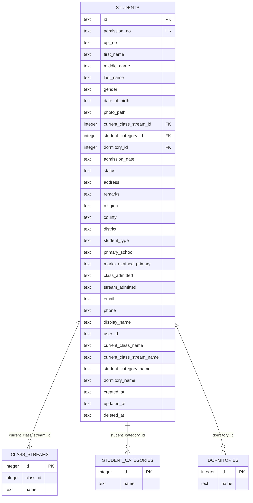
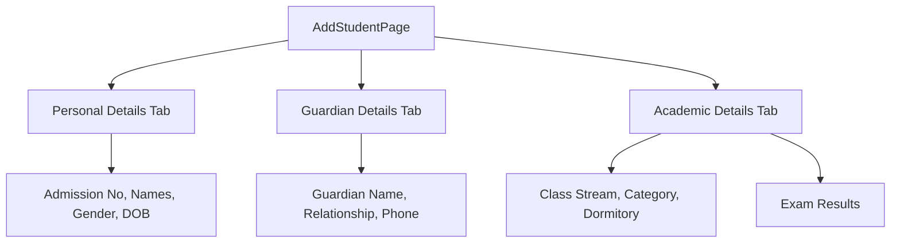
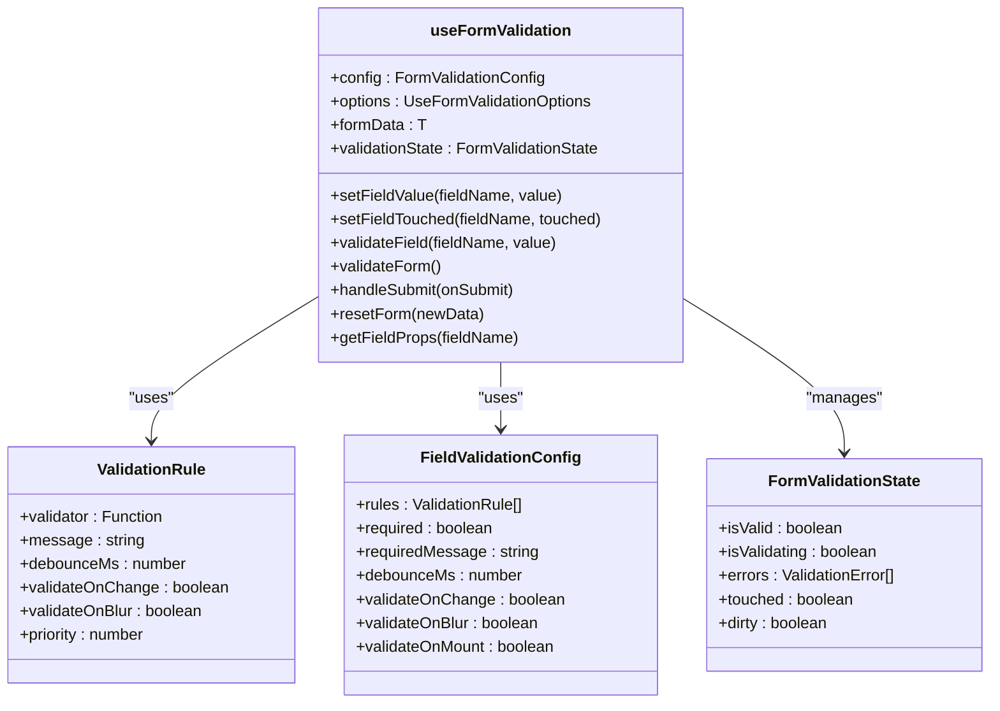
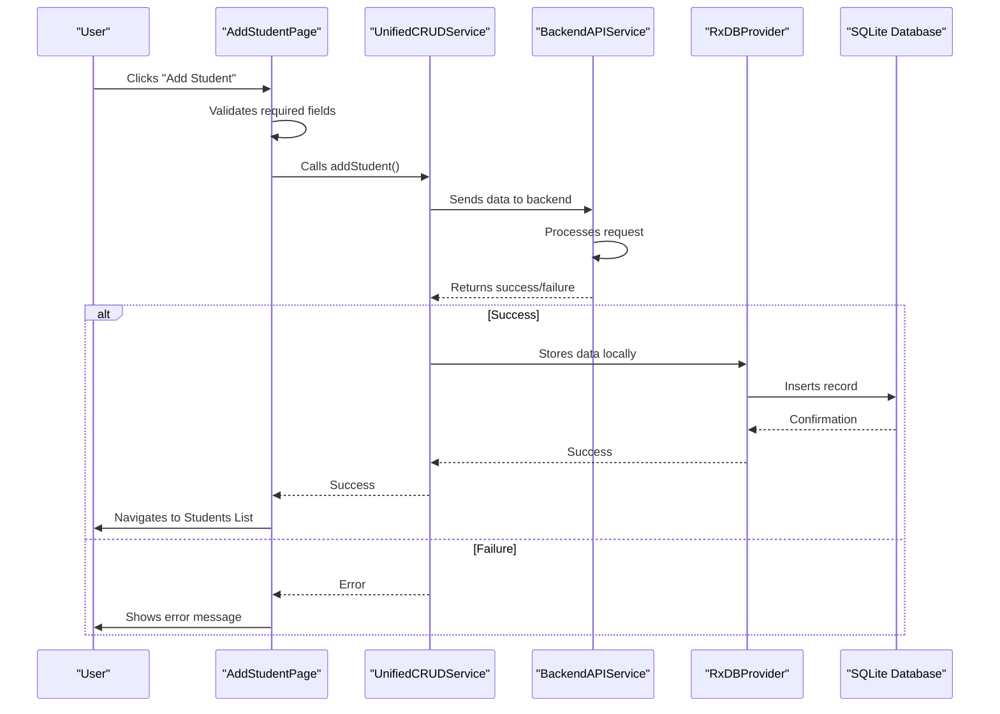
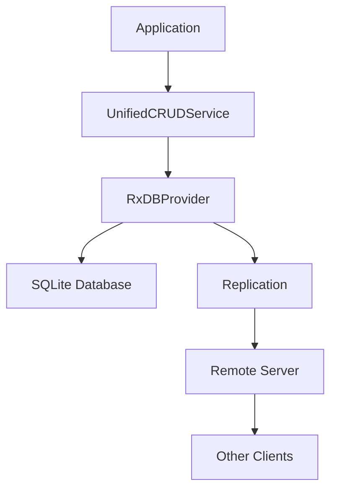

# Student Enrollment

<cite>
**Referenced Files in This Document**   
- [AddStudentPage.tsx](file://src/modules/administration/pages/AddStudentPage.tsx)
- [schema.ts](file://src/livestore/schema.ts)
- [types.ts](file://src/core/types.ts)
- [types.ts](file://src/modules/administration/data/types.ts)
- [useFormValidation.tsx](file://src/hooks/useFormValidation.tsx)
- [UnifiedCRUDService.ts](file://src/services/UnifiedCRUDService.ts)
- [BackendAPIService.ts](file://src/services/BackendAPIService.ts)
- [RxDBProvider.ts](file://src/services/database/RxDBProvider.ts)
</cite>

## Table of Contents
1. [Introduction](#introduction)
2. [Student Data Model](#student-data-model)
3. [AddStudentPage Implementation](#addstudentpage-implementation)
4. [Form Validation with useFormValidation](#form-validation-with-useformvalidation)
5. [Data Submission Flow via UnifiedCRUDService](#data-submission-flow-via-unifiedcrudservice)
6. [Integration with Backend Services](#integration-with-backend-services)
7. [Batch Enrollment and CSV Import](#batch-enrollment-and-csv-import)
8. [Error Handling and Validation](#error-handling-and-validation)
9. [Best Practices](#best-practices)

## Introduction
The Student Enrollment sub-feature enables administrators to register new students into the school system through a structured, multi-tab form interface. This document details the implementation of the AddStudentPage component, including its form structure, validation logic, data submission flow, and integration with backend services. The system ensures data integrity through unique constraints, real-time validation, and robust error handling. The enrollment process supports individual student registration as well as batch operations through CSV imports.

## Student Data Model
The student data model is defined in the LiveStore schema and TypeScript interfaces, establishing a comprehensive structure for student information with required fields, unique constraints, and relationships to other entities.

### Core Student Schema
The student schema in `schema.ts` defines the database structure with SQLite constraints:



**Diagram sources**
- [schema.ts](file://src/livestore/schema.ts#L100-L150)

**Section sources**
- [schema.ts](file://src/livestore/schema.ts#L100-L150)
- [types.ts](file://src/core/types.ts#L400-L450)

### Student Interface Definition
The `Student` interface in `types.ts` provides type safety and defines the complete data structure:

```typescript
export interface Student {
  id: string;
  admission_no: string;
  upi_no?: string | null;
  first_name: string;
  middle_name?: string | null;
  last_name: string;
  gender: PersonGender;
  date_of_birth?: string | null;
  photo_path?: string | null;
  current_class_stream_id?: number | null;
  student_category_id?: number | null;
  dormitory_id?: number | null;
  admission_date?: string | null;
  status: StudentStatus;
  created_at: string;
  updated_at: string;
  deleted_at?: string | null;
  // Denormalized fields
  current_class_name?: string | null;
  current_class_stream_name?: string | null;
  student_category_name?: string | null;
  dormitory_name?: string | null;
  primary_guardian?: ParentsGuardian | null;
  exam_result_summary?: ExamResultSummary | null;
  // Additional fields
  address?: string | null;
  remarks?: string | null;
  religion?: string | null;
  county?: string | null;
  district?: string | null;
  student_type?: string | null;
  primary_school?: string | null;
  marks_attained_primary?: string | null;
  class_admitted?: string | null;
  stream_admitted?: string | null;
  email?: string | null;
  phone?: string | null;
  display_name?: string | null;
  user_id?: string | null;
}
```

### Key Constraints and Relationships
The student data model enforces several critical constraints and relationships:

- **Unique Constraints**: The `admission_no` field has a UNIQUE constraint in the database schema, preventing duplicate student records.
- **Required Fields**: `admission_no`, `first_name`, `last_name`, `gender`, and `status` are required fields with non-nullable database columns.
- **Foreign Key Relationships**: 
  - `current_class_stream_id` references the `class_streams` table
  - `student_category_id` references the `student_categories` table  
  - `dormitory_id` references the `dormitories` table
- **Denormalized Fields**: Fields like `current_class_name`, `student_category_name`, and `dormitory_name` are denormalized for performance, storing human-readable names alongside their ID references.

## AddStudentPage Implementation
The AddStudentPage component provides a user-friendly interface for enrolling new students through a tabbed form layout that organizes information into logical sections.

### Form Structure and Layout
The AddStudentPage implements a tabbed form interface with three main sections:



**Diagram sources**
- [AddStudentPage.tsx](file://src/modules/administration/pages/AddStudentPage.tsx#L100-L200)

**Section sources**
- [AddStudentPage.tsx](file://src/modules/administration/pages/AddStudentPage.tsx#L1-L509)

### Component Architecture
The AddStudentPage uses React hooks for state management and integrates with the application's data layer:

- **useState**: Manages form data, active tab, and submission state
- **useMemo**: Optimizes performance by memoizing form tabs and initial data
- **useCallback**: Prevents unnecessary re-renders of event handlers
- **useAppData**: Custom hook that provides access to application data like class streams, student categories, and dormitories
- **useNavigate**: React Router hook for navigation after successful submission

### Tab Configuration
The form is organized into three tabs with specific content and validation:

```typescript
const formTabs = useMemo((): FormTab[] => {
  return [
    {
      id: 'personal',
      label: 'Personal Details',
      icon: icons.personal,
      required: true,
      validation: () => tabValidation.personal,
      content: (
        // Personal details form fields
      ),
    },
    {
      id: 'guardian',
      label: 'Guardian Details',
      icon: icons.guardian,
      validation: () => tabValidation.guardian,
      content: (
        // Guardian details form fields
      ),
    },
    {
      id: 'academic',
      label: 'Academic Details',
      icon: icons.academic,
      validation: () => tabValidation.academic,
      content: (
        // Academic details form fields
      ),
    },
  ];
}, [icons, tabValidation, handleFieldChange, classStreams, studentCategories, dormitories]);
```

### Dynamic Data Loading
The component leverages the `useAppData` hook to access dynamic data for dropdown selections:

- **classStreams**: Available class streams for enrollment
- **studentCategories**: Student category options (e.g., Day Student, Boarding Student)
- **dormitories**: Dormitory options for boarding students

These data sources are automatically populated by the application's data layer and made available through the context system.

## Form Validation with useFormValidation
The form validation system uses the `useFormValidation` hook to provide real-time validation, error management, and accessibility features.

### Validation Hook Architecture
The `useFormValidation` hook implements a comprehensive validation system with the following key features:



**Diagram sources**
- [useFormValidation.tsx](file://src/hooks/useFormValidation.tsx#L1-L529)

**Section sources**
- [useFormValidation.tsx](file://src/hooks/useFormValidation.tsx#L1-L529)

### Built-in Validators
The validation system includes several built-in validators that can be composed for different fields:

- **required**: Ensures a field has a value
- **minLength**: Validates minimum string length
- **maxLength**: Validates maximum string length
- **email**: Validates email format
- **pattern**: Validates against a regular expression
- **numeric**: Ensures a valid number
- **min**: Validates minimum numeric value
- **max**: Validates maximum numeric value
- **custom**: Allows custom validation functions

### Validation Configuration
The validation system supports flexible configuration through the `FormValidationConfig` interface:

```typescript
export type FormValidationConfig = {
  [fieldName: string]: FieldValidationConfig;
};

export type FieldValidationConfig<T = any> = {
  rules: ValidationRule<T>[];
  required?: boolean;
  requiredMessage?: string;
  debounceMs?: number;
  validateOnChange?: boolean;
  validateOnBlur?: boolean;
  validateOnMount?: boolean;
};
```

### Real-time Validation Features
The validation system implements several user experience enhancements:

- **Debouncing**: Validation is debounced to prevent excessive processing during typing
- **Accessibility**: Error messages are announced to screen readers using `announceToScreenReader`
- **Priority-based Error Display**: Errors are sorted by priority, showing the most critical first
- **Focus Management**: The first field with an error is automatically focused on form submission
- **Loading States**: Fields show a loading indicator during asynchronous validation

## Data Submission Flow via UnifiedCRUDService
The data submission process follows a structured flow from form submission to data persistence, orchestrated by the UnifiedCRUDService.

### Submission Workflow
The student enrollment submission follows this sequence:



**Diagram sources**
- [AddStudentPage.tsx](file://src/modules/administration/pages/AddStudentPage.tsx#L300-L400)
- [UnifiedCRUDService.ts](file://src/services/UnifiedCRUDService.ts)
- [BackendAPIService.ts](file://src/services/BackendAPIService.ts)
- [RxDBProvider.ts](file://src/services/database/RxDBProvider.ts)

**Section sources**
- [AddStudentPage.tsx](file://src/modules/administration/pages/AddStudentPage.tsx#L300-L400)
- [UnifiedCRUDService.ts](file://src/services/UnifiedCRUDService.ts)

### Payload Construction
The AddStudentPage constructs a comprehensive payload for submission:

```typescript
const handleSubmit = useCallback(async () => {
  setIsSubmitting(true);

  try {
    // Simple validation
    if (!formData.admission_no || !formData.first_name || !formData.last_name) {
      alert('Please fill in all required fields (Admission No, First Name, Last Name)');
      setIsSubmitting(false);
      return;
    }

    // Destructure form data
    const {
      primary_guardian_id, primary_guardian_name, primary_guardian_phone, primary_guardian_relationship_type,
      exam_result_summary_exam_name, exam_result_summary_english, exam_result_summary_kiswahili,
      exam_result_summary_mathematics, exam_result_summary_science, exam_result_summary_ssre, exam_result_summary_total_marks,
      ...coreStudentData
    } = formData;

    const studentPayload: Omit<Student, 'id' | 'created_at' | 'updated_at' | 'primary_guardian' | 'exam_result_summary'> = {
      ...coreStudentData,
      admission_no: coreStudentData.admission_no!,
      first_name: coreStudentData.first_name!,
      last_name: coreStudentData.last_name!,
      gender: coreStudentData.gender!,
      status: coreStudentData.status!,
      current_class_stream_id: coreStudentData.current_class_stream_id ? Number(coreStudentData.current_class_stream_id) : undefined,
      student_category_id: coreStudentData.student_category_id ? Number(coreStudentData.student_category_id) : undefined,
      dormitory_id: coreStudentData.dormitory_id ? Number(coreStudentData.dormitory_id) : undefined,
    };

    let guardianPayload: (Omit<ParentsGuardian, 'id' | 'created_at' | 'updated_at'> & { relationship_type: string, id?: string }) | undefined = undefined;
    if (primary_guardian_name && primary_guardian_relationship_type) {
      guardianPayload = {
        id: primary_guardian_id,
        name: primary_guardian_name,
        phone: primary_guardian_phone || '',
        relationship_type: primary_guardian_relationship_type,
      };
    }

    let examSummaryPayload: ExamResultSummary | undefined = undefined;
    if (exam_result_summary_exam_name) {
      examSummaryPayload = {
        exam_name: exam_result_summary_exam_name,
        english: exam_result_summary_english,
        kiswahili: exam_result_summary_kiswahili,
        mathematics: exam_result_summary_mathematics,
        science: exam_result_summary_science,
        social_studies_religious_education: exam_result_summary_ssre,
        total_marks: exam_result_summary_total_marks ? parseFloat(exam_result_summary_total_marks) : undefined,
      };
    }

    const newStudentPayload = {
      ...studentPayload,
      exam_result_summary: examSummaryPayload,
    };

    await addStudent(newStudentPayload, guardianPayload as any);

    // Navigate back to students list on success
    navigate('/administration/students');
  } catch (error) {
    console.error('Error adding student:', error);
  } finally {
    setIsSubmitting(false);
  }
}, [formData, addStudent, navigate]);
```

### UnifiedCRUDService Integration
The UnifiedCRUDService provides a consistent interface for CRUD operations across the application:

- **Abstraction Layer**: Hides the complexity of direct database or API calls
- **Error Handling**: Centralizes error handling and retry logic
- **Data Transformation**: Ensures data is properly formatted for the backend
- **Offline Support**: Works with local storage when offline, syncing when connectivity is restored
- **Transaction Management**: Handles related operations (e.g., creating a student and their guardian) as a single transaction

## Integration with Backend Services
The student enrollment feature integrates with multiple backend services for data persistence and synchronization.

### BackendAPIService
The BackendAPIService handles communication with the remote API:

- **HTTP Operations**: Manages GET, POST, PUT, DELETE requests
- **Authentication**: Includes authentication tokens in requests
- **Error Handling**: Transforms HTTP errors into application-level errors
- **Request Caching**: Implements caching for read operations
- **Rate Limiting**: Handles API rate limiting and retries

### RxDBProvider
The RxDBProvider manages local data persistence using RxDB:



**Diagram sources**
- [RxDBProvider.ts](file://src/services/database/RxDBProvider.ts)

**Section sources**
- [RxDBProvider.ts](file://src/services/database/RxDBProvider.ts)

### Data Synchronization
The system implements bidirectional data synchronization:

- **Local-First Architecture**: Data is written to the local database first
- **Background Sync**: Changes are synchronized with the server in the background
- **Conflict Resolution**: Implements conflict detection and resolution strategies
- **Offline Support**: Full functionality when offline, with changes synced when online

## Batch Enrollment and CSV Import
The system supports batch enrollment through CSV import functionality for efficient bulk operations.

### CSV Import Process
The batch enrollment process follows these steps:

1. **Template Download**: Users download a CSV template with required columns
2. **Data Preparation**: Users populate the template with student data
3. **File Upload**: Users upload the completed CSV file
4. **Validation**: The system validates all records for completeness and correctness
5. **Processing**: Valid records are processed and enrolled
6. **Results Reporting**: A report is generated showing successes and failures

### Required CSV Fields
The CSV import requires the following fields:

- **admission_no**: Unique admission number (required, must be unique)
- **first_name**: Student's first name (required)
- **last_name**: Student's last name (required)
- **gender**: Male, Female, or Other (required)
- **date_of_birth**: Date in YYYY-MM-DD format
- **current_class_stream_id**: ID of the class stream
- **student_category_id**: ID of the student category
- **dormitory_id**: ID of the dormitory (for boarding students)
- **status**: Active, Inactive, or Graduated

### Validation and Error Handling
The batch import process includes comprehensive validation:

- **Format Validation**: Ensures CSV format is correct
- **Required Field Validation**: Checks for mandatory fields
- **Data Type Validation**: Validates data types (e.g., dates, numbers)
- **Reference Validation**: Verifies foreign key references exist
- **Duplicate Detection**: Identifies duplicate admission numbers
- **Error Reporting**: Provides detailed error messages for each failed record

## Error Handling and Validation
The student enrollment system implements robust error handling and validation at multiple levels.

### Client-Side Validation
Client-side validation provides immediate feedback:

- **Real-time Validation**: Fields are validated as users type
- **Visual Indicators**: Error states are clearly displayed
- **Comprehensive Rules**: Multiple validation rules per field
- **Accessibility**: Screen reader announcements for errors

### Server-Side Validation
Server-side validation ensures data integrity:

- **Duplicate Prevention**: Rejects duplicate admission numbers
- **Reference Integrity**: Validates foreign key relationships
- **Business Rules**: Enforces enrollment policies
- **Security**: Prevents injection attacks and unauthorized access

### Error Scenarios and Handling
Common error scenarios and their handling:

- **Duplicate Admission Number**: System detects and prevents creation of students with existing admission numbers
- **Invalid Data Types**: Rejects data that doesn't match expected formats (e.g., non-numeric values in numeric fields)
- **Missing Required Fields**: Prevents submission until all required fields are filled
- **Network Errors**: Gracefully handles connectivity issues with retry mechanisms
- **Server Errors**: Provides user-friendly error messages for server-side issues

## Best Practices
The following best practices are recommended for effective student enrollment:

### Individual Enrollment
- **Complete All Required Fields**: Ensure all mandatory information is provided
- **Verify Unique Identifiers**: Double-check admission numbers to prevent duplicates
- **Use Consistent Formatting**: Follow established formats for dates, names, and other fields
- **Review Before Submission**: Carefully review all information before submitting

### Batch Enrollment
- **Use the Template**: Always use the provided CSV template
- **Validate Locally**: Check data for errors before upload
- **Test with Small Batches**: Start with a small number of records to verify the process
- **Review Error Reports**: Carefully examine error reports to correct issues
- **Schedule Off-Peak**: Perform large imports during off-peak hours to minimize system impact

### Data Quality
- **Maintain Accuracy**: Ensure all information is accurate and up-to-date
- **Standardize Entries**: Use consistent formatting and terminology
- **Regular Audits**: Periodically review student data for completeness and accuracy
- **Documentation**: Keep records of enrollment decisions and special cases

### Security and Privacy
- **Protect Sensitive Data**: Handle personal information according to privacy policies
- **Access Control**: Ensure only authorized personnel can enroll students
- **Audit Trails**: Maintain logs of enrollment activities
- **Data Retention**: Follow established policies for data retention and archiving