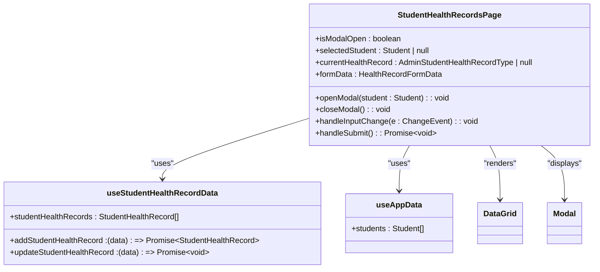
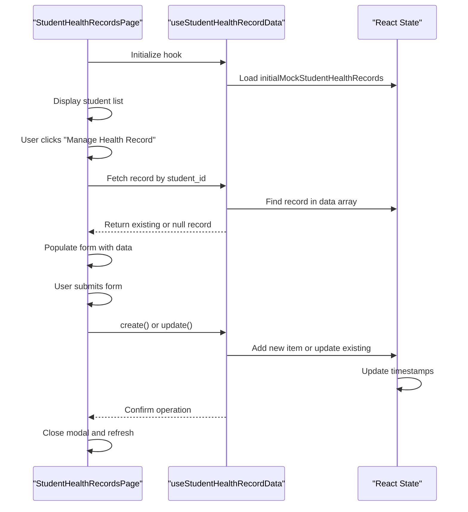
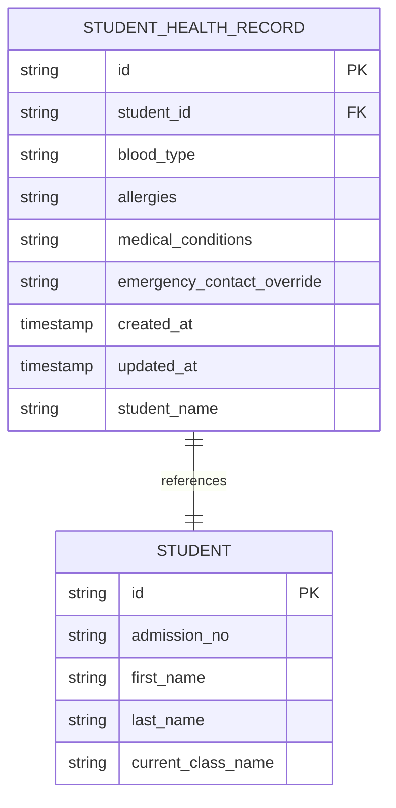
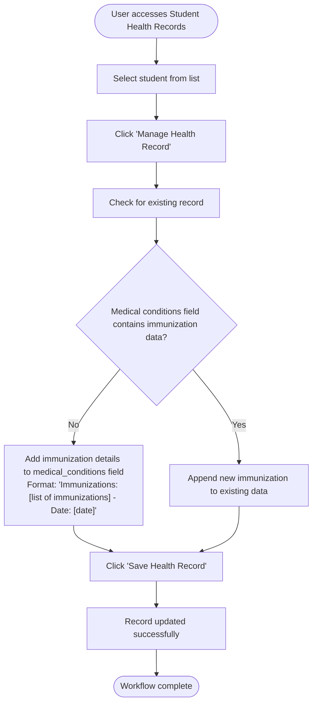
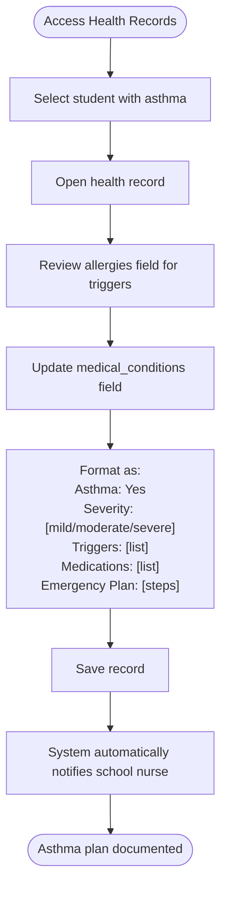

# Student Health Records

<cite>
**Referenced Files in This Document**   
- [StudentHealthRecordsPage.tsx](file://src/modules/administration/pages/StudentHealthRecordsPage.tsx)
- [useStudentHealthRecordData.ts](file://src/modules/administration/data/useStudentHealthRecordData.ts)
- [rbac.ts](file://src/modules/administration/rbac.ts)
- [schema.ts](file://src/modules/administration/data/schema.ts)
- [types.ts](file://src/modules/administration/data/types.ts)
- [mockData.ts](file://src/modules/administration/data/mockData.ts)
</cite>

## Table of Contents
1. [Introduction](#introduction)
2. [Core Components](#core-components)
3. [Data Model](#data-model)
4. [Access Control](#access-control)
5. [Workflow Examples](#workflow-examples)
6. [Security and Compliance](#security-and-compliance)

## Introduction
The Student Health Records feature provides a secure interface for managing sensitive medical information for students within the educational institution. This system enables authorized staff to record and access critical health data including allergies, chronic conditions, medications, and emergency procedures. The implementation follows a modular architecture with strict access controls to ensure student privacy and regulatory compliance.

## Core Components

### StudentHealthRecordsPage Component
The StudentHealthRecordsPage serves as the primary user interface for managing student health records. It displays a comprehensive list of students with their health record status and provides a modal interface for detailed record management.



**Diagram sources**
- [StudentHealthRecordsPage.tsx](file://src/modules/administration/pages/StudentHealthRecordsPage.tsx#L0-L209)

**Section sources**
- [StudentHealthRecordsPage.tsx](file://src/modules/administration/pages/StudentHealthRecordsPage.tsx#L0-L209)

### useStudentHealthRecordData Hook
The useStudentHealthRecordData custom hook provides data management functionality for student health records, implementing CRUD operations with state management.



**Diagram sources**
- [useStudentHealthRecordData.ts](file://src/modules/administration/data/useStudentHealthRecordData.ts#L0-L44)

**Section sources**
- [useStudentHealthRecordData.ts](file://src/modules/administration/data/useStudentHealthRecordData.ts#L0-L44)

## Data Model

### Health Record Schema
The health record data model is defined with specific fields to capture essential medical information while maintaining data integrity through proper typing and constraints.



**Diagram sources**
- [schema.ts](file://src/modules/administration/data/schema.ts#L48-L76)
- [types.ts](file://src/modules/administration/data/types.ts#L486-L536)

**Section sources**
- [schema.ts](file://src/modules/administration/data/schema.ts#L48-L76)
- [types.ts](file://src/modules/administration/data/types.ts#L486-L536)

### Field Specifications
The health record data model includes the following fields:

**Health Record Fields**
- **id**: Unique identifier for the health record (string, required)
- **student_id**: Reference to the student (string, required)
- **blood_type**: Student's blood type (string, optional, max 10 characters)
- **allergies**: Known allergies (string, optional, max 500 characters)
- **medical_conditions**: Pre-existing medical conditions (string, optional, max 500 characters)
- **emergency_contact_override**: Alternative emergency contact phone (string, optional, max 200 characters)
- **created_at**: Record creation timestamp (ISO string, required)
- **updated_at**: Last update timestamp (ISO string, required)
- **student_name**: Denormalized student name for display (string, optional)

## Access Control

### RBAC Implementation
The system implements Role-Based Access Control (RBAC) to ensure that only authorized personnel can access sensitive health information. The administration module defines specific permissions for health record access.

```mermaid
classDiagram
class Permission {
+id : string
+name : string
+description : string
+resource : string
+action : string
+moduleId : string
+feature : string
}
class administrationPermissions {
+permissions : Permission[]
}
class User {
+roles : Role[]
}
class Role {
+permissions : Permission[]
}
Permission --> administrationPermissions : "contained in"
User --> Role : "has"
Role --> Permission : "grants"
note right of Permission
id : 'administration.studentHealth.read'
name : 'View Student Health'
description : 'View student health records'
resource : 'administration.studentHealth'
action : 'read'
moduleId : 'administration'
feature : 'student-health'
end note
```

**Diagram sources**
- [rbac.ts](file://src/modules/administration/rbac.ts#L150-L170)

**Section sources**
- [rbac.ts](file://src/modules/administration/rbac.ts#L150-L170)

### Permission Details
The following permission is defined for accessing student health records:

**Student Health Read Permission**
- **id**: administration.studentHealth.read
- **name**: View Student Health
- **description**: View student health records
- **resource**: administration.studentHealth
- **action**: read
- **moduleId**: administration
- **feature**: student-health

This permission allows authorized staff to view health records but does not grant create, update, or delete capabilities, following the principle of least privilege.

## Workflow Examples

### Recording Immunizations
The current implementation does not have a specific field for immunizations, but this information can be recorded in the medical_conditions field. A typical workflow would be:



**Section sources**
- [StudentHealthRecordsPage.tsx](file://src/modules/administration/pages/StudentHealthRecordsPage.tsx#L0-L209)

### Managing Asthma Action Plans
Asthma action plans can be managed through the existing medical_conditions field with specific formatting:



**Section sources**
- [StudentHealthRecordsPage.tsx](file://src/modules/administration/pages/StudentHealthRecordsPage.tsx#L0-L209)

## Security and Compliance

### Current Security Implementation
Based on the code analysis, the current implementation has several security considerations:

**Data Storage**
- Health records are stored in memory during the session
- Data is initialized from mock data (initialMockStudentHealthRecords)
- No evidence of encryption at rest or in transit in the provided code

**Access Controls**
- RBAC system is implemented with specific permissions
- Only users with 'administration.studentHealth.read' permission can access records
- Frontend-only access control (no server-side validation visible in code)

**Compliance Considerations**
The current implementation appears to have limitations regarding regulatory compliance:

**FERPA Compliance**
- Family Educational Rights and Privacy Act requires protection of student education records
- Health records are considered education records under FERPA
- Current implementation lacks audit trails for record access
- No evidence of data minimization practices

**HIPAA Considerations**
- Health Insurance Portability and Accountability Act applies to protected health information
- Current implementation does not show encryption of health data
- No access logging or audit trails visible in code
- Lack of specific HIPAA authorization workflows

### Security Recommendations
To enhance security and compliance, the following improvements are recommended:

1. **Implement Data Encryption**: Add encryption for health data at rest and in transit
2. **Enhance Access Controls**: Implement server-side validation and audit logging
3. **Add Audit Trails**: Track all access and modifications to health records
4. **Implement Data Retention Policies**: Define and enforce policies for record retention
5. **Add Consent Management**: Implement workflows for obtaining and tracking parental consent
6. **Regular Security Audits**: Conduct periodic security assessments of the health records system

**Section sources**
- [useStudentHealthRecordData.ts](file://src/modules/administration/data/useStudentHealthRecordData.ts#L0-L44)
- [schema.ts](file://src/modules/administration/data/schema.ts#L48-L76)
- [rbac.ts](file://src/modules/administration/rbac.ts#L150-L170)