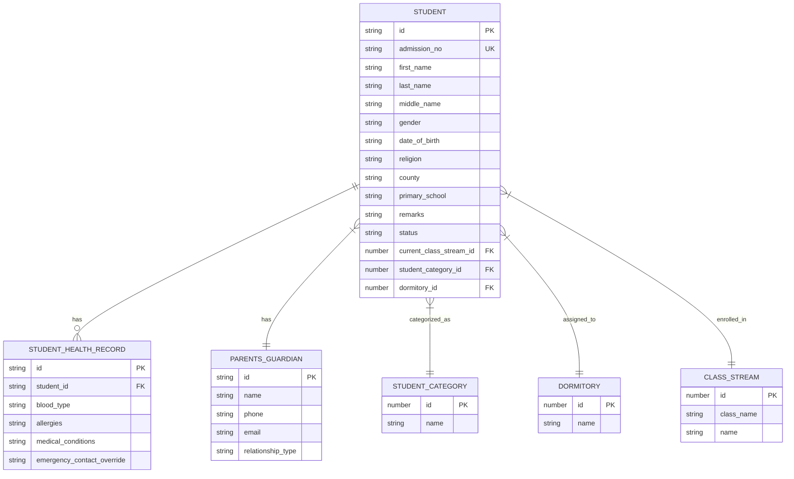
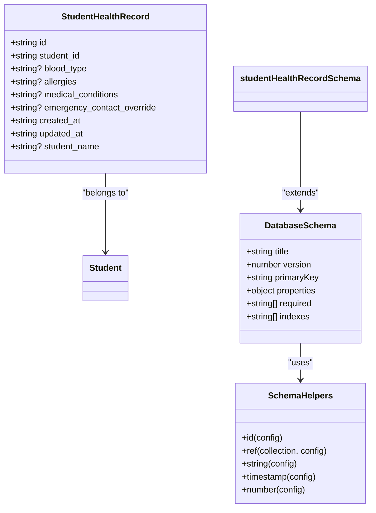
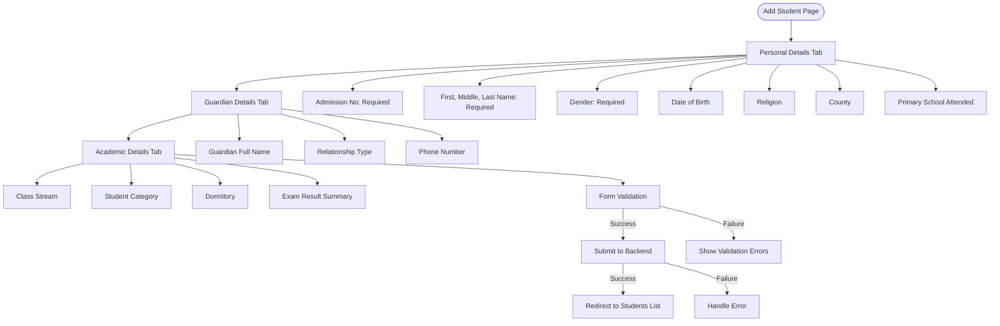
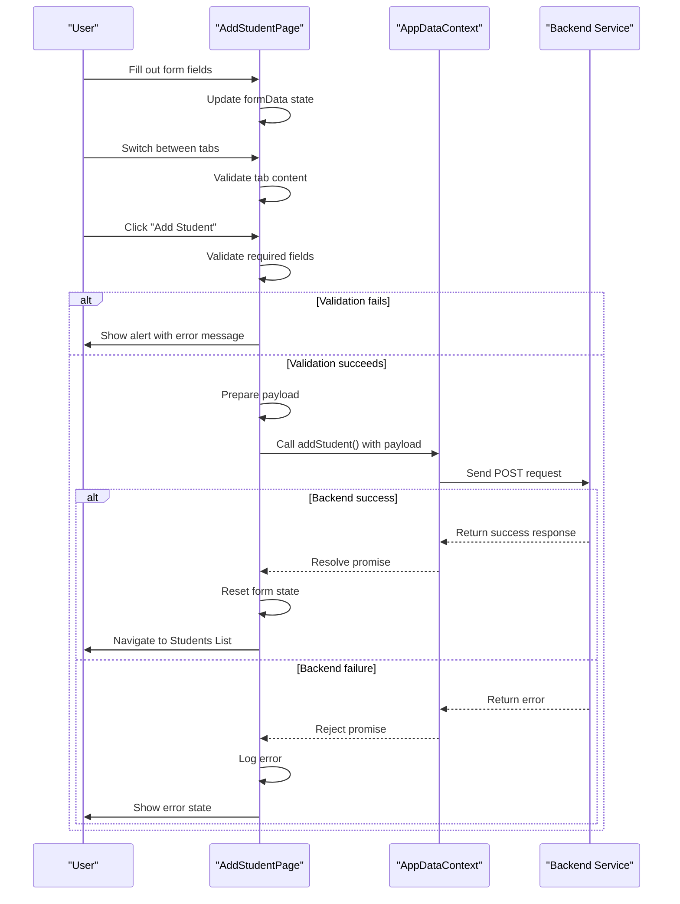
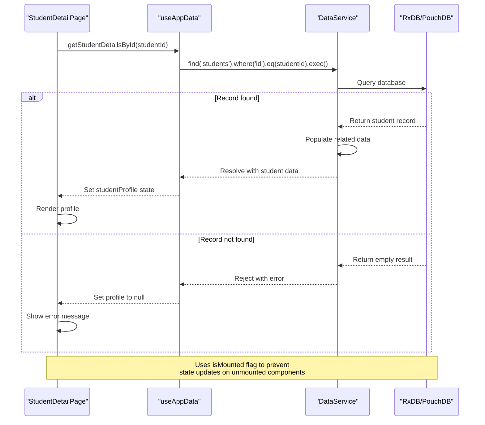
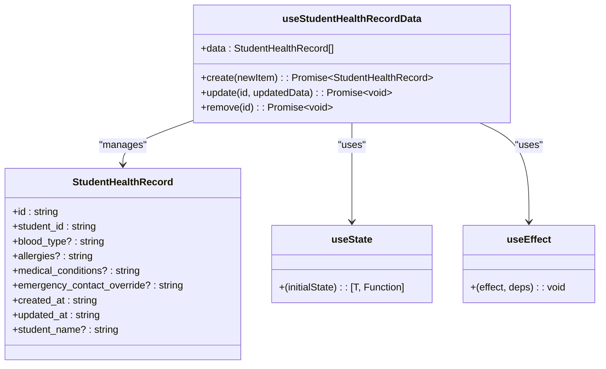
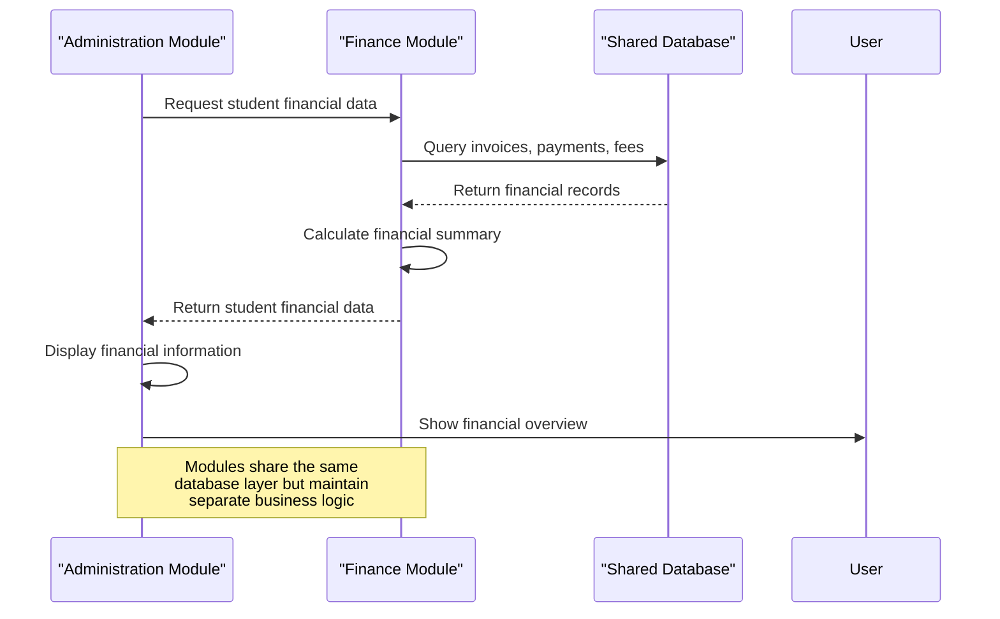

# Student Management

<cite>
**Referenced Files in This Document**   
- [AddStudentPage.tsx](file://src/modules/administration/pages/AddStudentPage.tsx)
- [StudentDetailPage.tsx](file://src/modules/administration/pages/StudentDetailPage.tsx)
- [StudentFinancialDetailPage.tsx](file://src/modules/administration/pages/StudentFinancialDetailPage.tsx)
- [useStudentHealthRecordData.ts](file://src/modules/administration/data/useStudentHealthRecordData.ts)
- [schema.ts](file://src/modules/administration/data/schema.ts)
- [types.ts](file://src/modules/administration/data/types.ts)
</cite>

## Table of Contents
1. [Introduction](#introduction)
2. [Data Model](#data-model)
3. [Student Enrollment Workflow](#student-enrollment-workflow)
4. [Profile Management](#profile-management)
5. [Health Records Management](#health-records-management)
6. [Integration with Finance Module](#integration-with-finance-module)
7. [Integration with Academics Module](#integration-with-academics-module)
8. [Best Practices and Common Issues](#best-practices-and-common-issues)

## Introduction
The Student Management sub-feature within the Administration module provides comprehensive functionality for managing student information throughout their academic lifecycle. This system handles student enrollment, profile management, demographic tracking, health records, and integrates with financial and academic modules. The implementation follows a modular architecture with clear separation of concerns between data models, UI components, and business logic.

## Data Model

### Student Data Structure
The student data model is defined across multiple files, with the core structure defined in the schema and types files. The primary student entity includes personal information, academic categorization, and demographic data.



**Diagram sources**
- [schema.ts](file://src/modules/administration/data/schema.ts#L150-L200)
- [types.ts](file://src/modules/administration/data/types.ts#L150-L200)

**Section sources**
- [schema.ts](file://src/modules/administration/data/schema.ts)
- [types.ts](file://src/modules/administration/data/types.ts)

### Health Records Data Model
The health records data model is specifically designed to securely store sensitive medical information while maintaining referential integrity with student records.



**Diagram sources**
- [schema.ts](file://src/modules/administration/data/schema.ts#L100-L150)
- [types.ts](file://src/modules/administration/data/types.ts#L100-L150)

**Section sources**
- [schema.ts](file://src/modules/administration/data/schema.ts)
- [types.ts](file://src/modules/administration/data/types.ts)

## Student Enrollment Workflow

### AddStudentPage Implementation
The student enrollment workflow is implemented through the AddStudentPage component, which provides a tabbed interface for collecting student information in a structured manner.



**Diagram sources**
- [AddStudentPage.tsx](file://src/modules/administration/pages/AddStudentPage.tsx#L50-L500)

**Section sources**
- [AddStudentPage.tsx](file://src/modules/administration/pages/AddStudentPage.tsx)

### Form Validation and Data Processing
The enrollment form implements client-side validation to ensure data quality before submission to the backend service.



**Diagram sources**
- [AddStudentPage.tsx](file://src/modules/administration/pages/AddStudentPage.tsx#L300-L500)

**Section sources**
- [AddStudentPage.tsx](file://src/modules/administration/pages/AddStudentPage.tsx)

## Profile Management

### StudentDetailPage Implementation
The StudentDetailPage component provides a comprehensive view of student information, organized into tabs for easy navigation.

```mermaid
flowchart TD
PageLoad([Page Load]) --> ExtractParams["Extract studentId from URL"]
ExtractParams --> CheckId["Validate studentId"]
alt studentId exists
CheckId --> FetchData["Call getStudentDetailsById()"]
FetchData --> |Success| SetProfile["Set studentProfile state"]
FetchData --> |Failure| SetNull["Set profile to null"]
else
CheckId --> SetNull
end
SetProfile --> RenderPage["Render Student Profile"]
SetNull --> ShowError["Show 'Student not found' message"]
RenderPage --> BioTab["Student Bio Tab"]
RenderPage --> SubjectsTab["Enrolled Subjects Tab"]
RenderPage --> PaymentsTab["Payment History Tab"]
BioTab --> Display["Show personal information"]
SubjectsTab --> Grid["Display DataGrid with enrolled subjects"]
PaymentsTab --> PaymentGrid["Display DataGrid with payment history"]
Display --> Actions["Show action buttons"]
Actions --> Financials["View Financials Button"]
Actions --> Edit["Edit Profile Button"]
```

**Diagram sources**
- [StudentDetailPage.tsx](file://src/modules/administration/pages/StudentDetailPage.tsx#L20-L250)

**Section sources**
- [StudentDetailPage.tsx](file://src/modules/administration/pages/StudentDetailPage.tsx)

### Data Persistence and Loading
The profile management system implements proper data loading patterns with loading states and error handling.



**Diagram sources**
- [StudentDetailPage.tsx](file://src/modules/administration/pages/StudentDetailPage.tsx#L20-L100)
- [useAppData.ts](file://src/hooks/useAppData.ts)

**Section sources**
- [StudentDetailPage.tsx](file://src/modules/administration/pages/StudentDetailPage.tsx)

## Health Records Management

### useStudentHealthRecordData Hook
The useStudentHealthRecordData hook provides CRUD operations for managing student health records with proper state management.



**Diagram sources**
- [useStudentHealthRecordData.ts](file://src/modules/administration/data/useStudentHealthRecordData.ts#L5-L45)

**Section sources**
- [useStudentHealthRecordData.ts](file://src/modules/administration/data/useStudentHealthRecordData.ts)

### Secure Medical Information Handling
The health records system is designed with security and privacy in mind, following best practices for sensitive data management.

```mermaid
flowchart TD
CreateRecord["Create Health Record"] --> Validate["Validate Input Data"]
Validate --> AssignId["Assign Unique ID"]
AssignId --> Timestamp["Set created_at/updated_at"]
Timestamp --> Store["Store in encrypted database"]
Store --> Denormalize["Denormalize student_name"]
Denormalize --> Complete["Return created record"]
UpdateRecord["Update Health Record"] --> Find["Find record by ID"]
Find --> CheckExists["Record exists?"]
CheckExists --> |Yes| UpdateFields["Update specified fields"]
UpdateFields --> UpdateTimestamp["Set updated_at"]
UpdateTimestamp --> Save["Save updated record"]
Save --> Done["Return"]
CheckExists --> |No| NotFound["Throw error"]
DeleteRecord["Delete Health Record"] --> Locate["Locate record by ID"]
Locate --> Exists["Record exists?"]
Exists --> |Yes| Remove["Remove from data array"]
Remove --> Success["Return"]
Exists --> |No| Error["Throw error"]
Note: All operations maintain data integrity<br/>and follow privacy regulations
```

**Diagram sources**
- [useStudentHealthRecordData.ts](file://src/modules/administration/data/useStudentHealthRecordData.ts#L5-L45)
- [schema.ts](file://src/modules/administration/data/schema.ts#L100-L150)

**Section sources**
- [useStudentHealthRecordData.ts](file://src/modules/administration/data/useStudentHealthRecordData.ts)

## Integration with Finance Module

### StudentFinancialDetailPage Implementation
The StudentFinancialDetailPage component provides a financial overview of a student, integrating data from the Finance module.

```mermaid
flowchart TD
LoadPage([Load Financial Page]) --> ExtractId["Extract studentId from URL"]
ExtractId --> FetchFinancial["Call getStudentFinancialDetailsById()"]
FetchFinancial --> |Success| SetData["Set studentData state"]
FetchFinancial --> |Failure| SetNull["Set data to null"]
SetData --> DisplayOverview["Display Financial Overview"]
DisplayOverview --> StudentInfo["Student Information Card"]
DisplayOverview --> FinancialSummary["Financial Summary Card"]
DisplayOverview --> Tabs["Tabs Component"]
Tabs --> Invoices["Invoices & Charges Tab"]
Tabs --> Payments["Payment History Tab"]
Invoices --> DataGrid["DataGrid with invoice data"]
Payments --> PaymentGrid["DataGrid with payment history"]
DataGrid --> Columns["Define columns with rendering logic"]
Columns --> Status["Status badges with color coding"]
Columns --> Actions["Action buttons"]
Note: Financial data is aggregated from<br/>multiple sources including invoices,<br/>payments, and fee structures
```

**Diagram sources**
- [StudentFinancialDetailPage.tsx](file://src/modules/administration/pages/StudentFinancialDetailPage.tsx#L10-L277)

**Section sources**
- [StudentFinancialDetailPage.tsx](file://src/modules/administration/pages/StudentFinancialDetailPage.tsx)

### Financial Data Integration
The integration between Student Management and Finance modules enables comprehensive financial tracking for students.



**Diagram sources**
- [StudentFinancialDetailPage.tsx](file://src/modules/administration/pages/StudentFinancialDetailPage.tsx)
- [finance/data/schema.ts](file://src/modules/finance/data/schema.ts)

**Section sources**
- [StudentFinancialDetailPage.tsx](file://src/modules/administration/pages/StudentFinancialDetailPage.tsx)

## Integration with Academics Module

### Subject Enrollment Integration
The Student Management system integrates with the Academics module to display enrolled subjects and academic performance.

```mermaid
flowchart TD
StudentProfile["Student Profile"] --> AcademicsAPI["Call Academics API"]
AcademicsAPI --> SubjectService["Subject Enrollment Service"]
SubjectService --> Database["Query student_subject_enrollments"]
Database --> |Success| ReturnSubjects["Return enrolled subjects"]
Database --> |Failure| HandleError["Handle error"]
ReturnSubjects --> FormatData["Format for display"]
FormatData --> Display["Show in StudentDetailPage"]
Display --> CourseName["Course Name"]
Display --> Instructor["Instructor Name"]
Display --> Status["Enrollment Status"]
Note: Subject enrollment data is<br/>synchronized between modules<br/>using the shared database
```

**Diagram sources**
- [StudentDetailPage.tsx](file://src/modules/administration/pages/StudentDetailPage.tsx#L100-L150)
- [academics/data/useStudentSubjectEnrollmentData.ts](file://src/modules/academics/data/useStudentSubjectEnrollmentData.ts)

**Section sources**
- [StudentDetailPage.tsx](file://src/modules/administration/pages/StudentDetailPage.tsx)

## Best Practices and Common Issues

### Duplicate Student Records Prevention
The system implements several strategies to prevent duplicate student records.

```mermaid
flowchart TD
NewEnrollment["New Student Enrollment"] --> CheckAdmission["Check admission_no"]
CheckAdmission --> |Exists| ShowWarning["Show warning to user"]
CheckAdmission --> |Unique| Continue["Continue with enrollment"]
Continue --> VerifyNames["Verify first_name + last_name + date_of_birth"]
VerifyNames --> |Match existing| FlagPotential["Flag potential duplicate"]
VerifyNames --> |No match| Proceed["Proceed with enrollment"]
FlagPotential --> ManualReview["Require manual review"]
ManualReview --> Confirm["Confirm if same student"]
Confirm --> |Same| LinkRecords["Link to existing record"]
Confirm --> |Different| CreateNew["Create new record"]
Note: The system uses a combination<br/>of unique constraints and<br/>fuzzy matching to prevent duplicates
```

**Diagram sources**
- [schema.ts](file://src/modules/administration/data/schema.ts#L150-L200)
- [AddStudentPage.tsx](file://src/modules/administration/pages/AddStudentPage.tsx)

**Section sources**
- [schema.ts](file://src/modules/administration/data/schema.ts)
- [AddStudentPage.tsx](file://src/modules/administration/pages/AddStudentPage.tsx)

### Data Accuracy Best Practices
Maintaining data accuracy is critical for effective student management. The following best practices are recommended:

**Validation Rules**
- **Admission No**: Must be unique across all students
- **Names**: Required fields, validate for non-empty strings
- **Date of Birth**: Must be in valid date format, reasonable range
- **Gender**: Must be one of predefined values (Male, Female, Other)
- **Status**: Must be one of predefined values (Active, Inactive, Graduated, etc.)

**Data Entry Guidelines**
- Always verify information against official documents
- Use dropdowns for categorical data to prevent typos
- Implement real-time validation where possible
- Provide clear error messages for invalid inputs
- Regularly audit data for consistency and accuracy

**Integration Points**
- Synchronize student data changes across modules
- Update financial records when student status changes
- Update academic records when class assignments change
- Maintain consistent data formats across the system

**Section sources**
- [schema.ts](file://src/modules/administration/data/schema.ts)
- [types.ts](file://src/modules/administration/data/types.ts)
- [AddStudentPage.tsx](file://src/modules/administration/pages/AddStudentPage.tsx)