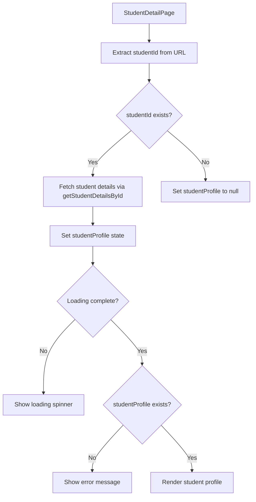
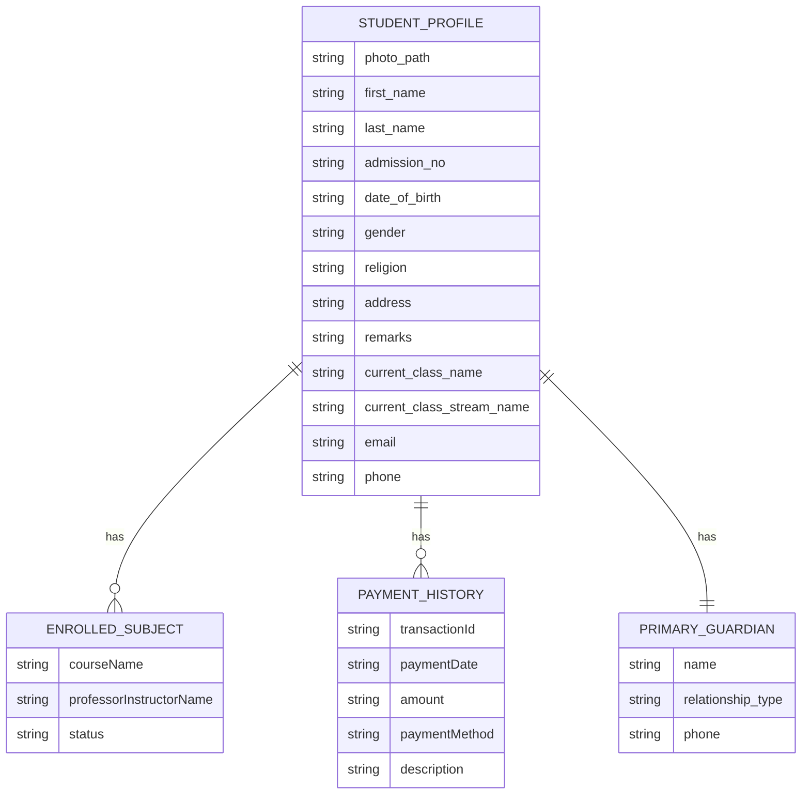
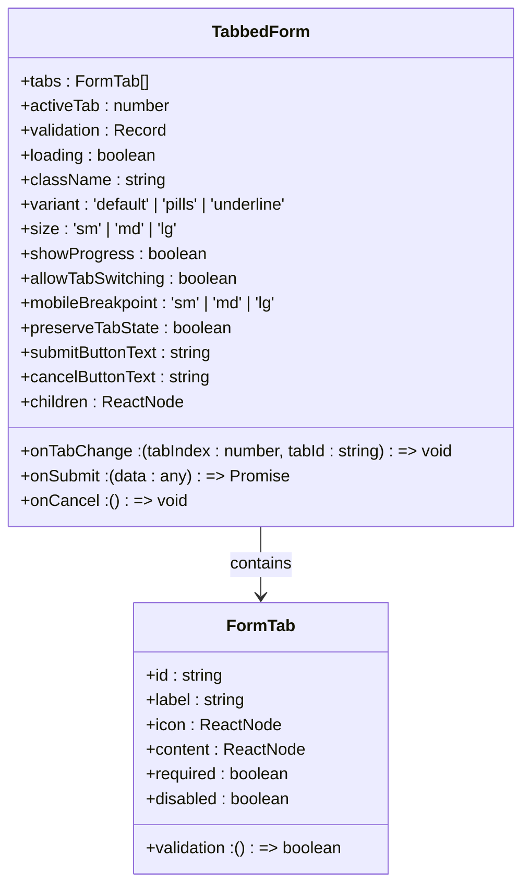
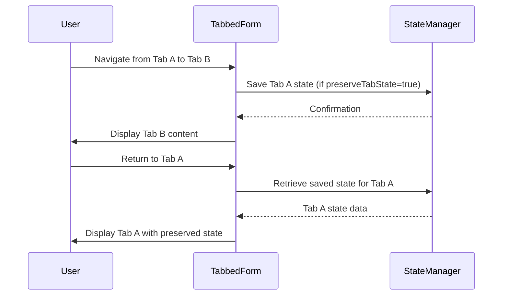
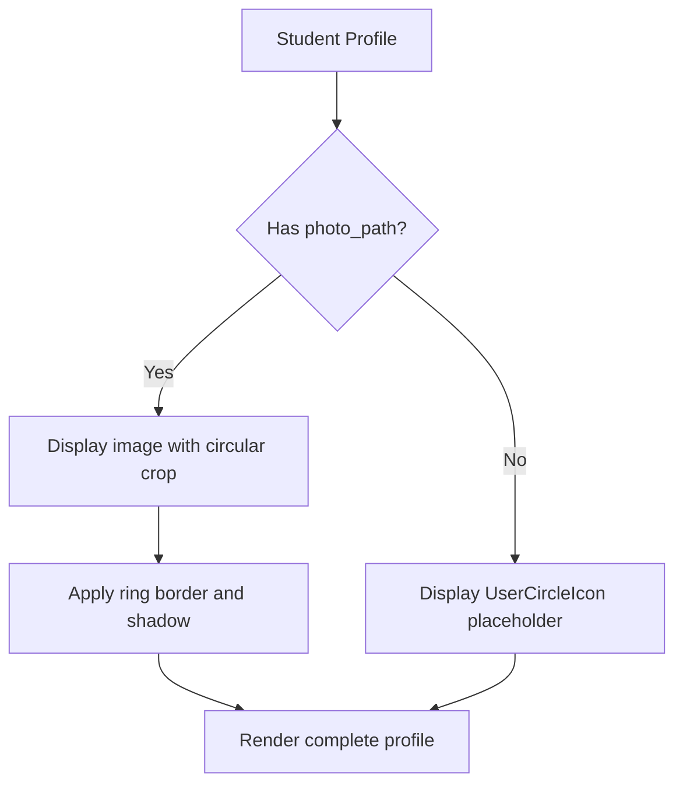
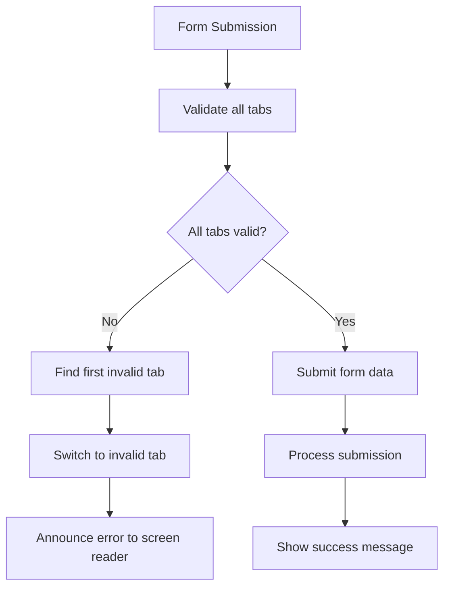
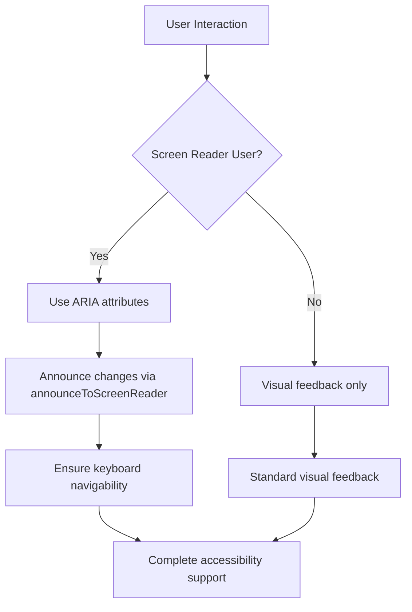
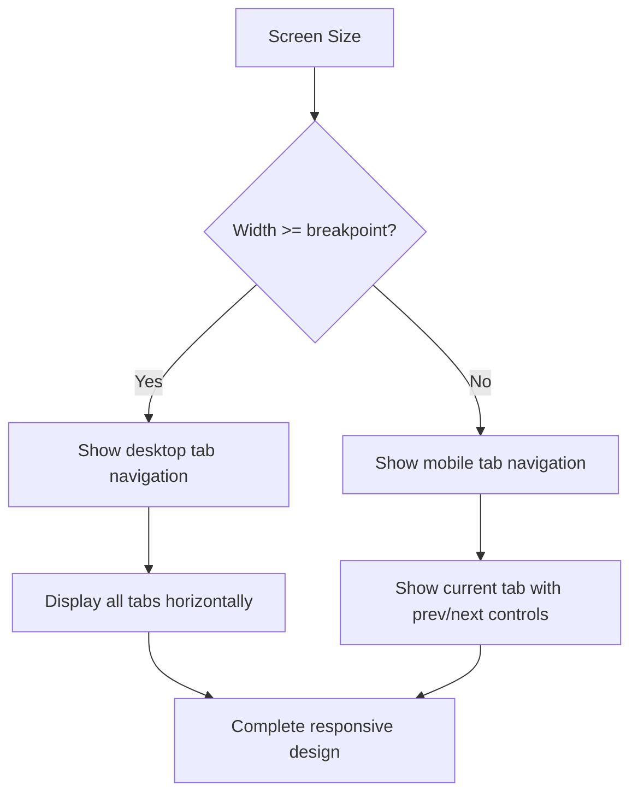

# Student Profile Management

<cite>
**Referenced Files in This Document**   
- [StudentDetailPage.tsx](file://src/modules/administration/pages/StudentDetailPage.tsx)
- [TabbedForm.tsx](file://src/components/ui/forms/TabbedForm.tsx)
- [types.ts](file://src/types.ts)
</cite>

## Table of Contents
1. [Introduction](#introduction)
2. [Student Detail Page Implementation](#student-detail-page-implementation)
3. [Data Schema for Student Profiles](#data-schema-for-student-profiles)
4. [TabbedForm Component Functionality](#tabbedform-component-functionality)
5. [Image Upload Integration](#image-upload-integration)
6. [Validation Rules and Data Integrity](#validation-rules-and-data-integrity)
7. [Accessibility Features](#accessibility-features)
8. [Responsive Design Considerations](#responsive-design-considerations)
9. [Troubleshooting Common Issues](#troubleshooting-common-issues)

## Introduction
The Student Profile Management system provides a comprehensive interface for viewing and managing student information within the educational platform. This document details the implementation of the StudentDetailPage, which utilizes the TabbedForm component to organize student data across multiple tabs, including personal, academic, and contact information. The system supports modular editing, state persistence, image uploads, and robust validation to ensure data integrity.

## Student Detail Page Implementation

The StudentDetailPage component serves as the primary interface for viewing student profiles. It retrieves student data based on the student ID parameter and displays it in a structured format with both summary information and tabbed details.

**Diagram sources**
- [StudentDetailPage.tsx](file://src/modules/administration/pages/StudentDetailPage.tsx#L11-L247)

**Section sources**
- [StudentDetailPage.tsx](file://src/modules/administration/pages/StudentDetailPage.tsx#L11-L247)

## Data Schema for Student Profiles

The student profile data structure contains comprehensive information about students, including personal details, academic information, and contact data.

**Student Profile Fields:**
- **Personal Information**
  - `photo_path`: string - Path to student's photo
  - `first_name`: string - Student's first name
  - `last_name`: string - Student's last name
  - `admission_no`: string - Unique admission number
  - `date_of_birth`: string - Date of birth in ISO format
  - `gender`: string - Gender identifier
  - `religion`: string - Religious affiliation
  - `address`: string - Residential address
  - `remarks`: string - Additional notes about the student

- **Academic Information**
  - `current_class_name`: string - Current class name
  - `current_class_stream_name`: string - Current class stream
  - `enrolled_subjects`: array - List of enrolled subjects with course name, instructor, and status

- **Contact Information**
  - `email`: string - Email address
  - `phone`: string - Phone number
  - `primary_guardian`: object - Guardian information including name, relationship type, and phone

- **Financial Information**
  - `payment_history`: array - List of payment records with transaction ID, date, amount, payment method, and description

**Diagram sources**
- [StudentDetailPage.tsx](file://src/modules/administration/pages/StudentDetailPage.tsx#L50-L80)

**Section sources**
- [StudentDetailPage.tsx](file://src/modules/administration/pages/StudentDetailPage.tsx#L50-L80)

## TabbedForm Component Functionality

The TabbedForm component enables modular editing and state persistence during updates. Although not directly used in the read-only StudentDetailPage, it serves as the foundation for the editing interface.

**Diagram sources**
- [TabbedForm.tsx](file://src/components/ui/forms/TabbedForm.tsx#L38-L483)

**Section sources**
- [TabbedForm.tsx](file://src/components/ui/forms/TabbedForm.tsx#L38-L483)

### State Management and Persistence
The TabbedForm component implements state persistence through the `preserveTabState` prop, which when enabled, saves the state of each tab when navigating away from it:

**Diagram sources**
- [TabbedForm.tsx](file://src/components/ui/forms/TabbedForm.tsx#L100-L120)

## Image Upload Integration

The StudentDetailPage integrates image upload functionality for student photos through the `photo_path` field. When a photo is available, it displays the image with a circular crop and border styling; otherwise, it shows a placeholder icon.

**Diagram sources**
- [StudentDetailPage.tsx](file://src/modules/administration/pages/StudentDetailPage.tsx#L170-L180)

**Section sources**
- [StudentDetailPage.tsx](file://src/modules/administration/pages/StudentDetailPage.tsx#L170-L180)

## Validation Rules and Data Integrity

The system implements validation rules to ensure data integrity across various fields in the student profile.

**Validation Rules:**
- **Required Fields**: Admission number, first name, and last name are required
- **Date Format**: Date of birth must be in valid ISO format
- **Email Validation**: Email field must contain a valid email address format
- **Phone Number**: Phone field should follow standard phone number patterns
- **Data Type Validation**: All fields are validated for correct data types

The TabbedForm component supports validation through multiple mechanisms:
- External validation prop (`validation: Record<string, boolean>`)
- Per-tab validation functions (`validation?: () => boolean`)
- Visual indicators for validation status (success/error)

**Diagram sources**
- [TabbedForm.tsx](file://src/components/ui/forms/TabbedForm.tsx#L300-L350)

**Section sources**
- [TabbedForm.tsx](file://src/components/ui/forms/TabbedForm.tsx#L300-L350)

## Accessibility Features

The Student Profile Management system incorporates several accessibility features to ensure usability for all users:

- **Screen Reader Support**: Uses ARIA attributes (role, aria-selected, aria-controls) for tab navigation
- **Keyboard Navigation**: Fully navigable via keyboard with focus management
- **Announcements**: Uses `announceToScreenReader` function to provide feedback on tab changes and form submission
- **Focus Management**: Maintains focus on tab content when switching tabs
- **Color Contrast**: Uses sufficient color contrast for text and interactive elements
- **Responsive Design**: Adapts layout for different screen sizes

**Diagram sources**
- [TabbedForm.tsx](file://src/components/ui/forms/TabbedForm.tsx#L120-L130)

**Section sources**
- [TabbedForm.tsx](file://src/components/ui/forms/TabbedForm.tsx#L120-L130)

## Responsive Design Considerations

The interface adapts to different screen sizes through responsive design techniques:

- **Desktop View**: Full tab navigation with all tabs visible
- **Mobile View**: Simplified navigation with previous/next buttons and current tab indicator
- **Breakpoint Configuration**: Configurable mobile breakpoint (sm, md, lg)
- **Flexible Layout**: Uses CSS Grid and Flexbox for adaptive layouts
- **Touch-Friendly Controls**: Adequate tap target sizes for mobile devices

**Diagram sources**
- [TabbedForm.tsx](file://src/components/ui/forms/TabbedForm.tsx#L400-L450)

**Section sources**
- [TabbedForm.tsx](file://src/components/ui/forms/TabbedForm.tsx#L400-L450)

## Troubleshooting Common Issues

### Unsaved Changes
**Issue**: Changes are not preserved when navigating between tabs
**Solution**: Ensure `preserveTabState` prop is set to `true` in TabbedForm component. Verify that state management is properly implemented to save form data when switching tabs.

### Permission-Denied Errors
**Issue**: Users encounter permission errors when accessing student profiles
**Solution**: Verify user role permissions in the RBAC system. Check that the user has the appropriate permissions for the administration module and student data access.

### Image Upload Failures
**Issue**: Student photos fail to upload or display
**Solution**: Check file size limits and accepted formats. Verify server-side upload endpoints are accessible. Ensure proper CORS configuration if uploading to external services.

### Slow Loading Times
**Issue**: Student profiles take too long to load
**Solution**: Implement data fetching optimizations such as:
- Lazy loading of non-essential data
- Caching frequently accessed student information
- Optimizing database queries for student data retrieval

### Validation Errors
**Issue**: Form validation fails unexpectedly
**Solution**: Check validation rules for each tab. Ensure validation functions return boolean values. Verify that required fields are properly marked and contain valid data.

**Section sources**
- [TabbedForm.tsx](file://src/components/ui/forms/TabbedForm.tsx#L300-L350)
- [StudentDetailPage.tsx](file://src/modules/administration/pages/StudentDetailPage.tsx#L30-L50)