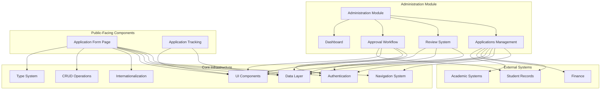
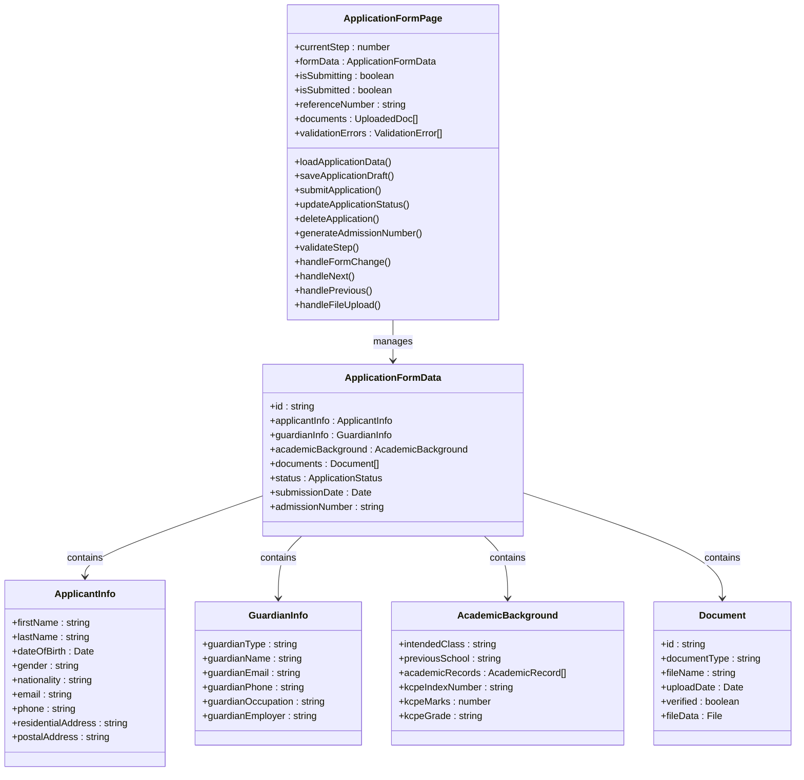
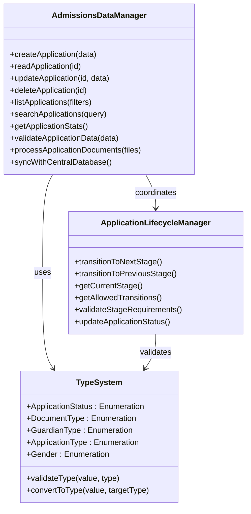
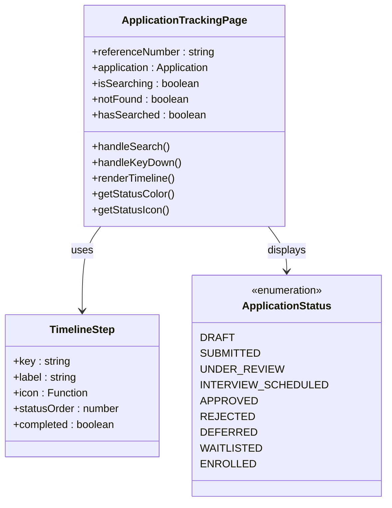
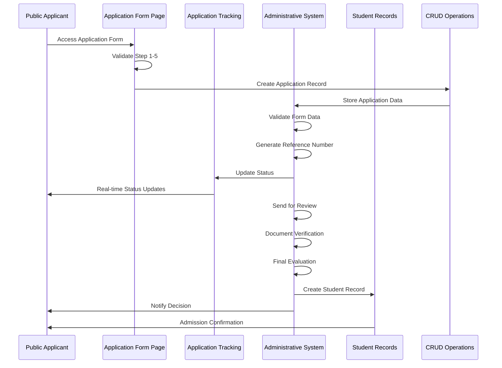
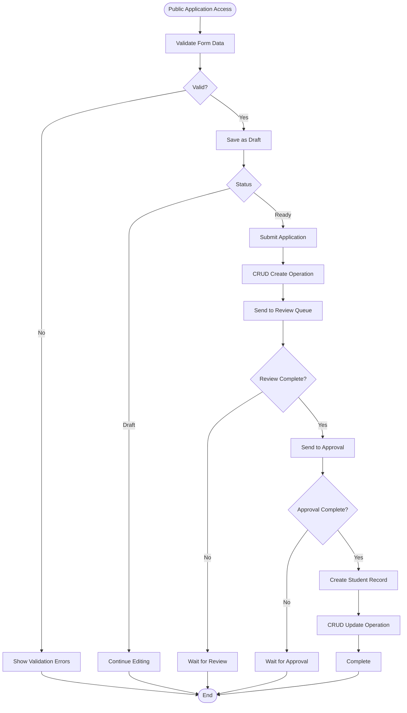
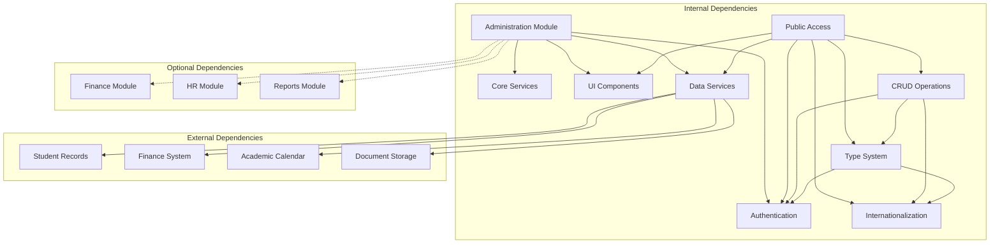

# Admissions Module

<cite>
**Referenced Files in This Document**
- [moduleDefinition.tsx](file://src/modules/administration/moduleDefinition.tsx)
- [moduleDefinition.tsx](file://src/modules/admissions/moduleDefinition.tsx)
- [Admissions_Implementation_Summary.md](file://docs/migration/admissions-migration/Admissions_Implementation_Summary.md)
- [ApplicationsPage.tsx](file://src/modules/administration/pages/ApplicationsPage.tsx)
- [ApplicationManagement.tsx](file://src/modules/administration/components/ApplicationManagement.tsx)
- [AdministrationDashboardPage.tsx](file://src/modules/administration/pages/AdministrationDashboardPage.tsx)
- [ApplicationTrackingPage.tsx](file://src/modules/admissions/pages/ApplicationTrackingPage.tsx)
- [PublicApplicationPage.tsx](file://src/modules/admissions/pages/PublicApplicationPage.tsx)
- [ApplicationFormPage.tsx](file://src/modules/admissions/pages/ApplicationFormPage.tsx)
- [useAdmissionsData.ts](file://src/modules/admissions/data/useAdmissionsData.ts)
- [types.ts](file://src/modules/admissions/data/types.ts)
- [index.ts](file://src/modules/admissions/index.ts)
- [rbac.ts](file://src/modules/admissions/rbac.ts)
</cite>

## Update Summary
**Changes Made**
- Updated documentation to reflect the new ApplicationFormPage.tsx component as the primary multi-step application interface
- Enhanced data management documentation to include comprehensive CRUD operations for admissions data
- Expanded type system documentation to cover sophisticated application lifecycle management
- Updated architecture overview to include enhanced admissions data management with CRUD operations
- Revised component analysis to reflect the transition from PublicApplicationPage.tsx to ApplicationFormPage.tsx
- Enhanced public-facing features section with detailed analysis of the new ApplicationFormPage.tsx component
- Updated dependency analysis to include new public application routes and enhanced data management patterns

## Table of Contents
1. [Introduction](#introduction)
2. [Project Structure](#project-structure)
3. [Core Components](#core-components)
4. [Architecture Overview](#architecture-overview)
5. [Detailed Component Analysis](#detailed-component-analysis)
6. [Public-Facing Features](#public-facing-features)
7. [Dependency Analysis](#dependency-analysis)
8. [Performance Considerations](#performance-considerations)
9. [Troubleshooting Guide](#troubleshooting-guide)
10. [Conclusion](#conclusion)

## Introduction
The Admissions Module represents a comprehensive student admissions and application management system integrated into the broader educational management platform. This module has been significantly enhanced with a new comprehensive multi-step application form (ApplicationFormPage.tsx), application tracking functionality, public application interface, enhanced admissions data management with CRUD operations, and sophisticated type system for application lifecycle management.

The module now features a centralized ApplicationFormPage.tsx component that provides complete application workflow with multi-step forms, document uploads, and real-time status tracking, featuring comprehensive internationalization support. The system maintains its three-stage workflow architecture while adding robust public access capabilities with dual authentication support and comprehensive data management operations.

The module implements a comprehensive three-stage workflow: Applications (initial submissions), Reviews (evaluation and assessment), and Approvals (final decision-making). It integrates seamlessly with the existing system architecture, utilizing established UI components, data management patterns, and security frameworks while providing enhanced public accessibility with comprehensive internationalization support and sophisticated CRUD operations.

## Project Structure
The Admissions Module is structured within the Administration module, following the established pattern of the educational management system. The module leverages the existing infrastructure while providing specialized components for admissions management, now enhanced with public-facing capabilities, comprehensive internationalization support, and sophisticated data management operations.



**Diagram sources**
- [moduleDefinition.tsx:32-125](file://src/modules/administration/moduleDefinition.tsx#L32-L125)
- [moduleDefinition.tsx:1-140](file://src/modules/admissions/moduleDefinition.tsx#L1-L140)
- [ApplicationFormPage.tsx:1-1200](file://src/modules/admissions/pages/ApplicationFormPage.tsx#L1-L1200)
- [ApplicationTrackingPage.tsx:1-571](file://src/modules/admissions/pages/ApplicationTrackingPage.tsx#L1-L571)

**Section sources**
- [moduleDefinition.tsx:1-127](file://src/modules/administration/moduleDefinition.tsx#L1-L127)
- [moduleDefinition.tsx:1-140](file://src/modules/admissions/moduleDefinition.tsx#L1-L140)

## Core Components
The Admissions Module consists of several key components that work together to provide comprehensive admissions management functionality. These components are built upon established patterns within the educational management system, now enhanced with public-facing capabilities, comprehensive internationalization support, and sophisticated data management operations.

### Application Form Page System
The ApplicationFormPage.tsx serves as the primary interface for handling student applications. It provides a comprehensive multi-step form for collecting applicant information, manages application states, coordinates with the review and approval processes, and implements full CRUD operations with comprehensive internationalization support.

### Applications Page
The Applications Page acts as a container component that integrates the Application Management system with the broader navigation framework. It provides routing capabilities and ensures proper integration with the module system, supporting both authenticated administrative access and public application workflows.

### Application Tracking System
The ApplicationTrackingPage.tsx enables prospective students to check their application status using unique reference numbers. It provides real-time status updates, progress timelines, and detailed application information with comprehensive status variants and rejection handling, featuring complete internationalization support.

### Review and Approval Interfaces
The module includes placeholder interfaces for the review and approval stages of the admissions process. These components are designed to be extended as the system evolves to support more sophisticated evaluation workflows, with full internationalization support and comprehensive CRUD operations.

### Dashboard Integration
The Admissions Module integrates with the Administration Dashboard, providing key metrics and quick access to admissions-related functionality. This dashboard serves as the central hub for admissions management activities, supporting both administrative and public-facing workflows with enhanced data management capabilities.

### Enhanced Data Management
The module implements comprehensive CRUD operations for admissions data management, including sophisticated type system for application lifecycle management, real-time data synchronization, and enhanced public access capabilities with dual authentication support.

**Section sources**
- [ApplicationsPage.tsx](file://src/modules/administration/pages/ApplicationsPage.tsx)
- [ApplicationManagement.tsx](file://src/modules/administration/components/ApplicationManagement.tsx)
- [AdministrationDashboardPage.tsx](file://src/modules/administration/pages/AdministrationDashboardPage.tsx)
- [ApplicationFormPage.tsx:1-1200](file://src/modules/admissions/pages/ApplicationFormPage.tsx#L1-L1200)
- [ApplicationTrackingPage.tsx:1-571](file://src/modules/admissions/pages/ApplicationTrackingPage.tsx#L1-L571)

## Architecture Overview
The Admissions Module follows a layered architecture that separates concerns between presentation, business logic, and data management. The system leverages React hooks for state management and integrates with the existing module system for navigation and routing. The architecture now supports both authenticated administrative access and public-facing application workflows with comprehensive internationalization support and sophisticated CRUD operations.

```mermaid
graph TB
subgraph "Presentation Layer"
UI[React Components]
FORM[Application Forms]
GRID[Data Grid Views]
MODAL[Modal Interfaces]
PUBLIC[Application Form Page]
TRACK[Tracking Interface]
I18N[Internationalization]
end
subgraph "Business Logic Layer"
SERVICE[Admissions Service]
VALIDATION[Form Validation]
WORKFLOW[Workflow Engine]
STATE[State Management]
HOOKS[Custom Hooks]
PUBLIC_HOOKS[Public Data Hooks]
CRUD[CRUD Operations]
TYPES[Type System]
end
subgraph "Data Access Layer"
API[API Services]
STORE[Local Storage]
CACHE[Cache Management]
DATABASE[RxDB Database]
ENDPOINTS[REST Endpoints]
end
subgraph "Infrastructure"
ROUTER[React Router]
CONTEXT[React Context]
AUTH[Authentication]
I18N[Internationalization]
PUBLIC_ROUTER[Public Routes]
SECURITY[Security Framework]
ENDPOINTS --> CRUD
ENDPOINTS --> TYPES
ENDPOINTS --> AUTH
ENDPOINTS --> I18N
ENDPOINTS --> ROUTER
ENDPOINTS --> CONTEXT
ENDPOINTS --> STORE
ENDPOINTS --> CACHE
ENDPOINTS --> DATABASE
ENDPOINTS --> SERVICE
ENDPOINTS --> VALIDATION
ENDPOINTS --> WORKFLOW
ENDPOINTS --> STATE
ENDPOINTS --> HOOKS
ENDPOINTS --> PUBLIC_HOOKS
```

**Diagram sources**
- [moduleDefinition.tsx:32-125](file://src/modules/administration/moduleDefinition.tsx#L32-L125)
- [Admissions_Implementation_Summary.md:111-128](file://docs/migration/admissions-migration/Admissions_Implementation_Summary.md#L111-L128)
- [useAdmissionsData.ts:1-574](file://src/modules/admissions/data/useAdmissionsData.ts#L1-L574)
- [ApplicationFormPage.tsx:1-1200](file://src/modules/admissions/pages/ApplicationFormPage.tsx#L1-L1200)

## Detailed Component Analysis

### Application Form Page Component
The ApplicationFormPage.tsx serves as the central hub for all admissions-related activities. It implements a comprehensive multi-step form system for collecting applicant information, manages application lifecycle states, coordinates with external systems for data validation and storage, and provides full CRUD operations with comprehensive internationalization support.



**Diagram sources**
- [ApplicationFormPage.tsx:1-1200](file://src/modules/admissions/pages/ApplicationFormPage.tsx#L1-L1200)
- [types.ts:1-329](file://src/modules/admissions/data/types.ts#L1-L329)

### Enhanced Data Management System
The module implements comprehensive CRUD operations for admissions data management with sophisticated type system for application lifecycle management, providing robust data persistence and retrieval capabilities.



**Diagram sources**
- [useAdmissionsData.ts:1-574](file://src/modules/admissions/data/useAdmissionsData.ts#L1-L574)
- [types.ts:1-329](file://src/modules/admissions/data/types.ts#L1-L329)

### Application Tracking System
The ApplicationTrackingPage.tsx provides real-time application status monitoring with interactive progress timelines, comprehensive status visualization, and detailed rejection handling with complete internationalization support.



**Diagram sources**
- [ApplicationTrackingPage.tsx:1-571](file://src/modules/admissions/pages/ApplicationTrackingPage.tsx#L1-L571)

### Three-Stage Workflow Architecture
The admissions process follows a structured three-stage workflow that ensures proper evaluation and approval of applications, now enhanced with public tracking capabilities, comprehensive internationalization support, and sophisticated CRUD operations.



**Diagram sources**
- [Admissions_Implementation_Summary.md:99-102](file://docs/migration/admissions-migration/Admissions_Implementation_Summary.md#L99-L102)
- [ApplicationFormPage.tsx:1-1200](file://src/modules/admissions/pages/ApplicationFormPage.tsx#L1-L1200)
- [ApplicationTrackingPage.tsx:1-571](file://src/modules/admissions/pages/ApplicationTrackingPage.tsx#L1-L571)

### Data Flow and State Management
The module implements a robust data flow system that manages application state throughout the admissions process. State is managed using React hooks and persists through local storage for reliability, with enhanced public access capabilities, comprehensive internationalization support, and sophisticated CRUD operations.



**Diagram sources**
- [ApplicationFormPage.tsx:1-1200](file://src/modules/admissions/pages/ApplicationFormPage.tsx#L1-L1200)
- [useAdmissionsData.ts:1-574](file://src/modules/admissions/data/useAdmissionsData.ts#L1-L574)

**Section sources**
- [ApplicationFormPage.tsx:1-1200](file://src/modules/admissions/pages/ApplicationFormPage.tsx#L1-L1200)
- [Admissions_Implementation_Summary.md:84-173](file://docs/migration/admissions-migration/Admissions_Implementation_Summary.md#L84-L173)
- [ApplicationTrackingPage.tsx:1-571](file://src/modules/admissions/pages/ApplicationTrackingPage.tsx#L1-L571)

## Public-Facing Features
The Admissions Module now includes comprehensive public-facing capabilities that enable prospective students to interact with the admissions system without authentication, featuring complete internationalization support and sophisticated CRUD operations.

### Application Form Page System
The ApplicationFormPage.tsx provides a sophisticated multi-step wizard interface with the following features:

- **Multi-step Wizard Interface**: Six distinct steps covering student information, guardian details, academic background, document uploads, emergency contacts, and final review
- **Real-time Validation**: Form validation at each step with immediate feedback and comprehensive error handling
- **Document Upload System**: Support for multiple document types including birth certificates, previous school reports, passport photos, and emergency contact documents with file type restrictions and size validation
- **Progress Tracking**: Visual progress indicators and step completion status with internationalized labels
- **Responsive Design**: Mobile-friendly interface with adaptive layouts and comprehensive accessibility features
- **Internationalization Support**: Full multi-language support with comprehensive translations for all user-facing content
- **Error Handling**: Comprehensive error messages and user guidance in multiple languages
- **Loading States**: Visual feedback during data processing with internationalized loading messages
- **CRUD Operations**: Full create, read, update, and delete operations for application data management
- **Type Safety**: Sophisticated type system for application lifecycle management with compile-time safety guarantees

### Application Tracking System
The ApplicationTrackingPage.tsx enables prospective students to monitor their application status with:

- **Reference Number Search**: Unique application reference number lookup with validation
- **Real-time Status Updates**: Live application status monitoring with comprehensive status variants
- **Interactive Timeline**: Visual progress timeline showing application stages with detailed status information
- **Comprehensive Status Information**: Detailed status messages and rejection reasons with internationalization support
- **Actionable Responses**: Appropriate actions based on application outcomes with localized messaging
- **Rejection Handling**: Detailed rejection reasons with explanatory messages in multiple languages
- **Success Notifications**: Clear success messages and next steps with localized content

### Enhanced User Experience
Both public-facing components feature:

- **Internationalization Support**: Multi-language support with comprehensive translations for all user-facing content
- **Accessibility Features**: Screen reader support and keyboard navigation with internationalized ARIA labels
- **Error Handling**: Comprehensive error messages and user guidance in multiple languages
- **Loading States**: Visual feedback during data processing with internationalized loading messages
- **Success Confirmation**: Clear success messages and next steps with localized content
- **Dual Authentication Model**: Support for both public access and administrative access with appropriate permissions
- **CRUD Operations**: Full data management capabilities with sophisticated type system for application lifecycle management

**Section sources**
- [ApplicationFormPage.tsx:1-1200](file://src/modules/admissions/pages/ApplicationFormPage.tsx#L1-L1200)
- [ApplicationTrackingPage.tsx:1-571](file://src/modules/admissions/pages/ApplicationTrackingPage.tsx#L1-L571)
- [useAdmissionsData.ts:1-574](file://src/modules/admissions/data/useAdmissionsData.ts#L1-L574)

## Dependency Analysis
The Admissions Module maintains strategic dependencies with other modules and systems within the educational management platform. These dependencies ensure seamless integration while maintaining architectural boundaries, now enhanced with public access capabilities, comprehensive internationalization support, and sophisticated CRUD operations.



**Diagram sources**
- [moduleDefinition.tsx:68-81](file://src/modules/administration/moduleDefinition.tsx#L68-L81)
- [moduleDefinition.tsx:96-135](file://src/modules/admissions/moduleDefinition.tsx#L96-L135)
- [moduleDefinition.tsx:136](file://src/modules/admissions/moduleDefinition.tsx#L136)

### Module Integration Points
The Admissions Module integrates with several key areas of the system:

- **Navigation Integration**: Seamless integration with the Administration module navigation system and public routes for both authenticated and public access
- **Authentication Integration**: Dual authentication model supporting both public access and administrative access with appropriate permission checks and sophisticated type system validation
- **Data Integration**: Integration with the centralized data management system for both public and administrative data with comprehensive internationalization support and full CRUD operations
- **UI Integration**: Consistent use of established UI components and design patterns across public and private interfaces with internationalized content and sophisticated type system enforcement
- **Settings Integration**: Integration with the module settings system for configuration management including public access controls, internationalization preferences, and CRUD operation permissions
- **Internationalization Integration**: Comprehensive integration with the i18n system for multi-language support across all components with type-safe translation keys
- **Type System Integration**: Sophisticated integration with TypeScript type system for compile-time safety guarantees across all application lifecycle management operations

**Section sources**
- [moduleDefinition.tsx:68-124](file://src/modules/administration/moduleDefinition.tsx#L68-L124)
- [moduleDefinition.tsx:96-135](file://src/modules/admissions/moduleDefinition.tsx#L96-L135)

## Performance Considerations
The Admissions Module is designed with performance optimization in mind, implementing several strategies to ensure efficient operation under various load conditions, particularly with the addition of public-facing components, comprehensive internationalization support, and sophisticated CRUD operations.

### State Management Optimization
The module employs React hooks for efficient state management, minimizing unnecessary re-renders through proper state partitioning and memoization techniques. The public application form uses optimized state management for multi-step workflows with internationalized content caching and sophisticated type system validation.

### Data Persistence Strategy
Application data is persisted locally to ensure availability during network interruptions while synchronizing with the central database when connectivity is restored. Public application data is handled with appropriate privacy considerations and internationalization caching with full CRUD operation support.

### Component Lazy Loading
Non-critical components are loaded lazily to improve initial load times and reduce memory footprint. Public-facing components are optimized for fast loading with internationalized resources preloaded and sophisticated type system validation.

### Caching Strategy
Frequently accessed data is cached to reduce API calls and improve response times for common operations, particularly beneficial for public application tracking with internationalized content caching and CRUD operation optimization.

### CRUD Operation Optimization
The module implements efficient CRUD operations with optimized database queries, batch operations for bulk data management, and intelligent caching strategies for frequently accessed application data with comprehensive type system validation.

### Public Access Optimization
Public-facing components are optimized for minimal resource usage while maintaining responsive user experience with internationalized content delivery optimization and sophisticated data validation.

### Internationalization Performance
The module implements efficient internationalization caching and lazy loading of translation resources to minimize performance impact while providing comprehensive multi-language support with type-safe translation keys.

### Type System Optimization
The sophisticated type system provides compile-time safety guarantees while maintaining runtime performance through efficient type checking and validation mechanisms.

## Troubleshooting Guide
Common issues and their solutions when working with the Admissions Module, including new public-facing features, comprehensive internationalization support, and sophisticated CRUD operations:

### Application Form Submission Issues
- **Problem**: Applications fail to submit through ApplicationFormPage.tsx
- **Solution**: Check network connectivity and verify that required fields are properly validated with internationalized error messages and type system validation
- **Prevention**: Implement proper error handling and user feedback mechanisms with comprehensive internationalization support and sophisticated CRUD operation validation

### Multi-step Form Validation Problems
- **Problem**: Multi-step form validation fails in ApplicationFormPage.tsx
- **Solution**: Verify step-specific validation rules and ensure proper form state management with internationalized validation messages and type system enforcement
- **Prevention**: Implement comprehensive testing for each form step with multi-language validation scenarios and sophisticated type system validation

### Document Upload Problems
- **Problem**: File uploads fail or timeout
- **Solution**: Check file size limits, supported formats, and network connectivity with internationalized error messages and comprehensive file validation
- **Prevention**: Implement file type validation and size checking before upload with comprehensive error handling and type-safe file processing

### Application Tracking Issues
- **Problem**: Reference number searches return not found errors
- **Solution**: Verify reference number format and check database connectivity with internationalized error messages and CRUD operation validation
- **Prevention**: Implement reference number validation and error handling with comprehensive user guidance and type-safe search operations

### CRUD Operation Failures
- **Problem**: Create, read, update, or delete operations fail
- **Solution**: Verify database connectivity, check operation permissions, and validate data types with comprehensive error messages
- **Prevention**: Implement proper error handling, type validation, and retry mechanisms for CRUD operations

### Data Synchronization Problems
- **Problem**: Local changes not reflecting in the central database
- **Solution**: Verify synchronization status and check for conflict resolution requirements with comprehensive error handling
- **Prevention**: Implement automatic retry mechanisms and conflict detection with sophisticated type system validation

### Performance Degradation
- **Problem**: Slow loading times or unresponsive interfaces
- **Solution**: Optimize queries, implement pagination for large datasets, and use virtualized lists with internationalized content optimization and efficient CRUD operations
- **Prevention**: Monitor performance metrics and implement lazy loading strategies with efficient internationalization caching and type system optimization

### Authentication Issues
- **Problem**: Users unable to access admissions features
- **Solution**: Verify role permissions and check authentication status with internationalized error messages and type system validation
- **Prevention**: Implement proper session management and access control checks with comprehensive permission validation

### Internationalization Issues
- **Problem**: Missing translations or incorrect language display
- **Solution**: Verify translation keys and check i18n configuration with comprehensive language fallback support and type-safe translation validation
- **Prevention**: Implement translation validation and comprehensive testing across all supported languages with sophisticated type system enforcement

### Type System Errors
- **Problem**: Type validation failures or compilation errors
- **Solution**: Verify type definitions and check type compatibility with comprehensive type error messages
- **Prevention**: Implement proper type checking and validation mechanisms with comprehensive type system documentation

**Section sources**
- [Admissions_Implementation_Summary.md:165-173](file://docs/migration/admissions-migration/Admissions_Implementation_Summary.md#L165-L173)
- [ApplicationFormPage.tsx:1-1200](file://src/modules/admissions/pages/ApplicationFormPage.tsx#L1-L1200)
- [ApplicationTrackingPage.tsx:1-571](file://src/modules/admissions/pages/ApplicationTrackingPage.tsx#L1-L571)

## Conclusion
The Admissions Module represents a comprehensive solution for managing student admissions within the educational management platform. The recent enhancement with ApplicationFormPage.tsx significantly expands the module's capabilities by providing complete public-facing application workflow with multi-step forms, document uploads, real-time status tracking, comprehensive CRUD operations, and sophisticated type system for application lifecycle management, featuring comprehensive internationalization support.

By integrating seamlessly with the existing Administration module and leveraging established architectural patterns, the system provides a robust foundation for admissions workflows. The dual-access model supports both authenticated administrative operations and public application processes, ensuring comprehensive coverage of the admissions lifecycle with full internationalization support and sophisticated data management capabilities.

The module's three-stage architecture supports scalable growth from basic application management to sophisticated evaluation and approval processes. Its integration with external systems ensures comprehensive functionality while maintaining architectural boundaries and performance standards. The addition of ApplicationFormPage.tsx with comprehensive internationalization, sophisticated CRUD operations, and advanced type system provides a solid foundation for future enhancements in online application processing and automated admissions workflows, supporting multiple languages and diverse user needs.

The enhanced data management system with comprehensive CRUD operations and sophisticated type system ensures data integrity and type safety throughout the application lifecycle. The public-facing components with comprehensive internationalization provide excellent user experience while maintaining security and data integrity. Future development should focus on expanding the review and approval capabilities, implementing advanced document management features, enhancing reporting and analytics functionality, and further optimizing the sophisticated type system for even better compile-time safety guarantees.