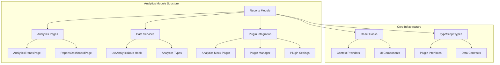
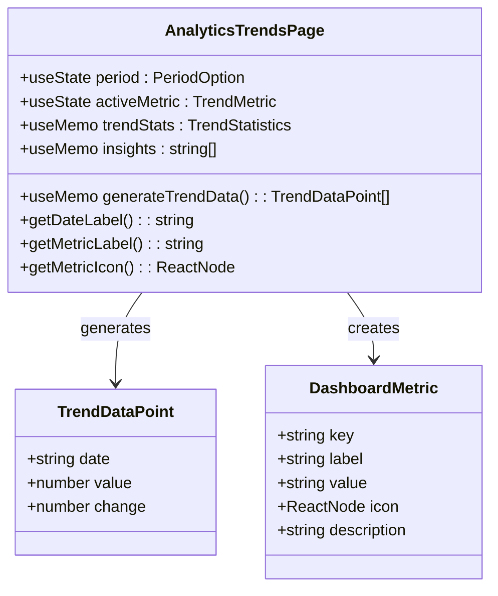
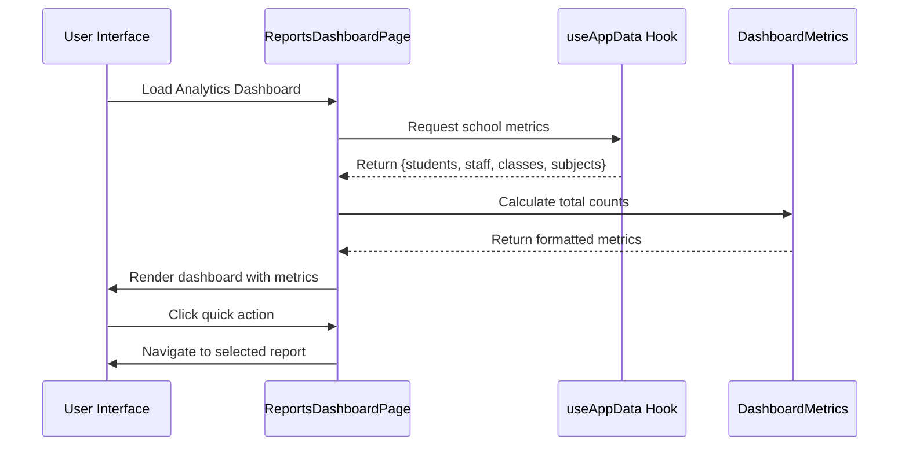
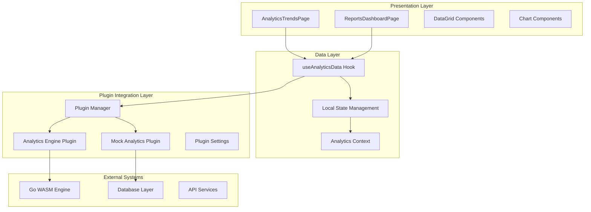
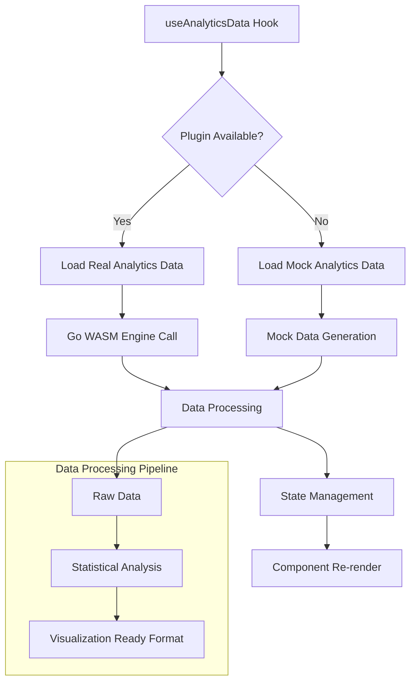
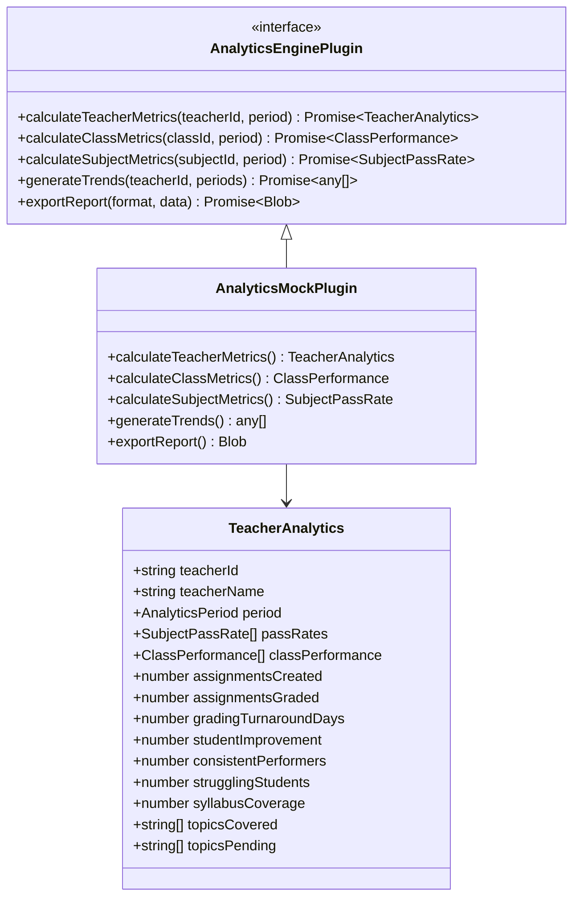
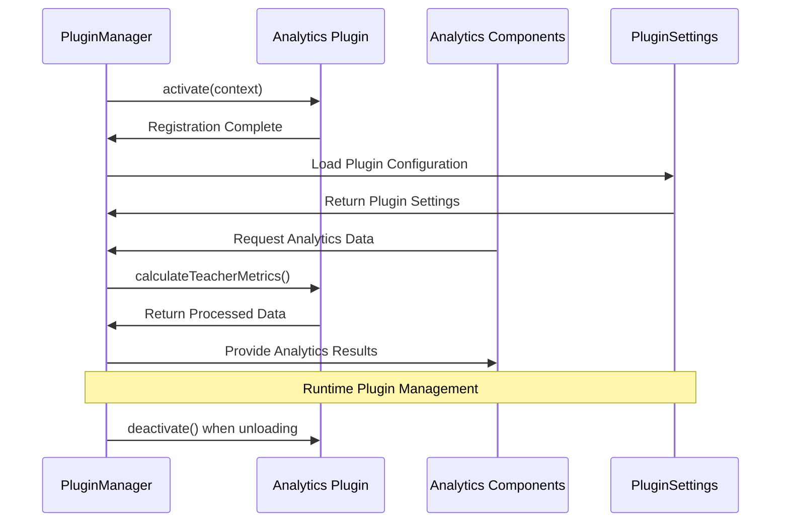
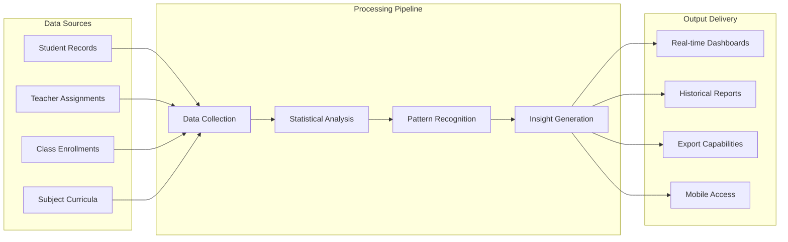

# Analytics Module Overview

<cite>
**Referenced Files in This Document**
- [AnalyticsTrendsPage.tsx](file://src/modules/reports/pages/analytics/AnalyticsTrendsPage.tsx)
- [ReportsDashboardPage.tsx](file://src/modules/reports/pages/ReportsDashboardPage.tsx)
- [useAnalyticsData.ts](file://src/modules/reports/data/useAnalyticsData.ts)
- [types.ts](file://src/modules/reports/data/types.ts)
- [index.ts](file://src/plugins/builtin/analytics-mock/index.ts)
- [types.ts](file://src/plugins/types.ts)
- [useAppData.ts](file://src/hooks/useAppData.ts)
- [PluginManager.ts](file://src/plugins/PluginManager.ts)
- [PluginSettingsManager.ts](file://src/plugins/PluginSettingsManager.ts)
</cite>

## Table of Contents
1. [Introduction](#introduction)
2. [Project Structure](#project-structure)
3. [Core Components](#core-components)
4. [Architecture Overview](#architecture-overview)
5. [Detailed Component Analysis](#detailed-component-analysis)
6. [Plugin System Integration](#plugin-system-integration)
7. [Data Flow Analysis](#data-flow-analysis)
8. [Performance Considerations](#performance-considerations)
9. [Troubleshooting Guide](#troubleshooting-guide)
10. [Conclusion](#conclusion)

## Introduction

The Analytics Module in SchoolPilot3 represents a comprehensive educational analytics framework designed to provide teachers, administrators, and stakeholders with actionable insights into academic performance, attendance patterns, and institutional metrics. This module serves as a centralized hub for data-driven decision making, offering interactive dashboards, trend analysis, and automated reporting capabilities.

The module leverages a sophisticated plugin architecture that supports both mock data generation for development environments and integration with external analytics engines. Built with modern React patterns and TypeScript, it provides a scalable foundation for educational data analysis while maintaining flexibility for future enhancements.

## Project Structure

The Analytics Module follows a modular architecture organized around distinct functional areas:

**Diagram sources**
- [AnalyticsTrendsPage.tsx:1-473](file://src/modules/reports/pages/analytics/AnalyticsTrendsPage.tsx#L1-L473)
- [ReportsDashboardPage.tsx:1-69](file://src/modules/reports/pages/ReportsDashboardPage.tsx#L1-L69)

The module is structured into three primary layers:

- **Presentation Layer**: React components handling user interface and data visualization
- **Data Layer**: Hooks and services managing analytics data retrieval and processing  
- **Integration Layer**: Plugin system enabling extensible analytics engine support

**Section sources**
- [AnalyticsTrendsPage.tsx:1-473](file://src/modules/reports/pages/analytics/AnalyticsTrendsPage.tsx#L1-L473)
- [ReportsDashboardPage.tsx:1-69](file://src/modules/reports/pages/ReportsDashboardPage.tsx#L1-L69)

## Core Components

### AnalyticsTrendsPage Component

The AnalyticsTrendsPage serves as the primary interface for trend analysis, providing comprehensive insights into academic performance metrics over configurable time periods.

**Diagram sources**
- [AnalyticsTrendsPage.tsx:23-158](file://src/modules/reports/pages/analytics/AnalyticsTrendsPage.tsx#L23-L158)

Key features include:
- **Multi-timeframe Analysis**: Support for weekly, monthly, term, and yearly periods
- **Interactive Metrics**: Pass rate, attendance, and performance trend visualization
- **Automated Insights**: AI-generated observations based on statistical analysis
- **Real-time Updates**: Dynamic chart rendering with SVG-based visualization

### ReportsDashboardPage Component

The ReportsDashboardPage provides a centralized entry point for analytics functionality, aggregating key metrics and quick access to specialized reports.

**Diagram sources**
- [ReportsDashboardPage.tsx:10-69](file://src/modules/reports/pages/ReportsDashboardPage.tsx#L10-L69)

**Section sources**
- [AnalyticsTrendsPage.tsx:29-473](file://src/modules/reports/pages/analytics/AnalyticsTrendsPage.tsx#L29-L473)
- [ReportsDashboardPage.tsx:10-69](file://src/modules/reports/pages/ReportsDashboardPage.tsx#L10-L69)

## Architecture Overview

The Analytics Module employs a layered architecture that separates concerns while maintaining flexibility for different analytics engines:

**Diagram sources**
- [index.ts:111-394](file://src/plugins/builtin/analytics-mock/index.ts#L111-L394)
- [PluginManager.ts](file://src/plugins/PluginManager.ts)
- [useAnalyticsData.ts](file://src/modules/reports/data/useAnalyticsData.ts)

The architecture supports dual operational modes:
- **Development Mode**: Mock analytics engine for rapid prototyping and testing
- **Production Mode**: Integration with Go WASM analytics engine for real data processing

**Section sources**
- [index.ts:111-474](file://src/plugins/builtin/analytics-mock/index.ts#L111-L474)
- [types.ts:508-561](file://src/plugins/types.ts#L508-L561)

## Detailed Component Analysis

### Analytics Data Service

The analytics data service provides a unified interface for accessing educational metrics through React hooks and context providers.

**Diagram sources**
- [useAnalyticsData.ts](file://src/modules/reports/data/useAnalyticsData.ts)
- [index.ts:117-193](file://src/plugins/builtin/analytics-mock/index.ts#L117-L193)

The service handles:
- **Data Aggregation**: Combining metrics from multiple sources
- **Statistical Computation**: Trend analysis and comparative calculations
- **State Synchronization**: Real-time updates across components
- **Error Handling**: Graceful degradation to mock data when engines fail

### Mock Analytics Engine

The mock analytics engine provides realistic synthetic data generation for development and testing scenarios:

**Diagram sources**
- [types.ts:508-561](file://src/plugins/types.ts#L508-L561)
- [index.ts:111-193](file://src/plugins/builtin/analytics-mock/index.ts#L111-L193)

**Section sources**
- [index.ts:111-474](file://src/plugins/builtin/analytics-mock/index.ts#L111-L474)
- [types.ts:508-561](file://src/plugins/types.ts#L508-L561)

## Plugin System Integration

The Analytics Module integrates seamlessly with SchoolPilot3's plugin architecture, enabling flexible analytics engine selection and configuration.

### Plugin Lifecycle Management

**Diagram sources**
- [PluginManager.ts](file://src/plugins/PluginManager.ts)
- [index.ts:454-464](file://src/plugins/builtin/analytics-mock/index.ts#L454-L464)

### Plugin Configuration and Privileges

The mock analytics plugin demonstrates comprehensive privilege management and configuration capabilities:

| Configuration Parameter | Type | Default Value | Description |
|------------------------|------|---------------|-------------|
| `passRateMin` | Number | 60 | Minimum pass rate percentage for mock data |
| `passRateMax` | Number | 95 | Maximum pass rate percentage for mock data |

| Required Privileges | Data Access | Purpose |
|--------------------|-------------|---------|
| `students` | Read | Student enrollment and performance data |
| `teachers` | Read | Teacher assignment and metrics |
| `classes` | Read | Class composition and performance |
| `subjects` | Read | Subject curriculum and assessment data |
| `exams` | Read | Examination results and grading data |
| `assignments` | Read | Homework and assessment tracking |

**Section sources**
- [index.ts:400-448](file://src/plugins/builtin/analytics-mock/index.ts#L400-L448)
- [types.ts:508-561](file://src/plugins/types.ts#L508-L561)

## Data Flow Analysis

The analytics data flow encompasses multiple stages from raw data collection to user visualization:

**Diagram sources**
- [AnalyticsTrendsPage.tsx:43-84](file://src/modules/reports/pages/analytics/AnalyticsTrendsPage.tsx#L43-L84)
- [index.ts:269-307](file://src/plugins/builtin/analytics-mock/index.ts#L269-L307)

The data flow supports:
- **Real-time Processing**: Live updates for trending metrics
- **Historical Analysis**: Long-term pattern identification
- **Cross-reference Analysis**: Multi-dimensional data correlation
- **Export Functionality**: Multiple format support (CSV, Excel, PDF)

**Section sources**
- [AnalyticsTrendsPage.tsx:43-190](file://src/modules/reports/pages/analytics/AnalyticsTrendsPage.tsx#L43-L190)
- [index.ts:313-393](file://src/plugins/builtin/analytics-mock/index.ts#L313-L393)

## Performance Considerations

The Analytics Module implements several performance optimization strategies:

### Memory Management
- **Lazy Loading**: Analytics components load only when needed
- **Data Caching**: Recent analytics results cached for quick re-access
- **Virtual Scrolling**: Large datasets rendered efficiently using virtualization

### Computational Efficiency
- **Memoized Calculations**: Complex statistical computations cached using React.memo
- **Debounced Updates**: Frequent metric updates debounced to prevent excessive re-renders
- **Background Processing**: Heavy computations performed asynchronously

### Network Optimization
- **Batch Requests**: Multiple analytics queries combined into single requests
- **Progressive Loading**: Data loaded incrementally as components mount
- **Error Recovery**: Graceful fallback to cached data when network issues occur

## Troubleshooting Guide

### Common Issues and Solutions

**Analytics Data Not Loading**
1. Verify plugin activation in Plugin Manager
2. Check browser console for analytics engine errors
3. Confirm mock data availability during development mode
4. Validate database connectivity for production analytics

**Performance Degradation**
1. Monitor component re-render frequency using React DevTools
2. Check for memory leaks in long-running analytics sessions
3. Verify proper cleanup of event listeners and timers
4. Review network request patterns for optimization opportunities

**Data Accuracy Concerns**
1. Validate mock data ranges against expected distributions
2. Cross-reference analytics results with source data
3. Check for timezone and localization issues in date calculations
4. Verify statistical significance for trend analysis

**Plugin Integration Problems**
1. Confirm plugin manifest registration in Plugin Manager
2. Verify required privileges and permissions
3. Check plugin settings configuration
4. Review plugin lifecycle events (activate/deactivate)

**Section sources**
- [index.ts:454-464](file://src/plugins/builtin/analytics-mock/index.ts#L454-L464)
- [PluginManager.ts](file://src/plugins/PluginManager.ts)

## Conclusion

The Analytics Module in SchoolPilot3 represents a sophisticated educational analytics framework that successfully balances functionality, scalability, and maintainability. Through its modular architecture, comprehensive plugin system, and robust data processing capabilities, it provides educational institutions with powerful tools for data-driven decision making.

Key strengths of the implementation include:

- **Flexible Architecture**: Plugin-based design enables easy switching between analytics engines
- **Comprehensive Coverage**: Multi-dimensional analytics supporting various educational metrics
- **Developer-Friendly**: Extensive mocking capabilities facilitate rapid development and testing
- **Performance Optimized**: Efficient data processing and caching mechanisms ensure responsive user experience
- **Extensible Design**: Well-defined interfaces support future enhancements and integrations

The module's integration with SchoolPilot3's broader ecosystem positions it as a cornerstone component for educational data analysis, providing both immediate value through its current capabilities and a solid foundation for future analytical features.