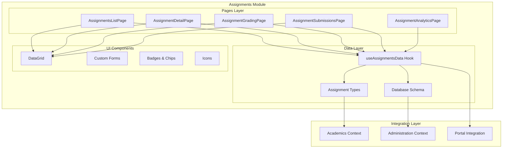
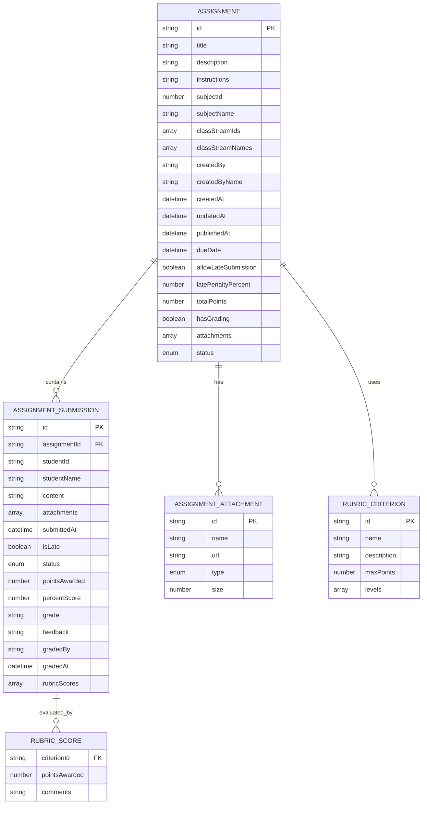
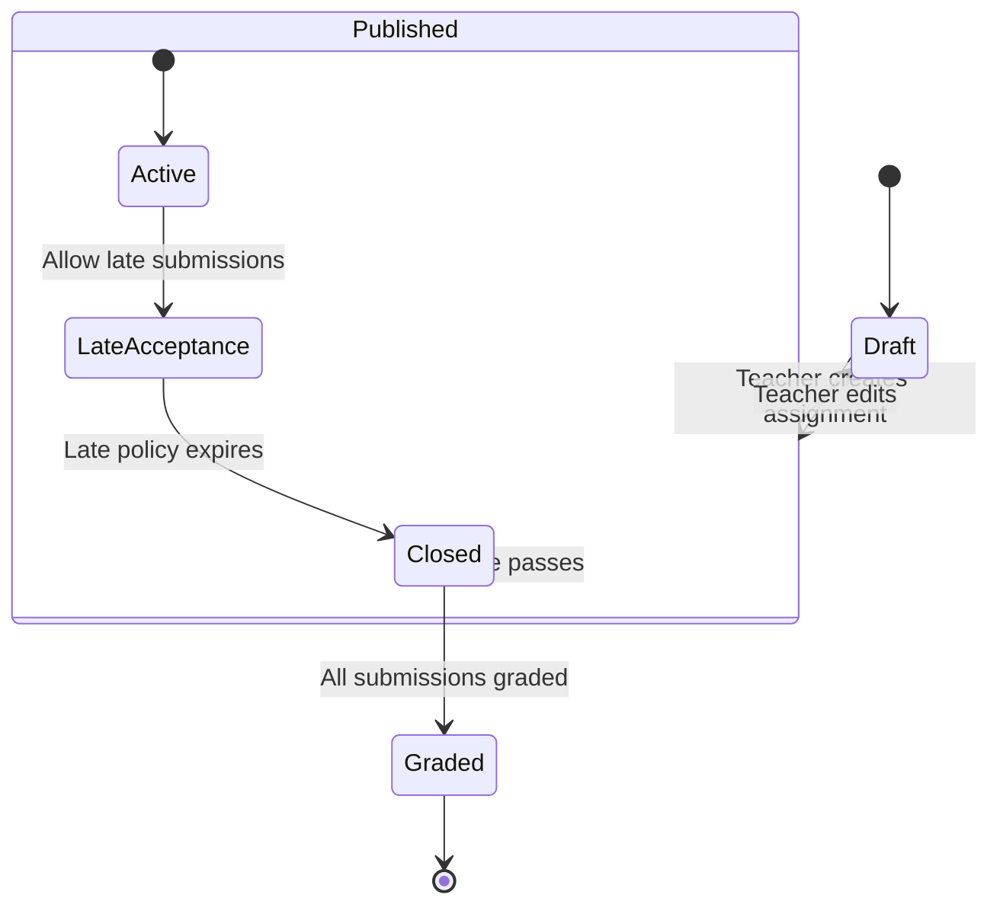
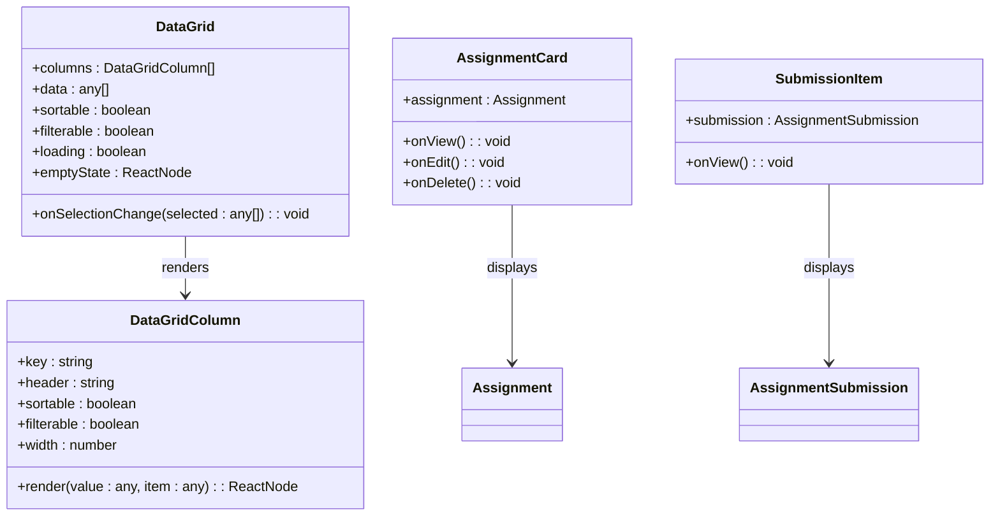
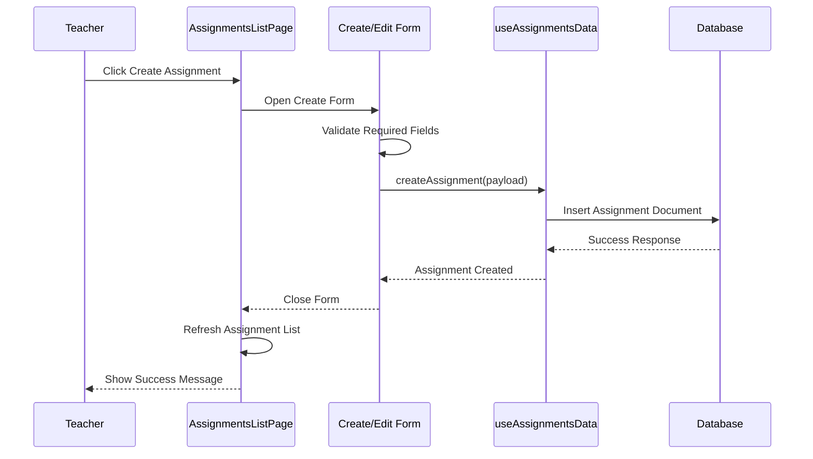
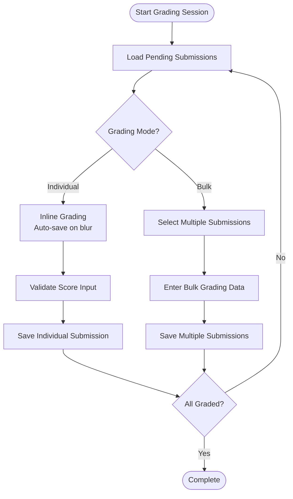
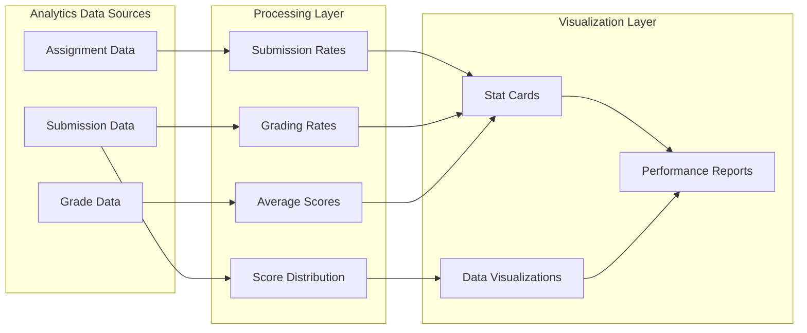
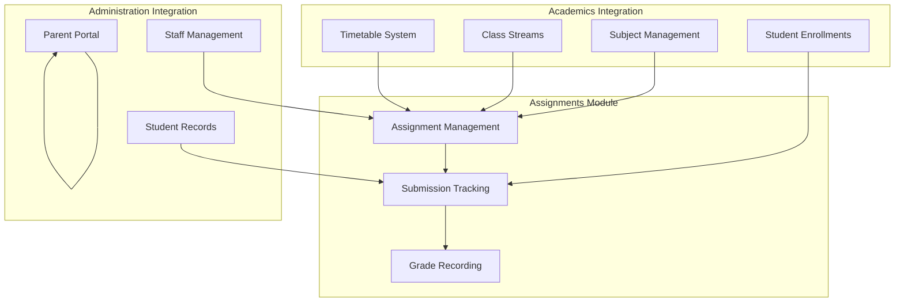

# Assignments Module Overview

<cite>
**Referenced Files in This Document**
- [AssignmentsListPage.tsx](file://src/modules/academics/pages/assignments/AssignmentsListPage.tsx)
- [AssignmentDetailPage.tsx](file://src/modules/academics/pages/assignments/AssignmentDetailPage.tsx)
- [AssignmentGradingPage.tsx](file://src/modules/academics/pages/assignments/AssignmentGradingPage.tsx)
- [AssignmentSubmissionsPage.tsx](file://src/modules/academics/pages/assignments/AssignmentSubmissionsPage.tsx)
- [AssignmentAnalyticsPage.tsx](file://src/modules/academics/pages/assignments/AssignmentAnalyticsPage.tsx)
- [types.ts](file://src/modules/academics/data/types.ts)
- [schema.ts](file://src/modules/academics/data/schema.ts)
- [MISSING_FEATURES_IMPLEMENTATION_PLAN.md](file://docs/planning/MISSING_FEATURES_IMPLEMENTATION_PLAN.md)
</cite>

## Table of Contents
1. [Introduction](#introduction)
2. [Module Architecture](#module-architecture)
3. [Core Components](#core-components)
4. [Data Model](#data-model)
5. [User Interface Components](#user-interface-components)
6. [Workflow Analysis](#workflow-analysis)
7. [Analytics and Reporting](#analytics-and-reporting)
8. [Integration Points](#integration-points)
9. [Performance Considerations](#performance-considerations)
10. [Conclusion](#conclusion)

## Introduction

The Assignments Module is a comprehensive educational assessment management system designed to streamline the creation, distribution, submission, and grading of student assignments within the SchoolPilot3 learning management platform. This module integrates seamlessly with the existing academics and administration systems to provide educators with powerful tools for managing classroom assessments while giving students and parents transparent access to assignment information and results.

The module follows modern React development patterns with TypeScript for type safety, implementing a component-based architecture that emphasizes reusability and maintainability. It leverages the platform's established design system and provides intuitive interfaces for both teachers and students to manage the complete assignment lifecycle.

## Module Architecture

The Assignments Module is structured around a clear separation of concerns, with distinct layers for presentation, data management, and business logic. The architecture follows the React functional component pattern with hooks for state management and effect handling.

**Diagram sources**
- [AssignmentsListPage.tsx:1-701](file://src/modules/academics/pages/assignments/AssignmentsListPage.tsx#L1-L701)
- [AssignmentDetailPage.tsx:1-376](file://src/modules/academics/pages/assignments/AssignmentDetailPage.tsx#L1-L376)
- [AssignmentGradingPage.tsx:1-552](file://src/modules/academics/pages/assignments/AssignmentGradingPage.tsx#L1-L552)

## Core Components

### Assignment Management Pages

The module consists of five primary pages, each serving a specific role in the assignment lifecycle:

#### AssignmentsListPage
The main dashboard page that displays all assignments with filtering, sorting, and CRUD operations capabilities. This page serves as the central hub for assignment management.

**Key Features:**
- Comprehensive assignment listing with status indicators
- Advanced filtering by subject, class, and status
- Real-time search functionality
- Bulk operations and inline editing
- Responsive design with mobile optimization

#### AssignmentDetailPage
Provides detailed information about individual assignments, including submission statistics and performance metrics.

**Key Features:**
- Assignment metadata display
- Submission statistics cards
- Average score visualization
- Progress tracking indicators
- Action buttons for editing and deletion

#### AssignmentGradingPage
Specialized interface for teachers to grade student submissions with both individual and bulk grading capabilities.

**Key Features:**
- Inline grading with auto-save functionality
- Bulk grading operations
- Progress tracking with visual indicators
- Submission filtering by status
- Immediate feedback provision

#### AssignmentSubmissionsPage
Displays all submissions for a specific assignment with detailed student information and grading status.

**Key Features:**
- Submission status tracking
- Student-specific information display
- Detailed submission views
- Filtering by submission status
- Action buttons for individual submission review

#### AssignmentAnalyticsPage
Comprehensive analytics dashboard showing assignment performance across the entire institution.

**Key Features:**
- Overall assignment statistics
- Submission rate analysis
- Score distribution visualization
- Performance trend analysis
- Comparative reporting capabilities

**Section sources**
- [AssignmentsListPage.tsx:33-701](file://src/modules/academics/pages/assignments/AssignmentsListPage.tsx#L33-L701)
- [AssignmentDetailPage.tsx:31-376](file://src/modules/academics/pages/assignments/AssignmentDetailPage.tsx#L31-L376)
- [AssignmentGradingPage.tsx:34-552](file://src/modules/academics/pages/assignments/AssignmentGradingPage.tsx#L34-L552)
- [AssignmentSubmissionsPage.tsx:27-354](file://src/modules/academics/pages/assignments/AssignmentSubmissionsPage.tsx#L27-L354)
- [AssignmentAnalyticsPage.tsx:30-438](file://src/modules/academics/pages/assignments/AssignmentAnalyticsPage.tsx#L30-L438)

## Data Model

The Assignments Module implements a robust data model that supports complex academic workflows while maintaining data integrity and performance optimization.

**Diagram sources**
- [types.ts:408-491](file://src/modules/academics/data/types.ts#L408-L491)

### Assignment Status Management

The module implements a comprehensive status tracking system that manages assignments through their complete lifecycle:

**Diagram sources**
- [types.ts:393-398](file://src/modules/academics/data/types.ts#L393-L398)

### Submission Status Tracking

Student submissions are tracked through a detailed status system that provides clear visibility into assignment completion and grading progress.

**Section sources**
- [types.ts:392-491](file://src/modules/academics/data/types.ts#L392-L491)

## User Interface Components

### DataGrid Implementation

The module extensively uses a custom DataGrid component that provides advanced filtering, sorting, and pagination capabilities optimized for educational data management.

**Diagram sources**
- [AssignmentsListPage.tsx:254-366](file://src/modules/academics/pages/assignments/AssignmentsListPage.tsx#L254-L366)
- [AssignmentDetailPage.tsx:112-162](file://src/modules/academics/pages/assignments/AssignmentDetailPage.tsx#L112-L162)

### Form Management System

The module implements a sophisticated form management system that handles complex assignment creation and editing workflows with real-time validation and error handling.

**Section sources**
- [AssignmentsListPage.tsx:48-671](file://src/modules/academics/pages/assignments/AssignmentsListPage.tsx#L48-L671)

## Workflow Analysis

### Assignment Creation Workflow

The assignment creation process follows a structured workflow that ensures proper validation and data consistency:

**Diagram sources**
- [AssignmentsListPage.tsx:159-221](file://src/modules/academics/pages/assignments/AssignmentsListPage.tsx#L159-L221)

### Grading Workflow

The grading system implements a dual-mode approach supporting both individual and bulk grading operations:

**Diagram sources**
- [AssignmentGradingPage.tsx:103-216](file://src/modules/academics/pages/assignments/AssignmentGradingPage.tsx#L103-L216)

### Analytics Workflow

The analytics system processes large datasets to provide meaningful insights into assignment performance and submission patterns.

**Section sources**
- [AssignmentAnalyticsPage.tsx:34-145](file://src/modules/academics/pages/assignments/AssignmentAnalyticsPage.tsx#L34-L145)

## Analytics and Reporting

### Performance Metrics Dashboard

The module provides comprehensive analytics capabilities that help educators understand assignment performance trends and identify areas for improvement.

**Diagram sources**
- [AssignmentAnalyticsPage.tsx:34-111](file://src/modules/academics/pages/assignments/AssignmentAnalyticsPage.tsx#L34-L111)

### Statistical Analysis Features

The analytics system implements sophisticated statistical analysis including:
- Submission rate calculations across different time periods
- Performance trend analysis for individual assignments
- Comparative analysis between different class groups
- Score distribution visualization with percentile calculations
- Progress tracking for individual student performance

**Section sources**
- [AssignmentAnalyticsPage.tsx:16-145](file://src/modules/academics/pages/assignments/AssignmentAnalyticsPage.tsx#L16-L145)

## Integration Points

### Academic System Integration

The Assignments Module integrates deeply with the broader academic system, leveraging existing subject and class structures:

**Diagram sources**
- [MISSING_FEATURES_IMPLEMENTATION_PLAN.md:333-387](file://docs/planning/MISSING_FEATURES_IMPLEMENTATION_PLAN.md#L333-L387)

### Database Schema Integration

The module's database schema is designed to work seamlessly with the platform's existing data infrastructure, supporting both local and distributed data storage scenarios.

**Section sources**
- [schema.ts:18-305](file://src/modules/academics/data/schema.ts#L18-L305)

## Performance Considerations

### Data Loading Strategies

The module implements several performance optimization strategies:
- Lazy loading for large datasets
- Virtual scrolling for improved rendering performance
- Memoization for expensive computations
- Debounced search functionality
- Efficient filtering and sorting algorithms

### Caching Mechanisms

The system employs intelligent caching strategies to minimize database queries and improve response times:
- Local state caching for frequently accessed data
- Optimistic updates for immediate UI feedback
- Batch operations for reduced network overhead
- Smart invalidation strategies to maintain data consistency

### Scalability Features

The architecture supports horizontal scaling through:
- Stateless component design
- Centralized data management
- Event-driven updates
- Modular service boundaries

## Conclusion

The Assignments Module represents a comprehensive solution for educational assessment management within the SchoolPilot3 platform. Its robust architecture, extensive feature set, and deep integration with existing systems make it a valuable addition to the educational technology ecosystem.

The module successfully balances functionality with usability, providing educators with powerful tools for assignment management while maintaining simplicity for students and parents. The implementation demonstrates best practices in modern React development, including proper state management, type safety, and performance optimization.

Future enhancements could include expanded integration with external learning platforms, advanced analytics capabilities, and mobile-optimized interfaces to further enhance the user experience across all device types and usage scenarios.