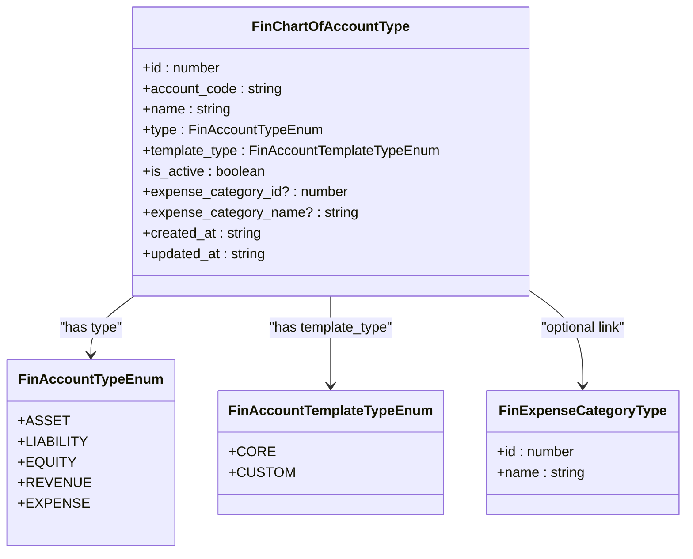
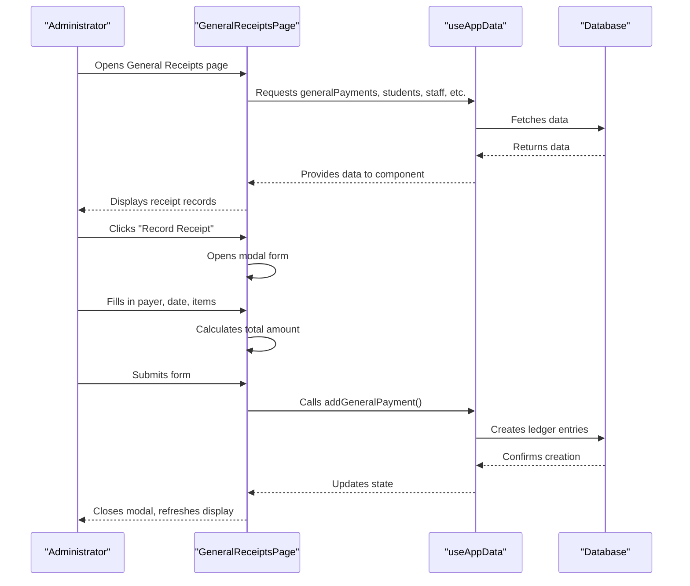
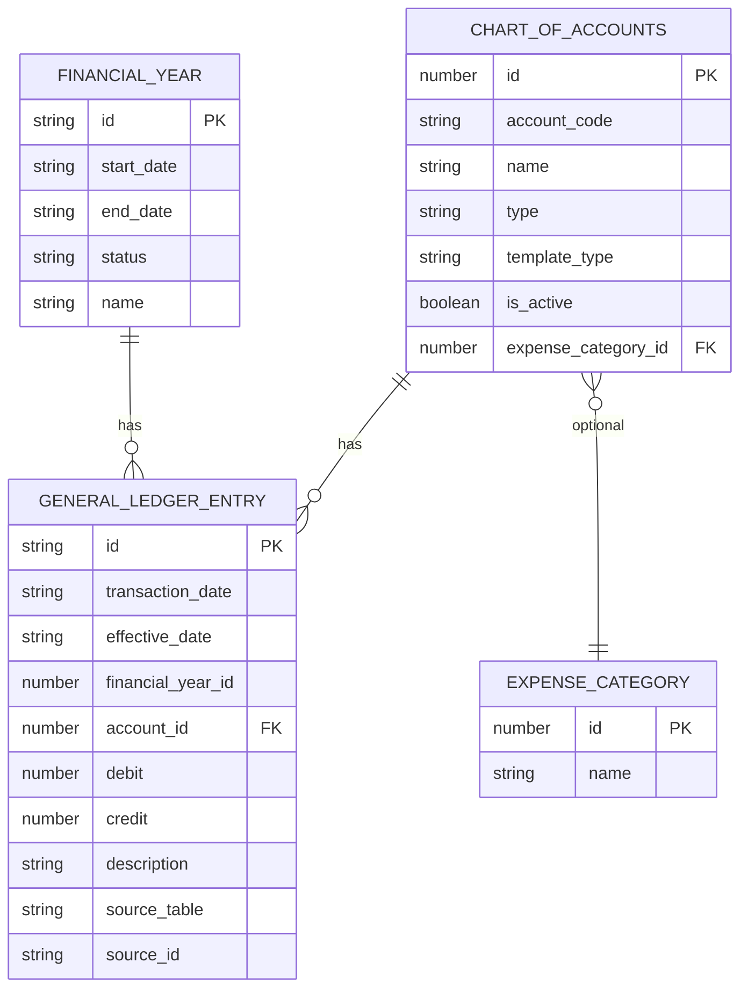
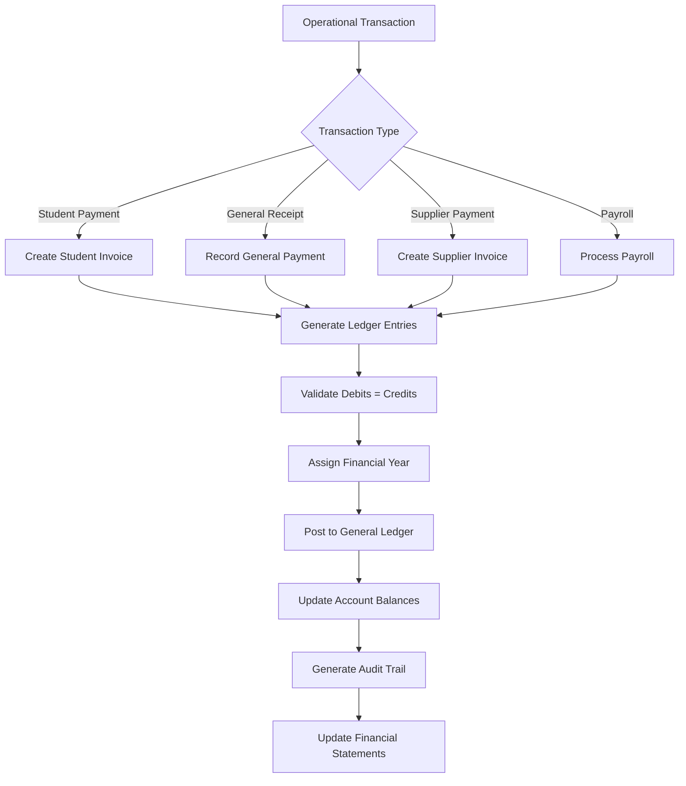
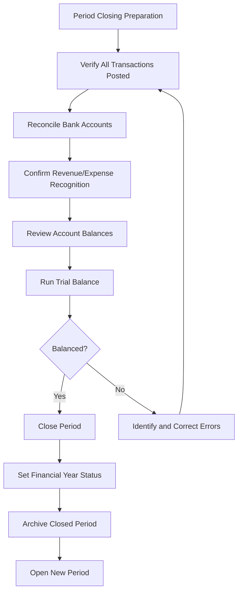

# Accounting & Ledger

<cite>
**Referenced Files in This Document**   
- [ChartOfAccountsPage.tsx](file://src/modules/finance/pages/ChartOfAccountsPage.tsx)
- [GeneralReceiptsPage.tsx](file://src/modules/finance/pages/GeneralReceiptsPage.tsx)
- [types.ts](file://src/modules/finance/data/types.ts)
- [mockData.ts](file://src/modules/finance/data/mockData.ts)
- [schema.ts](file://src/modules/finance/data/schema.ts)
</cite>

## Table of Contents
1. [Introduction](#introduction)
2. [Chart of Accounts Implementation](#chart-of-accounts-implementation)
3. [General Ledger and Double-Entry Accounting](#general-ledger-and-double-entry-accounting)
4. [Data Model Relationships](#data-model-relationships)
5. [Transaction Posting Process](#transaction-posting-process)
6. [Journal Entry Creation and Financial Statements](#journal-entry-creation-and-financial-statements)
7. [Account Reconciliation and Period Closing](#account-reconciliation-and-period-closing)
8. [Audit Compliance and Best Practices](#audit-compliance-and-best-practices)

## Introduction
The Accounting & Ledger system in schoolpilot3 provides a comprehensive financial management solution for educational institutions. This document details the implementation of core accounting features including the chart of accounts, general ledger entries, and double-entry accounting principles. The system enables administrators to configure account structures through the ChartOfAccountsPage interface and record financial transactions via the GeneralReceiptsPage. Built on robust data models and following accounting best practices, the system supports accurate financial reporting, audit compliance, and integration with other modules such as HR, nutrition, and library services.

## Chart of Accounts Implementation

The Chart of Accounts system allows administrators to define and manage the school's financial account structure. The implementation is centered around the `ChartOfAccountsPage.tsx` component, which provides a user interface for creating, editing, and deleting accounts.



**Diagram sources**
- [types.ts](file://src/modules/finance/data/types.ts#L5-L279)

**Section sources**
- [ChartOfAccountsPage.tsx](file://src/modules/finance/pages/ChartOfAccountsPage.tsx#L1-L295)

The `ChartOfAccountsPage` component renders a data grid displaying all configured accounts with columns for account code, name, type, template type, expense category (for expense accounts), and active status. Administrators can add new accounts or edit existing ones through a modal interface that validates required fields including account code, name, type, and template type.

Account types follow standard accounting categories:
- **Asset**: Resources owned by the school (e.g., bank accounts, equipment)
- **Liability**: Obligations of the school (e.g., loans, accounts payable)
- **Equity**: Owner's interest in the school (e.g., retained earnings)
- **Revenue**: Income generated by the school (e.g., tuition fees, donations)
- **Expense**: Costs incurred by the school (e.g., salaries, supplies)

The system distinguishes between CORE accounts (predefined system accounts) and CUSTOM accounts (user-defined accounts), allowing for both standardization and flexibility in account configuration.

## General Ledger and Double-Entry Accounting

The General Ledger system implements double-entry accounting principles, ensuring that every transaction affects at least two accounts with equal debits and credits. The `GeneralReceiptsPage.tsx` component enables recording of miscellaneous payments received by the school.



**Diagram sources**
- [GeneralReceiptsPage.tsx](file://src/modules/finance/pages/GeneralReceiptsPage.tsx#L1-L376)

**Section sources**
- [GeneralReceiptsPage.tsx](file://src/modules/finance/pages/GeneralReceiptsPage.tsx#L1-L376)

When recording a general receipt, administrators specify:
- **Payer type**: Student, staff, customer, partner, or other
- **Payer details**: Specific individual or external name
- **Payment details**: Date, method, reference number, and notes
- **Receipt items**: One or more line items with description, amount, and revenue account

Each receipt item is linked to a revenue account from the chart of accounts, ensuring proper categorization of income. The system validates that all items have valid amounts and assigned revenue accounts before submission.

## Data Model Relationships

The accounting system's data model establishes clear relationships between the chart of accounts and ledger entries, forming the foundation of the double-entry system.



**Diagram sources**
- [types.ts](file://src/modules/finance/data/types.ts#L5-L279)
- [schema.ts](file://src/modules/finance/data/schema.ts#L32-L58)

**Section sources**
- [types.ts](file://src/modules/finance/data/types.ts#L5-L279)
- [schema.ts](file://src/modules/finance/data/schema.ts#L1-L100)

The core relationship is between `FinChartOfAccountType` and `FinGeneralLedgerEntryType`, where each ledger entry references an account through the `account_id` field. This one-to-many relationship enables the system to track all transactions affecting each account.

The `FinGeneralLedgerEntryType` interface defines the structure of ledger entries with required fields:
- **id**: Unique identifier for the entry
- **transaction_date**: When the transaction occurred
- **effective_date**: When the transaction impacts financial statements
- **financial_year_id**: Links to the appropriate financial year
- **account_id**: References the chart of account
- **debit/credit**: Monetary amounts (only one can be present per entry)
- **description**: Narrative explanation of the transaction

This design supports the double-entry principle by requiring separate entries for debit and credit components of each transaction, as demonstrated in the mock data where a single transaction like "Student fees collection" generates two ledger entries: one debit to the bank account and one credit to the revenue account.

## Transaction Posting Process

The posting process from operational transactions to the general ledger follows a systematic workflow that ensures data integrity and proper accounting treatment.



**Diagram sources**
- [mockData.ts](file://src/modules/finance/data/mockData.ts#L170-L235)

**Section sources**
- [mockData.ts](file://src/modules/finance/data/mockData.ts#L55-L235)

When a transaction occurs in any module (finance, HR, nutrition, library), the system generates corresponding general ledger entries. For example:
- **Student fee collection**: Debits the bank account and credits the tuition fees revenue account
- **Salary payment**: Debits the salary expense account and credits the bank account
- **Library fine**: Debits accounts receivable and credits library fines revenue
- **Supplier payment**: Debits the relevant expense account and credits the bank account

The posting process ensures that:
1. Every transaction is linked to a valid account from the chart of accounts
2. Debits equal credits for each complete transaction
3. Entries are assigned to the correct financial year based on transaction date
4. Descriptive information is preserved for audit purposes
5. Source references are maintained to trace entries back to originating transactions

## Journal Entry Creation and Financial Statements

The system supports journal entry creation through various interfaces, with the GeneralReceiptsPage serving as a primary mechanism for recording revenue transactions. While dedicated journal entry functionality may exist elsewhere, the general receipts process demonstrates the same underlying principles.

Example journal entry for student fee collection:
```
Date: 2024-07-05
Description: Student fees collection - Term 3

Debit: 250,000 KES
Account: 101 - Bank Account (Asset)

Credit: 250,000 KES
Account: 401 - Tuition Fees Revenue (Revenue)
```

This entry would be represented in the system as two separate ledger records:
```json
[
  {
    "id": "GLE003",
    "transaction_date": "2024-07-05",
    "effective_date": "2024-07-05",
    "financial_year_id": 1,
    "account_id": 101,
    "debit": 250000,
    "description": "Student fees collection - Term 3"
  },
  {
    "id": "GLE004",
    "transaction_date": "2024-07-05",
    "effective_date": "2024-07-05",
    "financial_year_id": 1,
    "account_id": 401,
    "credit": 250000,
    "description": "Student fees collection - Term 3"
  }
]
```

Financial statements are generated by aggregating ledger data:
- **Balance Sheet**: Summarizes assets, liabilities, and equity accounts
- **Income Statement**: Summarizes revenue and expense accounts
- **Cash Flow Statement**: Analyzes cash movements across operating, investing, and financing activities

The system can generate these statements for specific periods by filtering ledger entries based on transaction dates and financial year boundaries.

## Account Reconciliation and Period Closing

The system supports account reconciliation and period closing procedures through its structured data model and financial year management.



**Section sources**
- [types.ts](file://src/modules/finance/data/types.ts#L5-L279)
- [schema.ts](file://src/modules/finance/data/schema.ts#L32-L58)

The `FinFinancialYearStatusEnum` defines three states for financial years: OPEN, CLOSED, and ARCHIVED. This status system controls user access and prevents modifications to closed periods, ensuring data integrity for audit purposes.

Account reconciliation discrepancies may arise from:
- Unrecorded transactions
- Duplicate entries
- Incorrect account assignments
- Timing differences between transaction date and effective date

The system provides tools to identify these issues through comprehensive reporting and data validation. For example, the mock data shows integration between modules, where transactions from nutrition, library, and HR systems are properly reflected in the general ledger, reducing the risk of reconciliation issues.

Period closing procedures involve:
1. Ensuring all transactions for the period are recorded
2. Reconciling all balance sheet accounts (especially bank accounts)
3. Accruing any unrecognized revenue or expenses
4. Running a trial balance to verify debits equal credits
5. Officially closing the period by updating the financial year status
6. Generating final financial statements for the period

## Audit Compliance and Best Practices

The accounting system incorporates several features to support audit compliance and maintain accounting accuracy.

**Audit Trail Features:**
- Immutable ledger entries with creation and update timestamps
- Source tracking through `source_table` and `source_id` fields
- Comprehensive user activity logging
- Version history for critical financial data
- Status controls preventing modification of closed periods

**Best Practices for Maintaining Accounting Accuracy:**
1. **Regular Reconciliation**: Perform monthly bank reconciliations and account reviews
2. **Segregation of Duties**: Ensure different users handle transaction entry, approval, and reconciliation
3. **Data Validation**: Implement robust validation rules for all financial inputs
4. **Periodic Audits**: Conduct internal reviews before closing financial periods
5. **Backup Procedures**: Maintain regular backups of financial data
6. **User Training**: Ensure staff understand proper accounting procedures

**Support for External Audits:**
- Complete transaction history with supporting documentation links
- Export capabilities for financial data in standard formats
- User access logs showing who created or modified records
- Clear separation between operational data and financial records
- Consistent application of accounting policies across all transactions

The system's design follows generally accepted accounting principles (GAAP) and supports compliance with educational institution financial regulations. By maintaining a clear audit trail, enforcing data integrity, and providing comprehensive reporting capabilities, the system ensures that financial records are reliable and audit-ready.