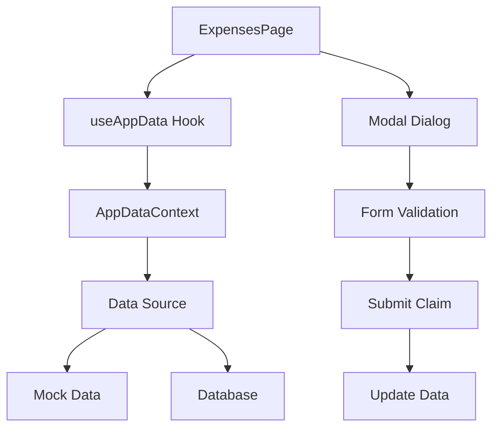
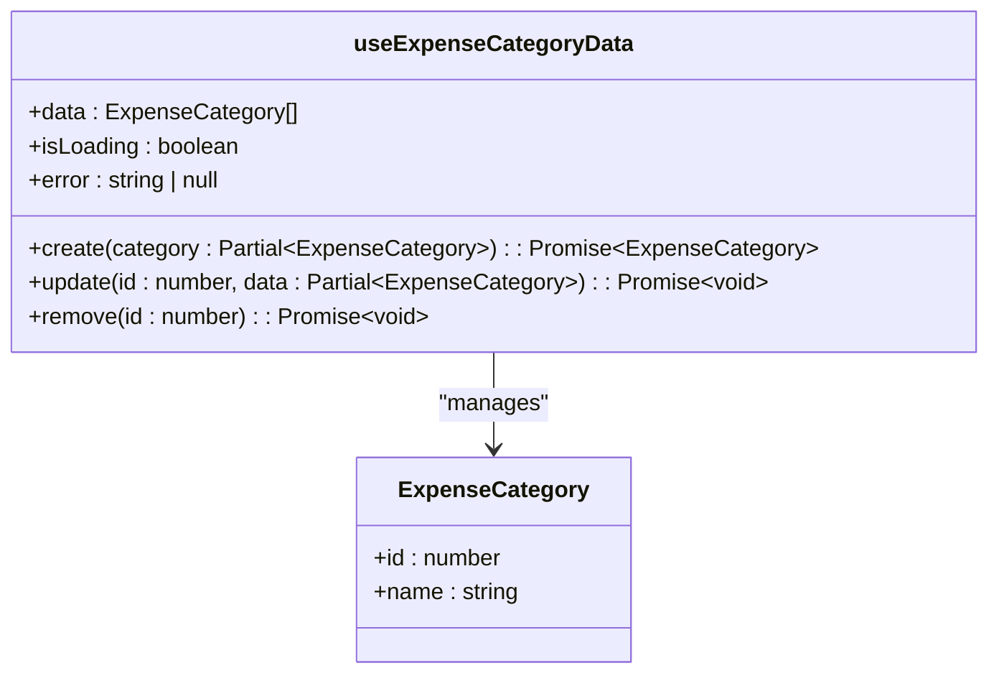
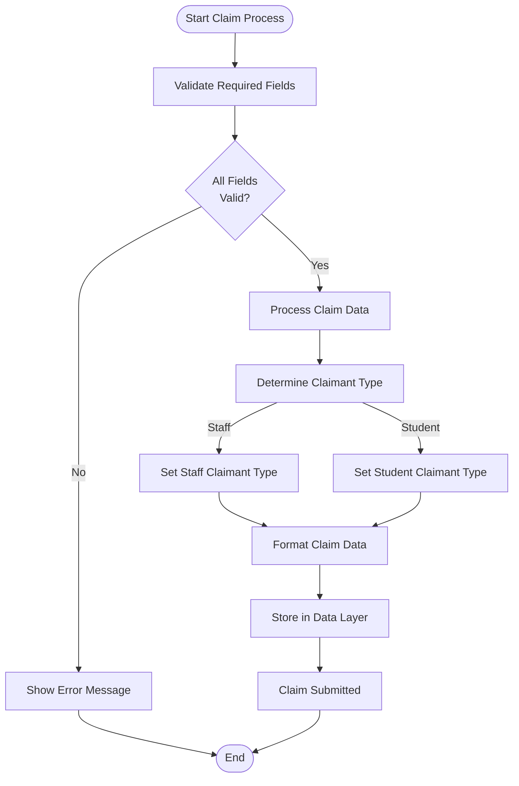
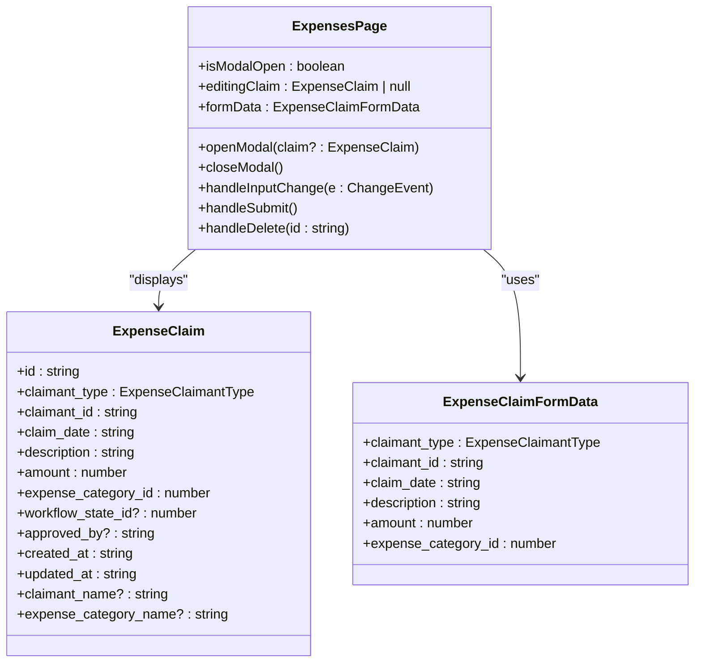
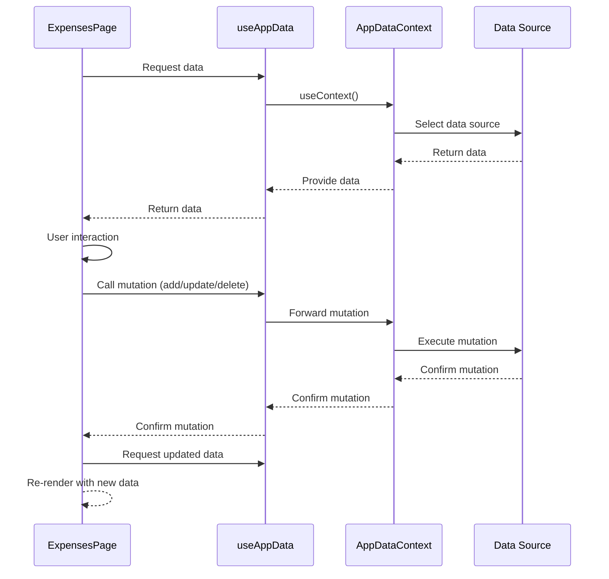
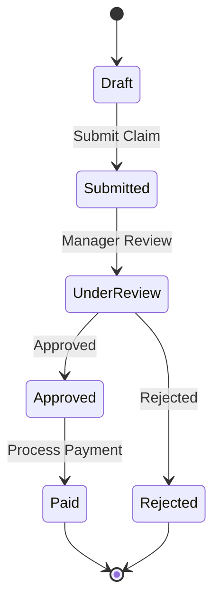
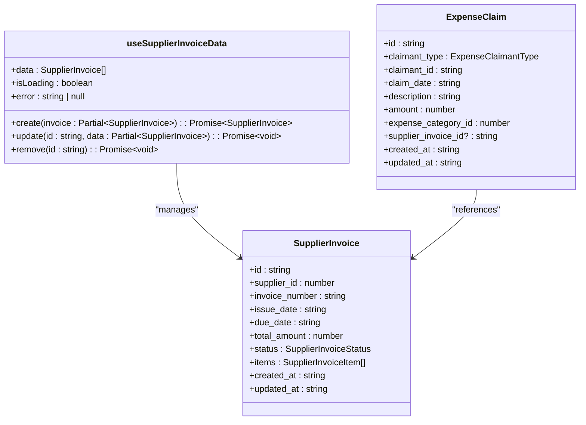
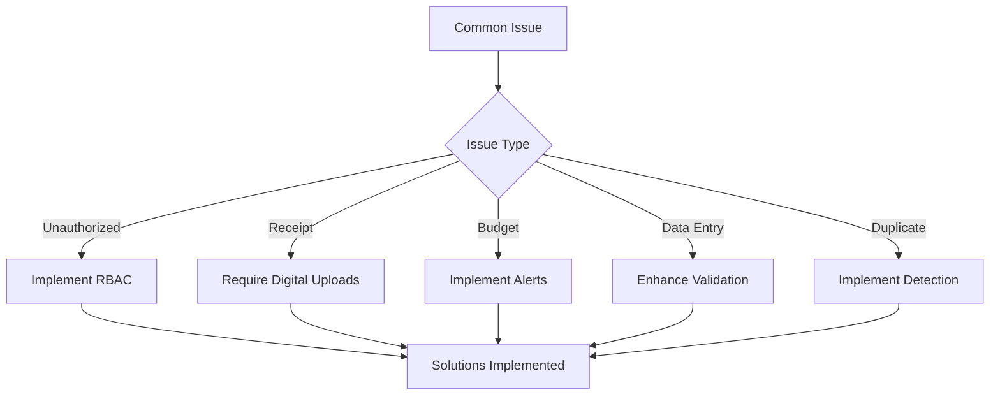

# Expense Management

<cite>
**Referenced Files in This Document**   
- [ExpensesPage.tsx](file://src/modules/finance/pages/ExpensesPage.tsx)
- [useExpenseCategoryData.ts](file://src/modules/finance/data/useExpenseCategoryData.ts)
- [useExpenseClaimData.ts](file://src/modules/finance/data/useExpenseClaimData.ts)
- [useSupplierInvoiceData.ts](file://src/modules/finance/data/useSupplierInvoiceData.ts)
- [types.ts](file://src/modules/finance/data/types.ts)
- [mockData.ts](file://src/modules/finance/data/mockData.ts)
- [useAppData.ts](file://src/hooks/useAppData.ts)
- [AppDataContext.tsx](file://src/contexts/AppDataContext.tsx)
</cite>

## Table of Contents
1. [Introduction](#introduction)
2. [Expense Tracking Implementation](#expense-tracking-implementation)
3. [Category Management](#category-management)
4. [Expense Claims Processing](#expense-claims-processing)
5. [ExpensesPage Interface](#expensespage-interface)
6. [Data Flow Analysis](#data-flow-analysis)
7. [Validation Rules](#validation-rules)
8. [Approval Workflows](#approval-workflows)
9. [Supplier Invoice Integration](#supplier-invoice-integration)
10. [Common Issues and Solutions](#common-issues-and-solutions)
11. [Best Practices](#best-practices)

## Introduction
The Expense Management system in schoolpilot3 provides a comprehensive solution for tracking, approving, and managing expenses within educational institutions. This system enables staff and students to submit expense claims, which are then processed through a structured workflow. The implementation focuses on user-friendly interfaces, robust data management, and integration with financial systems to ensure accurate accounting and compliance with institutional policies.

**Section sources**
- [ExpensesPage.tsx](file://src/modules/finance/pages/ExpensesPage.tsx#L0-L311)

## Expense Tracking Implementation
The expense tracking system is implemented through a combination of React components, custom hooks, and data management patterns. The core functionality revolves around the `ExpensesPage` component, which serves as the primary interface for recording and managing expense claims. The system tracks expenses by claimant type (staff or student), date, amount, category, and description, providing a complete audit trail for financial accountability.

The implementation uses a modular architecture where data operations are separated from UI components. This separation allows for easier maintenance and testing of the system. Expense data is managed through specialized hooks that handle CRUD operations, ensuring consistent data access patterns across the application.



**Diagram sources**
- [ExpensesPage.tsx](file://src/modules/finance/pages/ExpensesPage.tsx#L0-L311)
- [AppDataContext.tsx](file://src/contexts/AppDataContext.tsx#L0-L169)

**Section sources**
- [ExpensesPage.tsx](file://src/modules/finance/pages/ExpensesPage.tsx#L0-L311)
- [AppDataContext.tsx](file://src/contexts/AppDataContext.tsx#L0-L169)

## Category Management
Expense categories are managed through the `useExpenseCategoryData` hook, which provides a standardized interface for accessing and manipulating category information. The system supports predefined categories such as Stationery, Repairs & Maintenance, Utilities, Travel, Staff Welfare, Teaching Materials, Laboratory Supplies, Sports & Recreation, Transport & Fuel, Professional Services, Insurance, Marketing & Advertising, Security Services, Communication, and Food & Catering.

The category management system is implemented as a self-contained hook that can operate independently of the main application context. This design allows for flexibility in data sourcing, enabling the system to work with both mock data during development and real database connections in production.



**Diagram sources**
- [useExpenseCategoryData.ts](file://src/modules/finance/data/useExpenseCategoryData.ts#L0-L57)
- [types.ts](file://src/modules/finance/data/types.ts#L29-L32)

**Section sources**
- [useExpenseCategoryData.ts](file://src/modules/finance/data/useExpenseCategoryData.ts#L0-L57)
- [types.ts](file://src/modules/finance/data/types.ts#L29-L32)
- [mockData.ts](file://src/modules/finance/data/mockData.ts#L10-L26)

## Expense Claims Processing
Expense claims processing is handled through the `useExpenseClaimData` hook, which provides CRUD operations for managing expense claims. Each claim includes essential information such as claimant type, claimant ID, claim date, description, amount, and expense category ID. The system supports claims from both staff and students, with appropriate validation rules applied based on the claimant type.

The processing workflow begins with data entry through the ExpensesPage interface, followed by validation, submission, and storage. Claims are stored with timestamps for creation and updates, providing a complete audit trail. The system also includes soft deletion capabilities, allowing administrators to review deleted claims if necessary.



**Diagram sources**
- [useExpenseClaimData.ts](file://src/modules/finance/data/useExpenseClaimData.ts#L0-L57)
- [types.ts](file://src/modules/finance/data/types.ts#L649-L665)

**Section sources**
- [useExpenseClaimData.ts](file://src/modules/finance/data/useExpenseClaimData.ts#L0-L57)
- [types.ts](file://src/modules/finance/data/types.ts#L649-L665)
- [mockData.ts](file://src/modules/finance/data/mockData.ts#L248-L257)

## ExpensesPage Interface
The ExpensesPage component provides a user-friendly interface for recording and approving expenses. The interface is built using React components and follows a card-based layout with a data grid for displaying existing claims and a modal form for creating or editing claims.

The page includes several key features:
- A data grid that displays all expense claims with sortable and filterable columns
- An "Add Expense Claim" button that opens a modal form
- Edit and delete actions for existing claims
- Real-time validation of form inputs
- Loading states during data operations

The interface is designed to be intuitive, with clear labels and visual cues to guide users through the expense submission process. The use of consistent UI components ensures a cohesive user experience across the application.



**Diagram sources**
- [ExpensesPage.tsx](file://src/modules/finance/pages/ExpensesPage.tsx#L0-L311)

**Section sources**
- [ExpensesPage.tsx](file://src/modules/finance/pages/ExpensesPage.tsx#L0-L311)

## Data Flow Analysis
The data flow in the Expense Management system follows a unidirectional pattern, starting from the data source and flowing through the application context to the UI components. The `useAppData` hook serves as the primary data access point, aggregating data from various sources and providing it to components in a consistent format.

When a user interacts with the ExpensesPage, the following data flow occurs:
1. The component reads data from `useAppData`, which accesses the AppDataContext
2. The context determines the appropriate data source based on configuration
3. Data is passed to the UI components for rendering
4. User interactions trigger state updates in the component
5. Form submission calls data mutation functions through the context
6. The data layer updates the underlying data source
7. The updated data flows back through the context to refresh the UI

This flow ensures data consistency and provides a clear separation between data management and presentation logic.



**Diagram sources**
- [useAppData.ts](file://src/hooks/useAppData.ts#L8-L14)
- [AppDataContext.tsx](file://src/contexts/AppDataContext.tsx#L0-L169)
- [ExpensesPage.tsx](file://src/modules/finance/pages/ExpensesPage.tsx#L0-L311)

**Section sources**
- [useAppData.ts](file://src/hooks/useAppData.ts#L8-L14)
- [AppDataContext.tsx](file://src/contexts/AppDataContext.tsx#L0-L169)
- [ExpensesPage.tsx](file://src/modules/finance/pages/ExpensesPage.tsx#L0-L311)

## Validation Rules
The expense claims system implements several validation rules to ensure data integrity and compliance with financial policies. These rules are enforced both at the UI level and in the data layer to provide immediate feedback to users and prevent invalid data from being stored.

Key validation rules include:
- **Required fields**: Claimant, claim date, description, amount, and expense category are mandatory
- **Amount validation**: Amount must be greater than zero
- **Date validation**: Claim date must be a valid date
- **Type validation**: Claimant type must be either Staff or Student
- **Category validation**: Expense category must be selected from available options

The validation is implemented in the `handleSubmit` function of the ExpensesPage component, which checks all required fields before submitting the claim. If validation fails, an alert is displayed to the user with specific instructions on how to correct the errors.

```mermaid
flowchart TD
A[Form Submission] --> B{Claimant ID<br/>Provided?}
B --> |No| C[Show Error:<br/>"Claimant is required"]
B --> |Yes| D{Claim Date<br/>Provided?}
D --> |No| E[Show Error:<br/>"Claim Date is required"]
D --> |Yes| F{Description<br/>Provided?}
F --> |No| G[Show Error:<br/>"Description is required"]
F --> |Yes| H{Amount > 0?}
H --> |No| I[Show Error:<br/>"Valid Amount is required"]
H --> |Yes| J{Expense Category<br/>Selected?}
J --> |No| K[Show Error:<br/>"Expense Category is required"]
J --> |Yes| L[Submit Claim]
C --> M[End]
E --> M
G --> M
I --> M
K --> M
L --> M
```

**Diagram sources**
- [ExpensesPage.tsx](file://src/modules/finance/pages/ExpensesPage.tsx#L148-L155)

**Section sources**
- [ExpensesPage.tsx](file://src/modules/finance/pages/ExpensesPage.tsx#L148-L155)

## Approval Workflows
While the current implementation does not include a complete approval workflow, the data structure is designed to support such functionality. The `ExpenseClaim` interface includes fields for `workflow_state_id`, `workflow_status_name`, and `approved_by`, which can be used to implement multi-stage approval processes.

A typical approval workflow would involve:
1. Submission of an expense claim by a staff member or student
2. Review by a department manager or supervisor
3. Approval or rejection of the claim
4. Processing of approved claims for payment
5. Recording of payment details

The system could be extended to include role-based access control, where different users have different permissions based on their roles. For example, staff members could submit claims, managers could approve claims up to a certain amount, and finance officers could approve larger claims.



**Section sources**
- [types.ts](file://src/modules/finance/data/types.ts#L649-L665)

## Supplier Invoice Integration
The expense management system integrates with supplier invoices through the `useSupplierInvoiceData` hook. This hook provides access to supplier invoice data and enables the system to link expense claims to specific supplier invoices when appropriate.

The integration allows for:
- Verification of expenses against supplier invoices
- Prevention of duplicate payments
- Improved audit trails by linking claims to supporting documentation
- Streamlined reconciliation processes

The `useSupplierInvoiceData` hook acts as a bridge between the expense management system and the supplier invoice management system, ensuring data consistency across modules. This integration is particularly important for expenses related to goods and services purchased from external suppliers.



**Diagram sources**
- [useSupplierInvoiceData.ts](file://src/modules/finance/data/useSupplierInvoiceData.ts#L0-L15)
- [types.ts](file://src/core/types.ts#L649-L665)

**Section sources**
- [useSupplierInvoiceData.ts](file://src/modules/finance/data/useSupplierInvoiceData.ts#L0-L15)

## Common Issues and Solutions
The expense management system may encounter several common issues that require specific solutions:

**Unauthorized Expenses**
- **Issue**: Users submitting expenses without proper authorization
- **Solution**: Implement role-based access control and approval workflows to ensure only authorized personnel can submit or approve expenses

**Receipt Management**
- **Issue**: Lack of proper documentation for expenses
- **Solution**: Require digital receipt uploads for all claims above a certain amount and implement a document management system to store and retrieve receipts

**Budget Overrun Alerts**
- **Issue**: Expenses exceeding budget allocations
- **Solution**: Implement budget tracking features that monitor category spending and provide alerts when thresholds are approached or exceeded

**Data Entry Errors**
- **Issue**: Incorrect information entered by users
- **Solution**: Implement comprehensive validation rules and provide clear error messages to guide users in correcting mistakes

**Duplicate Claims**
- **Issue**: Multiple claims for the same expense
- **Solution**: Implement duplicate detection algorithms that compare claim details and flag potential duplicates for review



**Section sources**
- [ExpensesPage.tsx](file://src/modules/finance/pages/ExpensesPage.tsx#L148-L155)
- [types.ts](file://src/modules/finance/data/types.ts#L649-L665)

## Best Practices
To maintain proper documentation and ensure compliance with financial policies, the following best practices should be followed:

**Documentation Standards**
- Ensure all expense claims include a clear description of the purpose
- Require supporting documentation (receipts, invoices) for all claims
- Maintain a complete audit trail of all changes to expense records
- Regularly back up expense data to prevent data loss

**Compliance Measures**
- Adhere to institutional financial policies and procedures
- Conduct regular audits of expense claims
- Implement segregation of duties to prevent fraud
- Ensure all users are trained on proper expense reporting procedures

**System Maintenance**
- Regularly review and update expense categories to reflect current needs
- Monitor system performance and address any issues promptly
- Keep the system updated with the latest security patches
- Conduct regular user training sessions to ensure proper system usage

**Data Security**
- Implement appropriate access controls to protect sensitive financial data
- Encrypt data at rest and in transit
- Regularly review access logs for suspicious activity
- Implement multi-factor authentication for financial system access

These best practices help ensure the integrity, accuracy, and security of the expense management system, supporting effective financial management within the educational institution.

**Section sources**
- [ExpensesPage.tsx](file://src/modules/finance/pages/ExpensesPage.tsx#L0-L311)
- [types.ts](file://src/modules/finance/data/types.ts#L649-L665)
- [mockData.ts](file://src/modules/finance/data/mockData.ts#L10-L26)