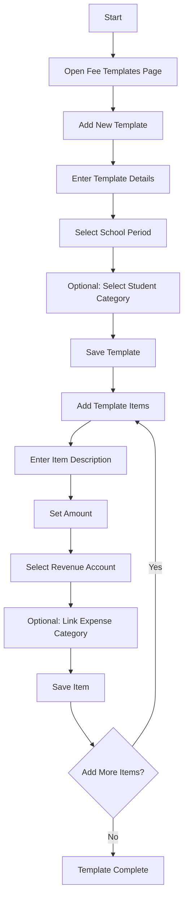
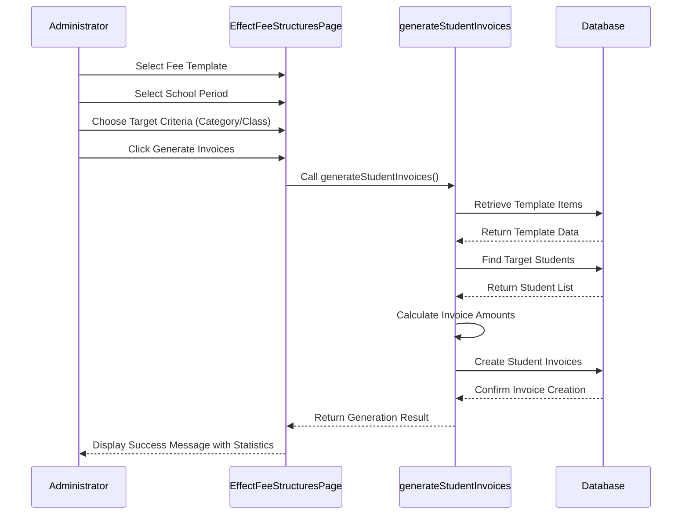
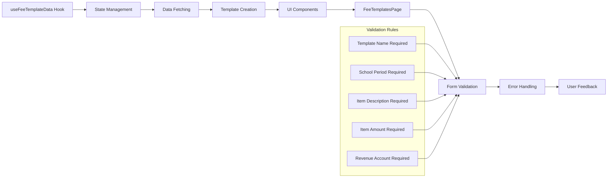
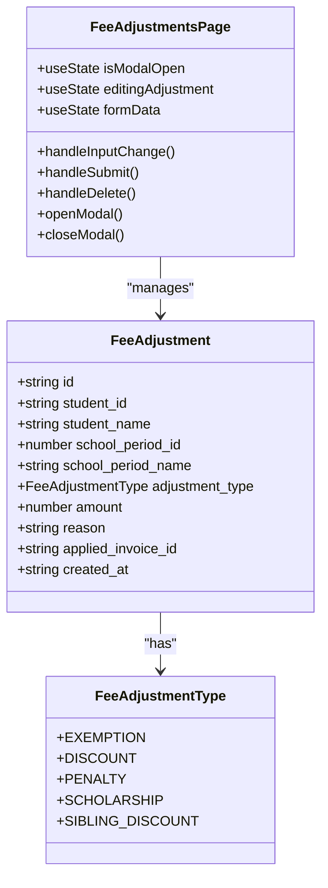
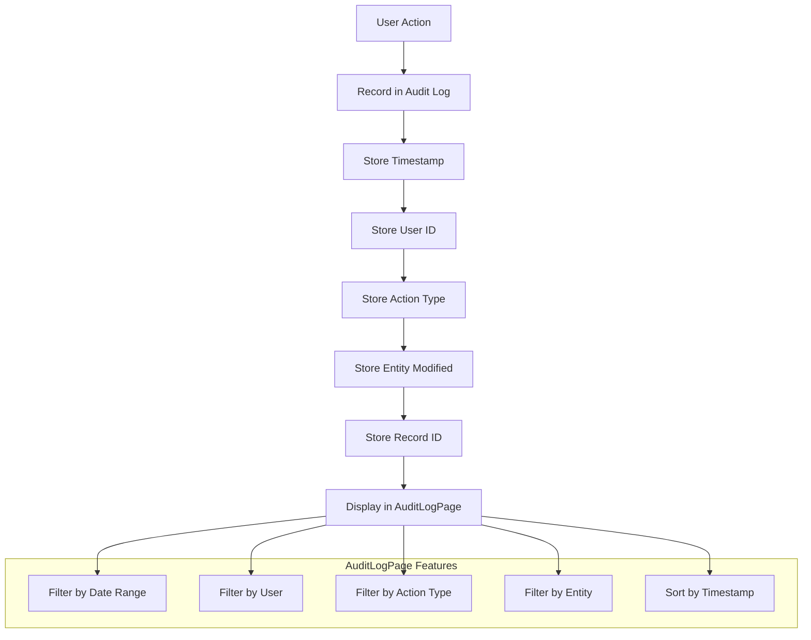

# Fee Management System

<cite>
**Referenced Files in This Document**   
- [FeeTemplatesPage.tsx](file://src/modules/finance/pages/FeeTemplatesPage.tsx)
- [EffectFeeStructuresPage.tsx](file://src/modules/finance/pages/EffectFeeStructuresPage.tsx)
- [useFeeTemplateData.ts](file://src/modules/finance/data/useFeeTemplateData.ts)
- [FeeAdjustmentsPage.tsx](file://src/modules/finance/pages/FeeAdjustmentsPage.tsx)
- [useFeeAdjustmentData.ts](file://src/modules/finance/data/useFeeAdjustmentData.ts)
- [StudentFinancialDetailPage.tsx](file://src/modules/administration/pages/StudentFinancialDetailPage.tsx)
- [AuditLogPage.tsx](file://src/modules/settings/pages/AuditLogPage.tsx)
</cite>

## Table of Contents
1. [Introduction](#introduction)
2. [Fee Templates Implementation](#fee-templates-implementation)
3. [Applying Fee Structures to Students](#applying-fee-structures-to-students)
4. [Data Flow and Validation](#data-flow-and-validation)
5. [Fee Adjustments and Waivers](#fee-adjustments-and-waivers)
6. [Special Fee Calculations](#special-fee-calculations)
7. [Audit Trail and Data Integrity](#audit-trail-and-data-integrity)
8. [Best Practices](#best-practices)

## Introduction
The Fee Management System in schoolpilot3 provides a comprehensive solution for managing school fees through reusable templates, structured application processes, and flexible adjustment mechanisms. This system enables administrators to define fee structures once and apply them consistently across student populations, while supporting special cases like discounts, waivers, and prorated fees. The architecture follows a modular design with clear separation between template definition, application logic, and financial adjustments.

## Fee Templates Implementation

The FeeTemplatesPage.tsx component serves as the primary interface for administrators to create and manage reusable fee structures. This implementation allows for the definition of fee templates that can be applied to specific school periods and student categories.

**Diagram sources**
- [FeeTemplatesPage.tsx](file://src/modules/finance/pages/FeeTemplatesPage.tsx)

**Section sources**
- [FeeTemplatesPage.tsx](file://src/modules/finance/pages/FeeTemplatesPage.tsx)

The fee template creation workflow involves several key steps:
1. Defining the template with a name, associated school period, and optional student category
2. Adding individual fee items (voteheads) with descriptions, amounts, and accounting codes
3. Linking revenue accounts from the chart of accounts for proper financial tracking
4. Optionally associating expense categories for cost tracking

Each fee template can contain multiple items representing different fee components such as tuition, transportation, meals, and activity fees. The system validates that all required fields are completed before saving, ensuring data integrity.

## Applying Fee Structures to Students

The EffectFeeStructuresPage.tsx component enables administrators to apply defined fee templates to students, generating invoices based on the selected criteria. This process transforms template definitions into actual student financial obligations.

**Diagram sources**
- [EffectFeeStructuresPage.tsx](file://src/modules/finance/pages/EffectFeeStructuresPage.tsx)

**Section sources**
- [EffectFeeStructuresPage.tsx](file://src/modules/finance/pages/EffectFeeStructuresPage.tsx)

The fee application process follows these steps:
1. Selection of a fee template and target school period
2. Specification of student criteria through either student category or class/stream
3. Validation of required selections before processing
4. Generation of individual invoices for each matching student
5. Display of results including the number of invoices created and total amount billed

This approach ensures consistent application of fee structures while allowing for targeted implementation based on institutional needs.

## Data Flow and Validation

The data flow from the useFeeTemplateData hook to UI components follows a structured pattern that ensures data consistency and provides validation at multiple levels.

**Diagram sources**
- [useFeeTemplateData.ts](file://src/modules/finance/data/useFeeTemplateData.ts)
- [FeeTemplatesPage.tsx](file://src/modules/finance/pages/FeeTemplatesPage.tsx)

**Section sources**
- [useFeeTemplateData.ts](file://src/modules/finance/data/useFeeTemplateData.ts)
- [FeeTemplatesPage.tsx](file://src/modules/finance/pages/FeeTemplatesPage.tsx)

The useFeeTemplateData hook provides the following functionality:
- State management for fee templates and related data
- CRUD operations (create, read, update, delete) for fee templates
- Integration with the application's data layer
- Error handling and loading state management

Validation rules are enforced at both the UI and data levels:
- Required fields are marked with the 'required' attribute in forms
- Client-side validation prevents submission of incomplete data
- Server-side validation ensures data integrity
- Error messages provide clear feedback to users

## Fee Adjustments and Waivers

The FeeAdjustmentsPage.tsx component provides functionality for managing fee adjustments, including discounts, exemptions, and penalties. This system allows for flexible financial management while maintaining auditability.

**Diagram sources**
- [FeeAdjustmentsPage.tsx](file://src/modules/finance/pages/FeeAdjustmentsPage.tsx)
- [useFeeAdjustmentData.ts](file://src/modules/finance/data/useFeeAdjustmentData.ts)

**Section sources**
- [FeeAdjustmentsPage.tsx](file://src/modules/finance/pages/FeeAdjustmentsPage.tsx)
- [useFeeAdjustmentData.ts](file://src/modules/finance/data/useFeeAdjustmentData.ts)

Key features of the fee adjustment system include:
- Multiple adjustment types: EXEMPTION, DISCOUNT, PENALTY, SCHOLARSHIP, and SIBLING_DISCOUNT
- Required fields for amount and reason to ensure proper documentation
- Optional linking to specific invoices for targeted adjustments
- Audit trail of all adjustments with timestamps and user information
- Confirmation dialogs for deletion to prevent accidental data loss

The system handles fee waivers through the EXEMPTION adjustment type, allowing administrators to completely waive fees for specific students based on various criteria.

## Special Fee Calculations

While the current codebase does not explicitly implement prorated fees, the system architecture supports special fee calculations through the adjustment mechanism. Sibling discounts are implemented as a specific adjustment type, demonstrating the system's flexibility.

The StudentFinancialDetailPage.tsx displays comprehensive financial information for individual students, including:
- Current balance with color-coded status
- Total fees billed
- Total payments made
- Total discounts applied
- Total fines assessed

This information provides administrators with a complete view of a student's financial status, enabling informed decision-making regarding fee adjustments and waivers.

For prorated fees, the recommended approach would be to:
1. Apply the full fee template to the student
2. Create a fee adjustment with a negative amount representing the prorated reduction
3. Document the reason for the adjustment (e.g., "Prorated for mid-term enrollment")
4. Link the adjustment to the relevant invoice

This approach maintains consistency with the existing architecture while providing the necessary flexibility for special cases.

## Audit Trail and Data Integrity

The system maintains audit trails through dedicated components and data structures, ensuring accountability and data integrity.

**Diagram sources**
- [AuditLogPage.tsx](file://src/modules/settings/pages/AuditLogPage.tsx)

**Section sources**
- [AuditLogPage.tsx](file://src/modules/settings/pages/AuditLogPage.tsx)

The audit trail system captures:
- Timestamp of each action
- User responsible for the action
- Type of action (CREATE, UPDATE, DELETE)
- Entity affected by the action
- Specific record ID modified

This comprehensive logging enables administrators to:
- Track all financial changes
- Investigate discrepancies
- Ensure compliance with institutional policies
- Maintain accountability for fee adjustments

## Best Practices

To ensure fee calculation accuracy and maintain proper audit trails, follow these best practices:

1. **Template Design**
   - Create specific templates for different student categories
   - Use clear, descriptive names for templates and items
   - Regularly review and update templates for accuracy

2. **Application Process**
   - Verify student criteria before generating invoices
   - Review the generation results for expected counts and amounts
   - Document any exceptions or special cases

3. **Adjustments Management**
   - Use specific adjustment types appropriately
   - Provide detailed reasons for all adjustments
   - Avoid direct database modifications; use the UI interface
   - Regularly audit adjustments for compliance

4. **Data Integrity**
   - Never delete fee templates that have been applied to students
   - Maintain consistent school period definitions
   - Regularly reconcile financial reports with system data
   - Backup data before major changes

5. **Audit Compliance**
   - Regularly review audit logs for suspicious activity
   - Train staff on proper fee management procedures
   - Implement role-based access control for financial operations
   - Conduct periodic audits of fee structures and adjustments

By following these best practices, institutions can ensure accurate fee calculations, maintain proper financial controls, and meet regulatory requirements.