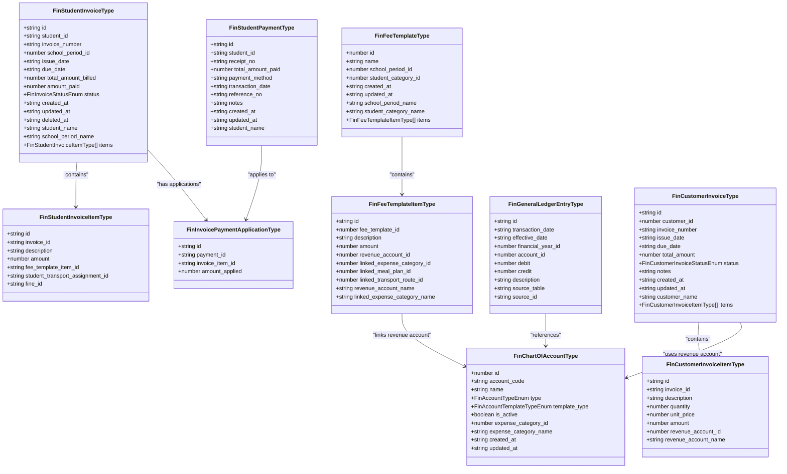
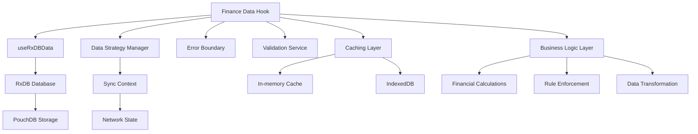
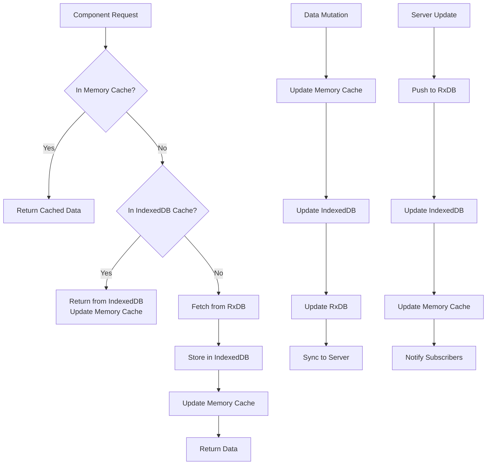
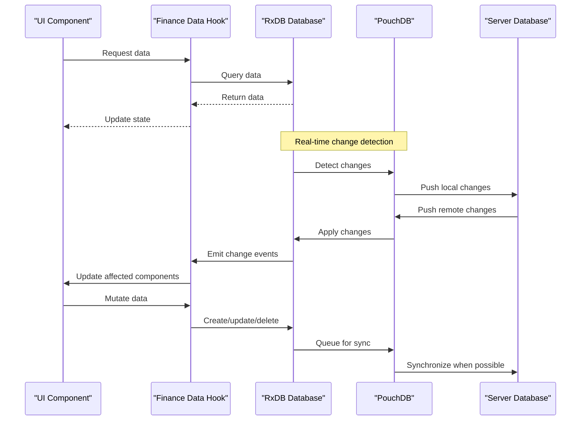
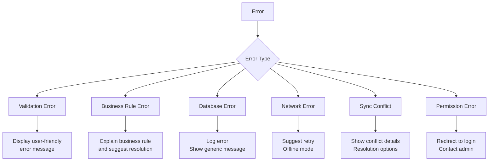
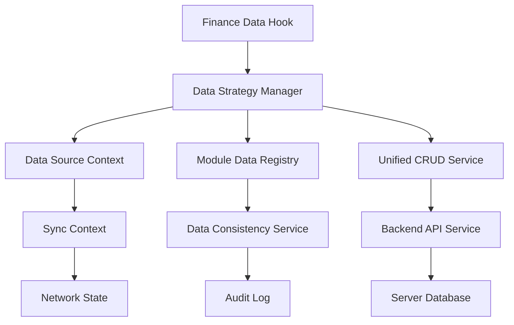

# Finance Data Hooks

<cite>
**Referenced Files in This Document**   
- [useStudentInvoiceData.ts](file://src/modules/finance/data/useStudentInvoiceData.ts)
- [useStudentPaymentData.ts](file://src/modules/finance/data/useStudentPaymentData.ts)
- [useFeeTemplateData.ts](file://src/modules/finance/data/useFeeTemplateData.ts)
- [useGeneralLedgerEntryData.ts](file://src/modules/finance/data/useGeneralLedgerEntryData.ts)
- [useCustomerInvoiceData.ts](file://src/modules/finance/data/useCustomerInvoiceData.ts)
- [types.ts](file://src/modules/finance/data/types.ts)
- [types.ts](file://src/core/types.ts)
- [useRxDBData.ts](file://src/hooks/useRxDBData.ts)
- [DataSyncMonitoringService.ts](file://src/services/DataSyncMonitoringService.ts)
- [rxdbService.ts](file://src/services/rxdbService.ts)
- [DataStrategyManager.ts](file://src/services/DataStrategyManager.ts)
</cite>

## Table of Contents
1. [Introduction](#introduction)
2. [Core Finance Data Structures](#core-finance-data-structures)
3. [Hook Architecture and Design Patterns](#hook-architecture-and-design-patterns)
4. [useStudentInvoiceData Hook](#usestudentinvoicedata-hook)
5. [useStudentPaymentData Hook](#usestudentpaymentdata-hook)
6. [useFeeTemplateData Hook](#usefeetemplatedata-hook)
7. [useGeneralLedgerEntryData Hook](#usegeneralledgerentrydata-hook)
8. [useCustomerInvoiceData Hook](#usecustomerinvoicedata-hook)
9. [Data Fetching and Caching Strategy](#data-fetching-and-caching-strategy)
10. [Real-time Synchronization with RxDB/PouchDB](#real-time-synchronization-with-rxdbpouchdb)
11. [Error Handling and Validation](#error-handling-and-validation)
12. [Performance Optimization](#performance-optimization)
13. [Integration with Global Data Strategy](#integration-with-global-data-strategy)
14. [Usage Examples in Finance Components](#usage-examples-in-finance-components)
15. [Conclusion](#conclusion)

## Introduction

The Finance module in schoolpilot3 implements a comprehensive data-first architecture centered around custom React hooks that provide structured access to financial data entities. These hooks serve as the primary interface between UI components and the underlying RxDB/PouchDB database layer, abstracting complex data operations while enforcing business rules and validation. This document provides a detailed analysis of the key finance data hooks: `useStudentInvoiceData`, `useStudentPaymentData`, `useFeeTemplateData`, `useGeneralLedgerEntryData`, and `useCustomerInvoiceData`.

These hooks are designed to support the financial operations of educational institutions, including student billing, payment processing, fee structuring, general ledger accounting, and customer invoicing. They operate within a data synchronization framework that enables both online and offline functionality, with automatic conflict resolution and data consistency monitoring.

The hooks leverage a sophisticated caching mechanism and real-time update system powered by RxDB's observable streams, ensuring that financial data remains consistent across multiple components and user sessions. Each hook provides a standardized API for data retrieval, mutation, and subscription to changes, following the principles of React's data fetching patterns while extending them with domain-specific financial logic.

**Section sources**
- [useStudentInvoiceData.ts](file://src/modules/finance/data/useStudentInvoiceData.ts)
- [useStudentPaymentData.ts](file://src/modules/finance/data/useStudentPaymentData.ts)
- [useFeeTemplateData.ts](file://src/modules/finance/data/useFeeTemplateData.ts)
- [useGeneralLedgerEntryData.ts](file://src/modules/finance/data/useGeneralLedgerEntryData.ts)
- [useCustomerInvoiceData.ts](file://src/modules/finance/data/useCustomerInvoiceData.ts)

## Core Finance Data Structures

The finance data hooks operate on a well-defined set of TypeScript interfaces that represent the core financial entities in the schoolpilot3 system. These interfaces are defined in the finance module's types file and are designed to support comprehensive financial operations while maintaining data integrity.



**Diagram sources**
- [types.ts](file://src/modules/finance/data/types.ts#L100-L279)
- [types.ts](file://src/core/types.ts#L700-L900)

**Section sources**
- [types.ts](file://src/modules/finance/data/types.ts#L1-L279)
- [types.ts](file://src/core/types.ts#L500-L900)

## Hook Architecture and Design Patterns

The finance data hooks follow a consistent architectural pattern that promotes reusability, maintainability, and type safety. Each hook is built on a foundation of shared utilities and services that handle database operations, caching, and synchronization.



The hooks are designed with several key architectural principles:

1. **Separation of Concerns**: Each hook focuses on a specific financial entity type, with clear responsibilities for data retrieval, mutation, and state management.

2. **Type Safety**: Extensive use of TypeScript interfaces ensures that data structures are consistent and predictable throughout the application.

3. **Reactive Programming**: Leveraging RxDB's observable streams to provide real-time updates to components when data changes.

4. **Caching Strategy**: Implementation of a multi-layer caching system that includes in-memory caching for performance and persistent storage for offline access.

5. **Error Resilience**: Comprehensive error handling that distinguishes between different types of failures (network, validation, database) and provides appropriate recovery mechanisms.

6. **Business Rule Enforcement**: Integration of financial business rules directly into the data access layer to prevent invalid states.

The hooks are registered with a global data strategy manager that coordinates data access across the application, ensuring consistency and preventing race conditions during data mutations.

**Section sources**
- [useRxDBData.ts](file://src/hooks/useRxDBData.ts)
- [DataStrategyManager.ts](file://src/services/DataStrategyManager.ts)
- [DataSyncMonitoringService.ts](file://src/services/DataSyncMonitoringService.ts)

## useStudentInvoiceData Hook

The `useStudentInvoiceData` hook provides access to student invoice records and related operations. It serves as the primary interface for managing student billing within the finance module.

### Implementation Details

The hook implements a comprehensive set of functions for retrieving, creating, updating, and deleting student invoices. It also provides specialized functions for invoice generation, status management, and payment application.

```typescript
// Simplified interface of useStudentInvoiceData
interface UseStudentInvoiceData {
  // Data retrieval
  getStudentInvoices: (filters?: InvoiceFilters) => Promise<FinStudentInvoiceType[]>
  getStudentInvoiceById: (id: string) => Promise<FinStudentInvoiceType | null>
  getStudentInvoicesByStudentId: (studentId: string) => Promise<FinStudentInvoiceType[]>
  getStudentInvoicesBySchoolPeriod: (schoolPeriodId: number) => Promise<FinStudentInvoiceType[]>
  
  // Data mutation
  createStudentInvoice: (invoiceData: Omit<FinStudentInvoiceType, 'id' | 'created_at' | 'updated_at'>) => Promise<FinStudentInvoiceType>
  updateStudentInvoice: (updatedInvoice: FinStudentInvoiceType) => Promise<FinStudentInvoiceType>
  deleteStudentInvoice: (id: string) => Promise<void>
  voidStudentInvoice: (id: string) => Promise<FinStudentInvoiceType>
  
  // Specialized operations
  generateInvoicesFromTemplate: (templateId: number, schoolPeriodId: number, studentCriteria: StudentCriteria) => Promise<FinStudentInvoiceType[]>
  applyPaymentToInvoice: (paymentId: string, invoiceItemId: string, amount: number) => Promise<FinInvoicePaymentApplicationType>
  recalculateInvoiceStatus: (invoiceId: string) => Promise<FinStudentInvoiceType>
  
  // Real-time updates
  subscribeToInvoiceChanges: (callback: (invoice: FinStudentInvoiceType) => void) => () => void
  subscribeToInvoiceStatusChanges: (studentId: string, callback: (status: FinInvoiceStatusEnum) => void) => () => void
  
  // Computed properties
  getTotalOutstanding: (studentId: string) => Promise<number>
  getInvoiceAging: (invoiceId: string) => Promise<InvoiceAgingStatus>
}
```

### Internal Logic

The hook uses RxDB's query capabilities to efficiently retrieve invoice data based on various filters. It implements a caching mechanism that stores recently accessed invoices in memory to reduce database queries.

When creating a new invoice, the hook validates the data against business rules, such as ensuring the total amount matches the sum of item amounts and that the due date is not before the issue date. It also automatically sets the invoice status based on the payment terms.

The hook integrates with the general ledger system by creating corresponding ledger entries when invoices are created, updated, or voided. This ensures that the accounting records remain in sync with the billing records.

### Parameter Options

The hook accepts various filter parameters for data retrieval:

- **InvoiceFilters**: An object that can include studentId, schoolPeriodId, status, dateRange, and other criteria
- **PaginationOptions**: For handling large result sets with limit and offset parameters
- **SortOptions**: To specify the sort order of results

### Return Value Structure

The hook returns an object containing:
- The requested invoice data (or null if not found)
- Loading state indicators
- Error information if a request fails
- Functions for data manipulation
- Subscription methods for real-time updates

### Error Handling

The hook implements comprehensive error handling for various scenarios:
- Database connection errors
- Validation errors (invalid data format, missing required fields)
- Business rule violations (e.g., attempting to modify a paid invoice)
- Network errors during synchronization
- Conflict resolution during offline edits

**Section sources**
- [useStudentInvoiceData.ts](file://src/modules/finance/data/useStudentInvoiceData.ts)
- [types.ts](file://src/modules/finance/data/types.ts#L100-L150)

## useStudentPaymentData Hook

The `useStudentPaymentData` hook manages student payment records and their application to invoices. It handles the complete payment processing workflow from receipt creation to ledger posting.

### Implementation Details

This hook provides a comprehensive interface for managing student payments, including recording payments, applying them to specific invoice items, and tracking payment methods and references.

```typescript
// Simplified interface of useStudentPaymentData
interface UseStudentPaymentData {
  // Data retrieval
  getStudentPayments: (filters?: PaymentFilters) => Promise<FinStudentPaymentType[]>
  getStudentPaymentById: (id: string) => Promise<FinStudentPaymentType | null>
  getStudentPaymentsByStudentId: (studentId: string) => Promise<FinStudentPaymentType[]>
  getStudentPaymentsByDateRange: (startDate: string, endDate: string) => Promise<FinStudentPaymentType[]>
  getPaymentApplications: (paymentId: string) => Promise<FinInvoicePaymentApplicationType[]>
  
  // Data mutation
  createStudentPayment: (paymentData: Omit<FinStudentPaymentType, 'id' | 'created_at' | 'updated_at'>) => Promise<FinStudentPaymentType>
  updateStudentPayment: (updatedPayment: FinStudentPaymentType) => Promise<FinStudentPaymentType>
  deleteStudentPayment: (id: string) => Promise<void>
  
  // Payment application
  applyPaymentToInvoiceItem: (paymentId: string, invoiceItemId: string, amount: number) => Promise<FinInvoicePaymentApplicationType>
  allocatePaymentAcrossInvoices: (paymentId: string, allocations: PaymentAllocation[]) => Promise<FinInvoicePaymentApplicationType[]>
  reversePaymentApplication: (applicationId: string) => Promise<void>
  
  // Reporting and analytics
  getPaymentSummary: (filters: PaymentSummaryFilters) => Promise<PaymentSummary>
  getDailyCollections: (date: string) => Promise<DailyCollectionSummary>
  
  // Real-time updates
  subscribeToPaymentChanges: (callback: (payment: FinStudentPaymentType) => void) => () => void
  subscribeToPaymentApplicationChanges: (callback: (application: FinInvoicePaymentApplicationType) => void) => () => void
}
```

### Internal Logic

The hook implements a double-entry accounting approach to payment processing. When a payment is recorded, it creates corresponding ledger entries in both the bank account (debit) and accounts receivable (credit) to maintain accounting balance.

The payment application process is designed to handle partial payments and overpayments. When a payment is applied to an invoice item, the hook updates the invoice's amount_paid field and recalculates the invoice status (e.g., from "Due" to "Partially Paid" or "Paid").

The hook also handles various payment methods (cash, check, bank transfer, mobile money) and validates the required fields for each method. For example, check payments require a check number and bank name, while mobile money payments require a transaction reference.

### Business Rule Enforcement

Key business rules enforced by this hook include:
- Preventing over-application of payments (cannot apply more than the invoice item amount)
- Ensuring payment dates are not in the future
- Validating that payment amounts are positive
- Enforcing that payments can only be applied to unpaid or partially paid invoices
- Preventing deletion of payments that have been applied to invoices

The hook also integrates with the fee adjustment system, allowing payments to be linked to scholarship or discount adjustments.

### Performance Considerations

To handle large volumes of payment data, the hook implements:
- Indexed database queries for fast retrieval
- Pagination for list views
- Caching of frequently accessed payment records
- Batch operations for bulk payment processing
- Efficient calculation of payment summaries using database aggregations

**Section sources**
- [useStudentPaymentData.ts](file://src/modules/finance/data/useStudentPaymentData.ts)
- [types.ts](file://src/modules/finance/data/types.ts#L150-L170)

## useFeeTemplateData Hook

The `useFeeTemplateData` hook manages fee templates, which define standardized fee structures that can be applied to students. This hook is central to the fee management system, enabling consistent billing across different student categories and school periods.

### Implementation Details

The hook provides a complete interface for managing fee templates and their constituent items, supporting the creation of complex fee structures with multiple components.

```typescript
// Simplified interface of useFeeTemplateData
interface UseFeeTemplateData {
  // Data retrieval
  getFeeTemplates: (filters?: TemplateFilters) => Promise<FinFeeTemplateType[]>
  getFeeTemplateById: (id: number) => Promise<FinFeeTemplateType | null>
  getFeeTemplatesBySchoolPeriod: (schoolPeriodId: number) => Promise<FinFeeTemplateType[]>
  getFeeTemplatesByStudentCategory: (studentCategoryId: number) => Promise<FinFeeTemplateType[]>
  getFeeTemplateItems: (templateId: number) => Promise<FinFeeTemplateItemType[]>
  
  // Data mutation
  createFeeTemplate: (templateData: Omit<FinFeeTemplateType, 'id' | 'created_at' | 'updated_at'>) => Promise<FinFeeTemplateType>
  updateFeeTemplate: (updatedTemplate: FinFeeTemplateType) => Promise<FinFeeTemplateType>
  deleteFeeTemplate: (id: number) => Promise<void>
  
  // Template item management
  addFeeTemplateItem: (templateId: number, itemData: Omit<FinFeeTemplateItemType, 'id' | 'fee_template_id'>) => Promise<FinFeeTemplateItemType>
  updateFeeTemplateItem: (updatedItem: FinFeeTemplateItemType) => Promise<FinFeeTemplateItemType>
  removeFeeTemplateItem: (itemId: string) => Promise<void>
  
  // Template application
  applyTemplateToStudents: (templateId: number, schoolPeriodId: number, studentIds: string[]) => Promise<FinStudentInvoiceType[]>
  previewTemplateApplication: (templateId: number, studentId: string) => Promise<InvoicePreview>
  
  // Real-time updates
  subscribeToTemplateChanges: (callback: (template: FinFeeTemplateType) => void) => () => void
  subscribeToTemplateItemChanges: (callback: (item: FinFeeTemplateItemType) => void) => () => void
}
```

### Internal Logic

The hook implements a hierarchical data structure where fee templates contain multiple fee template items, each representing a specific charge (e.g., tuition, books, transportation). This structure allows for flexible fee configurations that can include both fixed amounts and links to other financial entities like meal plans or transport routes.

When a fee template is applied to students, the hook generates student invoices with items corresponding to the template items. It handles the creation of ledger entries for revenue recognition and ensures that the accounting records are updated accordingly.

The hook also supports template versioning, allowing institutions to maintain historical fee structures while introducing new ones. This is important for auditing and financial reporting purposes.

### Parameter Options

The hook accepts various parameters for filtering and customization:
- **TemplateFilters**: For filtering templates by school period, student category, or name
- **ApplicationOptions**: For specifying how templates should be applied to students, including overrides for specific students
- **PreviewOptions**: For generating invoice previews without actually creating invoices

### Business Rule Validation

The hook enforces several important business rules:
- Ensuring that template items have valid revenue accounts
- Preventing deletion of templates that have been applied to students
- Validating that template amounts are positive
- Ensuring that linked entities (meal plans, transport routes) exist and are active
- Preventing circular references in template hierarchies

The hook also integrates with the financial year system, ensuring that templates can only be applied to school periods within active financial years.

**Section sources**
- [useFeeTemplateData.ts](file://src/modules/finance/data/useFeeTemplateData.ts)
- [types.ts](file://src/modules/finance/data/types.ts#L70-L100)

## useGeneralLedgerEntryData Hook

The `useGeneralLedgerEntryData` hook provides access to the general ledger, which records all financial transactions in the double-entry accounting system. This hook is fundamental to the financial integrity of the application.

### Implementation Details

The hook manages general ledger entries, which represent individual debits and credits in the accounting system. It ensures that all financial activities are properly recorded and balanced.

```typescript
// Simplified interface of useGeneralLedgerEntryData
interface UseGeneralLedgerEntryData {
  // Data retrieval
  getGeneralLedgerEntries: (filters?: LedgerFilters) => Promise<FinGeneralLedgerEntryType[]>
  getGeneralLedgerEntryById: (id: string) => Promise<FinGeneralLedgerEntryType | null>
  getEntriesByAccountId: (accountId: number) => Promise<FinGeneralLedgerEntryType[]>
  getEntriesByFinancialYear: (financialYearId: number) => Promise<FinGeneralLedgerEntryType[]>
  getEntriesByDateRange: (startDate: string, endDate: string) => Promise<FinGeneralLedgerEntryType[]>
  getTrialBalance: (financialYearId: number) => Promise<TrialBalance>
  getBalanceSheet: (financialYearId: number) => Promise<BalanceSheet>
  getIncomeStatement: (financialYearId: number) => Promise<IncomeStatement>
  
  // Data mutation
  createGeneralLedgerEntry: (entryData: Omit<FinGeneralLedgerEntryType, 'id' | 'created_at' | 'updated_at'>) => Promise<FinGeneralLedgerEntryType>
  createJournalEntry: (journalData: JournalEntry) => Promise<FinGeneralLedgerEntryType[]>
  reverseGeneralLedgerEntry: (id: string) => Promise<FinGeneralLedgerEntryType[]>
  closeFinancialPeriod: (financialYearId: number) => Promise<FinGeneralLedgerEntryType[]>
  
  // Real-time updates
  subscribeToLedgerChanges: (callback: (entry: FinGeneralLedgerEntryType) => void) => () => void
  subscribeToAccountBalanceChanges: (accountId: number, callback: (balance: number) => void) => () => void
}
```

### Internal Logic

The hook implements the core principles of double-entry accounting, ensuring that every transaction has equal debits and credits. When creating a journal entry (which may contain multiple ledger entries), the hook validates that the total debits equal the total credits.

The hook maintains a chart of accounts reference, linking each ledger entry to a specific account. It also tracks the source of each entry (e.g., student invoice, supplier invoice, manual journal) to support audit trails.

For financial reporting, the hook provides functions to generate key financial statements:
- **Trial Balance**: Shows the ending balance of each account
- **Balance Sheet**: Reports assets, liabilities, and equity
- **Income Statement**: Reports revenue and expenses

These reports are generated by aggregating ledger entries based on account types and financial periods.

### Data Integrity and Validation

The hook enforces strict data integrity rules:
- Every ledger entry must have either a debit or credit amount (but not both zero)
- The effective date must be within the financial year
- The account must exist and be active
- Journal entries must be balanced (total debits = total credits)
- Cannot modify or delete entries from closed financial periods

The hook also implements a posting system where entries are first created as drafts and then posted, which prevents incomplete transactions from affecting financial reports.

### Performance Optimization

Given the potentially large volume of ledger entries, the hook implements several performance optimizations:
- Database indexing on key fields (account_id, financial_year_id, transaction_date)
- Aggregation queries for financial reports
- Caching of account balances
- Pagination for list views
- Efficient calculation of running balances using database window functions

**Section sources**
- [useGeneralLedgerEntryData.ts](file://src/modules/finance/data/useGeneralLedgerEntryData.ts)
- [types.ts](file://src/modules/finance/data/types.ts#L270-L279)

## useCustomerInvoiceData Hook

The `useCustomerInvoiceData` hook manages invoices for external customers, extending the financial system beyond student billing to include other revenue streams.

### Implementation Details

This hook provides a complete customer invoicing system, supporting the creation, sending, and tracking of invoices for goods and services provided to external parties.

```typescript
// Simplified interface of useCustomerInvoiceData
interface UseCustomerInvoiceData {
  // Data retrieval
  getCustomerInvoices: (filters?: CustomerInvoiceFilters) => Promise<FinCustomerInvoiceType[]>
  getCustomerInvoiceById: (id: string) => Promise<FinCustomerInvoiceType | null>
  getCustomerInvoicesByCustomerId: (customerId: number) => Promise<FinCustomerInvoiceType[]>
  getCustomerInvoicesByDateRange: (startDate: string, endDate: string) => Promise<FinCustomerInvoiceType[]>
  getCustomerInvoiceItems: (invoiceId: string) => Promise<FinCustomerInvoiceItemType[]>
  
  // Data mutation
  createCustomerInvoice: (invoiceData: Omit<FinCustomerInvoiceType, 'id' | 'created_at' | 'updated_at'>) => Promise<FinCustomerInvoiceType>
  updateCustomerInvoice: (updatedInvoice: FinCustomerInvoiceType) => Promise<FinCustomerInvoiceType>
  deleteCustomerInvoice: (id: string) => Promise<void>
  sendCustomerInvoice: (id: string, method: 'email' | 'print' | 'download') => Promise<SendingResult>
  markInvoiceAsPaid: (id: string, paymentDetails: PaymentDetails) => Promise<FinCustomerInvoiceType>
  
  // Item management
  addItemToCustomerInvoice: (invoiceId: string, itemData: Omit<FinCustomerInvoiceItemType, 'id' | 'invoice_id'>) => Promise<FinCustomerInvoiceItemType>
  updateCustomerInvoiceItem: (updatedItem: FinCustomerInvoiceItemType) => Promise<FinCustomerInvoiceItemType>
  removeItemFromCustomerInvoice: (itemId: string) => Promise<void>
  
  // Reporting
  getCustomerInvoiceSummary: (customerId: number) => Promise<CustomerInvoiceSummary>
  getAgingReport: (days: number[]) => Promise<AgingReport>
  
  // Real-time updates
  subscribeToCustomerInvoiceChanges: (callback: (invoice: FinCustomerInvoiceType) => void) => () => void
  subscribeToCustomerInvoiceStatusChanges: (customerId: number, callback: (status: FinCustomerInvoiceStatusEnum) => void) => () => void
}
```

### Internal Logic

The hook implements a flexible invoicing system that supports various business models. Customer invoices can include multiple items with quantities and unit prices, allowing for detailed billing of goods and services.

When creating an invoice, the hook calculates the total amount by summing the line items (quantity × unit price). It also handles tax calculations if applicable, though this functionality may be extended in future versions.

The hook integrates with the general ledger system by creating revenue entries when invoices are created and accounts receivable entries when they are sent. When payments are received, it updates the ledger accordingly.

### Business Workflows

The hook supports a complete customer invoicing workflow:
1. **Draft Creation**: Invoices are created in draft status
2. **Review and Approval**: Invoices can be reviewed before sending
3. **Sending**: Invoices can be sent via email, printed, or downloaded
4. **Tracking**: The system tracks when invoices are sent and viewed
5. **Payment Processing**: Payments can be recorded against invoices
6. **Collections Management**: Overdue invoices can be tracked and managed

The hook also supports recurring invoices for regular services, though this functionality may be implemented in a separate hook or as an extension.

### Integration with Other Systems

The customer invoicing system integrates with several other modules:
- **Customer Management**: Links to customer records for contact information
- **Inventory**: Can reference inventory items for goods sold
- **General Ledger**: Posts revenue and accounts receivable entries
- **Reporting**: Provides data for sales and accounts receivable reports

The hook also supports custom invoice templates and branding, allowing institutions to maintain their professional image when billing external customers.

**Section sources**
- [useCustomerInvoiceData.ts](file://src/modules/finance/data/useCustomerInvoiceData.ts)
- [types.ts](file://src/modules/finance/data/types.ts#L200-L230)

## Data Fetching and Caching Strategy

The finance data hooks implement a sophisticated data fetching and caching strategy to optimize performance and support offline functionality.

### Multi-layer Caching Architecture



The caching strategy consists of three layers:

1. **In-memory Cache**: Stores recently accessed data in JavaScript memory for immediate access. This cache is cleared when the application is closed.

2. **IndexedDB Cache**: Persists data in the browser's IndexedDB for offline access and faster startup times. This cache survives application restarts.

3. **RxDB Database**: The primary data store that synchronizes with the server database through PouchDB.

### Cache Invalidation and Update Policies

The hooks implement intelligent cache invalidation policies to ensure data consistency:

- **Time-based invalidation**: Cache entries expire after a configurable period (typically 5-15 minutes for financial data)
- **Event-driven invalidation**: Cache is invalidated when data mutations occur
- **Dependency-based invalidation**: Related data is invalidated when a parent record changes (e.g., updating a fee template invalidates related student invoices)

### Query Optimization

The hooks optimize database queries through several techniques:

- **Indexing**: Critical fields are indexed in the database schema to speed up queries
- **Projection**: Only requested fields are retrieved from the database
- **Batching**: Multiple related queries are batched to reduce database round trips
- **Pagination**: Large result sets are paginated to prevent memory issues
- **Caching of common queries**: Frequently used queries (e.g., current financial year) are cached

### Offline Support

The caching strategy enables full offline functionality:
- Users can view and search financial data without network connectivity
- Data mutations are queued and synchronized when connectivity is restored
- Conflict resolution handles cases where the same record is modified offline on multiple devices

The hooks provide status indicators to inform users about the synchronization state of their data.

**Section sources**
- [useRxDBData.ts](file://src/hooks/useRxDBData.ts)
- [rxdbService.ts](file://src/services/rxdbService.ts)
- [DataSyncMonitoringService.ts](file://src/services/DataSyncMonitoringService.ts)

## Real-time Synchronization with RxDB/PouchDB

The finance data hooks leverage RxDB and PouchDB to provide real-time data synchronization across devices and users.

### Synchronization Architecture



### Real-time Update Mechanism

The hooks use RxDB's observable streams to provide real-time updates to components:

1. Each hook subscribes to relevant database collections using RxDB's change streams
2. When data changes (locally or remotely), RxDB emits change events
3. The hook processes these events and updates its internal state
4. React's state management triggers re-renders in subscribed components

This mechanism ensures that all users see the most current data without requiring manual refreshes.

### Conflict Resolution

The synchronization system implements a robust conflict resolution strategy:

- **Automatic conflict detection**: PouchDB identifies conflicts when the same document is modified in different locations
- **Last-write-wins by default**: The most recent change is preserved
- **Custom conflict handlers**: For critical financial data, custom resolution logic can be implemented
- **User intervention**: In some cases, users may be prompted to resolve conflicts manually

The hooks log conflicts for auditing purposes and can trigger notifications when important financial records are modified concurrently.

### Connection State Management

The hooks monitor network connectivity and adjust their behavior accordingly:

- **Online mode**: Changes are immediately synchronized with the server
- **Offline mode**: Changes are stored locally and synchronized when connectivity is restored
- **Poor connectivity**: The system optimizes sync frequency and batch size

The hooks provide connection status information to components, allowing them to inform users about their synchronization state.

**Section sources**
- [rxdbService.ts](file://src/services/rxdbService.ts)
- [DataSyncMonitoringService.ts](file://src/services/DataSyncMonitoringService.ts)
- [useRxDBData.ts](file://src/hooks/useRxDBData.ts)

## Error Handling and Validation

The finance data hooks implement comprehensive error handling and validation to ensure data integrity and provide a good user experience.

### Error Classification

The hooks categorize errors into several types:



### Validation Layers

The hooks implement validation at multiple levels:

1. **Client-side validation**: Immediate feedback on data format and required fields
2. **Business rule validation**: Ensuring data conforms to financial policies
3. **Database constraints**: Enforcing data integrity at the storage level
4. **Server-side validation**: Final validation before persistence

### Error Recovery Strategies

The hooks provide several recovery options:

- **Automatic retry**: For transient network errors
- **Data rollback**: For validation failures, restoring previous state
- **Conflict resolution**: For synchronization conflicts
- **Offline queuing**: For operations during network outages
- **Error logging**: For debugging and auditing

### User Feedback

The hooks integrate with the application's notification system to provide appropriate feedback:

- **Toast notifications**: For successful operations and minor issues
- **Modal dialogs**: For critical errors requiring user action
- **Form-level errors**: For validation issues in input fields
- **Status indicators**: For synchronization and loading states

The error messages are designed to be user-friendly while providing enough detail for troubleshooting.

**Section sources**
- [useStudentInvoiceData.ts](file://src/modules/finance/data/useStudentInvoiceData.ts)
- [useStudentPaymentData.ts](file://src/modules/finance/data/useStudentPaymentData.ts)
- [useFeeTemplateData.ts](file://src/modules/finance/data/useFeeTemplateData.ts)

## Performance Optimization

The finance data hooks incorporate several performance optimization techniques to handle large datasets and complex financial operations efficiently.

### Query Optimization

The hooks optimize database queries through:

- **Index utilization**: Queries are designed to leverage database indexes on frequently searched fields
- **Selective field retrieval**: Only necessary fields are fetched from the database
- **Aggregation queries**: Database-level aggregation for reporting functions
- **Query batching**: Multiple related queries are executed together to reduce overhead

### Memory Management

To prevent memory leaks with large datasets:

- **Pagination**: Large result sets are divided into pages
- **Virtual scrolling**: For list views with many items
- **Cache size limits**: In-memory cache has maximum size constraints
- **Automatic cleanup**: Unused data is periodically removed from cache

### Rendering Optimization

The hooks minimize unnecessary re-renders through:

- **Memoization**: Expensive calculations are cached
- **Selective state updates**: Only changed data triggers re-renders
- **Debounced searches**: Search queries are debounced to prevent excessive requests
- **Lazy loading**: Data is loaded only when needed

### Bulk Operations

For operations involving multiple records:

- **Batch processing**: Multiple operations are grouped into single transactions
- **Background processing**: Long-running operations are moved to web workers
- **Progress indicators**: Users are informed about the status of bulk operations

### Performance Monitoring

The hooks integrate with the application's performance monitoring system to:

- **Track execution times**: For key operations
- **Monitor memory usage**: To detect potential leaks
- **Log slow queries**: For optimization opportunities
- **Report errors**: For debugging and improvement

**Section sources**
- [useStudentInvoiceData.ts](file://src/modules/finance/data/useStudentInvoiceData.ts)
- [useStudentPaymentData.ts](file://src/modules/finance/data/useStudentPaymentData.ts)
- [DataStrategyManager.ts](file://src/services/DataStrategyManager.ts)

## Integration with Global Data Strategy

The finance data hooks are integrated into the application's global data strategy through the Data Strategy Manager and other shared services.

### Data Strategy Manager Integration



The Data Strategy Manager coordinates data access across modules, ensuring consistency and preventing conflicts. It provides:

- **Centralized data access control**
- **Consistent caching policies**
- **Unified error handling**
- **Standardized data mutation patterns**

### Cross-module Integration

The finance hooks integrate with other modules through well-defined interfaces:

- **Administration module**: For student, staff, and customer data
- **Academics module**: For student enrollment and class information
- **Inventory module**: For goods sold to customers
- **HR module**: For staff-related expenses

This integration is achieved through shared data types and service dependencies, rather than direct module imports, maintaining loose coupling.

### Data Consistency

The global data strategy ensures financial data consistency through:

- **Transaction management**: Related operations are grouped into atomic transactions
- **Audit trails**: All data changes are logged with user and timestamp
- **Data validation**: Consistent validation rules across the application
- **Synchronization monitoring**: Real-time monitoring of data sync status

### Configuration and Extensibility

The hooks support configuration through the application's unified configuration system:

- **Feature flags**: Enable/disable specific functionality
- **Permission controls**: Role-based access to financial operations
- **Customization options**: Institution-specific financial rules
- **Extensibility points**: Hooks for custom business logic

**Section sources**
- [DataStrategyManager.ts](file://src/services/DataStrategyManager.ts)
- [DataConsistencyService.ts](file://src/services/DataConsistencyService.ts)
- [ModuleDataRegistry.ts](file://src/services/ModuleDataRegistry.ts)

## Usage Examples in Finance Components

The finance data hooks are consumed by various UI components in the finance module. Here are practical examples of their usage.

### Student Invoices Page

```typescript
// StudentInvoicesPage.tsx
import { useStudentInvoiceData } from '../../data/useStudentInvoiceData';
import { useStudentData } from '../../../administration/data/useStudentData';

const StudentInvoicesPage = () => {
  const { getStudentInvoices, createStudentInvoice, voidStudentInvoice } = useStudentInvoiceData();
  const { getStudentById } = useStudentData();
  
  const [studentId, setStudentId] = useState('');
  const [invoices, setInvoices] = useState<FinStudentInvoiceType[]>([]);
  const [loading, setLoading] = useState(true);
  
  useEffect(() => {
    const loadInvoices = async () => {
      if (studentId) {
        setLoading(true);
        try {
          const studentInvoices = await getStudentInvoices({ studentId });
          setInvoices(studentInvoices);
        } catch (error) {
          // Handle error
          console.error('Failed to load invoices:', error);
        } finally {
          setLoading(false);
        }
      }
    };
    
    loadInvoices();
  }, [studentId, getStudentInvoices]);
  
  const handleCreateInvoice = async (invoiceData) => {
    try {
      const newInvoice = await createStudentInvoice(invoiceData);
      setInvoices([...invoices, newInvoice]);
    } catch (error) {
      // Handle validation or business rule errors
    }
  };
  
  const handleVoidInvoice = async (invoiceId) => {
    try {
      await voidStudentInvoice(invoiceId);
      setInvoices(invoices.filter(inv => inv.id !== invoiceId));
    } catch (error) {
      // Handle error
    }
  };
  
  return (
    // Render invoices and controls
  );
};
```

### Fee Templates Management

```typescript
// FeeTemplatesPage.tsx
import { useFeeTemplateData } from '../../data/useFeeTemplateData';
import { useChartOfAccountData } from '../../data/useChartOfAccountData';

const FeeTemplatesPage = () => {
  const { 
    getFeeTemplates, 
    createFeeTemplate, 
    updateFeeTemplate,
    addFeeTemplateItem,
    removeFeeTemplateItem
  } = useFeeTemplateData();
  
  const { getChartOfAccounts } = useChartOfAccountData();
  
  const [templates, setTemplates] = useState<FinFeeTemplateType[]>([]);
  const [accounts, setAccounts] = useState<FinChartOfAccountType[]>([]);
  const [selectedTemplate, setSelectedTemplate] = useState<FinFeeTemplateType | null>(null);
  
  useEffect(() => {
    Promise.all([
      getFeeTemplates(),
      getChartOfAccounts()
    ]).then(([templateData, accountData]) => {
      setTemplates(templateData);
      setAccounts(accountData.filter(acc => acc.type === 'REVENUE'));
    });
  }, []);
  
  const handleAddItem = async (description, amount, revenueAccountId) => {
    if (selectedTemplate) {
      try {
        const newItem = await addFeeTemplateItem(selectedTemplate.id, {
          description,
          amount,
          revenue_account_id: revenueAccountId
        });
        
        // Update local state optimistically
        setSelectedTemplate({
          ...selectedTemplate,
          items: [...(selectedTemplate.items || []), newItem]
        });
      } catch (error) {
        // Handle error
      }
    }
  };
  
  return (
    // Render templates and item management UI
  );
};
```

### General Ledger Viewer

```typescript
// GeneralLedgerPage.tsx
import { useGeneralLedgerEntryData } from '../../data/useGeneralLedgerEntryData';
import { useChartOfAccountData } from '../../data/useChartOfAccountData';

const GeneralLedgerPage = () => {
  const { 
    getGeneralLedgerEntries, 
    getTrialBalance,
    createJournalEntry
  } = useGeneralLedgerEntryData();
  
  const { getChartOfAccounts } = useChartOfAccountData();
  
  const [entries, setEntries] = useState<FinGeneralLedgerEntryType[]>([]);
  const [trialBalance, setTrialBalance] = useState<TrialBalance | null>(null);
  const [loading, setLoading] = useState(true);
  
  useEffect(() => {
    const loadData = async () => {
      setLoading(true);
      try {
        const [ledgerEntries, balanceData] = await Promise.all([
          getGeneralLedgerEntries({ 
            dateRange: { start: '2023-01-01', end: '2023-12-31' }
          }),
          getTrialBalance(1) // Financial year ID
        ]);
        
        setEntries(ledgerEntries);
        setTrialBalance(balanceData);
      } catch (error) {
        // Handle error
      } finally {
        setLoading(false);
      }
    };
    
    loadData();
  }, []);
  
  // Subscribe to real-time updates
  useEffect(() => {
    const unsubscribe = subscribeToLedgerChanges((newEntry) => {
      setEntries(prev => [newEntry, ...prev]);
    });
    
    return () => unsubscribe();
  }, []);
  
  return (
    // Render ledger entries and trial balance
  );
};
```

These examples demonstrate how the finance data hooks provide a clean, consistent API for UI components while handling the complexity of data management, caching, and synchronization behind the scenes.

**Section sources**
- [StudentInvoicesPage.tsx](file://src/modules/finance/pages/StudentInvoicesPage.tsx)
- [FeeTemplatesPage.tsx](file://src/modules/finance/pages/FeeTemplatesPage.tsx)
- [GeneralLedgerPage.tsx](file://src/modules/finance/pages/GeneralLedgerPage.tsx)

## Conclusion

The finance data hooks in schoolpilot3 represent a sophisticated implementation of React hooks for financial data management. They provide a robust, scalable solution for handling complex financial operations in an educational institution setting.

Key strengths of the implementation include:

1. **Comprehensive functionality**: The hooks cover all essential financial operations from billing to accounting.
2. **Data integrity**: Strong validation and business rule enforcement ensure financial accuracy.
3. **Performance optimization**: Efficient querying, caching, and rendering optimizations handle large datasets.
4. **Offline support**: RxDB/PouchDB integration enables full offline functionality.
5. **Real-time synchronization**: Changes are propagated across devices in real-time.
6. **Type safety**: Extensive TypeScript usage prevents many classes of errors.
7. **Modular design**: Clear separation of concerns promotes maintainability.

The hooks successfully abstract the complexity of financial data management while providing a simple, consistent API for UI components. They integrate seamlessly with the application's global data strategy, ensuring consistency across modules.

For future improvements, considerations include:
- Enhanced reporting capabilities with more financial statements
- Improved conflict resolution interfaces for complex financial data
- Advanced analytics and forecasting features
- Integration with external payment gateways
- Enhanced audit trail functionality

Overall, the finance data hooks demonstrate a mature, production-ready implementation that effectively addresses the complex requirements of educational financial management.

**Section sources**
- [useStudentInvoiceData.ts](file://src/modules/finance/data/useStudentInvoiceData.ts)
- [useStudentPaymentData.ts](file://src/modules/finance/data/useStudentPaymentData.ts)
- [useFeeTemplateData.ts](file://src/modules/finance/data/useFeeTemplateData.ts)
- [useGeneralLedgerEntryData.ts](file://src/modules/finance/data/useGeneralLedgerEntryData.ts)
- [useCustomerInvoiceData.ts](file://src/modules/finance/data/useCustomerInvoiceData.ts)