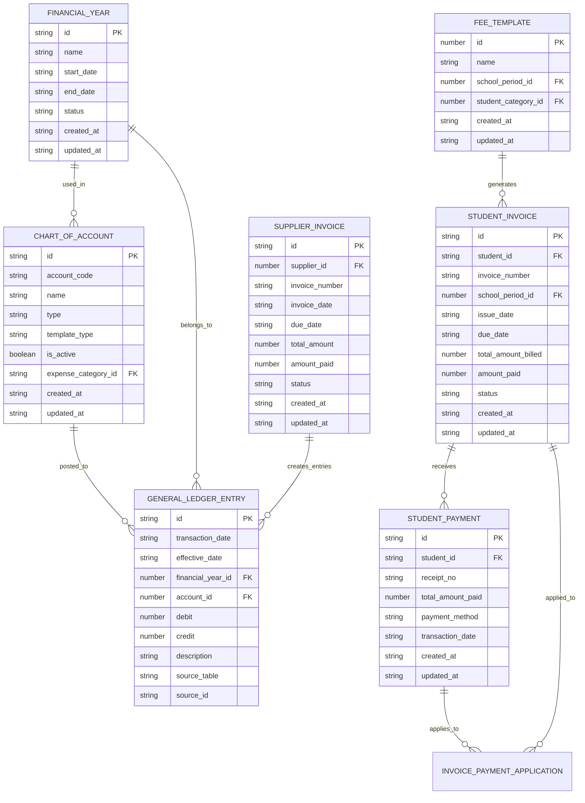
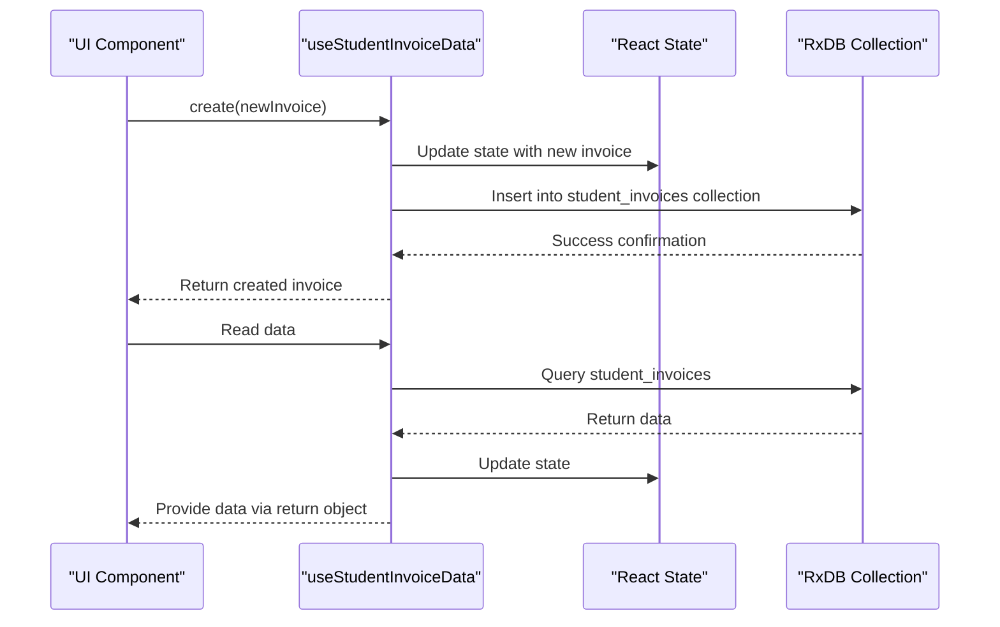

# Finance Data Models

<cite>
**Referenced Files in This Document**   
- [rxdbService.ts](file://src/services/rxdbService.ts)
- [collections.ts](file://src/modules/finance/data/collections.ts)
- [schema.ts](file://src/modules/finance/data/schema.ts)
- [types.ts](file://src/modules/finance/data/types.ts)
- [useStudentInvoiceData.ts](file://src/modules/finance/data/useStudentInvoiceData.ts)
- [useFeeTemplateData.ts](file://src/modules/finance/data/useFeeTemplateData.ts)
- [useChartOfAccountData.ts](file://src/modules/finance/data/useChartOfAccountData.ts)
- [useStudentPaymentData.ts](file://src/modules/finance/data/useStudentPaymentData.ts)
- [useGeneralLedgerEntryData.ts](file://src/modules/finance/data/useGeneralLedgerEntryData.ts)
- [useFinancialYearData.ts](file://src/modules/finance/data/useFinancialYearData.ts)
</cite>

## Table of Contents
1. [Introduction](#introduction)
2. [Core Entities Overview](#core-entities-overview)
3. [Entity Definitions and Schemas](#entity-definitions-and-schemas)
   - [Chart of Accounts](#chart-of-accounts)
   - [Financial Years](#financial-years)
   - [Student Invoices](#student-invoices)
   - [Supplier Invoices](#supplier-invoices)
   - [Payments](#payments)
   - [Fee Templates](#fee-templates)
   - [General Ledger Entries](#general-ledger-entries)
4. [Business Rules and Logic](#business-rules-and-logic)
5. [Data Access Patterns](#data-access-patterns)
6. [Validation and Constraints](#validation-and-constraints)
7. [Lifecycle Management](#lifecycle-management)
8. [Sample JSON Representations](#sample-json-representations)
9. [Integration with RxDB](#integration-with-rxdb)

## Introduction
This document provides comprehensive documentation for the Finance module data models within the schoolpilot3 application. It details the core financial entities, their relationships, field definitions, data types, constraints, and business rules. The system leverages RxDB for offline-first operations, enabling robust data management across various financial workflows including student billing, supplier management, and general accounting.

**Section sources**
- [rxdbService.ts](file://src/services/rxdbService.ts)

## Core Entities Overview
The Finance module comprises several interconnected entities that support comprehensive financial management in an educational institution. These include Chart of Accounts, Financial Years, Student Invoices, Supplier Invoices, Payments, Fee Templates, and General Ledger Entries. All entities are implemented using RxDB collections with schema validation and are accessible through dedicated React hooks for data operations.



**Diagram sources**
- [collections.ts](file://src/modules/finance/data/collections.ts)
- [schema.ts](file://src/modules/finance/data/schema.ts)

## Entity Definitions and Schemas

### Chart of Accounts
The Chart of Accounts defines the structure for all financial accounts used in the system.

**Field Definitions**
- `id`: Unique identifier (string, max 100 chars)
- `account_code`: Account code (string, max 50 chars)
- `name`: Account name (string, max 150 chars)
- `type`: Account type (enum: Asset, Liability, Equity, Revenue, Expense)
- `template_type`: Template classification (enum: Core, Custom)
- `is_active`: Active status (boolean)
- `expense_category_id`: Linked expense category ID (string, max 100 chars)
- `created_at`: Creation timestamp
- `updated_at`: Last update timestamp
- `expense_category_name`: Denormalized expense category name

**Schema Definition**
```typescript
export const chartOfAccountsSchema: DatabaseSchema = createDatabaseSchema({
  title: 'chart_of_account',
  primaryKey: 'id',
  properties: {
    id: SchemaHelpers.string({ maxLength: 100 }),
    account_code: SchemaHelpers.string({ maxLength: 50 }),
    name: SchemaHelpers.string({ maxLength: 150 }),
    type: SchemaHelpers.string({ enum: Object.values(types.FinAccountTypeEnum) }),
    template_type: SchemaHelpers.string({ enum: Object.values(types.FinAccountTemplateTypeEnum) }),
    is_active: SchemaHelpers.boolean(),
    expense_category_id: SchemaHelpers.string({ maxLength: 100 }),
    created_at: SchemaHelpers.timestamp(),
    updated_at: SchemaHelpers.timestamp(),
    expense_category_name: SchemaHelpers.string({ maxLength: 100 }),
  },
  required: ['id', 'account_code', 'name', 'type', 'template_type', 'is_active', 'created_at', 'updated_at'],
});
```

**Section sources**
- [schema.ts](file://src/modules/finance/data/schema.ts#L45-L75)
- [types.ts](file://src/modules/finance/data/types.ts#L10-L20)

### Financial Years
Financial Years define accounting periods for financial reporting and transaction tracking.

**Field Definitions**
- `id`: Unique identifier (string, max 100 chars)
- `name`: Year name (string, max 100 chars)
- `start_date`: Period start date
- `end_date`: Period end date
- `status`: Current status (enum: Open, Closed, Archived)
- `created_at`: Creation timestamp
- `updated_at`: Last update timestamp

**Schema Definition**
```typescript
export const financialYearsSchema: DatabaseSchema = createDatabaseSchema({
  title: 'financial_years',
  primaryKey: 'id',
  properties: {
    id: SchemaHelpers.string({ maxLength: 100 }),
    name: SchemaHelpers.string({ maxLength: 100 }),
    start_date: SchemaHelpers.date(),
    end_date: SchemaHelpers.date(),
    status: SchemaHelpers.string({ enum: Object.values(types.FinFinancialYearStatusEnum) }),
    created_at: SchemaHelpers.timestamp(),
    updated_at: SchemaHelpers.timestamp(),
  },
  required: ['id', 'name', 'start_date', 'end_date', 'status', 'created_at', 'updated_at'],
});
```

**Section sources**
- [schema.ts](file://src/modules/finance/data/schema.ts#L5-L25)
- [types.ts](file://src/modules/finance/data/types.ts#L5-L8)

### Student Invoices
Student Invoices represent billing documents issued to students for fees and other charges.

**Field Definitions**
- `id`: Unique identifier (string, max 100 chars)
- `student_id`: Student reference (string, max 100 chars)
- `invoice_number`: Invoice number (string, max 50 chars)
- `school_period_id`: Associated school period (number)
- `issue_date`: Date issued
- `due_date`: Payment due date
- `total_amount_billed`: Total invoice amount
- `amount_paid`: Amount already paid
- `status`: Invoice status (enum: Draft, Due, Paid, Partially Paid, Overdue, Voided)
- `items`: Array of invoice line items
- `student_name`: Denormalized student name
- `school_period_name`: Denormalized school period name
- `deleted_at`: Soft delete timestamp
- `created_at`: Creation timestamp
- `updated_at`: Last update timestamp

**Schema Definition**
```typescript
const studentInvoiceItemProperties = {
    id: SchemaHelpers.string({ maxLength: 100 }),
    invoice_id: SchemaHelpers.string({ maxLength: 100 }),
    description: SchemaHelpers.string({ maxLength: 500 }),
    amount: SchemaHelpers.number({ minimum: 0.01, maximum: 999999.99 }),
    fee_template_item_id: SchemaHelpers.string({ maxLength: 100 }),
    student_transport_assignment_id: SchemaHelpers.string({ maxLength: 100 }),
    fine_id: SchemaHelpers.string({ maxLength: 100 }),
};
export const studentInvoicesSchema: DatabaseSchema = createDatabaseSchema({
    title: 'student_invoice',
    primaryKey: 'id',
    properties: {
        id: SchemaHelpers.string({ maxLength: 100 }),
        student_id: SchemaHelpers.string({ maxLength: 100 }),
        invoice_number: SchemaHelpers.string({ maxLength: 50 }),
        school_period_id: SchemaHelpers.string({ maxLength: 100 }),
        issue_date: SchemaHelpers.date(),
        due_date: SchemaHelpers.date(),
        total_amount_billed: SchemaHelpers.number({ minimum: 0.01, maximum: 999999.99 }),
        amount_paid: SchemaHelpers.number({ minimum: 0.01, maximum: 999999.99 }),
        status: SchemaHelpers.string({ enum: Object.values(types.FinInvoiceStatusEnum) }),
        items: SchemaHelpers.array(SchemaHelpers.object(studentInvoiceItemProperties)),
        student_name: SchemaHelpers.string({ maxLength: 200 }),
        school_period_name: SchemaHelpers.string({ maxLength: 100 }),
        deleted_at: SchemaHelpers.timestamp(),
        created_at: SchemaHelpers.timestamp(),
        updated_at: SchemaHelpers.timestamp(),
    },
    required: ['id', 'student_id', 'invoice_number', 'school_period_id', 'issue_date', 'status', 'created_at', 'updated_at'],
});
```

**Section sources**
- [schema.ts](file://src/modules/finance/data/schema.ts#L270-L310)
- [types.ts](file://src/modules/finance/data/types.ts#L100-L115)

### Supplier Invoices
Supplier Invoices track amounts owed to vendors and suppliers.

**Field Definitions**
- `id`: Unique identifier (string, max 100 chars)
- `supplier_id`: Supplier reference (number)
- `invoice_number`: Invoice number (string, max 50 chars)
- `invoice_date`: Date of invoice
- `due_date`: Payment due date
- `total_amount`: Total invoice amount
- `amount_paid`: Amount already paid
- `status`: Invoice status (enum: Unpaid, Paid, Partially Paid, Voided)
- `purchase_order_id`: Associated purchase order
- `notes`: Additional notes (string, max 500 chars)
- `supplier_name`: Denormalized supplier name
- `created_at`: Creation timestamp
- `updated_at`: Last update timestamp

**Schema Definition**
```typescript
export const supplierInvoicesSchema: DatabaseSchema = createDatabaseSchema({
    title: 'supplier_invoice',
    primaryKey: 'id',
    properties: {
        id: SchemaHelpers.string({ maxLength: 100 }),
        supplier_id: SchemaHelpers.string({ maxLength: 100 }),
        invoice_number: SchemaHelpers.string({ maxLength: 50 }),
        invoice_date: SchemaHelpers.date(),
        due_date: SchemaHelpers.date(),
        total_amount: SchemaHelpers.number({ minimum: 0.01, maximum: 999999.99 }),
        amount_paid: SchemaHelpers.number({ minimum: 0.01, maximum: 999999.99 }),
        status: SchemaHelpers.string({ enum: Object.values(types.FinSupplierInvoiceStatusEnum) }),
        purchase_order_id: SchemaHelpers.string({ maxLength: 100 }),
        notes: SchemaHelpers.string({ maxLength: 500 }),
        supplier_name: SchemaHelpers.string({ maxLength: 200 }),
        created_at: SchemaHelpers.timestamp(),
        updated_at: SchemaHelpers.timestamp(),
    },
    required: ['id', 'supplier_id', 'invoice_number', 'invoice_date', 'total_amount', 'status', 'created_at', 'updated_at']
});
```

**Section sources**
- [schema.ts](file://src/modules/finance/data/schema.ts#L345-L370)
- [types.ts](file://src/modules/finance/data/types.ts#L160-L175)

### Payments
Payments represent financial transactions received from students or made to suppliers.

#### Student Payments
**Field Definitions**
- `id`: Unique identifier (string, max 100 chars)
- `student_id`: Student reference (string, max 100 chars)
- `receipt_no`: Receipt number (string, max 50 chars)
- `total_amount_paid`: Total payment amount
- `payment_method`: Method of payment (string, max 50 chars)
- `transaction_date`: Date of transaction
- `reference_no`: Transaction reference
- `notes`: Additional notes (string, max 500 chars)
- `student_name`: Denormalized student name
- `created_at`: Creation timestamp
- `updated_at`: Last update timestamp

**Schema Definition**
```typescript
export const studentPaymentsSchema: DatabaseSchema = createDatabaseSchema({
    title: 'student_payment',
    primaryKey: 'id',
    properties: {
        id: SchemaHelpers.string({ maxLength: 100 }),
        student_id: SchemaHelpers.string({ maxLength: 100 }),
        receipt_no: SchemaHelpers.string({ maxLength: 50 }),
        total_amount_paid: SchemaHelpers.number({ minimum: 0.01, maximum: 999999.99 }),
        payment_method: SchemaHelpers.string({ maxLength: 50 }),
        transaction_date: SchemaHelpers.timestamp(),
        reference_no: SchemaHelpers.string({ maxLength: 100 }),
        notes: SchemaHelpers.string({ maxLength: 500 }),
        student_name: SchemaHelpers.string({ maxLength: 200 }),
        created_at: SchemaHelpers.timestamp(),
        updated_at: SchemaHelpers.timestamp(),
    },
    required: ['id', 'student_id', 'receipt_no', 'total_amount_paid', 'transaction_date', 'created_at', 'updated_at'],
});
```

#### Invoice Payment Applications
Tracks how payments are applied to specific invoice items.

**Field Definitions**
- `id`: Unique identifier (string, max 100 chars)
- `payment_id`: Reference to payment (string, max 100 chars)
- `invoice_item_id`: Reference to invoice item (string, max 100 chars)
- `amount_applied`: Amount allocated to this item

**Schema Definition**
```typescript
export const invoicePaymentApplicationsSchema: DatabaseSchema = createDatabaseSchema({
    title: 'invoice_payment_application',
    primaryKey: 'id',
    properties: {
        id: SchemaHelpers.string({ maxLength: 100 }),
        payment_id: SchemaHelpers.string({ maxLength: 100 }),
        invoice_item_id: SchemaHelpers.string({ maxLength: 100 }),
        amount_applied: SchemaHelpers.number({ minimum: 0.01, maximum: 999999.99 }),
    },
    required: ['id', 'payment_id', 'invoice_item_id', 'amount_applied'],
});
```

**Section sources**
- [schema.ts](file://src/modules/finance/data/schema.ts#L315-L340)
- [types.ts](file://src/modules/finance/data/types.ts#L130-L145)

### Fee Templates
Fee Templates define standardized fee structures that can be applied to students.

**Field Definitions**
- `id`: Unique identifier (number)
- `name`: Template name (string, max 200 chars)
- `school_period_id`: Associated school period (number)
- `student_category_id`: Target student category (number, optional)
- `items`: Array of fee template items
- `school_period_name`: Denormalized school period name
- `student_category_name`: Denormalized student category name
- `created_at`: Creation timestamp
- `updated_at`: Last update timestamp

**Fee Template Item Properties**
- `id`: Unique identifier (string, max 100 chars)
- `fee_template_id`: Parent template reference (number)
- `description`: Item description (string, max 500 chars)
- `amount`: Charge amount
- `revenue_account_id`: GL account for revenue (number)
- `linked_expense_category_id`: Associated expense category (number, optional)
- `linked_meal_plan_id`: Associated meal plan (number, optional)
- `linked_transport_route_id`: Associated transport route (number, optional)
- `revenue_account_name`: Denormalized revenue account name
- `linked_expense_category_name`: Denormalized expense category name

**Schema Definition**
```typescript
export const feeTemplatesSchema: DatabaseSchema = createDatabaseSchema({
    title: 'fee_template',
    primaryKey: 'id',
    properties: {
        id: SchemaHelpers.string({ maxLength: 100 }),
        name: SchemaHelpers.string({ maxLength: 200 }),
        school_period_id: SchemaHelpers.string({ maxLength: 100 }),
        student_category_id: SchemaHelpers.string({ maxLength: 100 }),
        items: SchemaHelpers.array(SchemaHelpers.object(feeTemplateItemProperties)),
        created_at: SchemaHelpers.timestamp(),
        updated_at: SchemaHelpers.timestamp(),
        school_period_name: SchemaHelpers.string({ maxLength: 100 }),
        student_category_name: SchemaHelpers.string({ maxLength: 100 }),
    },
    required: ['id', 'name', 'school_period_id', 'created_at', 'updated_at'],
});
```

**Section sources**
- [schema.ts](file://src/modules/finance/data/schema.ts#L100-L130)
- [types.ts](file://src/modules/finance/data/types.ts#L60-L80)

### General Ledger Entries
General Ledger Entries record individual accounting transactions.

**Field Definitions**
- `id`: Unique identifier (string, max 100 chars)
- `transaction_date`: Date of transaction
- `effective_date`: Accounting date
- `financial_year_id`: Associated financial year (number)
- `account_id`: GL account reference (number)
- `debit`: Debit amount
- `credit`: Credit amount
- `description`: Transaction description (string, max 500 chars)
- `source_table`: Originating table name
- `source_id`: Originating record ID

**Schema Definition**
```typescript
export const generalLedgerEntriesSchema: DatabaseSchema = createDatabaseSchema({
    title: 'general_ledger_entry',
    primaryKey: 'id',
    properties: {
        id: SchemaHelpers.string({ maxLength: 100 }),
        transaction_date: SchemaHelpers.timestamp(),
        effective_date: SchemaHelpers.date(),
        financial_year_id: SchemaHelpers.string({ maxLength: 100 }),
        account_id: SchemaHelpers.string({ maxLength: 100 }),
        debit: SchemaHelpers.number({ minimum: 0.01, maximum: 999999.99 }),
        credit: SchemaHelpers.number({ minimum: 0.01, maximum: 999999.99 }),
        description: SchemaHelpers.string({ maxLength: 500 }),
        source_table: SchemaHelpers.string({ maxLength: 100 }),
        source_id: SchemaHelpers.string({ maxLength: 100 }),
    },
    required: ['id', 'transaction_date', 'effective_date', 'financial_year_id', 'account_id', 'description']
});
```

**Section sources**
- [schema.ts](file://src/modules/finance/data/schema.ts#L375-L395)
- [types.ts](file://src/modules/finance/data/types.ts#L180-L195)

## Business Rules and Logic

### Invoice Status Transitions
Student invoices follow a defined lifecycle with specific status transitions:
- **Draft** → **Due** (when issued)
- **Due** → **Partially Paid** (when partial payment received)
- **Due** → **Paid** (when fully paid)
- **Partially Paid** → **Paid** (when balance paid)
- **Due** → **Overdue** (when due date passes without full payment)
- **Any Status** → **Voided** (when cancelled)

### Payment Application Logic
Payments are applied to invoices through the `invoice_payment_applications` collection:
1. A `student_payment` is created with a total amount
2. One or more `invoice_payment_application` records link the payment to specific invoice items
3. The sum of `amount_applied` across all applications must not exceed `total_amount_paid`
4. Application creates corresponding `general_ledger_entry` records for accounting

### Fee Template Inheritance
Fee templates support inheritance patterns:
- Templates are associated with specific `school_period_id`
- Optional `student_category_id` allows category-specific pricing
- Template items define the fee structure that gets instantiated into actual `student_invoice_items`
- Changes to templates do not affect already-generated invoices (historical integrity)

## Data Access Patterns
Data access is implemented through dedicated React hooks that provide CRUD operations:



**Section sources**
- [useStudentInvoiceData.ts](file://src/modules/finance/data/useStudentInvoiceData.ts)
- [useFeeTemplateData.ts](file://src/modules/finance/data/useFeeTemplateData.ts)

## Validation and Constraints
The system implements multiple layers of validation:

### Schema-Level Validation
- Field type enforcement (string, number, boolean, date)
- String length limits (maxLength constraints)
- Numeric ranges (minimum/maximum values)
- Required field enforcement
- Enum value restrictions

### Business Logic Validation
- Invoice total must equal sum of item amounts
- Payment applications cannot exceed invoice item balances
- Financial year periods cannot overlap
- Account codes must be unique within the chart of accounts
- Invoice numbers must be unique

## Lifecycle Management
Entities follow standardized lifecycle patterns:

### Creation
- `id` is generated (typically using `crypto.randomUUID()`)
- `created_at` and `updated_at` timestamps are set to current date/time
- Required fields are validated before persistence

### Updates
- `updated_at` timestamp is automatically updated
- Historical data is preserved (no overwriting of financial records)
- Audit trails are maintained through the `audit_logs` collection

### Deletion
- Most entities use soft deletion via `deleted_at` timestamp
- Critical financial records (invoices, payments, ledger entries) are never physically deleted
- Related records are preserved to maintain accounting integrity

## Sample JSON Representations

### Chart of Accounts Entry
```json
{
  "id": "COA001",
  "account_code": "1010",
  "name": "Cash - Main Bank Account",
  "type": "Asset",
  "template_type": "Core",
  "is_active": true,
  "expense_category_id": null,
  "expense_category_name": null,
  "created_at": "2023-01-15T08:30:00.000Z",
  "updated_at": "2023-01-15T08:30:00.000Z"
}
```

### Student Invoice
```json
{
  "id": "INV2023001",
  "student_id": "STU001",
  "invoice_number": "2023-001",
  "school_period_id": 1,
  "issue_date": "2023-01-01",
  "due_date": "2023-01-15",
  "total_amount_billed": 1500.00,
  "amount_paid": 0.00,
  "status": "Due",
  "items": [
    {
      "id": "ITEM001",
      "invoice_id": "INV2023001",
      "description": "Tuition Fee - Semester 1",
      "amount": 1200.00,
      "fee_template_item_id": "FTI001"
    },
    {
      "id": "ITEM002",
      "invoice_id": "INV2023001",
      "description": "Textbooks",
      "amount": 300.00,
      "fee_template_item_id": "FTI002"
    }
  ],
  "student_name": "John Doe",
  "school_period_name": "2023 Academic Year",
  "created_at": "2023-01-01T09:00:00.000Z",
  "updated_at": "2023-01-01T09:00:00.000Z"
}
```

### General Ledger Entry
```json
{
  "id": "GLE001",
  "transaction_date": "2023-01-01T09:00:00.000Z",
  "effective_date": "2023-01-01",
  "financial_year_id": 1,
  "account_id": 1010,
  "debit": 1500.00,
  "credit": null,
  "description": "Student invoice payment received",
  "source_table": "student_payments",
  "source_id": "SPAY1672531200000"
}
```

## Integration with RxDB
The Finance module integrates with RxDB for offline-first operations:

### Database Initialization
```typescript
export const financeCollections = {
  financial_years: { schema: schemas.financialYearsSchema },
  chart_of_accounts: { schema: schemas.chartOfAccountsSchema },
  student_invoices: { schema: schemas.studentInvoicesSchema },
  // ... other collections
};
```

### Collection Registration
Finance collections are registered centrally in `rxdbService.ts`:
```typescript
export const collectionsDefinition: Record<string, { schema: RxJsonSchema<any>}> = { 
  // Core collections
  // ...
  // Finance collections
  ...financeCollections,
  // Other module collections
};
```

### Offline-First Operations
- All financial data is stored locally using IndexedDB
- Data persists across browser sessions
- Automatic synchronization when connectivity is available
- Conflict resolution handled through RxDB's built-in mechanisms
- Users can create, read, update, and delete financial records without internet connectivity

**Section sources**
- [rxdbService.ts](file://src/services/rxdbService.ts)
- [collections.ts](file://src/modules/finance/data/collections.ts)