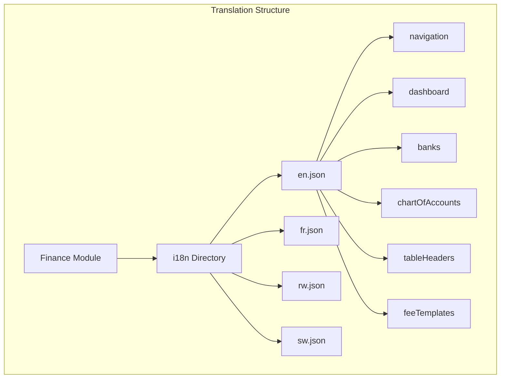
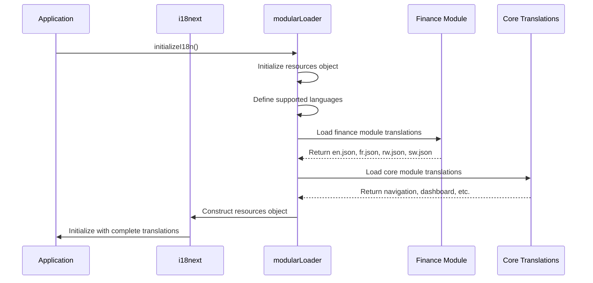
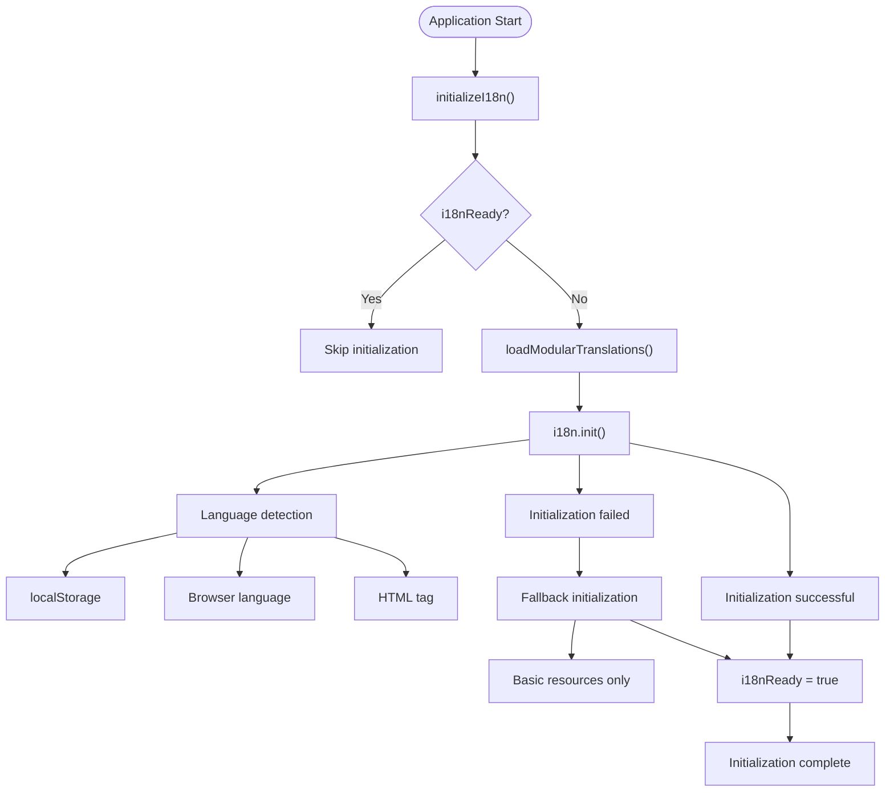
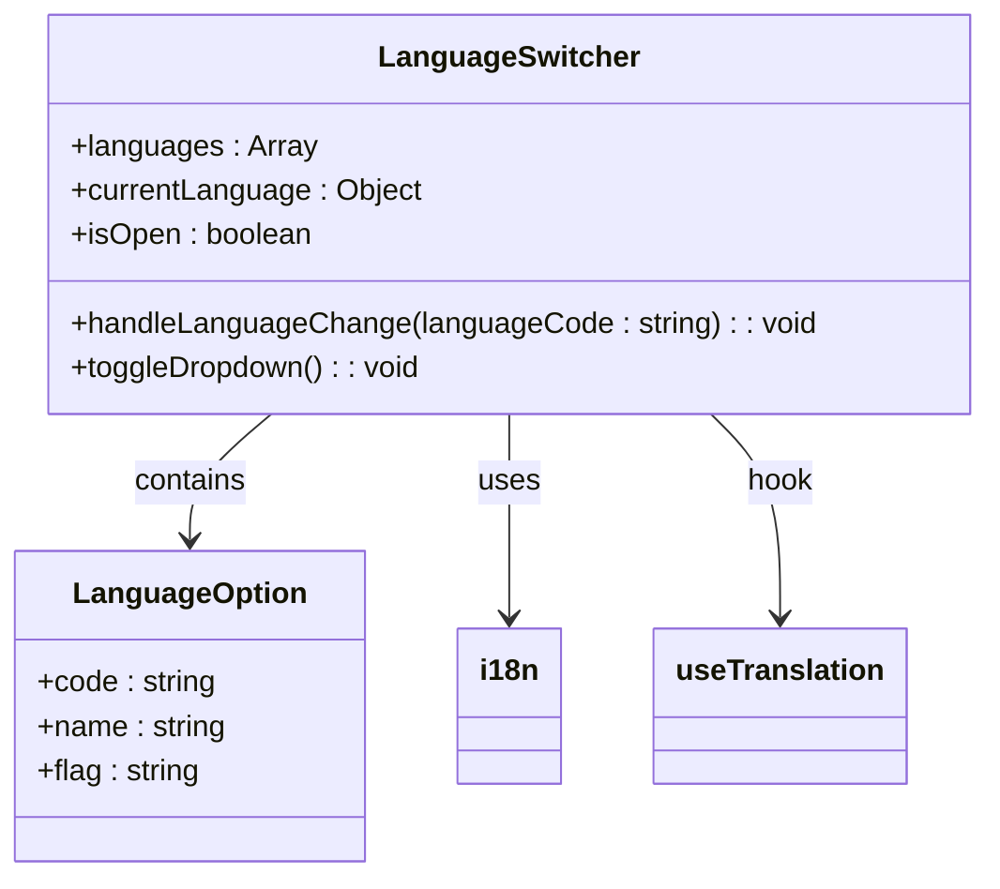
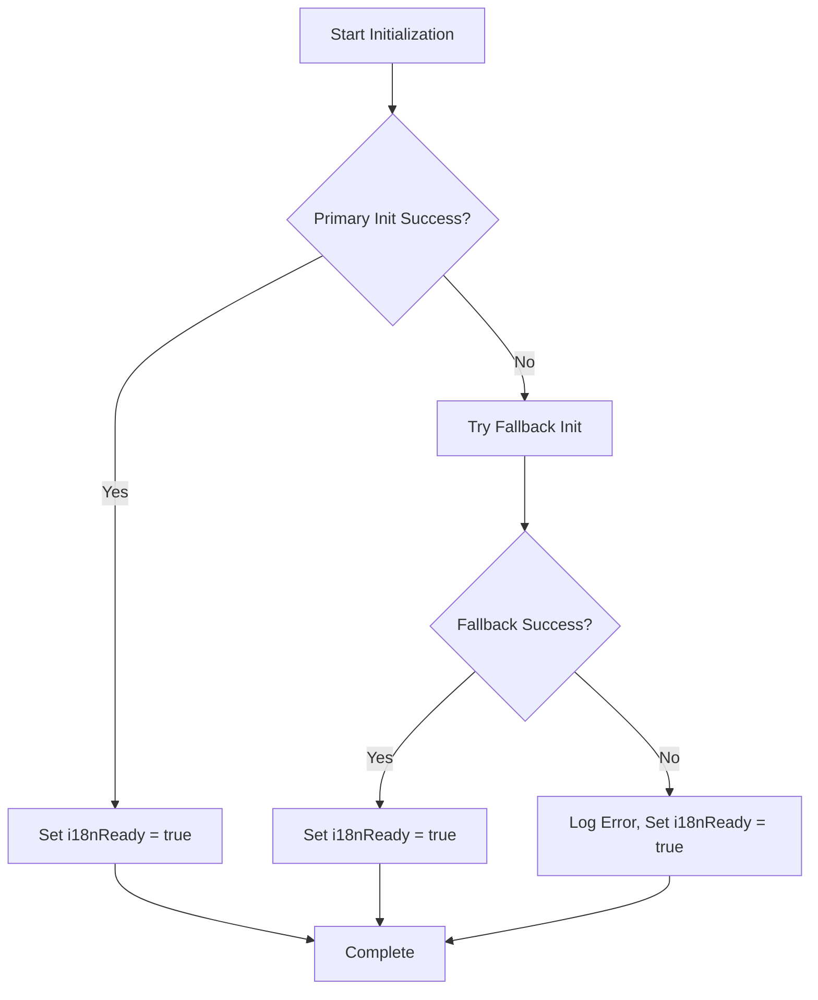

# Finance Internationalization

<cite>
**Referenced Files in This Document**   
- [i18n.ts](file://src/i18n/i18n.ts)
- [modularLoader.ts](file://src/i18n/modularLoader.ts)
- [LanguageSwitcher.tsx](file://src/components/ui/LanguageSwitcher.tsx)
- [FinanceDashboardPage.tsx](file://src/modules/finance/pages/FinanceDashboardPage.tsx)
- [en.json](file://src/modules/finance/i18n/en.json)
- [fr.json](file://src/modules/finance/i18n/fr.json)
- [rw.json](file://src/modules/finance/i18n/rw.json)
- [sw.json](file://src/modules/finance/i18n/sw.json)
- [finance.json](file://src/i18n/locales/en/finance.json)
</cite>

## Table of Contents
1. [Introduction](#introduction)
2. [Translation Structure and Organization](#translation-structure-and-organization)
3. [Supported Languages and Financial Terminology](#supported-languages-and-financial-terminology)
4. [Translation Integration and Loading Mechanism](#translation-integration-and-loading-mechanism)
5. [Consumption of Translated Strings in Finance Components](#consumption-of-translated-strings-in-finance-components)
6. [Fallback Mechanisms and Error Handling](#fallback-mechanisms-and-error-handling)
7. [Best Practices for Translation Maintenance](#best-practices-for-translation-maintenance)
8. [Currency Formatting and Regulatory Compliance](#currency-formatting-and-regulatory-compliance)
9. [Adding New Language Support](#adding-new-language-support)
10. [Conclusion](#conclusion)

## Introduction

The Finance module in schoolpilot3 implements a comprehensive internationalization (i18n) system to support multiple languages for financial operations, accounting, and budgeting. This documentation details the translation structure, content coverage, integration mechanisms, and best practices for maintaining multilingual financial functionality across the application. The system supports English, French, Kinyarwanda, and Swahili, with a modular architecture that enables consistent translation management across financial terms such as invoices, payments, ledgers, and fee templates.

**Section sources**
- [i18n.ts](file://src/i18n/i18n.ts#L0-L116)
- [modularLoader.ts](file://src/i18n/modularLoader.ts#L0-L66)

## Translation Structure and Organization

The internationalization system in schoolpilot3 follows a modular structure with translations organized both at the core application level and within individual modules. The Finance module maintains its own translation files in a dedicated i18n directory, allowing for module-specific financial terminology while integrating with the global translation system.

The translation structure is organized hierarchically with key categories that correspond to financial operations:

- **navigation**: Contains labels for navigation elements within the Finance module
- **dashboard**: Includes text for the finance dashboard interface
- **banks**: Manages translations for bank account management
- **chartOfAccounts**: Handles translations for chart of accounts functionality
- **tableHeaders**: Provides standardized translations for table column headers
- **feeTemplates**: Contains terminology related to fee templates and structures

Each language has its own JSON file (en.json, fr.json, rw.json, sw.json) within the finance module's i18n directory, ensuring that financial terms are accurately translated in context. The system also maintains a unified navigation namespace that aggregates navigation translations from all modules, allowing for consistent menu labeling across the application.



**Diagram sources**
- [en.json](file://src/modules/finance/i18n/en.json#L0-L90)
- [fr.json](file://src/modules/finance/i18n/fr.json#L0-L100)

**Section sources**
- [en.json](file://src/modules/finance/i18n/en.json#L0-L90)
- [fr.json](file://src/modules/finance/i18n/fr.json#L0-L100)
- [rw.json](file://src/modules/finance/i18n/rw.json#L0-L90)
- [sw.json](file://src/modules/finance/i18n/sw.json#L0-L90)

## Supported Languages and Financial Terminology

The Finance module supports four languages: English (en), French (fr), Kinyarwanda (rw), and Swahili (sw). Each language file contains comprehensive translations for financial terms and context-specific messaging used throughout the financial management interface.

### English Financial Terminology

The English translation file (en.json) contains the base financial terminology used in the application:

```json
{
  "navigation": {
    "finance": {
      "title": "Finance",
      "description": "Manage financial operations, accounting, and budgeting",
      "dashboard": "Dashboard",
      "banks": "Banks",
      "chartOfAccounts": "Chart of Accounts",
      "budgets": "Budgets",
      "transactions": "Transactions",
      "reports": "Reports",
      "invoices": "Invoices",
      "payments": "Payments",
      "expenses": "Expenses",
      "revenue": "Revenue",
      "feeTemplates": "Fee Templates"
    }
  },
  "dashboard": {
    "title": "Finance Dashboard",
    "totalIncome": "Total Income (Mock)",
    "totalExpenses": "Total Expenses (Mock)",
    "netPosition": "Net Position (Mock)",
    "outstandingInvoices": "Outstanding Invoices"
  }
}
```

### French Financial Terminology

The French translation (fr.json) provides accurate financial terminology for French-speaking users:

```json
{
  "navigation": {
    "finance": {
      "title": "Finance",
      "description": "Gérer tous les aspects financiers de l'école, y compris les frais scolaires, les paiements, les dépenses et la comptabilité.",
      "dashboard": "Tableau de Bord",
      "chartOfAccounts": "Plan Comptable",
      "feeTemplates": "Modèles de Frais"
    }
  },
  "dashboard": {
    "title": "Tableau de Bord des Finances",
    "totalIncome": "Revenu Total (Fictif)",
    "totalExpenses": "Dépenses Totales (Fictif)",
    "netPosition": "Position Nette (Fictif)"
  }
}
```

### Kinyarwanda Financial Terminology

The Kinyarwanda translation (rw.json) supports users in Rwanda:

```json
{
  "navigation": {
    "finance": {
      "title": "Imari",
      "description": "Gucunga ibikorwa by'imari, ibaruramari, n'ingengo y'imari",
      "dashboard": "Ikibaho",
      "chartOfAccounts": "Imbonerahamwe y'amakonti",
      "feeTemplates": "Inyandikorugero z'amafaranga y'ishuri"
    }
  },
  "dashboard": {
    "title": "Ikibaho cy'imari",
    "totalIncome": "Amafaranga yose yinjira (Urugero)",
    "totalExpenses": "Amafaranga yose akoreshwa (Urugero)",
    "netPosition": "Imiterere y'amafaranga (Urugero)"
  }
}
```

### Swahili Financial Terminology

The Swahili translation (sw.json) serves users in Swahili-speaking regions:

```json
{
  "navigation": {
    "finance": {
      "title": "Fedha",
      "description": "Kusimamia shughuli za kifedha, uhasibu, na bajeti",
      "dashboard": "Dashibodi",
      "chartOfAccounts": "Chati ya Akaunti",
      "feeTemplates": "Mifumo ya Ada"
    }
  },
  "dashboard": {
    "title": "Dashibodi ya Fedha",
    "totalIncome": "Jumla ya Mapato (Mfano)",
    "totalExpenses": "Jumla ya Gharama (Mfano)",
    "netPosition": "Msimamo wa Safi (Mfano)"
  }
}
```

The translation system covers key financial concepts including:
- **Invoice management**: Terms related to customer and supplier invoices
- **Payment processing**: Language for recording and managing payments
- **Ledger accounting**: Terminology for chart of accounts and general ledger
- **Fee structures**: Translations for fee templates, adjustments, and collection
- **Expense tracking**: Terms for managing school expenses and categories
- **Financial reporting**: Labels for financial reports and dashboards

**Section sources**
- [en.json](file://src/modules/finance/i18n/en.json#L0-L90)
- [fr.json](file://src/modules/finance/i18n/fr.json#L0-L100)
- [rw.json](file://src/modules/finance/i18n/rw.json#L0-L90)
- [sw.json](file://src/modules/finance/i18n/sw.json#L0-L90)

## Translation Integration and Loading Mechanism

The internationalization system in schoolpilot3 uses a modular loading approach that dynamically loads translation resources from both core application directories and individual modules. This architecture ensures that financial translations are properly integrated while maintaining separation of concerns.

### Modular Translation Loader

The `modularLoader.ts` file implements the core mechanism for loading translations from various sources:



**Diagram sources**
- [modularLoader.ts](file://src/i18n/modularLoader.ts#L0-L66)
- [i18n.ts](file://src/i18n/i18n.ts#L0-L116)

The `loadModularTranslations` function uses Vite's import.meta.glob to dynamically import translation files from each module's i18n directory. It processes both module-specific translations and core translations, constructing a comprehensive resources object that includes:

1. **Module-specific namespaces**: Each module (including finance) has its own namespace
2. **Unified navigation namespace**: Navigation translations are merged into a single namespace
3. **Language-specific resources**: Translations are organized by language code

The loader initializes resources for all supported languages (en, fr, sw, rw) and processes translation files from both the finance module and core modules. When a module contains navigation translations, these are extracted and merged into the unified navigation namespace, ensuring consistent menu labeling across the application.

### i18n Initialization Process

The main i18n configuration in `i18n.ts` orchestrates the initialization process:



**Diagram sources**
- [i18n.ts](file://src/i18n/i18n.ts#L0-L116)

The initialization process includes:
- **Language detection**: The system detects the user's preferred language using multiple methods in order: localStorage, browser navigator, and HTML tag
- **Caching**: Detected language preferences are cached in localStorage
- **Fallback mechanism**: If primary initialization fails, a fallback initialization with basic resources is attempted
- **Error handling**: Comprehensive error handling prevents initialization failures from crashing the application

The system is configured with a list of namespaces including 'common', 'navigation', 'dashboard', 'academics', 'administration', 'finance', 'hr', 'inventory', 'library', 'settings', 'student', and 'teacher', ensuring that all financial terms are properly loaded.

**Section sources**
- [i18n.ts](file://src/i18n/i18n.ts#L0-L116)
- [modularLoader.ts](file://src/i18n/modularLoader.ts#L0-L66)

## Consumption of Translated Strings in Finance Components

Translated strings are consumed in finance components using the `useTranslation` hook from react-i18next, which provides access to the translation functions and current language context.

### Finance Dashboard Implementation

The `FinanceDashboardPage.tsx` component demonstrates how translated strings are consumed in financial interfaces:

```typescript
import { useTranslation } from 'react-i18next';

const FinanceDashboardPage: React.FC = () => {
  const { t, ready } = useTranslation();
  
  return (
    <div className="space-y-6">
      <Card title={t('dashboard.title')} className="bg-white shadow-xl">
        <div className="p-6">
          <div className="grid grid-cols-1 md:grid-cols-2 lg:grid-cols-4 gap-6 mb-6">
            <StatCard 
              title={t('dashboard.totalIncome')} 
              value={`Ksh ${mockTotalIncome.toLocaleString()}`} 
              icon={<CurrencyDollarIcon />} 
              iconBgColor="bg-green-100" 
              iconColor="text-green-600"
            />
            <StatCard 
              title={t('dashboard.totalExpenses')} 
              value={`Ksh ${mockTotalExpenses.toLocaleString()}`} 
              icon={<CurrencyDollarIcon />} 
              iconBgColor="bg-red-100" 
              iconColor="text-red-600"
            />
          </div>
          
          <Card title={t('dashboard.quickLinksTitle')} className="mb-6">
            <div className="grid grid-cols-2 md:grid-cols-4 gap-4 p-4">
                <Button as={Link} to="/finance/student-payments" variant="outline" leftIcon={<ReceiptRefundIcon className="w-5 h-5"/>}>
                    {t('dashboard.recordPaymentButton')}
                </Button>
                <Button as={Link} to="/finance/expenses" variant="outline" leftIcon={<CurrencyDollarIcon className="w-5 h-5"/>}>
                    {t('dashboard.newExpenseButton')}
                </Button>
            </div>
          </Card>
        </div>
      </Card>
    </div>
  );
};
```

The component uses the `t` function to retrieve translated strings using dot notation to navigate the translation object hierarchy. For example, `t('dashboard.title')` retrieves the "Finance Dashboard" string from the dashboard namespace.

### Translation Key Structure

The translation keys follow a hierarchical structure that mirrors the component organization:

- **navigation.finance.title**: Main navigation title
- **dashboard.title**: Dashboard page title
- **dashboard.totalIncome**: Label for total income statistic
- **banks.title**: Title for bank management page
- **chartOfAccounts.title**: Title for chart of accounts page
- **tableHeaders.bankName**: Header for bank name column

This structure enables precise targeting of specific UI elements while maintaining organizational clarity.

### Language Switching Interface

The `LanguageSwitcher.tsx` component provides users with the ability to switch between available languages:



**Diagram sources**
- [LanguageSwitcher.tsx](file://src/components/ui/LanguageSwitcher.tsx#L0-L118)

The language switcher displays available languages with their flags and names, allowing users to change the interface language. When a user selects a language, the component calls `i18n.changeLanguage(languageCode)` to update the application's language setting, which triggers a re-render of all components with the new translations.

**Section sources**
- [FinanceDashboardPage.tsx](file://src/modules/finance/pages/FinanceDashboardPage.tsx#L0-L124)
- [LanguageSwitcher.tsx](file://src/components/ui/LanguageSwitcher.tsx#L0-L118)

## Fallback Mechanisms and Error Handling

The internationalization system implements robust fallback mechanisms to ensure application stability when translation resources are unavailable or fail to load.

### Primary Fallback Strategy

The system employs a two-tiered initialization approach:



**Diagram sources**
- [i18n.ts](file://src/i18n/i18n.ts#L0-L116)

If the primary initialization fails, the system attempts a fallback initialization with basic resources for essential namespaces ('common', 'navigation', 'settings'). This ensures that critical UI elements remain functional even if module-specific translations cannot be loaded.

### Error Handling Implementation

The error handling strategy includes:

1. **Initialization state tracking**: The `i18nReady` flag prevents multiple concurrent initialization attempts
2. **Promise-based initialization**: The `initializationPromise` ensures that initialization is only attempted once
3. **Comprehensive logging**: All initialization steps and errors are logged for debugging
4. **Graceful degradation**: If both primary and fallback initialization fail, the system sets `i18nReady = true` to prevent infinite loops while maintaining application functionality

The system also handles errors in the language switching component, with try-catch blocks around critical operations to prevent UI crashes when changing languages.

**Section sources**
- [i18n.ts](file://src/i18n/i18n.ts#L0-L116)

## Best Practices for Translation Maintenance

Maintaining translation consistency across the Finance module requires adherence to specific best practices and organizational principles.

### Translation Key Organization

Translation keys should follow a consistent hierarchical structure:

- **Use descriptive namespaces**: Group translations by functional area (dashboard, banks, chartOfAccounts)
- **Maintain consistent naming**: Use the same key names across languages for equivalent terms
- **Include context in keys**: Use descriptive key names that indicate the UI context
- **Avoid abbreviations**: Use full words in key names for clarity

### Consistency Guidelines

To ensure translation consistency:

1. **Maintain parallel structure**: Keep the same JSON structure across all language files
2. **Update all languages simultaneously**: When adding new keys, add them to all language files
3. **Use consistent terminology**: Use the same translation for the same concept throughout the application
4. **Document specialized terms**: Maintain a glossary of financial terms and their approved translations

### Translation Completeness

The system should ensure that all required translations are available:

- **Regular audits**: Use tools like `translation-completeness-check.js` to verify translation coverage
- **Automated testing**: Include translation integrity tests in the test suite
- **Missing key handling**: Configure i18next to return empty strings instead of null for missing keys

**Section sources**
- [en.json](file://src/modules/finance/i18n/en.json#L0-L90)
- [fr.json](file://src/modules/finance/i18n/fr.json#L0-L100)
- [rw.json](file://src/modules/finance/i18n/rw.json#L0-L90)
- [sw.json](file://src/modules/finance/i18n/sw.json#L0-L90)

## Currency Formatting and Regulatory Compliance

The Finance module must handle currency formatting differences and ensure regulatory compliance in multilingual environments.

### Currency Formatting

While the current implementation uses "Ksh" (Kenyan Shillings) as the currency symbol, a robust internationalization system should:

- **Support multiple currencies**: Allow configuration of currency based on institution location
- **Implement locale-specific formatting**: Use appropriate decimal separators, thousands separators, and currency positioning
- **Provide currency conversion**: Support multi-currency transactions when needed

The current implementation shows currency values with the "Ksh" prefix and uses `toLocaleString()` for number formatting:

```typescript
value={`Ksh ${mockTotalIncome.toLocaleString()}`}
```

### Regulatory Compliance

For multilingual financial systems, regulatory compliance requires:

1. **Audit trails**: Maintain records of financial transactions in the original language
2. **Legal document consistency**: Ensure financial reports and invoices use consistent terminology
3. **Data privacy**: Protect financial data according to regional regulations
4. **Reporting standards**: Adhere to accounting standards in the relevant jurisdiction

The system should also consider:
- **Date formatting**: Use locale-appropriate date formats in financial reports
- **Number formatting**: Adapt decimal and thousands separators to regional conventions
- **Legal disclaimers**: Translate legal terms accurately with input from legal experts

**Section sources**
- [FinanceDashboardPage.tsx](file://src/modules/finance/pages/FinanceDashboardPage.tsx#L0-L124)

## Adding New Language Support

Adding new language support to the Finance module follows a systematic process:

### Step 1: Add Language to Supported List

Update the modular loader to include the new language:

```typescript
export const loadModularTranslations = async () => {
  const resources: any = {
    en: { translation: {} },
    fr: { translation: {} },
    sw: { translation: {} },
    rw: { translation: {} },
    // Add new language here
    es: { translation: {} }
  };
  // ... rest of implementation
};
```

### Step 2: Create Translation Files

Create a new JSON file in the finance module's i18n directory with the language code (e.g., `es.json` for Spanish). The file should mirror the structure of existing translation files:

```json
{
  "navigation": {
    "finance": {
      "title": "Finanzas",
      "description": "Gestione operaciones financieras, contabilidad y presupuesto",
      "dashboard": "Panel",
      "banks": "Bancos",
      "chartOfAccounts": "Plan de Cuentas"
    }
  },
  "dashboard": {
    "title": "Panel de Finanzas",
    "totalIncome": "Ingresos Totales (Simulados)",
    "totalExpenses": "Gastos Totales (Simulados)"
  }
}
```

### Step 3: Update Language Switcher

Add the new language to the LanguageSwitcher component:

```typescript
const languages = useMemo(() => {
  return [
    { code: 'en', name: 'English', flag: '🇺🇸' },
    { code: 'fr', name: 'Français', flag: '🇫🇷' },
    { code: 'es', name: 'Español', flag: '🇪🇸' },
    // Add new language here
    { code: 'de', name: 'Deutsch', flag: '🇩🇪' }
  ];
}, []);
```

### Step 4: Test Implementation

Verify the new language support by:
- Testing all financial pages with the new language selected
- Checking for missing translation keys
- Validating currency and number formatting
- Ensuring all UI elements are properly translated

The modular architecture makes it relatively straightforward to add new languages, as the system automatically loads translation files from the standardized directory structure.

**Section sources**
- [modularLoader.ts](file://src/i18n/modularLoader.ts#L0-L66)
- [LanguageSwitcher.tsx](file://src/components/ui/LanguageSwitcher.tsx#L0-L118)
- [en.json](file://src/modules/finance/i18n/en.json#L0-L90)

## Conclusion

The Finance module's internationalization system in schoolpilot3 provides a robust framework for supporting multiple languages in financial operations. The modular architecture separates translation concerns while maintaining integration with the global i18n system, allowing for consistent financial terminology across the application.

Key strengths of the system include:
- **Modular translation loading**: Dynamic loading of translation resources from multiple sources
- **Comprehensive language support**: Full translations for English, French, Kinyarwanda, and Swahili
- **Robust fallback mechanisms**: Graceful degradation when translation resources fail to load
- **Consistent key organization**: Hierarchical structure that mirrors component organization
- **User-friendly language switching**: Intuitive interface for changing application language

To further enhance the system, consider implementing:
- **Translation management interface**: A UI for administrators to manage translations
- **Automated translation validation**: Tools to verify translation completeness and consistency
- **Enhanced currency support**: Configuration for multiple currencies and locale-specific formatting
- **Translation memory**: Reuse of previously translated terms across the application

The current implementation provides a solid foundation for multilingual financial management, ensuring that school administrators can operate the system in their preferred language while maintaining accurate financial records and reporting.