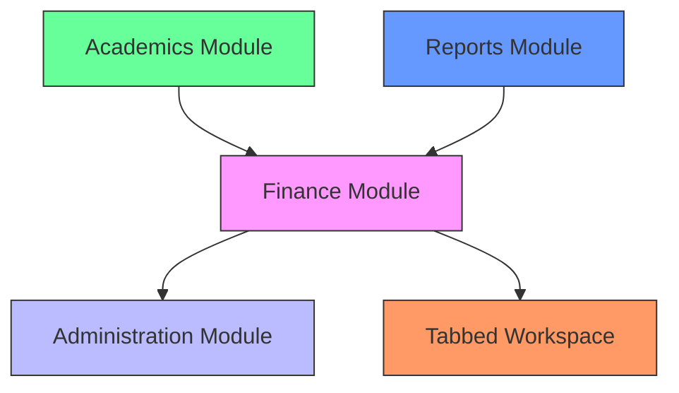
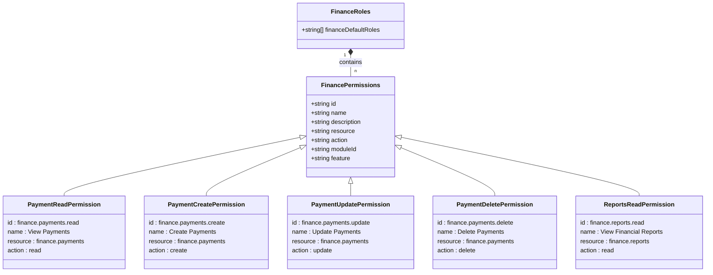
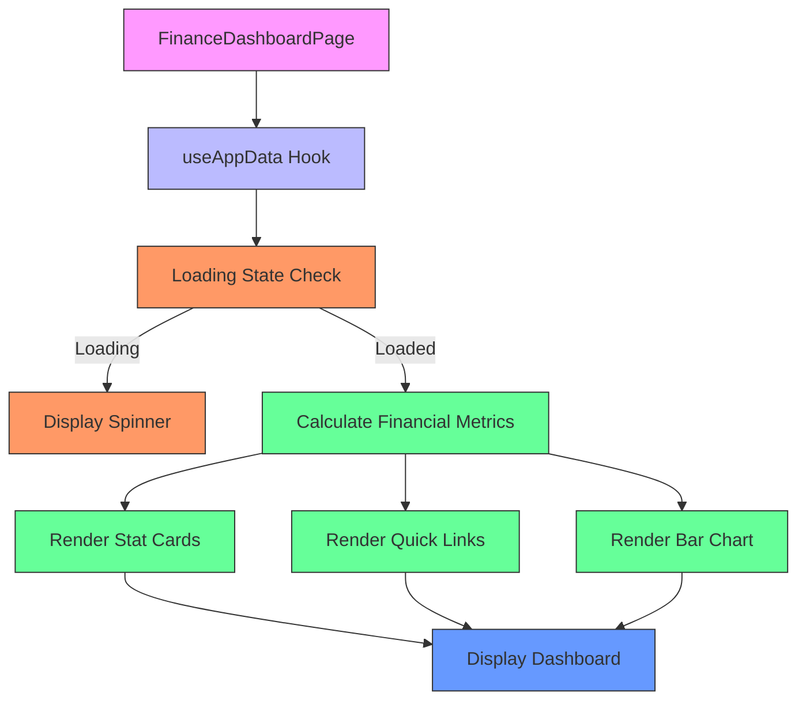
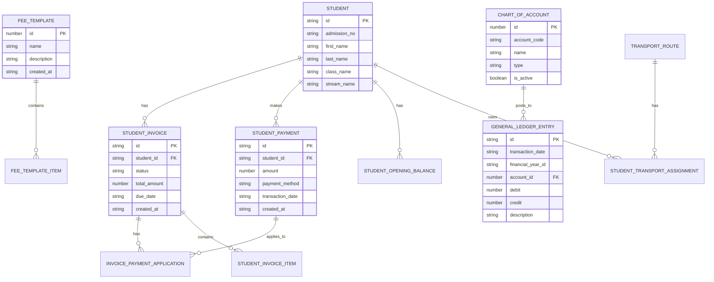
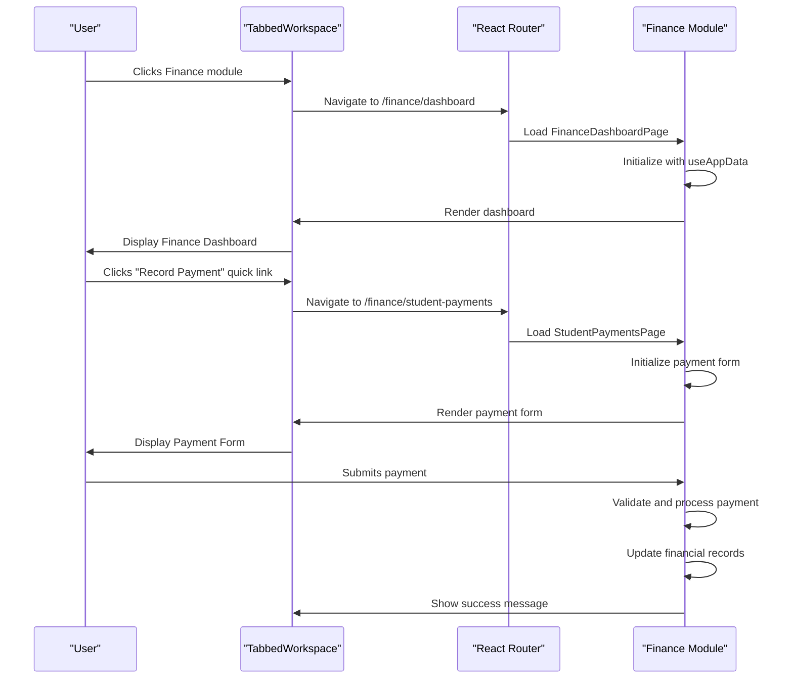
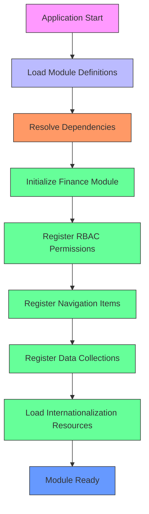

# Finance Module Overview

<cite>
**Referenced Files in This Document**   
- [moduleDefinition.tsx](file://src/modules/finance/moduleDefinition.tsx)
- [rbac.ts](file://src/modules/finance/rbac.ts)
- [FinanceDashboardPage.tsx](file://src/modules/finance/pages/FinanceDashboardPage.tsx)
- [StudentFinancialDetailPage.tsx](file://src/modules/administration/pages/StudentFinancialDetailPage.tsx)
- [collections.ts](file://src/modules/finance/data/collections.ts)
- [schema.ts](file://src/modules/finance/data/schema.ts)
- [types.ts](file://src/core/types.ts)
- [modules.json](file://src/config/modules.json)
- [finance.json](file://src/i18n/locales/en/finance.json)
</cite>

## Table of Contents
1. [Module Purpose and Scope](#module-purpose-and-scope)
2. [Architecture and Module Registration](#architecture-and-module-registration)
3. [Permission Control and RBAC](#permission-control-and-rbac)
4. [Dashboard Layout and Navigation](#dashboard-layout-and-navigation)
5. [Integration Points with Other Modules](#integration-points-with-other-modules)
6. [Dynamic Loading and Tabbed Workspace Integration](#dynamic-loading-and-tabbed-workspace-integration)
7. [Configuration and Initialization](#configuration-and-initialization)

## Module Purpose and Scope

The Finance module in schoolpilot3 is designed to manage all financial operations within an educational institution. It provides comprehensive tools for fee collection, invoicing, payment processing, accounting, and expense tracking. The module serves as the central hub for financial data management, enabling administrators to oversee revenue streams, monitor expenses, generate financial reports, and maintain accurate accounting records.

Key functionalities include:
- **Fee Management**: Creation and management of fee templates, fee structures, and fee adjustments
- **Payment Processing**: Recording student payments, processing general receipts, and managing payment applications
- **Accounting**: Maintaining a chart of accounts, recording general ledger entries, and managing financial years
- **Expense Tracking**: Managing expense categories, recording supplier invoices, and processing expense claims
- **Financial Reporting**: Generating fee collection summaries, account ledgers, and financial position reports

The module integrates financial data across various aspects of school operations, ensuring that financial records are synchronized with student information, academic activities, and administrative functions.

**Section sources**
- [moduleDefinition.tsx](file://src/modules/finance/moduleDefinition.tsx)
- [finance.json](file://src/i18n/locales/en/finance.json)

## Architecture and Module Registration

The Finance module follows the modular architecture of schoolpilot3, registering itself through the `moduleDefinition.tsx` file. This registration process defines the module's metadata, navigation structure, dependencies, and configuration settings.

The module is defined as a `ModuleDefinition` object with the following key properties:

```typescript
export const financeModule: ModuleDefinition = {
  id: 'finance',
  name: 'navigation:finance.title',
  description: 'navigation:finance.description',
  icon: CurrencyDollarIcon,
  path: '/finance',
  isActive: true,
  version: '1.0.0',
  navigation: [
    { name: 'navigation:finance.dashboard', path: '/finance/dashboard', icon: CurrencyDollarIcon, page: 'FinanceDashboardPage' },
    { name: 'navigation:finance.chartOfAccounts', path: '/finance/chart-of-accounts', icon: DocumentTextIcon, page: 'ChartOfAccountsPage' },
    // Additional navigation items...
  ],
  features: ['fee-management', 'payment-processing', 'accounting', 'expense-tracking', 'transport-finance'],
  dependencies: [
    {
      moduleId: 'administration',
      version: '^1.0.0',
      required: true
    }
  ],
  settings: {
    category: 'finance',
    items: [
      {
        key: 'enableFeeManagement',
        type: 'boolean',
        defaultValue: true
      },
      {
        key: 'enablePaymentProcessing',
        type: 'boolean',
        defaultValue: true
      },
      {
        key: 'enableExpenseTracking',
        type: 'boolean',
        defaultValue: true
      }
    ]
  },
  rbacPermissions: financePermissions,
  defaultRoles: financeDefaultRoles,
};
```

The module registration includes a navigation array that defines the routes and corresponding page components for each feature within the Finance module. Each navigation item specifies a name (referencing internationalized text), path, icon, and page component.

The module declares a dependency on the Administration module, which is required for accessing student and staff data. This dependency is explicitly defined in both the `moduleDefinition.tsx` file and the global `modules.json` configuration file.



**Diagram sources**
- [moduleDefinition.tsx](file://src/modules/finance/moduleDefinition.tsx)
- [modules.json](file://src/config/modules.json)

**Section sources**
- [moduleDefinition.tsx](file://src/modules/finance/moduleDefinition.tsx)
- [modules.json](file://src/config/modules.json)

## Permission Control and RBAC

The Finance module implements a robust Role-Based Access Control (RBAC) system through the `rbac.ts` file. This system defines granular permissions for different financial operations, allowing administrators to control access based on user roles and responsibilities.

The module defines a set of permissions that cover various financial operations:

```typescript
export const financePermissions: Permission[] = [
  {
    id: 'finance.payments.read',
    name: 'View Payments',
    description: 'View payment information',
    resource: 'finance.payments',
    action: 'read',
    moduleId: 'finance',
    feature: 'payment-processing',
  },
  {
    id: 'finance.payments.create',
    name: 'Create Payments',
    description: 'Create new payments',
    resource: 'finance.payments',
    action: 'create',
    moduleId: 'finance',
    feature: 'payment-processing',
  },
  {
    id: 'finance.payments.update',
    name: 'Update Payments',
    description: 'Update payment information',
    resource: 'finance.payments',
    action: 'update',
    moduleId: 'finance',
    feature: 'payment-processing',
  },
  {
    id: 'finance.payments.delete',
    name: 'Delete Payments',
    description: 'Delete payments',
    resource: 'finance.payments',
    action: 'delete',
    moduleId: 'finance',
    feature: 'payment-processing',
  },
  {
    id: 'finance.reports.read',
    name: 'View Financial Reports',
    description: 'View financial reports',
    resource: 'finance.reports',
    action: 'read',
    moduleId: 'finance',
    feature: 'reporting',
  },
];
```

These permissions are organized by resource and action, following a consistent naming convention: `finance.<resource>.<action>`. The permissions cover key financial operations including payments, invoices, expenses, and reporting.

The module also defines default roles that have access to financial functionality:

```typescript
export const financeDefaultRoles = ['finance_officer', 'administrator'];
```

This RBAC implementation allows for fine-grained control over financial operations, ensuring that users can only perform actions appropriate to their roles. For example, a finance officer might have read and create permissions for payments, while an administrator might have full access to all financial operations.



**Diagram sources**
- [rbac.ts](file://src/modules/finance/rbac.ts)

**Section sources**
- [rbac.ts](file://src/modules/finance/rbac.ts)

## Dashboard Layout and Navigation

The Finance module provides a comprehensive dashboard through the `FinanceDashboardPage.tsx` component, which serves as the central interface for financial operations. The dashboard is designed to provide an overview of key financial metrics while offering quick access to essential functionality.

The dashboard layout consists of several key components:

1. **Statistical Summary Cards**: Displaying key financial metrics such as total income, total expenses, net position, and outstanding invoices
2. **Quick Links Section**: Providing direct access to common financial operations
3. **Income vs Expenses Chart**: Visualizing financial performance over time
4. **Welcome Section**: Offering contextual information about the financial management capabilities

The implementation of the dashboard uses a responsive grid layout that adapts to different screen sizes:

```tsx
return (
  <div className="space-y-6">
    <Card title="Finance Dashboard" className="bg-white shadow-xl">
      <div className="p-6">
        <div className="grid grid-cols-1 md:grid-cols-2 lg:grid-cols-4 gap-6 mb-6">
          <StatCard title="Total Income (Mock)" value={`Ksh ${mockTotalIncome.toLocaleString()}`} icon={<CurrencyDollarIcon />} iconBgColor="bg-green-100" iconColor="text-green-600"/>
          <StatCard title="Total Expenses (Mock)" value={`Ksh ${mockTotalExpenses.toLocaleString()}`} icon={<CurrencyDollarIcon />} iconBgColor="bg-red-100" iconColor="text-red-600"/>
          <StatCard title="Net Position (Mock)" value={`Ksh ${mockNetPosition.toLocaleString()}`} icon={<CurrencyDollarIcon />} iconBgColor="bg-blue-100" iconColor="text-blue-600"/>
          <StatCard title="Outstanding Invoices" value={mockOutstandingInvoices} icon={<ReceiptRefundIcon />} iconBgColor="bg-orange-100" iconColor="text-orange-600"/>
        </div>

        <Card title="Quick Links" className="mb-6">
          <div className="grid grid-cols-2 md:grid-cols-4 gap-4 p-4">
              <Button as={Link} to="/finance/student-payments" variant="outline" leftIcon={<ReceiptRefundIcon className="w-5 h-5"/>}>
                  Record Payment
              </Button>
              <Button as={Link} to="/finance/expenses" variant="outline" leftIcon={<CurrencyDollarIcon className="w-5 h-5"/>}>
                  New Expense
              </Button>
              <Button as={Link} to="/finance/fee-templates" variant="outline" leftIcon={<TicketIcon className="w-5 h-5"/>}>
                  Fee Templates
              </Button>
              <Button as={Link} to="/finance/general-receipts" variant="outline" leftIcon={<PlusIcon className="w-5 h-5"/>}>
                  General Receipts
              </Button>
          </div>
        </Card>

        <Card title="Income vs Expenses (Last 6 Months - Mock)" className="mt-6">
           <BarChart 
              data={incomeExpenseData} 
              xAxisKey="name" 
              barDataKey="uv"
          />
        </Card>
      </div>
    </Card>
  </div>
);
```

The dashboard retrieves financial data through the `useAppData` hook, which provides access to various financial entities such as banks, chart of accounts, suppliers, fee templates, and student invoices. The component handles loading states and displays a spinner when data is being fetched.



**Diagram sources**
- [FinanceDashboardPage.tsx](file://src/modules/finance/pages/FinanceDashboardPage.tsx)

**Section sources**
- [FinanceDashboardPage.tsx](file://src/modules/finance/pages/FinanceDashboardPage.tsx)

## Integration Points with Other Modules

The Finance module integrates with several other modules in the schoolpilot3 system to provide a comprehensive financial management solution. These integrations ensure that financial data is synchronized across different aspects of school operations.

### Integration with Administration Module

The Finance module has a direct dependency on the Administration module, which provides access to student and staff data. This integration enables the Finance module to:

- Access student records for fee collection and payment processing
- Retrieve staff information for payroll-related financial transactions
- Link financial records to specific students and staff members

The dependency is explicitly defined in the module configuration:

```json
"moduleDependencies": {
  "finance": ["administration"]
}
```

The integration is further demonstrated in the `StudentFinancialDetailPage.tsx` component in the Administration module, which displays financial information for individual students:

```tsx
const StudentFinancialDetailPage: React.FC = () => {
  const { studentId } = useParams<{ studentId: string }>();
  const { getStudentFinancialDetailsById, loading } = useAppData();
  // ...
  
  return (
    // ...
    {financial_summary && (
      <Card title="Financial Summary">
        <div className="space-y-3 text-sm">
          <div className="flex justify-between items-center">
            <span className="font-medium text-gray-600">Current Balance:</span>
            <span className={`text-xl font-bold ${getBalanceColor(financial_summary.currentBalance)}`}>
              {formatCurrency(financial_summary.currentBalance)}
            </span>
          </div>
          <div className="flex justify-between">
            <span className="text-gray-500">Total Fees Billed:</span>
            <span className="text-gray-700 font-medium">{formatCurrency(financial_summary.totalFees)}</span>
          </div>
          <div className="flex justify-between">
            <span className="text-gray-500">Total Paid:</span>
            <span className="text-gray-700 font-medium">{formatCurrency(financial_summary.totalPaid)}</span>
          </div>
        </div>
      </Card>
    )}
    // ...
  );
};
```

### Integration with Academics Module

The Finance module integrates with the Academics module to support exam fee clearance and other academic-related financial transactions. While the Academics module does not have a direct dependency on Finance, it can optionally use financial data for certain operations.

The integration allows for:
- Verification of fee payment status before allowing students to sit for exams
- Generation of financial reports that combine academic performance with financial data
- Management of fees related to academic activities (e.g., exam fees, subject fees)

The Reports module, which depends on both Academics and Finance modules, facilitates this integration by providing combined reports:

```typescript
export const reportsModule: ModuleDefinition = {
  // ...
  dependencies: [
    {
      moduleId: 'administration',
      version: '^1.0.0',
      required: true
    },
    {
      moduleId: 'academics',
      version: '^1.0.0',
      required: true
    },
    {
      moduleId: 'finance',
      version: '^1.0.0',
      required: true
    }
  ],
  // ...
};
```

### Data Model Integration

The Finance module's data model is designed to integrate with other modules through shared data structures and relationships. The module defines collections for various financial entities:

```typescript
const financeCollections = {
  financial_years: {
    schema: schemas.financialYearsSchema,
  },
  chart_of_accounts: {
    schema: schemas.chartOfAccountsSchema,
  },
  fee_templates: {
    schema: schemas.feeTemplatesSchema,
  },
  student_invoices: {
    schema: schemas.studentInvoicesSchema,
  },
  student_payments: {
    schema: schemas.studentPaymentsSchema,
  },
  // ... other collections
};
```

These collections include references to entities from other modules, such as student IDs that link to records in the Administration module. This creates a unified data model where financial transactions are directly associated with students, staff, and other entities.



**Diagram sources**
- [collections.ts](file://src/modules/finance/data/collections.ts)
- [schema.ts](file://src/modules/finance/data/schema.ts)
- [types.ts](file://src/core/types.ts)
- [StudentFinancialDetailPage.tsx](file://src/modules/administration/pages/StudentFinancialDetailPage.tsx)

**Section sources**
- [collections.ts](file://src/modules/finance/data/collections.ts)
- [schema.ts](file://src/modules/finance/data/schema.ts)
- [types.ts](file://src/core/types.ts)
- [StudentFinancialDetailPage.tsx](file://src/modules/administration/pages/StudentFinancialDetailPage.tsx)
- [modules.json](file://src/config/modules.json)

## Dynamic Loading and Tabbed Workspace Integration

The Finance module is integrated into the tabbed workspace interface of schoolpilot3, allowing users to navigate between different modules and pages within tabs. This integration enables a seamless user experience where financial operations can be performed alongside other administrative tasks.

The dynamic loading mechanism is facilitated by the core module loading system, which registers module actions and components. The Finance module's actions are registered in the `moduleActions.ts` file:

```typescript
export const financeActions: ActionDefinition[] = [
  {
    id: 'finance.record_payment',
    label: 'Record Payment',
    icon: 'CreditCard',
    variant: 'primary',
    module: 'finance',
    submodule: 'payments',
    requiredPermissions: ['finance.payments.create'],
    onClick: async () => {
      console.log('Recording payment');
    }
  },
  {
    id: 'finance.create_invoice',
    label: 'Create Invoice',
    icon: 'DocumentText',
    variant: 'secondary',
    module: 'finance',
    submodule: 'invoices',
    requiredPermissions: ['finance.invoices.create'],
    onClick: async () => {
      console.log('Creating invoice');
    }
  }
  // ... other actions
];
```

When a user navigates to the Finance module, the tabbed workspace dynamically loads the appropriate component based on the route. The navigation structure defined in `moduleDefinition.tsx` maps routes to specific page components:

```typescript
navigation: [
  { name: 'navigation:finance.dashboard', path: '/finance/dashboard', icon: CurrencyDollarIcon, page: 'FinanceDashboardPage' },
  { name: 'navigation:finance.chartOfAccounts', path: '/finance/chart-of-accounts', icon: DocumentTextIcon, page: 'ChartOfAccountsPage' },
  // ... other routes
]
```

The tabbed workspace system uses React Router for navigation and dynamically imports page components when needed. This approach optimizes performance by only loading components when they are accessed.

The integration with the tabbed workspace is further enhanced by the module's ability to preserve state across navigation. When users switch between tabs, the Finance module maintains its state, allowing them to return to previously viewed financial data without reloading.



**Diagram sources**
- [moduleDefinition.tsx](file://src/modules/finance/moduleDefinition.tsx)
- [TabbedWorkspace.test.tsx](file://src/tests/integration/TabNavigation.test.tsx)
- [index.ts](file://src/components/tabbedWorkspace/index.ts)

**Section sources**
- [moduleDefinition.tsx](file://src/modules/finance/moduleDefinition.tsx)
- [TabbedWorkspace.test.tsx](file://src/tests/integration/TabNavigation.test.tsx)
- [index.ts](file://src/components/tabbedWorkspace/index.ts)

## Configuration and Initialization

The Finance module follows a standardized initialization pattern consistent with other modules in the schoolpilot3 system. The configuration and initialization process ensures that the module is properly set up and integrated with the rest of the application.

### Module Configuration

The module's configuration is defined in multiple locations:

1. **moduleDefinition.tsx**: Contains the primary module definition with metadata, navigation, dependencies, and settings
2. **modules.json**: Global configuration file that defines module dependencies and enabled status
3. **rbac.ts**: Defines permissions and default roles for the module
4. **finance.json**: Internationalization file containing translated text for the module

The module settings allow administrators to enable or disable specific features:

```typescript
settings: {
  category: 'finance',
  items: [
    {
      key: 'enableFeeManagement',
      type: 'boolean',
      defaultValue: true
    },
    {
      key: 'enablePaymentProcessing',
      type: 'boolean',
      defaultValue: true
    },
    {
      key: 'enableExpenseTracking',
      type: 'boolean',
      defaultValue: true
    }
  ]
}
```

These settings can be modified through the system's configuration interface, allowing schools to customize the financial functionality based on their needs.

### Initialization Process

When the application starts, the Finance module is initialized through the following process:

1. The core module registry loads the module definition from `moduleDefinition.tsx`
2. Dependencies are resolved, ensuring that the Administration module is loaded first
3. The module's RBAC permissions are registered with the global permission system
4. Navigation items are added to the main navigation menu
5. The module's data collections are registered with the database service
6. Internationalization resources are loaded from `finance.json`

The initialization process is handled by the core module loading system, which ensures that modules are loaded in the correct order based on their dependencies.

### Data Model Initialization

The Finance module defines its data model through schema definitions in the `data/schema.ts` file. These schemas define the structure of financial entities such as financial years, chart of accounts, fee templates, and student invoices.

```typescript
export const financialYearsSchema: DatabaseSchema = createDatabaseSchema({
    title: 'financial_year',
    primaryKey: 'id',
    properties: {
        id: SchemaHelpers.string({ maxLength: 100 }),
        academic_year_id: SchemaHelpers.string({ maxLength: 100 }),
        period_definition_id: SchemaHelpers.string({ maxLength: 100 }),
        financial_year_id: SchemaHelpers.string({ maxLength: 100 }),
        start_date: SchemaHelpers.date(),
        end_date: SchemaHelpers.date(),
        is_active: SchemaHelpers.boolean(),
        // ... other properties
    },
    required: ['id', 'academic_year_id', 'period_definition_id', 'financial_year_id', 'start_date', 'end_date', 'is_active'],
});
```

These schemas are used to create database collections when the application is initialized or when the database is migrated to a new version.



**Diagram sources**
- [moduleDefinition.tsx](file://src/modules/finance/moduleDefinition.tsx)
- [schema.ts](file://src/modules/finance/data/schema.ts)
- [rbac.ts](file://src/modules/finance/rbac.ts)
- [finance.json](file://src/i18n/locales/en/finance.json)

**Section sources**
- [moduleDefinition.tsx](file://src/modules/finance/moduleDefinition.tsx)
- [schema.ts](file://src/modules/finance/data/schema.ts)
- [rbac.ts](file://src/modules/finance/rbac.ts)
- [finance.json](file://src/i18n/locales/en/finance.json)
- [modules.json](file://src/config/modules.json)