# Chart of Accounts Management

<cite>
**Referenced Files in This Document**   
- [ChartOfAccountsPage.tsx](file://src/modules/finance/pages/ChartOfAccountsPage.tsx#L0-L295)
- [useChartOfAccountData.ts](file://src/modules/finance/data/useChartOfAccountData.ts#L0-L41)
- [types.ts](file://src/modules/finance/data/types.ts#L0-L280)
- [rbac.ts](file://src/modules/finance/rbac.ts#L0-L51)
- [useGeneralLedgerEntryData.ts](file://src/modules/finance/data/useGeneralLedgerEntryData.ts#L0-L57)
- [useAppData.ts](file://src/hooks/useAppData.ts#L1337-L1371)
- [export-database.ts](file://src/scripts/data-migration/export-database.ts#L0-L73)
</cite>

## Table of Contents
1. [Introduction](#introduction)
2. [Core Functionality](#core-functionality)
3. [Data Structure and Validation](#data-structure-and-validation)
4. [User Interface and Interaction](#user-interface-and-interaction)
5. [Integration with General Ledger](#integration-with-general-ledger)
6. [Permission-Based Access Control](#permission-based-access-control)
7. [Export Capabilities](#export-capabilities)
8. [Common Challenges and Troubleshooting](#common-challenges-and-troubleshooting)
9. [Performance Considerations](#performance-considerations)

## Introduction
The Chart of Accounts Management system in schoolpilot3 provides a comprehensive interface for defining and maintaining the school's financial account hierarchy. This document details the implementation, functionality, and integration points of the ChartOfAccountsPage component, which serves as the central hub for managing financial accounts categorized as assets, liabilities, equity, revenue, and expenses.

**Section sources**
- [ChartOfAccountsPage.tsx](file://src/modules/finance/pages/ChartOfAccountsPage.tsx#L0-L295)

## Core Functionality

### Chart of Accounts Management System
The ChartOfAccountsPage component enables users to define and maintain the school's financial account hierarchy through a user-friendly interface. The system supports the creation, editing, and deletion of financial accounts, with proper validation and error handling.

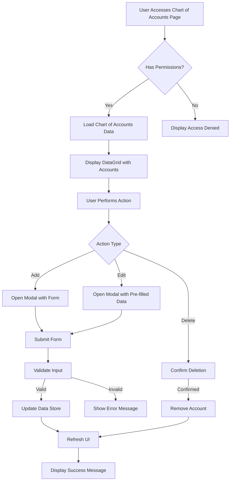

**Diagram sources**
- [ChartOfAccountsPage.tsx](file://src/modules/finance/pages/ChartOfAccountsPage.tsx#L0-L295)

**Section sources**
- [ChartOfAccountsPage.tsx](file://src/modules/finance/pages/ChartOfAccountsPage.tsx#L0-L295)

## Data Structure and Validation

### Chart of Accounts Data Model
The financial account data structure is defined with comprehensive type safety using TypeScript interfaces and enums. The system enforces strict validation rules for account codes and types to maintain data integrity.

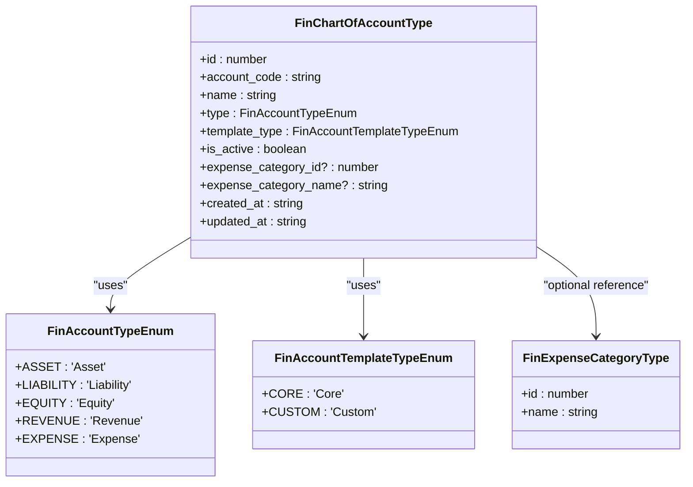

**Diagram sources**
- [types.ts](file://src/modules/finance/data/types.ts#L0-L280)

**Section sources**
- [types.ts](file://src/modules/finance/data/types.ts#L0-L280)

### Validation Rules Implementation
The system implements client-side validation for account creation and editing, ensuring that critical fields are properly filled before submission. The validation occurs in the handleSubmit function, which checks for required fields before proceeding with the data operation.

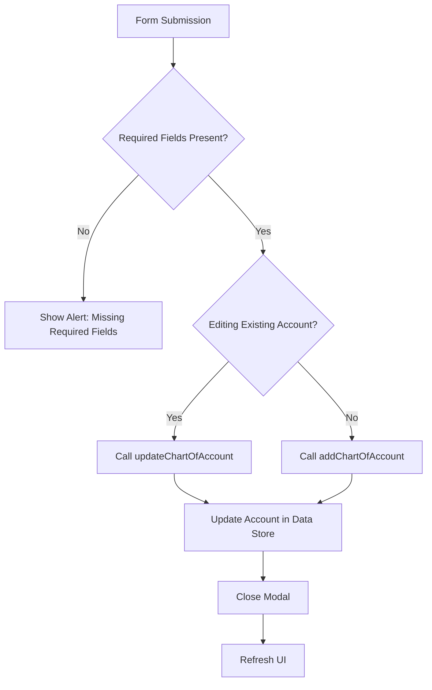

**Diagram sources**
- [ChartOfAccountsPage.tsx](file://src/modules/finance/pages/ChartOfAccountsPage.tsx#L150-L170)

**Section sources**
- [ChartOfAccountsPage.tsx](file://src/modules/finance/pages/ChartOfAccountsPage.tsx#L150-L170)

## User Interface and Interaction

### Tree-Structured UI for Nested Account Categories
The Chart of Accounts page implements a DataGrid component to display financial accounts in a structured format. While the current implementation shows a flat list, the system is designed to support hierarchical account categories through the account_code field, which follows a standardized numbering system.

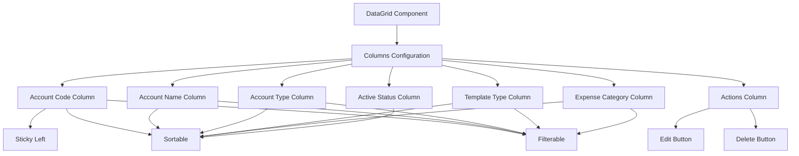

**Diagram sources**
- [ChartOfAccountsPage.tsx](file://src/modules/finance/pages/ChartOfAccountsPage.tsx#L100-L190)

**Section sources**
- [ChartOfAccountsPage.tsx](file://src/modules/finance/pages/ChartOfAccountsPage.tsx#L100-L190)

### Modal-Based Data Entry
The system uses a modal dialog for creating and editing financial accounts, providing a focused interface for data entry. The modal adapts its title and submit button text based on whether the user is creating a new account or editing an existing one.

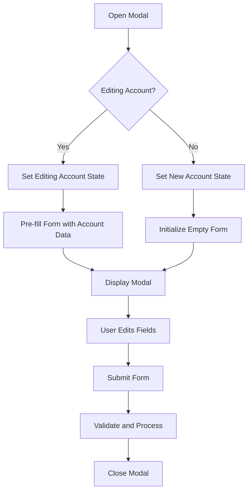

**Diagram sources**
- [ChartOfAccountsPage.tsx](file://src/modules/finance/pages/ChartOfAccountsPage.tsx#L50-L90)

**Section sources**
- [ChartOfAccountsPage.tsx](file://src/modules/finance/pages/ChartOfAccountsPage.tsx#L50-L90)

## Integration with General Ledger

### Data Management with useChartOfAccountData Hook
The chart of accounts data is managed through the useChartOfAccountData hook, which provides CRUD operations for financial accounts. This hook serves as the data access layer between the UI and the underlying data store.

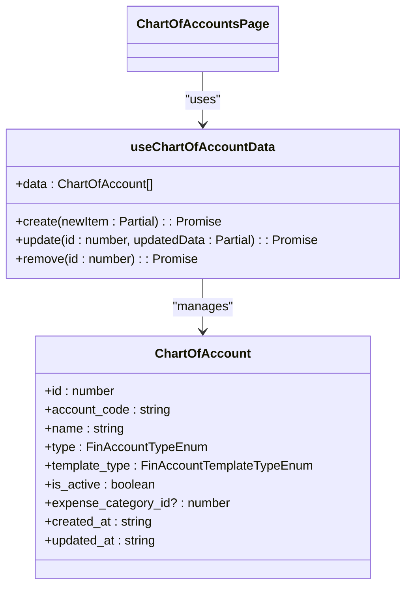

**Diagram sources**
- [useChartOfAccountData.ts](file://src/modules/finance/data/useChartOfAccountData.ts#L0-L41)

**Section sources**
- [useChartOfAccountData.ts](file://src/modules/finance/data/useChartOfAccountData.ts#L0-L41)

### General Ledger Entry Integration
The chart of accounts integrates with general ledger entries, allowing financial transactions to be posted to specific accounts. The system uses a dedicated hook for managing general ledger entries, ensuring proper accounting practices are followed.

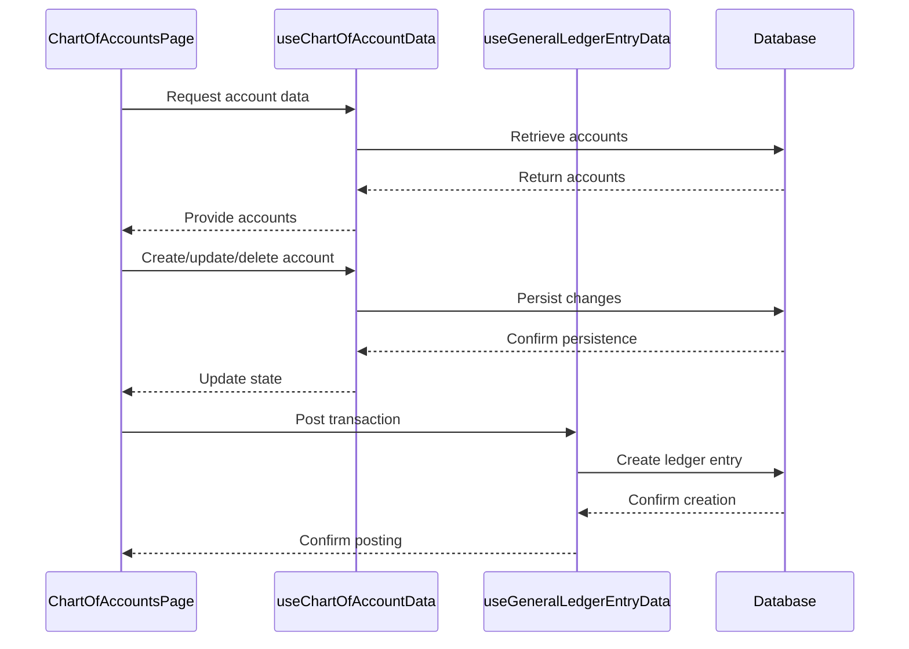

**Diagram sources**
- [useChartOfAccountData.ts](file://src/modules/finance/data/useChartOfAccountData.ts#L0-L41)
- [useGeneralLedgerEntryData.ts](file://src/modules/finance/data/useGeneralLedgerEntryData.ts#L0-L57)

**Section sources**
- [useChartOfAccountData.ts](file://src/modules/finance/data/useChartOfAccountData.ts#L0-L41)
- [useGeneralLedgerEntryData.ts](file://src/modules/finance/data/useGeneralLedgerEntryData.ts#L0-L57)

## Permission-Based Access Control

### RBAC Implementation for Finance Module
The system implements role-based access control (RBAC) to restrict access to financial data based on user roles. The finance module defines specific permissions for different financial operations, ensuring that only authorized users can modify chart of accounts data.

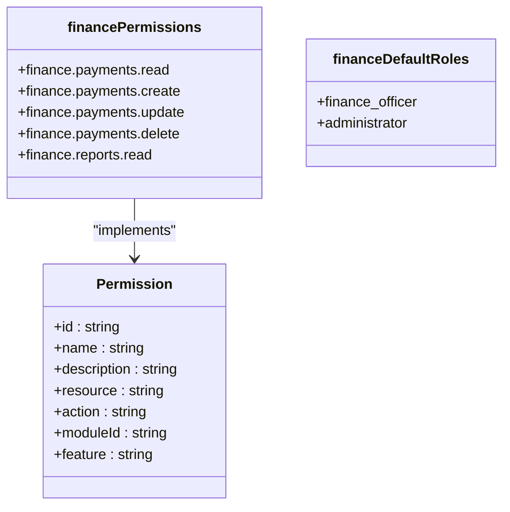

**Diagram sources**
- [rbac.ts](file://src/modules/finance/rbac.ts#L0-L51)

**Section sources**
- [rbac.ts](file://src/modules/finance/rbac.ts#L0-L51)

## Export Capabilities

### Data Export for External Accounting Systems
The system provides export capabilities to facilitate integration with external accounting systems. While the ChartOfAccountsPage itself doesn't contain direct export functionality, the underlying system supports database export operations that can be used to extract chart of accounts data.

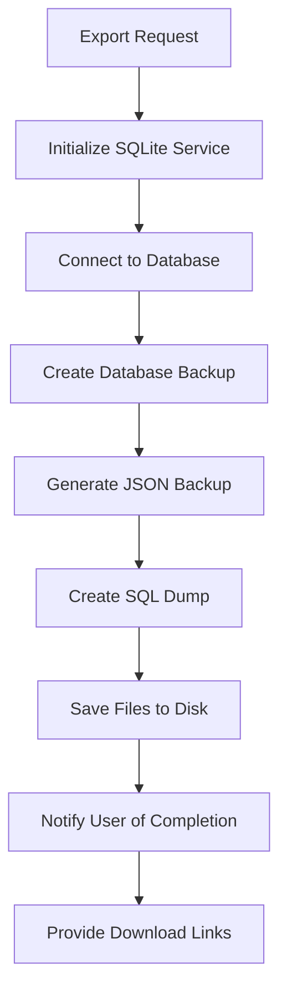

**Diagram sources**
- [export-database.ts](file://src/scripts/data-migration/export-database.ts#L0-L73)

**Section sources**
- [export-database.ts](file://src/scripts/data-migration/export-database.ts#L0-L73)

## Common Challenges and Troubleshooting

### Addressing Common Implementation Issues
The Chart of Accounts system may encounter several common challenges that require specific troubleshooting steps to resolve.

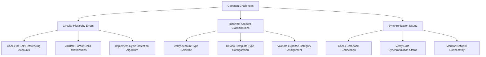

**Section sources**
- [ChartOfAccountsPage.tsx](file://src/modules/finance/pages/ChartOfAccountsPage.tsx#L0-L295)
- [useChartOfAccountData.ts](file://src/modules/finance/data/useChartOfAccountData.ts#L0-L41)

### Troubleshooting Steps
When encountering issues with the Chart of Accounts system, administrators should follow these systematic troubleshooting steps:

1. **Verify Data Loading**: Check if the chart of accounts data is loading correctly by monitoring the loading state.
2. **Check Permissions**: Ensure the user has the necessary permissions to view and modify financial data.
3. **Validate Form Inputs**: Confirm that all required fields are properly filled when creating or editing accounts.
4. **Review Database Status**: Check the database connection and synchronization status.
5. **Examine Error Messages**: Look for specific error messages in the browser console or application logs.

## Performance Considerations

### Optimizing Large Account Trees
For schools with extensive chart of accounts, performance optimization is crucial to maintain a responsive user interface.

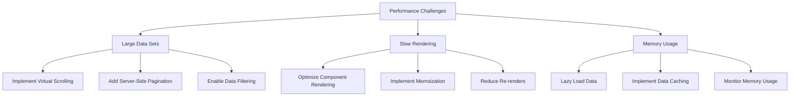

**Section sources**
- [ChartOfAccountsPage.tsx](file://src/modules/finance/pages/ChartOfAccountsPage.tsx#L0-L295)
- [useChartOfAccountData.ts](file://src/modules/finance/data/useChartOfAccountData.ts#L0-L41)