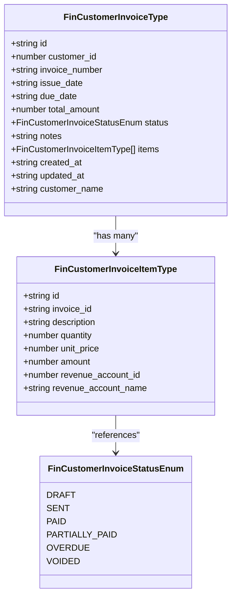
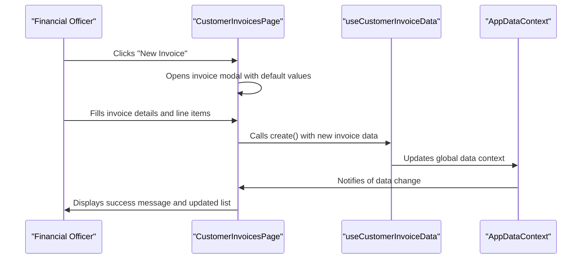
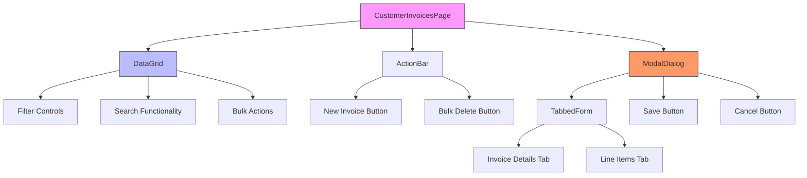
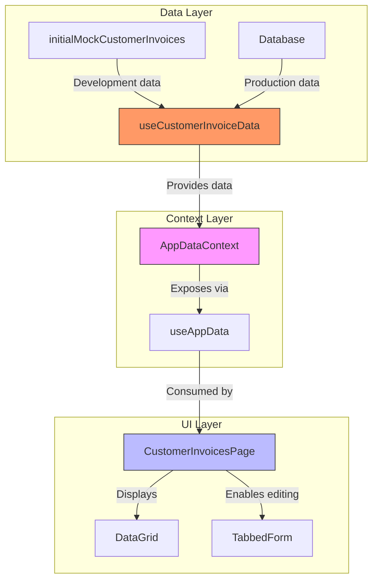
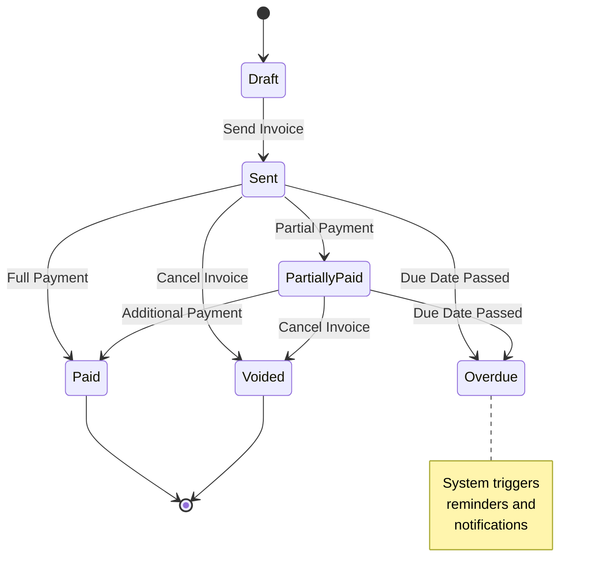
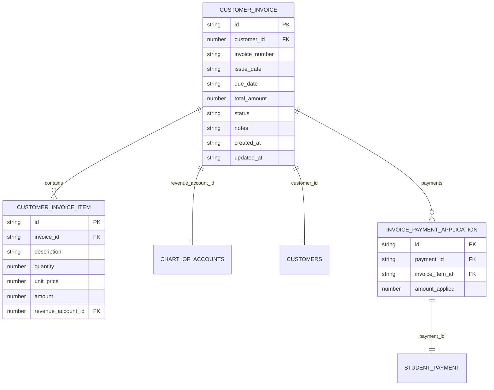

# Customer Invoices Management

<cite>
**Referenced Files in This Document**   
- [CustomerInvoicesPage.tsx](file://src/modules/finance/pages/CustomerInvoicesPage.tsx)
- [types.ts](file://src/modules/finance/data/types.ts)
- [useCustomerInvoiceData.ts](file://src/modules/finance/data/useCustomerInvoiceData.ts)
- [mockData.ts](file://src/modules/finance/data/mockData.ts)
- [schema.ts](file://src/modules/finance/data/schema.ts)
- [AppDataContext.tsx](file://src/contexts/AppDataContext.tsx)
- [useAppData.ts](file://src/hooks/useAppData.ts)
</cite>

## Table of Contents
1. [Introduction](#introduction)
2. [Data Structure and Types](#data-structure-and-types)
3. [Core Functionality and Workflows](#core-functionality-and-workflows)
4. [User Interface Components](#user-interface-components)
5. [Data Management and Hooks](#data-management-and-hooks)
6. [Status Management and Business Logic](#status-management-and-business-logic)
7. [Integration with Financial Systems](#integration-with-financial-systems)
8. [Troubleshooting Guide](#troubleshooting-guide)

## Introduction
The Customer Invoices Management system in schoolpilot3 provides a comprehensive solution for generating, tracking, and managing invoices for non-student customers such as parent associations, community partners, and external organizations. This system enables financial administrators to create professional invoices with proper due dates, payment terms, and tax calculations. The interface supports filtering, searching, and bulk actions through a DataGrid component, while invoice creation and editing workflows are facilitated through a TabbedForm interface. The system integrates with the broader financial ecosystem, maintaining status synchronization across payment receipts and supporting both partial and full payments.

**Section sources**
- [CustomerInvoicesPage.tsx](file://src/modules/finance/pages/CustomerInvoicesPage.tsx#L1-L50)

## Data Structure and Types
The customer invoice system is built on well-defined TypeScript interfaces that ensure data consistency and type safety throughout the application. The core data structures are defined in the finance module's types.ts file, establishing a clear contract for invoice data across the system.

**Diagram sources**
- [types.ts](file://src/modules/finance/data/types.ts#L200-L279)

**Section sources**
- [types.ts](file://src/modules/finance/data/types.ts#L0-L279)

## Core Functionality and Workflows
The CustomerInvoicesPage provides a complete workflow for managing customer invoices from creation to payment processing. The interface supports filtering, searching, and bulk actions through the DataGrid component, allowing users to efficiently manage large volumes of invoices.

The invoice creation and editing workflow is implemented using the TabbedForm component, which organizes invoice details and line items into logical tabs. When creating a new invoice, the system provides sensible defaults including a 30-day due date from the current date and sets the initial status to "Due".

**Diagram sources**
- [CustomerInvoicesPage.tsx](file://src/modules/finance/pages/CustomerInvoicesPage.tsx#L23-L50)
- [useCustomerInvoiceData.ts](file://src/modules/finance/data/useCustomerInvoiceData.ts#L0-L39)

**Section sources**
- [CustomerInvoicesPage.tsx](file://src/modules/finance/pages/CustomerInvoicesPage.tsx#L23-L50)

## User Interface Components
The CustomerInvoicesPage leverages several key UI components to provide an intuitive and efficient user experience. The DataGrid component serves as the primary interface for viewing and managing invoices, supporting filtering, searching, and bulk actions.

The TabbedForm component facilitates the invoice creation and editing process, organizing related fields into logical tabs. Modal dialogs are used for both invoice creation/editing and line item management, providing focused interfaces for data entry.

**Diagram sources**
- [CustomerInvoicesPage.tsx](file://src/modules/finance/pages/CustomerInvoicesPage.tsx#L23-L50)

**Section sources**
- [CustomerInvoicesPage.tsx](file://src/modules/finance/pages/CustomerInvoicesPage.tsx#L23-L50)

## Data Management and Hooks
The customer invoice system employs a robust data management architecture centered around React hooks. The useAppData hook provides access to the global application data context, which includes customer invoice data among other financial entities.

The useCustomerInvoiceData hook provides a self-contained interface for managing customer invoice data with CRUD operations. This hook works with mock data during development and can be integrated with the actual database layer in production.

**Diagram sources**
- [useCustomerInvoiceData.ts](file://src/modules/finance/data/useCustomerInvoiceData.ts#L0-L39)
- [AppDataContext.tsx](file://src/contexts/AppDataContext.tsx#L0-L168)
- [useAppData.ts](file://src/hooks/useAppData.ts#L8-L14)

**Section sources**
- [useCustomerInvoiceData.ts](file://src/modules/finance/data/useCustomerInvoiceData.ts#L0-L39)
- [AppDataContext.tsx](file://src/contexts/AppDataContext.tsx#L0-L168)
- [useAppData.ts](file://src/hooks/useAppData.ts#L8-L14)

## Status Management and Business Logic
The customer invoice system implements a comprehensive status management workflow that tracks invoices through their lifecycle. The FinCustomerInvoiceStatusEnum defines the possible states: Draft, Sent, Paid, Partially Paid, Overdue, and Voided.

The system automatically calculates the total amount based on line items and updates the status accordingly. When payments are applied, the system updates the invoice status to reflect whether it is fully paid, partially paid, or still due.

**Diagram sources**
- [types.ts](file://src/modules/finance/data/types.ts#L0-L199)

**Section sources**
- [types.ts](file://src/modules/finance/data/types.ts#L0-L199)

## Integration with Financial Systems
The customer invoice system is tightly integrated with the broader financial management ecosystem. It connects with the chart of accounts to ensure proper revenue account allocation, and maintains synchronization with payment receipts through the invoice payment application system.

The schema definition in schema.ts ensures data integrity with validation rules for amounts, dates, and required fields. The system supports recurring invoices through integration with the financial year and school period structures.

**Diagram sources**
- [schema.ts](file://src/modules/finance/data/schema.ts#L280-L328)

**Section sources**
- [schema.ts](file://src/modules/finance/data/schema.ts#L280-L328)

## Troubleshooting Guide
This section addresses common issues encountered when managing customer invoices and provides diagnostic and resolution guidance.

### Invoice Duplication
**Symptoms**: Duplicate invoice numbers appearing in the system, double billing customers.
**Diagnosis**: Check the invoice creation workflow and ID generation mechanism.
**Resolution**: Ensure the system validates invoice numbers for uniqueness before creation. The current implementation uses a simple timestamp-based ID generation that should prevent duplicates.

### Incorrect Tax Application
**Symptoms**: Tax amounts calculated incorrectly on invoices.
**Diagnosis**: Verify the revenue account configuration and tax settings.
**Resolution**: Check that the revenue accounts linked to invoice items have the correct tax treatment configured. The system currently does not have explicit tax fields, suggesting tax calculation may occur at the payment processing level.

### Reconciliation Mismatches
**Symptoms**: Payments not properly applied to invoices, balance discrepancies.
**Diagnosis**: Examine the invoice payment application data.
**Resolution**: Verify that the FinInvoicePaymentApplicationType records correctly link payments to invoice items with accurate amount_applied values. Check for orphaned payment applications or incorrect invoice_item_id references.

**Section sources**
- [types.ts](file://src/modules/finance/data/types.ts#L200-L279)
- [mockData.ts](file://src/modules/finance/data/mockData.ts#L0-L199)
- [useCustomerInvoiceData.ts](file://src/modules/finance/data/useCustomerInvoiceData.ts#L0-L39)