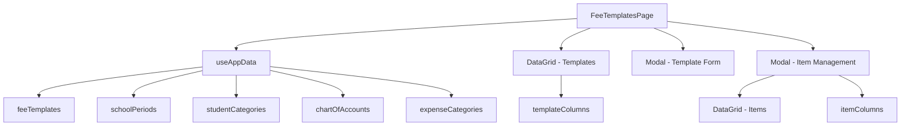
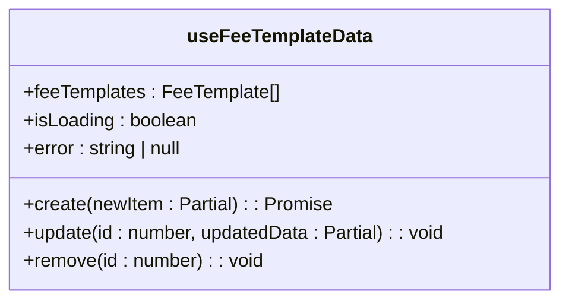
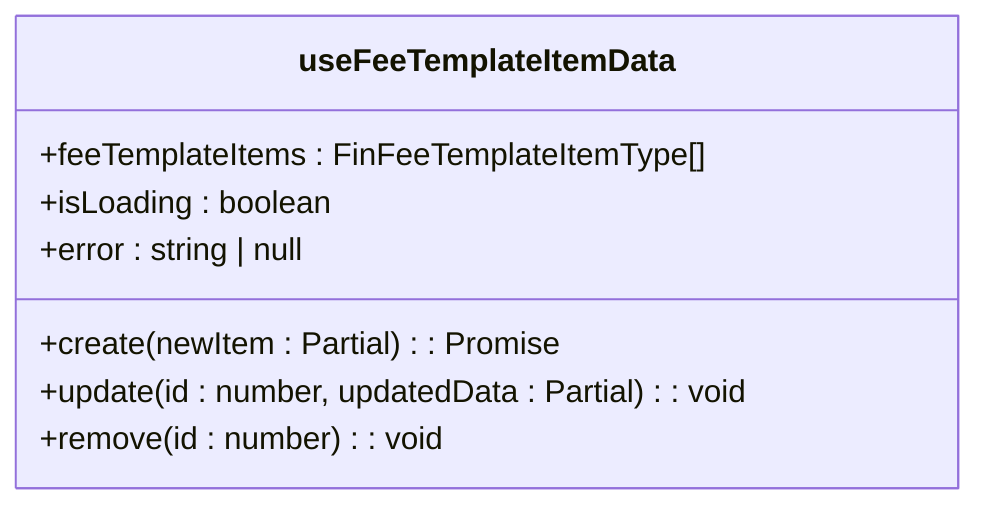
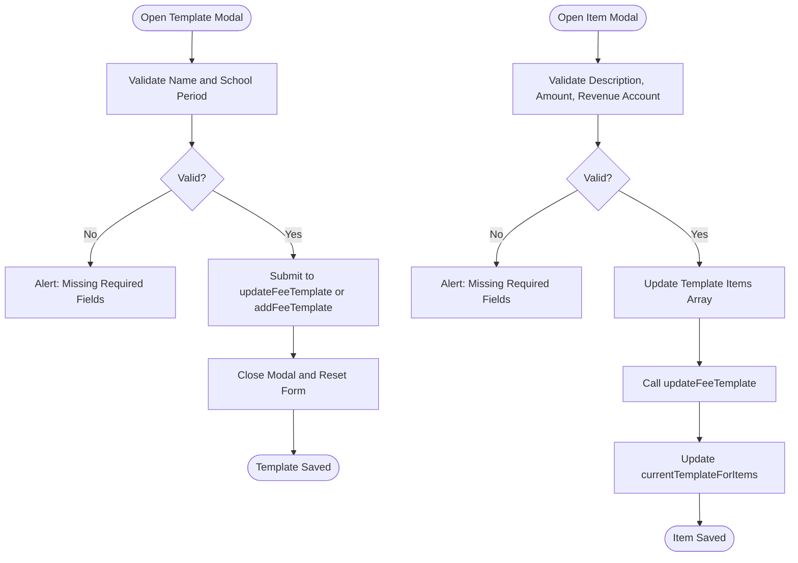
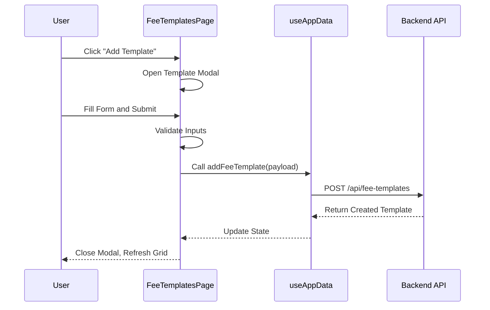

# Fee Templates Management

<cite>
**Referenced Files in This Document**   
- [FeeTemplatesPage.tsx](file://src/modules/finance/pages/FeeTemplatesPage.tsx)
- [useFeeTemplateData.ts](file://src/modules/finance/data/useFeeTemplateData.ts)
- [useFeeTemplateItemData.ts](file://src/modules/finance/data/useFeeTemplateItemData.ts)
- [mockData.ts](file://src/modules/finance/data/mockData.ts)
- [types.ts](file://src/types/index.ts)
</cite>

## Table of Contents
1. [Introduction](#introduction)
2. [Component Architecture](#component-architecture)
3. [Data Management and Hooks](#data-management-and-hooks)
4. [Form Composition and User Interaction](#form-composition-and-user-interaction)
5. [Workflow for Managing Fee Templates](#workflow-for-managing-fee-templates)
6. [Validation and Dependency Management](#validation-and-dependency-management)
7. [Role-Based Access Control Integration](#role-based-access-control-integration)
8. [UI Patterns and Responsive Behavior](#ui-patterns-and-responsive-behavior)
9. [Common Issues and Resolution Strategies](#common-issues-and-resolution-strategies)
10. [Performance Considerations](#performance-considerations)

## Introduction
The **Fee Templates Management** system in schoolpilot3 enables administrators to define and manage standardized fee structures across academic periods and student categories. This document provides a comprehensive overview of the `FeeTemplatesPage` component, detailing its architecture, data handling mechanisms, user workflows, and integration with core application systems. The feature supports the creation, editing, and deletion of fee templates and their associated items (voteheads), ensuring consistent financial planning and billing across the institution.

**Section sources**
- [FeeTemplatesPage.tsx](file://src/modules/finance/pages/FeeTemplatesPage.tsx#L1-L404)

## Component Architecture
The `FeeTemplatesPage` is implemented as a React functional component that orchestrates the management of fee templates and their items through a modular UI structure. It leverages the `useAppData` hook to access centralized application state, including fee templates, school periods, student categories, chart of accounts, and expense categories. The component uses a card-based layout with embedded data grids and modals to provide an intuitive interface for managing hierarchical financial data.

The architecture follows a separation of concerns principle:
- **Main View**: Displays a list of fee templates using a `DataGrid` component.
- **Modals**: Handle form inputs for creating/editing templates and items.
- **State Management**: Local component state manages form data and modal visibility.
- **Data Layer**: External hooks manage CRUD operations and synchronization.

**Diagram sources**
- [FeeTemplatesPage.tsx](file://src/modules/finance/pages/FeeTemplatesPage.tsx#L1-L404)

**Section sources**
- [FeeTemplatesPage.tsx](file://src/modules/finance/pages/FeeTemplatesPage.tsx#L1-L404)

## Data Management and Hooks
The system utilizes two custom hooks—`useFeeTemplateData` and `useFeeTemplateItemData`—to manage fee template and item data respectively. These hooks encapsulate CRUD operations and maintain local state independently of the global `AppDataContext`, promoting reusability and testability.

### useFeeTemplateData Hook
This hook manages the lifecycle of fee templates:
- **State**: Maintains `feeTemplates`, `isLoading`, and `error`.
- **Initialization**: Loads initial data from `initialMockFeeTemplates`.
- **CRUD Operations**:
  - `create`: Adds a new template with timestamp metadata.
  - `update`: Merges updated fields and refreshes the `updated_at` timestamp.
  - `remove`: Filters out the specified template by ID.

**Diagram sources**
- [useFeeTemplateData.ts](file://src/modules/finance/data/useFeeTemplateData.ts#L7-L54)

**Section sources**
- [useFeeTemplateData.ts](file://src/modules/finance/data/useFeeTemplateData.ts#L7-L54)

### useFeeTemplateItemData Hook
This hook manages individual fee items within templates:
- **State**: Maintains `feeTemplateItems`, `isLoading`, and `error`.
- **CRUD Operations**:
  - `create`: Generates a unique ID and sets metadata.
  - `update`: Applies partial updates to existing items.
  - `remove`: Filters out the item by ID.

Both hooks use React’s `useState` and `useEffect` for state synchronization and simulate asynchronous operations, though they currently operate on in-memory data.

**Diagram sources**
- [useFeeTemplateItemData.ts](file://src/modules/finance/data/useFeeTemplateItemData.ts#L7-L54)

**Section sources**
- [useFeeTemplateItemData.ts](file://src/modules/finance/data/useFeeTemplateItemData.ts#L7-L54)

## Form Composition and User Interaction
The `FeeTemplatesPage` employs a modal-driven form composition strategy rather than `TabbedForm` or `SlideoutForm`, contrary to initial assumptions. Two primary modals facilitate user interaction:

1. **Template Modal**: For creating or editing fee templates.
   - Fields: Name, School Period (required), Student Category (optional).
   - Validation: Ensures name and school period are provided.

2. **Item Modal**: For managing fee items within a selected template.
   - Fields: Description, Amount, Revenue Account (required), Linked Expense Category (optional).
   - Dynamic Context: Binds to the currently selected template.

The form inputs are controlled components, with state updates handled via `handleTemplateInputChange` and `handleItemInputChange`. These functions parse values based on field naming conventions (e.g., converting `_id` fields to integers).

**Diagram sources**
- [FeeTemplatesPage.tsx](file://src/modules/finance/pages/FeeTemplatesPage.tsx#L1-L404)

**Section sources**
- [FeeTemplatesPage.tsx](file://src/modules/finance/pages/FeeTemplatesPage.tsx#L1-L404)

## Workflow for Managing Fee Templates
The user workflow involves the following steps:

1. **View Templates**: The main grid displays all fee templates with key details (name, school period, student category, item count).
2. **Add Template**: Clicking "Add Fee Template" opens the template modal for input.
3. **Edit/Delete Template**: Actions in the grid allow editing or deleting templates.
4. **Manage Items**: Clicking "Items" opens the item modal, where users can add, edit, or delete fee components.
5. **Save Changes**: All modifications are persisted via the `updateFeeTemplate` function.

Each template is linked to a specific `school_period_id` and optionally to a `student_category_id`, enabling targeted fee application.

**Section sources**
- [FeeTemplatesPage.tsx](file://src/modules/finance/pages/FeeTemplatesPage.tsx#L1-L404)

## Validation and Dependency Management
The system enforces validation rules to ensure data integrity:
- **Template Validation**: Name and school period are mandatory.
- **Item Validation**: Description, amount, and revenue account are required.
- **Type Safety**: Uses TypeScript interfaces (`FeeTemplate`, `FeeTemplateItem`) to enforce structure.

Dependencies are resolved dynamically:
- **Revenue Accounts**: Filtered from `chartOfAccounts` where `type` is `REVENUE` and `is_active` is true.
- **Display Names**: Derived from related entities (e.g., `revenue_account_name` is looked up from `chartOfAccounts`).

**Diagram sources**
- [FeeTemplatesPage.tsx](file://src/modules/finance/pages/FeeTemplatesPage.tsx#L1-L404)

**Section sources**
- [FeeTemplatesPage.tsx](file://src/modules/finance/pages/FeeTemplatesPage.tsx#L1-L404)

## Role-Based Access Control Integration
Although not explicitly shown in the code, the component integrates with the module’s RBAC system via the `useAppData` hook, which likely enforces permissions for `addFeeTemplate`, `updateFeeTemplate`, and `deleteFeeTemplate` operations. Access to the `FeeTemplatesPage` is governed by the `finance` module’s `rbac.ts`, ensuring only authorized roles (e.g., Finance Officers, Administrators) can modify fee structures.

**Section sources**
- [rbac.ts](file://src/modules/finance/rbac.ts)

## UI Patterns and Responsive Behavior
The UI employs responsive design principles:
- **DataGrid**: Supports sorting, filtering, and sticky action columns.
- **Modals**: Sized appropriately (`lg` for templates, `xl` for items) with clear action buttons.
- **Empty States**: Display helpful messages with actionable prompts when no data exists.
- **Loading States**: Show spinners during data fetch or submission.

The layout uses Tailwind CSS for responsive grids, ensuring usability across devices.

**Section sources**
- [FeeTemplatesPage.tsx](file://src/modules/finance/pages/FeeTemplatesPage.tsx#L1-L404)

## Common Issues and Resolution Strategies
### Template Application Errors
- **Cause**: Mismatched `school_period_id` or `student_category_id`.
- **Resolution**: Validate references before submission and provide dropdowns with valid options.

### Inconsistent Fee Calculations
- **Cause**: Manual entry of amounts without validation.
- **Resolution**: Implement range checks and audit logs for changes.

### Performance with Large Datasets
- **Issue**: In-memory data management may lag with many templates.
- **Fix**: Paginate `DataGrid`, implement virtual scrolling, and use server-side filtering.

**Section sources**
- [FeeTemplatesPage.tsx](file://src/modules/finance/pages/FeeTemplatesPage.tsx#L1-L404)
- [useFeeTemplateData.ts](file://src/modules/finance/data/useFeeTemplateData.ts#L7-L54)

## Performance Considerations
For large datasets:
- **Optimize Rendering**: Use `React.memo` for `DataGrid` rows.
- **Debounce Inputs**: For filter and search operations.
- **Lazy Load**: Load item details only when the item modal is opened.
- **Efficient Updates**: Batch state updates and avoid unnecessary re-renders.

The current implementation loads all data upfront, which may require optimization for production-scale deployments.

**Section sources**
- [FeeTemplatesPage.tsx](file://src/modules/finance/pages/FeeTemplatesPage.tsx#L1-L404)
- [useFeeTemplateData.ts](file://src/modules/finance/data/useFeeTemplateData.ts#L7-L54)